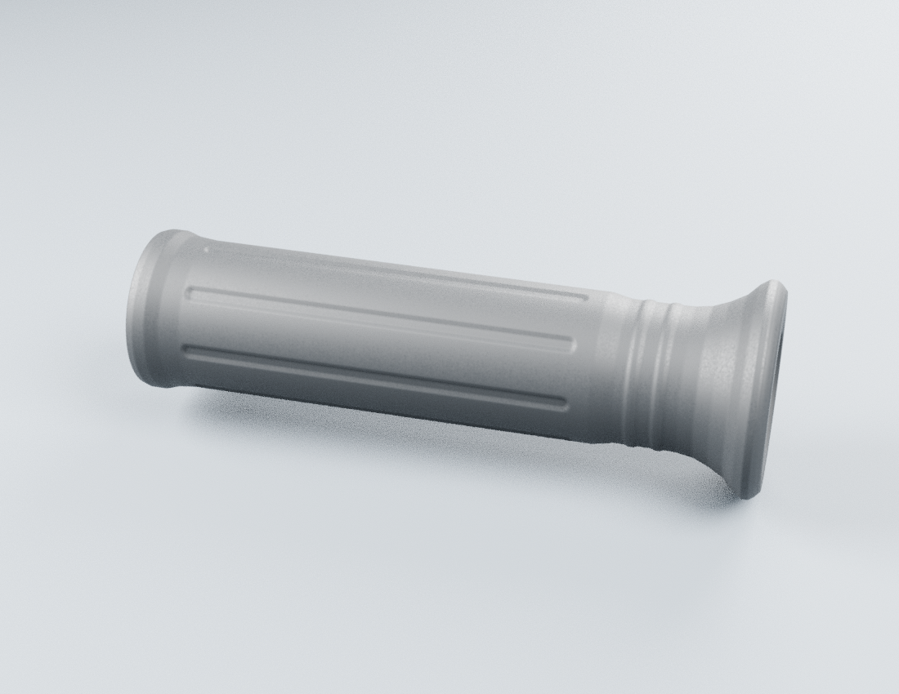
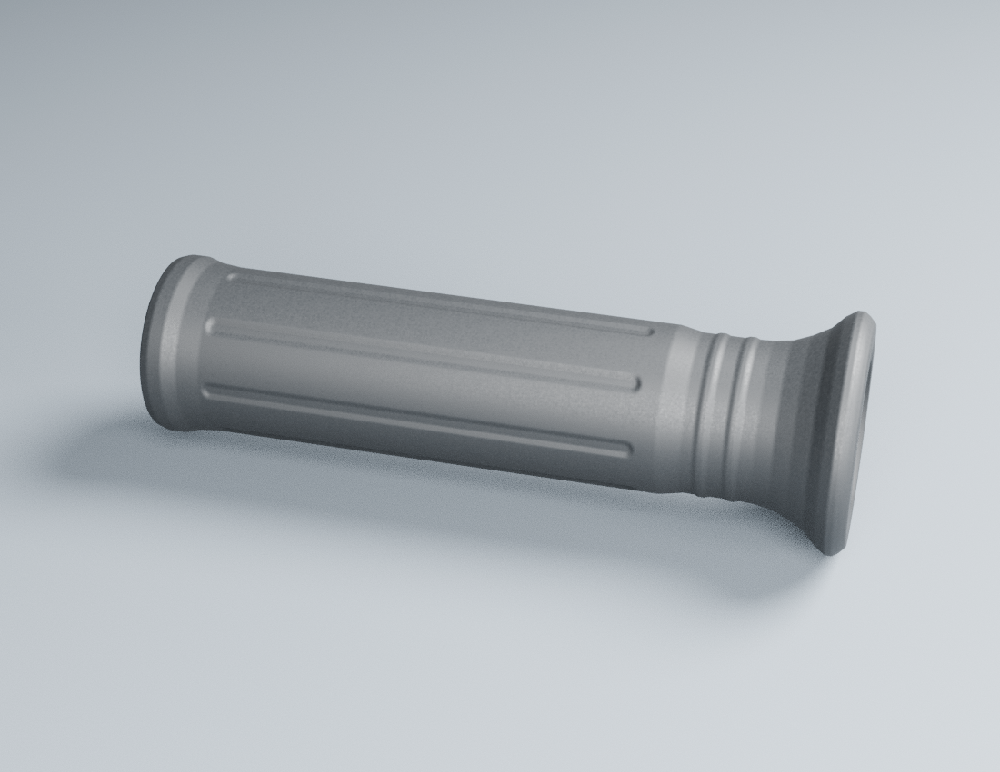

# Poignées seules — revue v1

**Deux rendus réels de la source Blender**, un par poignée. Ils ne montrent ni une image générée du jeu, ni un poste de conduite complet. Aucune réception artistique acquise.

La source et l’export conservent les coordonnées de montage partagées avec le tube candidat. Chaque vue masque l’autre poignée pour inspecter le caoutchouc isolément. Les [paramètres](../../../assets-src/moto-components/handlebar-grips/parameters.json) conservent les dimensions estimées et les limites de variante. La pièce droite est uniquement son enveloppe de caoutchouc : le manchon d’accélérateur vu sur la photo documentaire n’est pas inclus.

Les [contrôles source](source-geometry-check.json) vérifient une coque fermée par poignée, des volumes positifs et une cavité ouverte jusqu’à 80 mm de profondeur. Les fonds de cavité restent en dehors des bouts du tube candidat. Le [contrôle des buffers glTF](export-check.json) vérifie les deux corps réellement exportés, leur échelle, leurs volumes et le matériau PBR. Ces contrôles ne certifient pas les dimensions réelles, un ajustement élastique ou le fonctionnement d’un accélérateur.

Le relief longitudinal est géométrique et intégré au corps. Huit canaux peu profonds constituent une hypothèse de travail ; la totalité du motif n’est pas documentée, et son sens creux/saillant doit encore être confirmé. Les UV ont une échelle physique ; la rugosité est une texture mathématique originale. Aucun pixel de photographie n’est réutilisé comme matière.

À reprendre avant réception : identité RDC, dimensions et interférences réelles, motif complet, profils des collerettes et fermetures, surface sous éclairage de référence et raccords avec les commandes futures. Aucun commodo, levier, câble ou rétroviseur n’est présenté. Pas de qualification iPhone ou de LOD mobile reçu.

[Source éditable](../../../assets-src/moto-components/handlebar-grips/handlebar-grips-v1.blend) · [script de construction](../../../assets-src/moto-components/handlebar-grips/build.py) · [recherche et sources](../../research/handlebar-grips/README.md).
