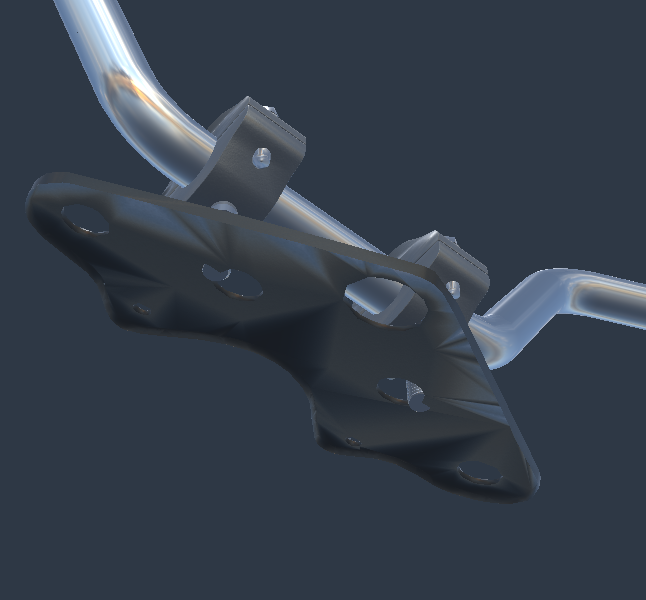
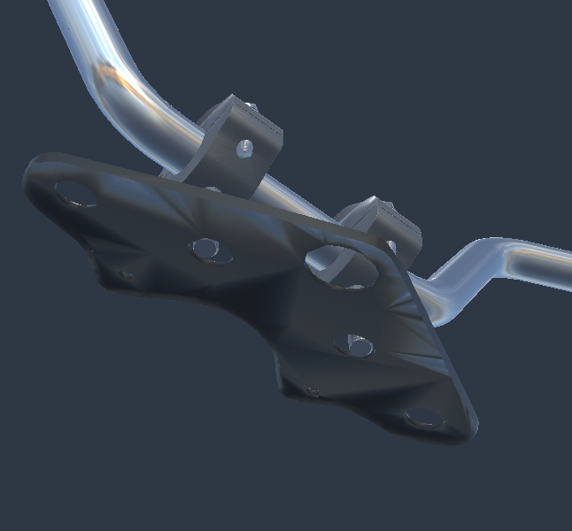
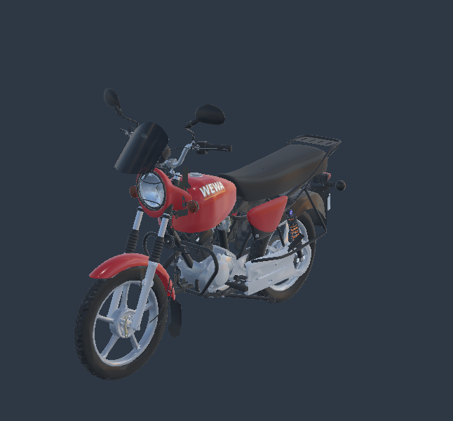
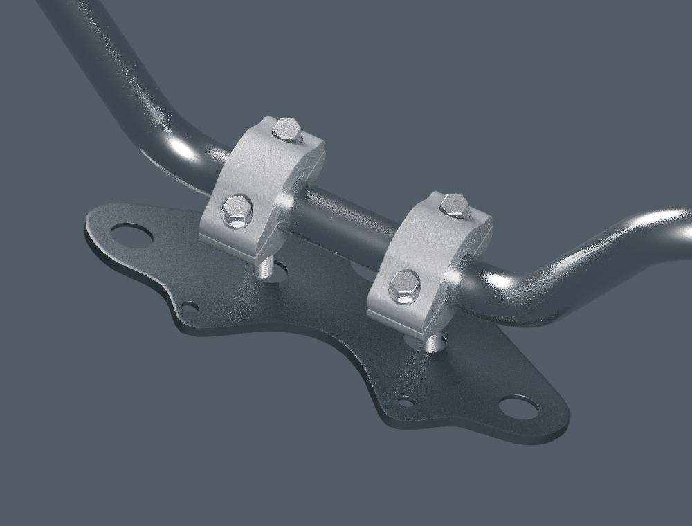

# Finitions moto — correction candidate du raccord de guidon

Le candidat rapproche chaque pontet de **6,5 mm** du centre, avec ses deux boulons. Les goujons passent désormais dans les ouvertures de la plaque du modèle : les contrôles natifs passent de **321 / 366 paires de triangles en intersection à zéro**. Le [plan de finition](../../workflow/motorcycle-finishing-plan-2026-10-22.md) couvre les autres manques identifiés.

Il s'agit d'une correction de placement des géométries existantes. **La moto reste inachevée.** Les dimensions exactes RDC, l'engagement vertical et l'empilage de fixation restent à établir. La v5 et toutes ses sources sont conservées ; ce candidat séparé n'est pas intégré au jeu.

## Examiner le résultat

- [Moto complète, GLB autonome candidat](../../../assets-src/moto-components/handlebar-registration-v2/motorcycle-registration-candidate.glb).
- [Pontets corrigés seuls, GLB détaillé](../../../assets-src/moto-components/handlebar-registration-v2/clamps.glb).
- [Source Blender éditable des pontets](../../../assets-src/moto-components/handlebar-registration-v2/handlebar-registration-v2.blend).
- [Contexte Blender autonome : guidon, pontets et plaque](../../../assets-src/moto-components/handlebar-registration-v2/registration-context.blend).
- [Comparateur interactif avant / candidat](../../../tools/handlebar-registration-review-v2/index.html).

Depuis la racine, après `npm ci`, lancer `npx vite --host 0.0.0.0 --port 4143`, puis ouvrir `http://localhost:4143/tools/handlebar-registration-review-v2/`. Les boutons comparent les poses v5 et candidates avec les mêmes géométries, matériaux et caméra. Les vues rapprochées isolent trois groupes ; « Moto entière » affiche les 177 groupes. Les extrémités du guidon peuvent sortir du cadre des gros plans.

| Avant, Babylon | Candidat, même caméra Babylon |
|---|---|
|  |  |



## Analyse et choix de placement

La [v5](../motorcycle-exterior-v5/README.md) signalait déjà que les axes X=±45 mm traversaient la plaque, tandis que des rayons à ±38 mm passaient dans les ouvertures. Un rayon axial seul ne vérifie pas le passage du diamètre de 10 mm.

Le nouveau placement **X=±38,5 mm** conserve le guidon, la plaque, les huit pièces des pontets et leurs sections. Ce choix maintient les bandes moletées existantes, centrées à ±45 mm et larges de 12 mm, sous les selles de 26 mm : marge nominale de couverture de 0,5 mm au bord extérieur. Les 77 mm d'entraxe sont une **hypothèse d'implantation du modèle**, pas une cote constructeur ni une identification de variante. Les [paramètres et limites](../../research/handlebar-registration-v2/plan.json) sont explicites.

Le guidon ne descend pas, les goujons ne sont pas allongés et la plaque n'est pas repercée. La pile silentbloc/rondelle/écrou n'est pas installée : son épaisseur, sa compression et la longueur engagée ne sont pas connues. La correction résout l'intersection latérale constatée, pas le montage mécanique complet.

## Vérifications exécutées

| Contrôle | Résultat et portée |
|---|---|
| [Triangles natifs évalués](native-check.json) | Intersections plaque / demi-coquille inférieure et goujon : gauche 321 → 0, droite 366 → 0. Contrôle des surfaces, sans certification de précharge ni test universel de volumes imbriqués. |
| [Passage dans l'export détaillé](export-check.json) | 129 sondes par section de goujon, centre et deux couronnes jusqu'au rayon de 5 mm. Avant : 80 et 79 sondes bloquées ; candidat : zéro. L'échantillonnage complète le contrôle natif. |
| [Conservation des exports](derivation-check.json) | Seulement huit translations changent dans chacun des deux GLB ; les chunks BIN restent identiques octet pour octet. Aucun changement de topologie, normales, UV, texture, matière, hiérarchie ou quantification. |
| Validation glTF | Zéro erreur sur les deux GLB. Les éventuels avertissements hérités restent visibles dans le rapport. |
| [Comparaison Babylon](browser-check.json) | 177 groupes, 944 683 triangles, trois paires avant/après ; poses des parents inchangées, huit déplacements vérifiés, retour avant/candidat contrôlé. Aucune erreur JavaScript ni HTTP. Commandes également essayées à 390 × 844. |
| [Rendus Blender](native-render-check.json) | Quatre vues, deux caméras identiques avant/après ; Cycles CPU, 24 échantillons sans débruitage, EXR 32 bits conservés. |
| Tests du dérivateur | Six tests : conservation binaire, déplacements, refus d'une seconde application, de pièces absentes/dupliquées, d'une animation, d'un fichier tronqué et d'un parent transformé inattendu. |



Relecture visuelle : les deux passages sont lisibles dans la vue Babylon par dessous et le rendu natif supérieur. Les zones moletées restent sous les pontets ; aucune déformation globale n'a été appliquée. Le rendu allégé conserve les facettes de la plaque de la v5 ; cette livraison ne les présente pas comme une amélioration de matière. Les images Blender à 24 échantillons gardent du bruit. La comparaison de positions et de buffers ne remplace pas une réception artistique.

## Reproduire

```sh
blender --background --threads 2 --python-exit-code 1 --python tools/build_handlebar_registration_v2.py
python tools/derive_handlebar_registration_v2.py
python tools/test_handlebar_registration_v2.py
node tools/check_handlebar_registration_v2.mjs
blender --background --threads 2 --python-exit-code 1 --python tools/render_handlebar_registration_v2.py
blender --background --threads 2 --python-exit-code 1 --python tools/check_handlebar_registration_portability_v2.py
# Avec Vite sur le port 4143 dans un autre terminal :
python tools/capture_handlebar_registration_v2.py
python tools/check_handlebar_registration_delivery_v2.py
```

Les outils utilisent les dépendances gelées du dépôt, Blender 4.3.2, Python avec NumPy/Pillow/Playwright et Chromium. Le [manifeste](production-manifest.json) conserve les empreintes de cette livraison ; les sources d'entrée sont également épinglées dans les rapports. Aucune bibliothèque Blender liée externe n'est nécessaire pour les deux nouvelles sources : leurs textures sont embarquées.

Le [contrôle de portabilité](portability-check.json) rouvre les deux fichiers depuis un répertoire temporaire distinct et vérifie l'absence de bibliothèques liées ainsi que les pixels des images embarquées. Les 33 tests du jeu et son build passent également ; l'avertissement de taille du bundle principal reste présent. Le jeu n'a pas reçu le nouveau modèle.

## Restant à traiter

Les fixations de commande M6/alésage 4,3 mm, l'axe de béquille 12 mm/œil 9 mm, le couple couronne six trous/porte-couronne quatre trous, les extrémités des câbles et les empilages mécaniques restent ouverts. Le [plan](../../workflow/motorcycle-finishing-plan-2026-10-22.md) précise les références à obtenir et les critères de clôture. Aucune réception artistique, qualification Safari physique, performance mobile ou clôture des trente paquets n'est déclarée.
