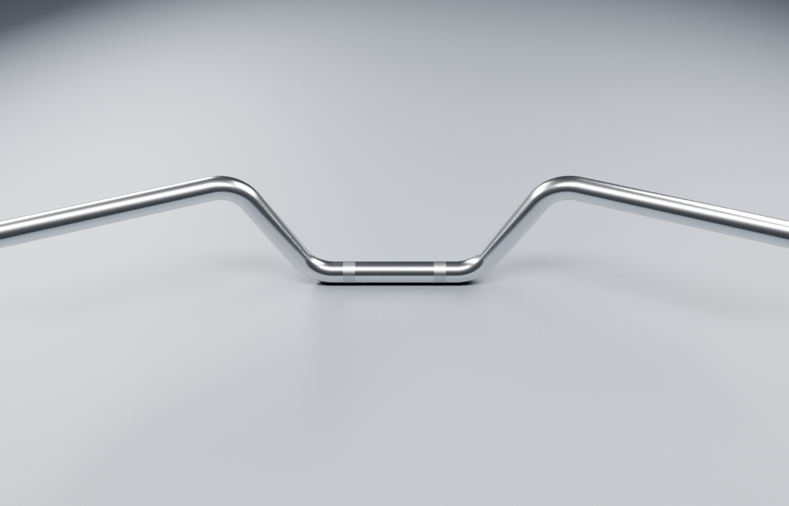
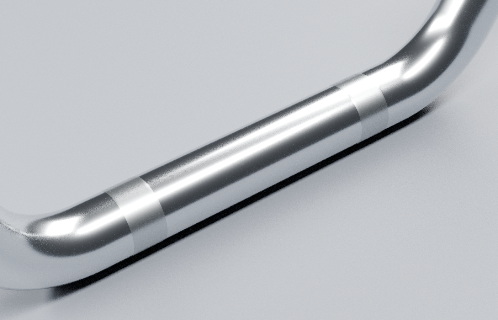

# Guidon nu — revue de fabrication v1

**Rendus réels de la source Blender**, et non une image générée d’une moto complète. La vue de conduite ci-dessous est une inspection du composant ; elle n’est pas une capture du jeu et n’inclut pas encore ses commandes.

Les [références consultées](../../research/handlebar/reference-observations.json) montrent les cintres chromés continus et les deux bandes de serrage. Leurs dimensions ne sont pas mesurées. Les photographies liées DU181021 ne certifient pas l’identité du guidon RDC et ne sont pas redistribuées ici.

La source originale conserve un tube creux à paroi réelle, des rayons de cintre tangents et le relief de deux zones moletées. Une seule coque de paroi fermée, un volume positif et des lumières d’extrémités ouvertes sont vérifiés par le [contrôle source](source-geometry-check.json), puis sur le [GLB réel](geometry-check.json). Le volume de paroi correspond au calcul de section × longueur à moins de 0,01 % ; ce contrôle technique ne démontre pas une reproduction dimensionnelle de la pièce physique.

Le gros plan montre les deux bandes, mais leur denture reste peu lisible sous cette lumière ; l’amplitude/pas du relief et l’éclairage rasant sont à reprendre avant de recevoir le moletage.

À examiner avant réception : largeur et recul réels, hauteur des cintres, diamètre et paroi, taille/position/pas du moletage, finesse des raccords et réponse du chrome. Les sections de contrôle, commandes, poignées et pontets sont des composants séparés. Le raccord UV est préparatoire et aucun aspect photographique ou performance mobile n’est certifié. La matière est constante ; seules les lumières de studio produisent ses variations de reflet.

[Source Blender et paramètres](../../../assets-src/moto-components/handlebar/README.md) · [rapport des vues](render-report.json).
