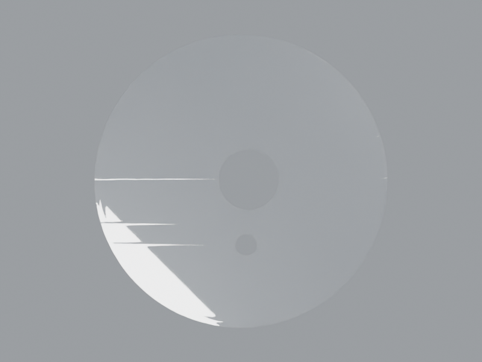
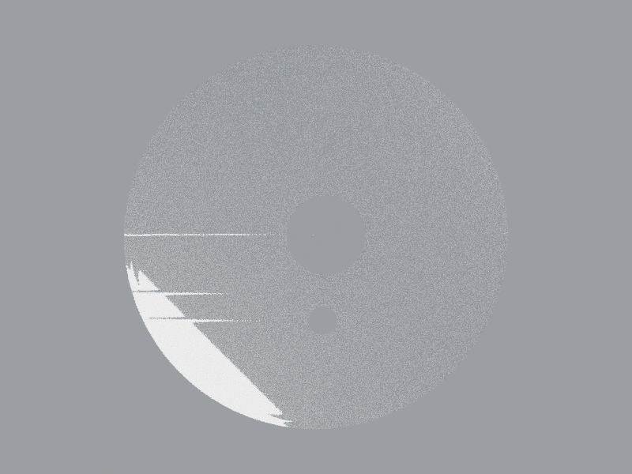
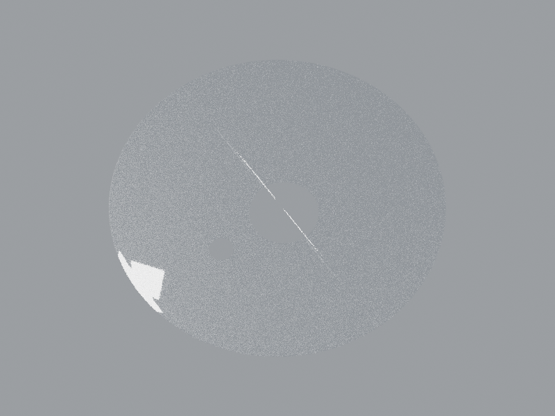
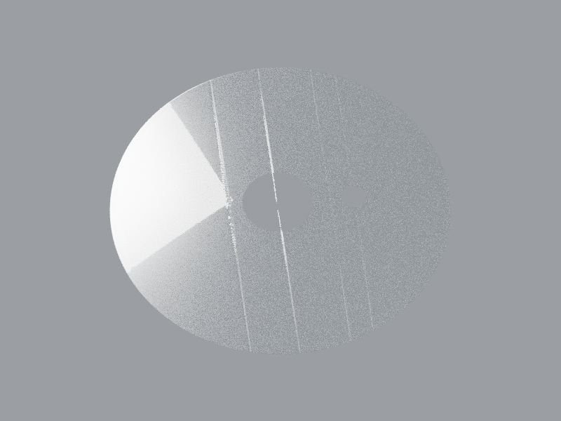

# Phare DJ201051 — surfaces visibles v3

Candidat construit : vitrage strié, lèvres argentées et surface réfléchissante frontale simplifiée, avec deux ouvertures réelles dans la géométrie. **Blender éditable et GLB livrés ; pas un audit seul.**

Présentation Cycles96 débruitée,800×600 ; géométrie/matières identiques, sans modifier les trois originaux sans débruitage ci-dessous.

[Source Blender](../../../assets-src/moto-components/headlamp-interior-completion-v3/visible-optics-v3.blend) · [GLB](../../../assets-src/moto-components/headlamp-interior-completion-v3/visible-optics-v3.glb) · [Fragment d’assemblage](integration-fragment.json) · [Paramètres et estimations](../../../assets-src/moto-components/headlamp-interior-completion-v3/parameters.json)

La portée demandée est l’extérieur visible à travers la glace. Trois photos physiques associées au code DJ201051 ont été réellement ouvertes : Prom de face, Crosland et Bajajonline en oblique. Elles contraignent le contour circulaire, les quatre lignes transversales persistantes, la fine bande périphérique et les deux projections d’ouvertures. Elles restent vitrées : cela permet une étude d’apparence visible, sans authentifier une prescription optique ni les faces cachées. Les originaux et leurs droits restent privés ; [registre URL/SHA](../../research/headlamp-interior-completion-v3/source-register.json).

La nouvelle collection contient cinq objets : vitrage continu, lèvre périphérique, lèvre de l’ouverture principale, lèvre pilote et surface argentée frontale à deux ajours. Les lignes sont construites dans la surface du vitrage ; leur côté de moulage reste une hypothèse. La bande striée utilise640répétitions, estimation480–800, pas un décompte certifié. Le rayon85mm, la faible convexité3,5mm, les reliefs0,12mm et0,055mm et les placements des lèvres sont des paramètres d’apparence bornés et explicités. Les dimensions n’ont pas été mesurées sur un original RDC.

La surface argentée est une **projection frontale plane reculée de0,45mm**, proposition de profondeur0–3mm ; elle ne représente pas la vraie concavité. Cette simplification remplit la région argentée visible et conserve les ouvertures sans fabriquer un bol de révolution ni convertir les zigzags de reflets en facettes. Elle doit être jugée comme candidat d’apparence en contexte : la réponse réelle du réflecteur incurvé/facetté n’est pas reproduite. Les faces arrière, cols, soudures et raccords cachés sont omis.

Le vitrage reste clair, non émissif, IOR1,46, transmission1, rugosité0,025. Les lèvres et le champ visible sont métalliques, sans texture photographique ni émission utilisée pour cacher une absence. La scène native neutre montre aussi les limites de la surface plane ; aucune réception artistique ou photométrique n’est déclarée.

Le fragment remplace seulement `outer-glass-envelope-context`, avec sa transformation historique conservée : translation `[0,-0.204,-0.12]`, rotation `[90,0,0]`, échelle1. Collection `WEWA_HEADLAMP_VISIBLE_OPTICS_V3`. Il conserve140parents ; les cinq maillages ne constituent pas cinq pièces OEM. Le propriétaire de l’assemblage peut consommer le fragment sans modifier les sources historiques.

Les preuves techniques sont séparées du jugement visuel : `native-export-parity.json` ouvre réellement le Blender et compare les positions aux buffers GLB à0,1µm d’arrondi, vérifie l’absence d’émission/images et les deux ajours par rayons. Les buffers exportés contiennent298500triangles, sans triangle dégénéré ni normale de longueur invalide. Le validateur glTF ne signale aucune erreur ni avertissement. Source détaillée de revue, sans qualification de coût mobile.

`preliminary-lips-only/` conserve le premier essai sans champ argenté : sa transparence ne corrigeait pas le vide visuel. Le champ visible a été ajouté dans la source avant les vues finales. L’erreur d’orientation de la première construction a été corrigée dans la source avant la livraison ; le défaut de cadrage800×600 a été arrêté par le préflight et corrigé par la caméra, sans déformer la pièce.

Aucune mutation Git n’est effectuée par ce propriétaire de composant ; le coordinateur conserve les sauvegardes et l’assemblagev20.

Les trois vues natives originales et la présentation débruitée ont été réellement ouvertes et relues. Quatre captures Babylon finales sont disponibles dans `inspection-v5/`, avec contrôles de pixels non vides et zéro erreur page/HTTP. Les EXR sont FLOAT32 monocouche ; leur vérificateur dédié accepte les vrais canauxR/G/B, contrairement au vérificateur historique qui attendait un préfixe de couche.

`placed-context-nonobstruction.json` compare les cinq maillages v3 au boîtier et au protecteur réellement placés en v19 : dix paires, zéro intersection de triangles. Le dossier v19 ne place pas les composants séparés ampoule/cage/capuchon ; leur ancien contexte les garde isolés. Leur non-obstruction montée n’est donc pas certifiée. Les rayons positifs sur le champ et négatifs sur les deux ajours restent prouvés dans la source.

`rejected-detached-field/` conserve l’essai à12mm et sa séparation visible en oblique. La version livrée est à0,45mm commun aux lèvres et au champ ;64points de frontière principale communs et écart de discrétisation des cercles inférieur à3µm. Pas d’architecture de facettes supposée ou de revendication OEM.
