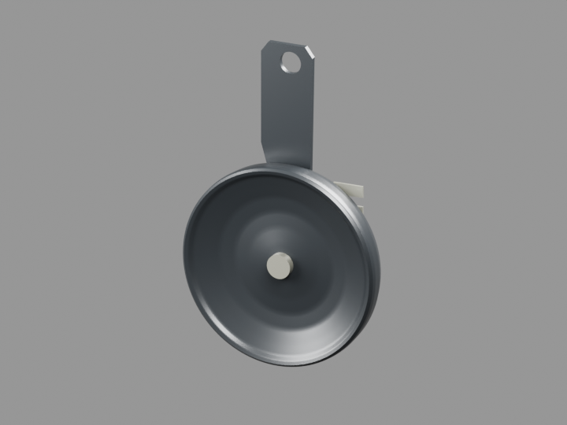

# Klaxon visible JV401602 — extérieur borné

**Absent de v20 : un parent à ajouter**, cinq petits maillages, aucun doublon. Lecture réelle des noms d’objets des126sources natives des151parents : seuls le bouton de klaxon et ses pictogrammes étaient présents. La comparaison avec l’inventaire de collections liées v19 ne révèle pas de corps de klaxon supplémentaire.

[Fragment exact](../../../assets-src/moto-components/horn-visible-completion-v1/integration-fragment.json) · [Routes GLB](../../research/horn-visible-completion-v1/export-routes.json) · [Blender](../../../assets-src/moto-components/horn-visible-completion-v1/horn-visible.blend) · [GLB](../../../assets-src/moto-components/horn-visible-completion-v1/horn-visible.glb)

Clé courte `horn-visible-jv401602`, collection `WEWA_HORN_VISIBLE_COMPLETION_V1`, cinq noms `selected_objects` explicites. Parent identité ; objets déjà placés dans le repère global. Devant le tube descendant, centre estimé `[0.030,-0.130,-0.395]`m, diamètre78mm estimé60–90mm. Le trou de patte est au-dessus du corps. Position±20mm, orientation±15°, raccord et fixation non réceptionnés.

Le catalogue apparenté Boxer identifieJV401602 DC Horn, quantité1 ; D04plate46, texte réellement extrait, précise KS China Nigeria. Il ne certifie pas la variante RDC. [Parts My Bike identifie aussi JV401602](https://partsmybike.com/product/horn-for-bajaj-boxer-bm150/) et fournit la photographie physique réellement lue. Elle montre une façade cuppée/bombée, un rebord roulé, un bouton central, une patte longue percée et deux cosses. Ces formes sont construites, sans substituer un simple disque. Les vues officielles00/03 ont servi au choix de la région de pose, sans prétendre lire une fixation cachée.

Le dos non exposé est laissé non modélisé ; aucune bobine, membrane interne, câble ou connectique cachée inventée. Aucun motif de petits évents ou texte illisible n’est ajouté à partir des137×123pixels de la référence. La photo russe consultée était AA201239 : mauvaise pièce, explicitement écartée de la fabrication. Original documentaire privé, URL/SHA dans le [plan G0–G2](../../research/horn-visible-completion-v1/G0-G2-plan.json).

Contrôles : source rouverte, cinq vrais maillages réimportés du GLB, connectivité et positions comparées ; composeur un parent, zéro erreur et zéro avertissement. Façade volontairement ouverte au dos et sous bouton séparé, autres pièces fermées, pas d’arêtes non-manifold inattendues. Une vue finale96échantillons720×540 FLOAT32 réellement lue. Premier cadrage trop serré conservé ; un second rendu élargit uniquement la caméra, sans modifier la source. Pas de nouveau whole ni de gros fichier.

Le rendu Babylon global et le calage final sont à effectuer par le coordinateur. G5 de fixation/course, G7 mobile et G8 artistique non reçus. Aucun push ni fichier global modifié dans cette mission.
