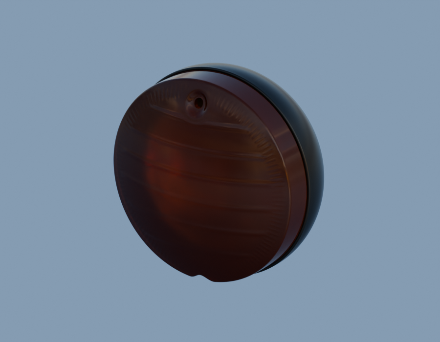
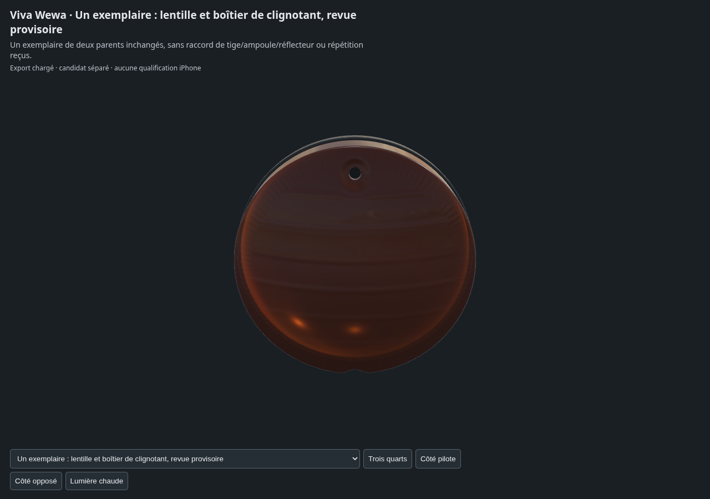

# Un exemplaire de surfaces extérieures du clignotant

**Un seul duo lentille/boîtier existant, pas de duplication ni de réception artistique.** Les géométries, normales, UV et matières originales restent inchangées. Le cadre local commun est celui des études précédentes, pas un montage moto certifié.

[Source liée](../../../assets-src/moto-components/indicator-exemplar-context-v1/indicator-exemplar-context-v1-material.blend) · [Sources parentes et empreintes](parents.json) · [Gris](gray-render-report.json) · [Aperçu](preview-render-report.json) · [Natifs96](final-render-report.json).

Cette surface ambre s’assombrit devant le boîtier noir ; le réflecteur, l’ampoule, le raccord à la tige, la rétention et le fonctionnement lumineux ne sont pas fabriqués dans cette composition. Les hypothèses de variante PF401001/2, dimensions et finition des parents restent ouvertes. Le but est de présenter concrètement les surfaces déjà disponibles avant toute éventuelle répétition provisoire dans la moto.

[Réouverture native et parents](source-parent-reopen-check.json) · [Buffers réels](export-buffer-check.json) · [Moteur réel](inspection-v5/engine-check.json) · [EXR FLOAT32](raw-render-check.json) · [Lecture](coordinator-review.json). Aucun essai ne vaut réceptionG8.
