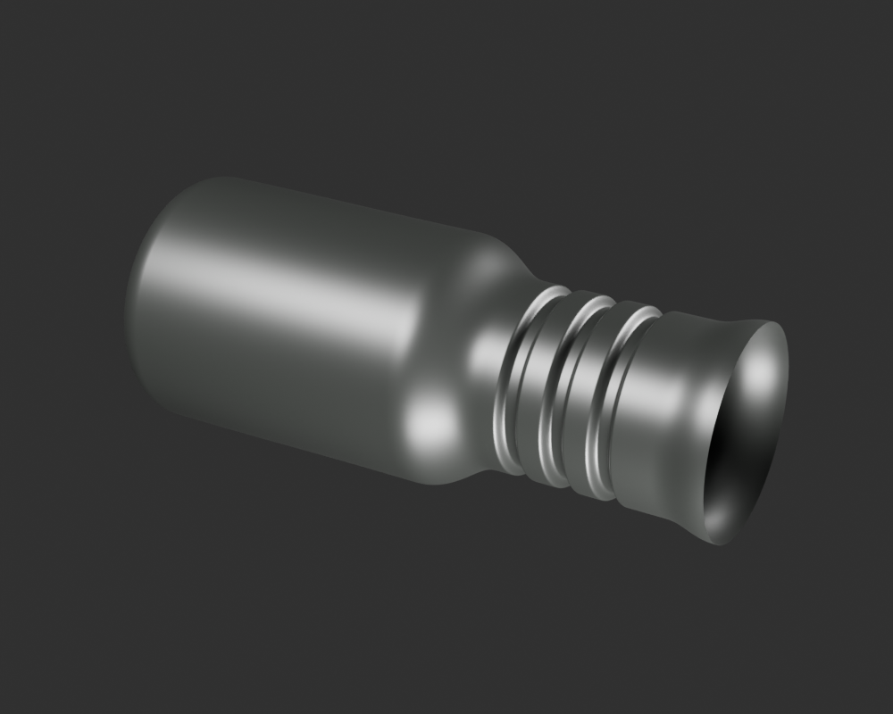
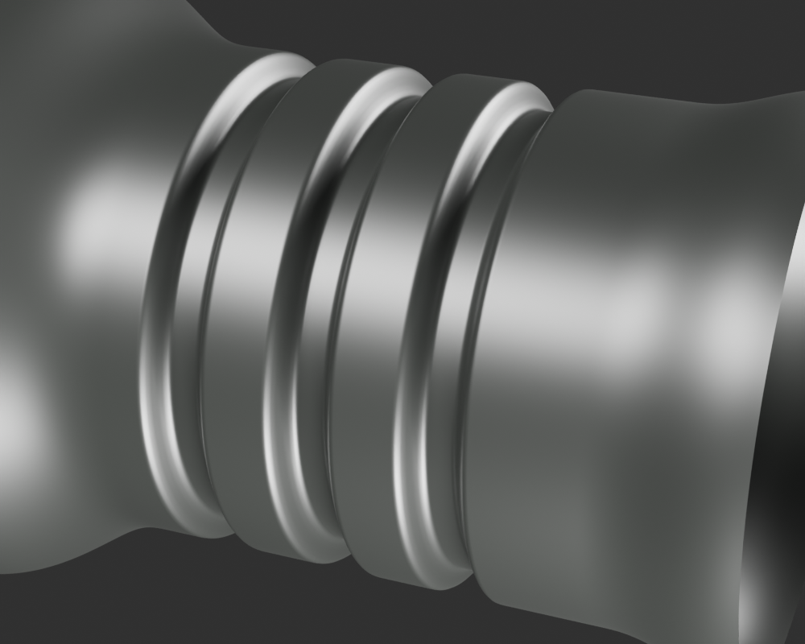
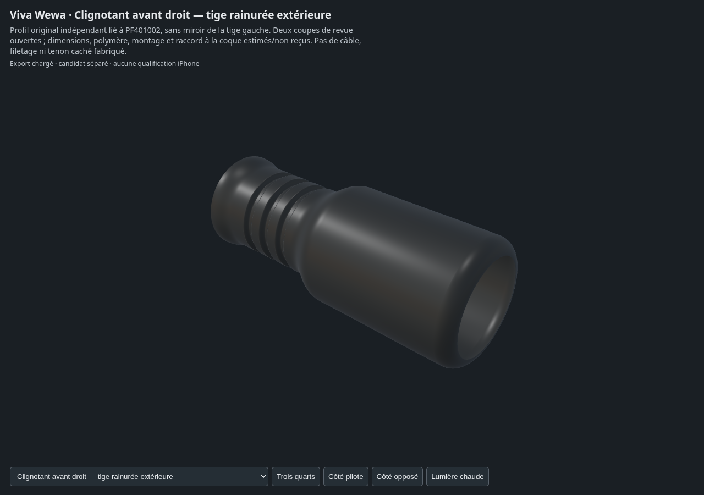

# Clignotant avant droit — tige extérieure candidate v1

Cette pièce développe un profil indépendant d'après PF401002. Les trois
rainures sont de la géométrie à raccords C2, non une texture. Le matériau noir
propre est une proposition originale ; dimensions, composé et pose restent
estimés. Les deux extrémités ouvertes sont des coupes de revue, pas un tenon,
un filetage ou un alésage caché. Le raccord à la coque suit séparément.

- [Source Blender et GLB](../../../assets-src/moto-components/indicators-front/right-stalk/)
- [Construction et limites de la source](../../../assets-src/moto-components/indicators-front/right-stalk/README.md)
- [Lecture des gris avant matière](gray-review.json)
- [Protection des vrais buffers entre gris et matière](material-transfer-check.json)
- [Rapport des trois rendus détaillés et leurs empreintes](render-report.json)
- [EXR FLOAT32, passes brutes et débruitage](raw-render-check.json)
- [Vraies captures et pixels Babylon](inspection-v3/engine-check.json)
- [Revue de coordination](coordinator-review.json)
- [Manifeste de la livraison](production-manifest.json)

La lecture en gris, en reflets et dans le moteur reste distincte d'une réception
artistique utilisateur. Aucun clignotant complet, montage sur la moto, LOD mobile
ou résultat iPhone n'est reçu. Les anciens paramètres préparatoires et les
instantanés de protocoles restent conservés.
