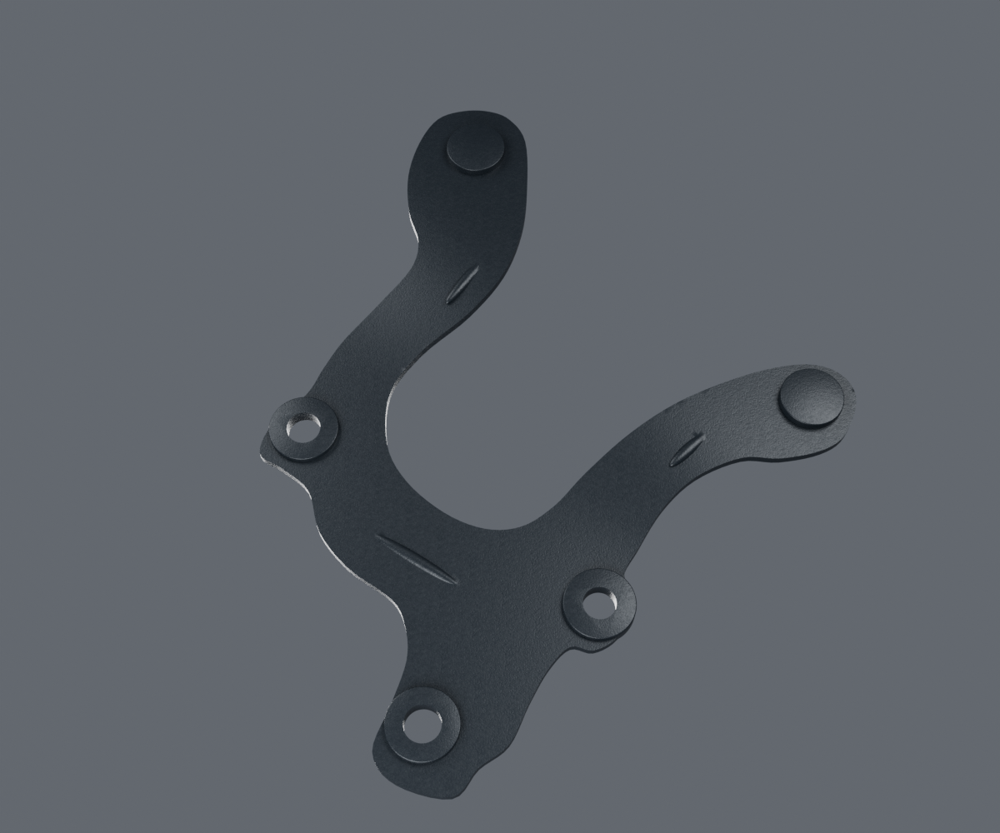
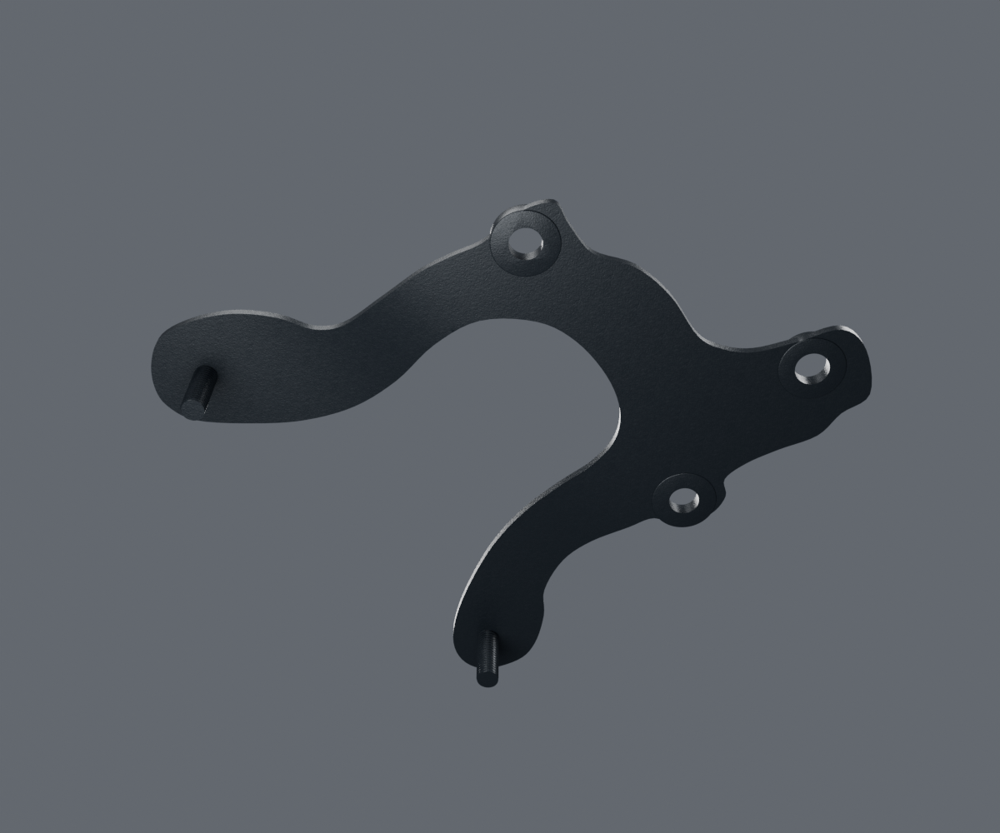

# Support des compteurs — revue isolée v1

Candidat original du support voisinPF402404, non reçu. Les rendus ci-dessous proviennent réellement de Blender4.3.2/Cycles96 avec OpenImageDenoise.

La fourche ouverte, ses trois passages et leurs bords sont contrôlés dans la source et les buffers réellement exportés. La tôle est triangulée dans sa surface avant formage pour éviter les grandes faces non planes. Le contrôle conserve son aire de contour et vérifie une coque fermée, connexe, de volume positif.

[Source](source-geometry-check.json) · [export](geometry-check.json) · [paramètres](../../../assets-src/moto-components/instrument-bracket/parameters.json) · [documentation](../../research/instrument-bracket/README.md).

Les profondeurs, l’épaisseur, les nervures et la pose des tiges ne sont pas mesurées. La photo oblique unique laisse une déformation de perspective non résolue ; les faces cachées sont des estimations explicites. La composition des reliefs de collier n’est pas identifiée. Les compteurs USB actuels n’ont pas de raccord certifié à cette variante2012BM150 ; la pièce est présentée isolée, sans faux montage. La garde du contact et la réception artistique restent ouvertes.

G4 : microrelief original périodique et variation de rugosité, tuile10mm, hauteur RMS5,42µm estimée. Les cartes de normale et ORM sont réellement embarquées : [contrôle des pixels](material-buffer-check.json), [paramètres de matière](material-build-report.json). Les colliers ont été corrigés avant gel pour retirer les faux reflets triangulaires du congé global ; aucune photographie ne sert de texture.
