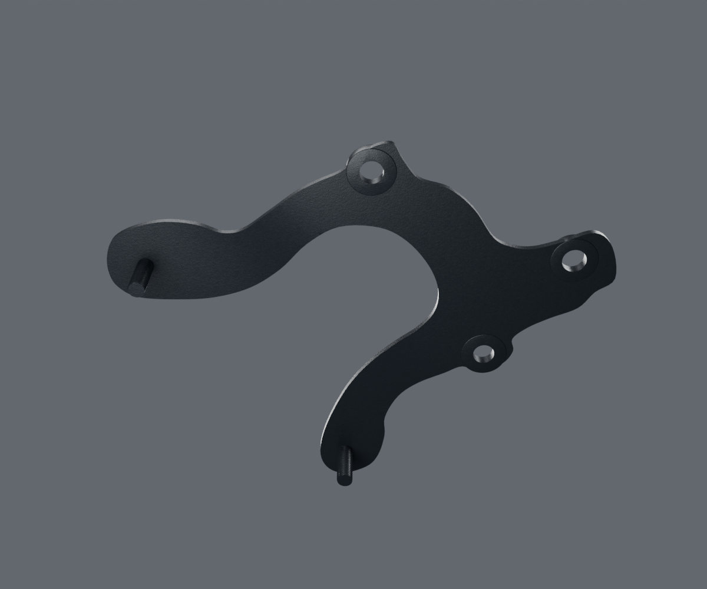

# Support de compteurs — revue v2

Candidat PF402404 d’une variante liée BM150, distinct de la v1 conservée. La correction vise la nervure inférieure à côtés parallèles et extrémités arrondies. La largeur4,8mm et la saillie1,1mm restent des estimations ; aucun relevé de cotes OEM.

Ces images sont des rendus réels de la source Blender4.3.2/Cycles96+OIDN. Le [contrôle source](source-geometry-check.json), les [vrais buffers exportés](geometry-check.json), les [paramètres de matière](material-build-report.json) et les [pixels embarqués](material-buffer-check.json) restent séparés du jugement artistique. Aucune réception utilisateur ou qualification Safari physique.

Le contour en U, les deux petites nervures, les têtes et les trois ajours sont conservés. Le modèle possède une seule coque fermée positive, avec un passage libre à chacune des trois positions testées. Le contrôle des triangles réels ne détecte pas d’aire quasi nulle. Le [relevé documentairev2](../../research/instrument-bracket/rib-v2-observations.json) conserve l’observation, son incertitude et les limites.

La collection locale `WEWA_INSTRUMENT_BRACKET_ISOLATED_V2` ne porte aucune pose installée : la compatibilité du supportBM150 avec les compteurs125HD USB actuels, l’empilage, le jeu de contact et la géométrie de pressage cachée restent inconnus.
