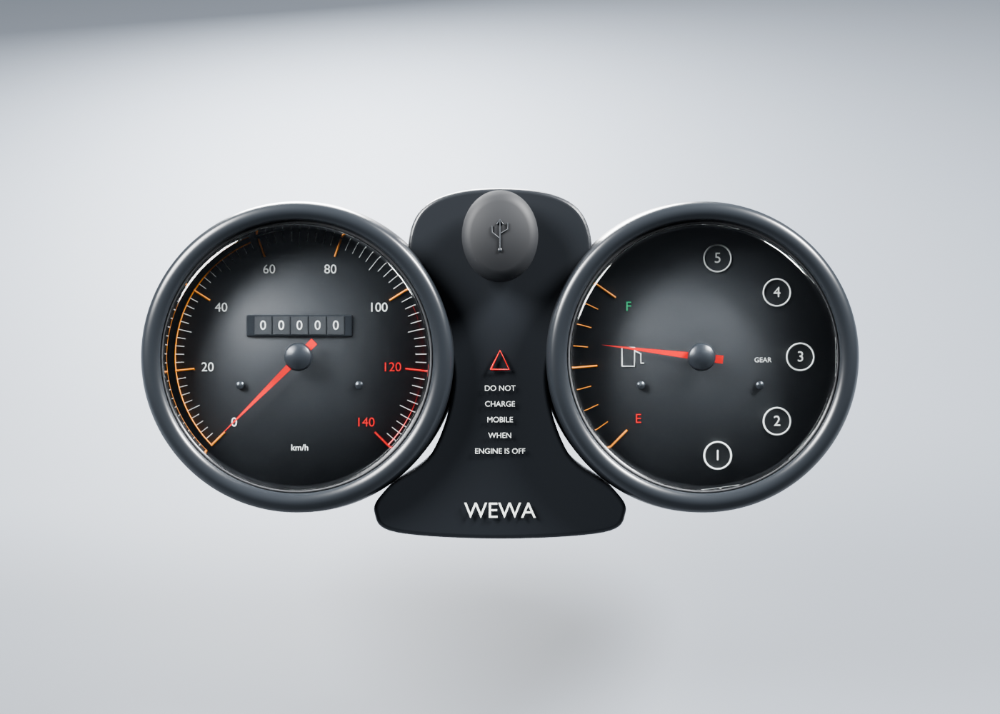
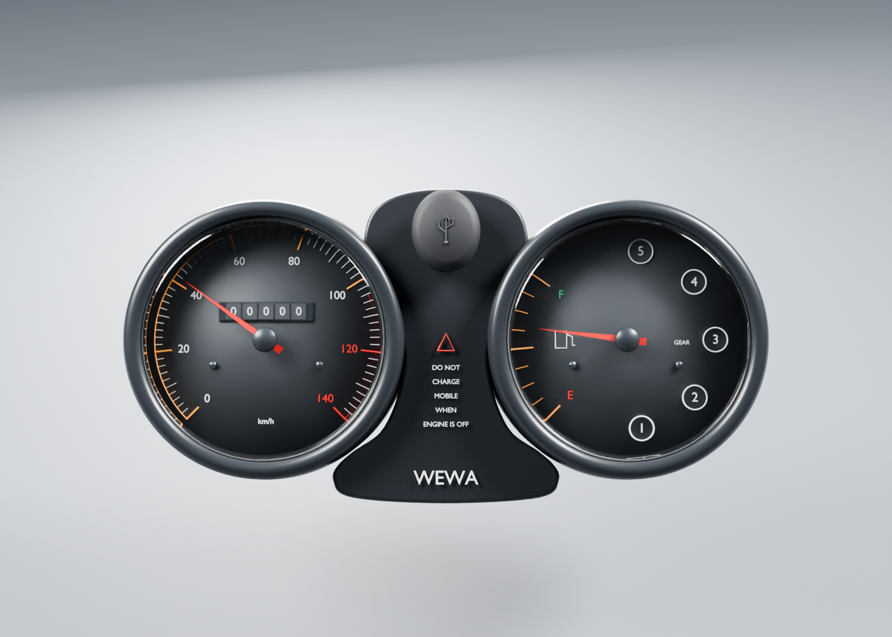
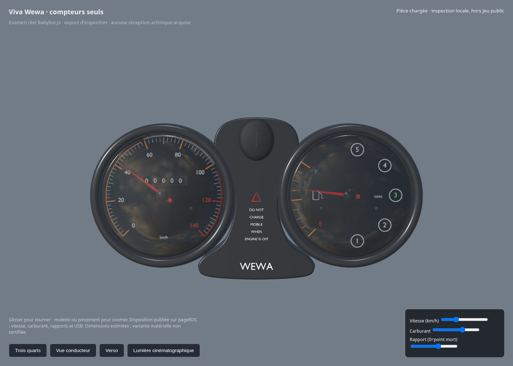

# Compteurs seuls — revue de la source et de l’export

**Rendus réels Blender du candidat**, d’après la disposition visible dans la photographie officielle RDC. Les dimensions et la variante de pièce restent à confirmer. Les numéros, graduations et le marquage WEWA sont originaux, sans photographie appliquée comme texture.

[Source, paramètres et limites](../../../assets-src/moto-components/instruments/README.md) · [recherche documentaire](../../research/instruments/README.md) · [trois quarts](quarter.png) · [dos estimé](rear.png).

Les coques et vitres ont été vérifiées comme volumes fermés ; l’export conserve les deux pivots d’aiguille et la transmission des vitres. Les contrôles moteur déplacent les vrais sommets exportés aux poses0/42/70/140 km/h, aux extrémités carburant et aux rapports0–5 ; les valeurs hors plage sont bornées. Les captures en844×390 sont des vues navigateur, sans qualification sur iPhone physique.

Un premier essai masquait les cadrans par le reflet d’une grande source : l’éclairage a été déplacé, le cache central reformé, puis la lisibilité réexaminée. La revue indépendante a ensuite fait reprendre le bouchon en capsule arrondie avec symbole moulé, ainsi que le contour du cache ; les pièces cachées restent estimées. Les rapports précisent les échantillons et le débruitage réellement employés. Les réflexions et caustiques ne constituent pas un modèle optique mesuré de la vitre.

À reprendre : numérotation exacte de pièce RDC, dimensions et sections arrière, supports, grain/état du plastique, courbure des vitres, calibration des aiguilles et comparaison photographique avec caméra calée. Le capuchon USB fermé ne prouve pas le port caché ; le contact et le câblage restent absents. L’odomètre est statique et les commandes locales ne sont pas reliées au jeu public. Aucune réception artistique ou performance matérielle n’est déduite des contrôles.

[Comparaison qualitative et écarts restants](../../research/cockpit-visual-audit.json).
