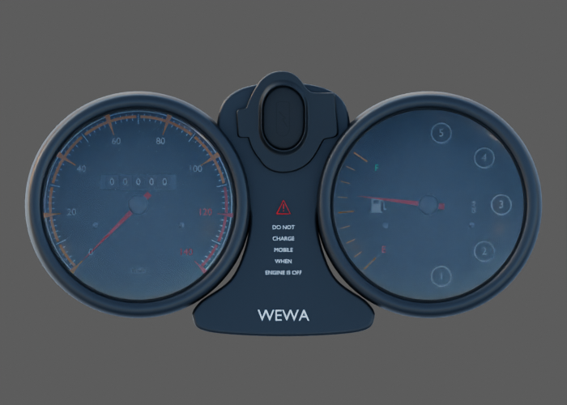
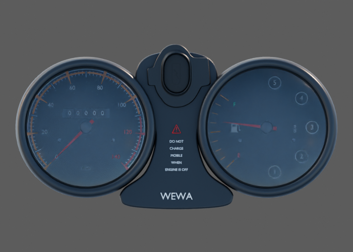

# Compteurs — plastique peint, vitrage et marquages — éclairage v2

Deux vrais aperçus Blender sur source et matériaux inchangés, sous le même HDR puis avec ajout d’un soleil chaud. Exposition déterminée par une vraie carte diffuse 18 % : **2.334EV**, sans balance des blancs. La carte sert à référencer l’exposition du scénario ; le HDR et la caméra ne sont pas radiométriquement calibrés.

Les cadrans deviennent plus lisibles avec l’exposition référencée ; le ciel bleu reste fortement réfléchi dans les vitres. La visière, l’angle de vue et l’éclairage devront être examinés ensemble. Aucun changement de matériau des compteurs n’est déduit de cette seule étude.

Les six vues des trois familles ont été relues ensemble en planche réduite ; les détails microscopiques ne sont pas qualifiés par cette lecture. Aperçus à 12 échantillons, pas des images finales du jeu. La carte 128 × 128 à 32 échantillons et son EXR linéaire privé ont un rôle de mesure du protocole, sans modèle de moto dedans.

[Carte réellement rendue](exposure-reference.png) · [Rapport et empreintes](report.json) · [Workflow](../../research/material-lighting-review-workflow-v2.md)

Aucune conformité OEM, matière physique mesurée, parité de shader mobile ou réception artistique n’est acquise. La source et son export gelés sont identifiés par SHA256 dans le protocole et les checkpoints.
