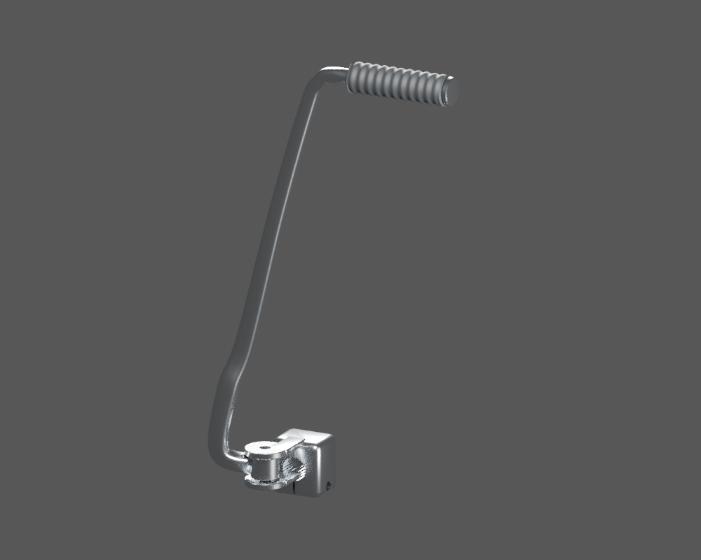
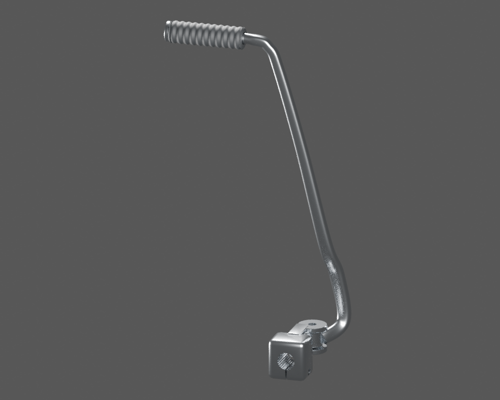
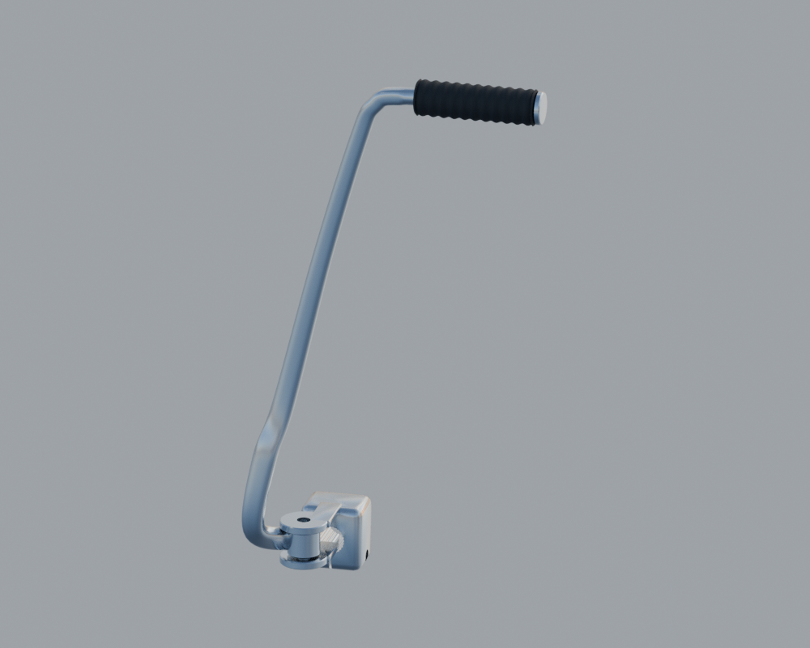

# P20 — Existing kickstarter exterior — four original meshes in native rest pose

[Source Blender](../../../assets-src/moto-components/kickstarter-exterior-context-v1/integration-wrapper.blend) · [GLB](../../../assets-src/moto-components/kickstarter-exterior-context-v1/kickstarter-exterior-context-v1-inspection.glb) · [Dossier](../../../creative/research/kickstarter-exterior-context-v1-coordination-v1/G0-G2-plan-v1.json) · [Étude auteur](../kickstarter-exterior-context-v1/README.md)

[Source rouverte](source-geometry-check.json), [export réel](export-buffer-check.json), [rendus96 associés à la source figée](render-report.json), [EXR FLOAT32](raw-render-check.json), [quatre vues Babylon de coordination](inspection-v5/engine-check.json), [lecture réelle](coordinator-review.json), [manifestes](production-manifest.json). Les images et rapports auteur restent inchangés. Leur association à la source est vérifiée dans le lot figé. Une éventuelle vue indépendante `coordination-neutral` est identifiée séparément avec sa provenance ; elle ne modifie pas la source.

Quatre maillages originaux du kick réunis : bride, bras, manchon annelé et embout fermé. Le studio produit des reflets très clairs ; le ciel neutre distingue manchon sombre et métal. Trois quincailleries estimées exclues. La pose historique de repos est conservée ; aucun ajustement au moteur actuel ni nouveau mécanisme caché n’est reçu.

Les dimensions et interfaces restent estimées. Aucune réception artistique ou qualification matérielle n’est transmise. Le paquet reste ouvert pour ses enfants et raccords manquants.
