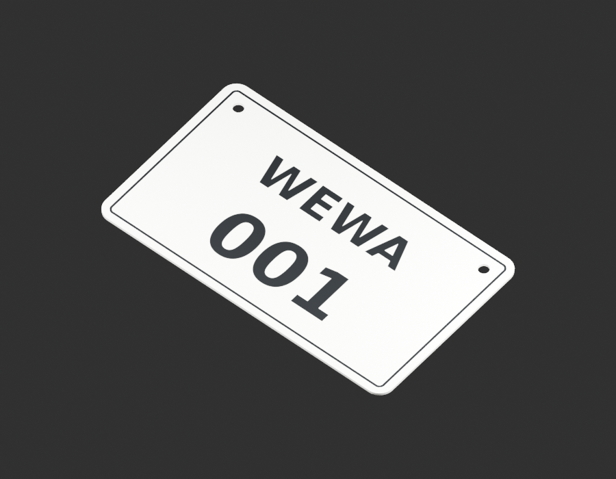
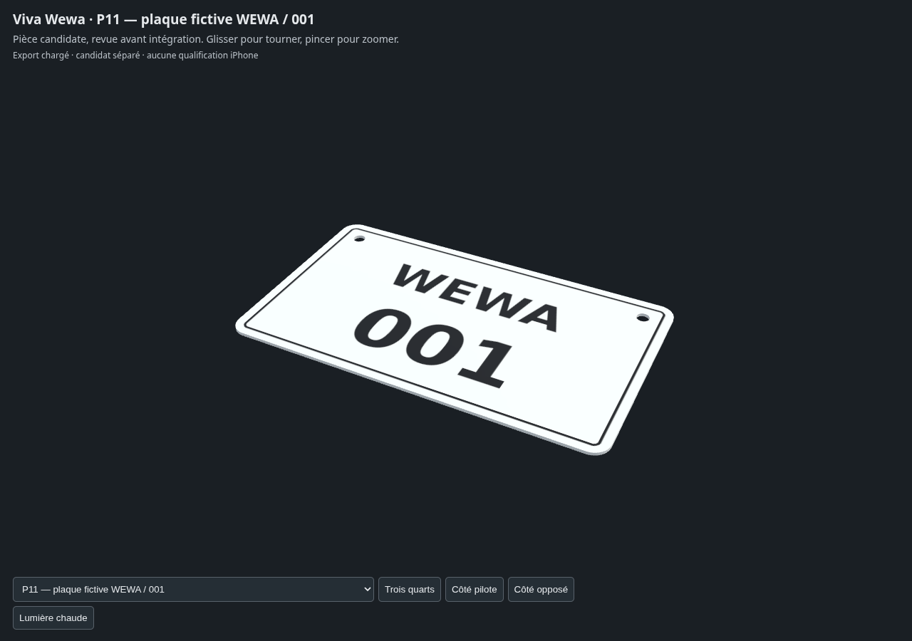

# Plaque originale WEWA / 001 — revue de fabrication

Le dessin original de cette plaque fictive a passé la revue technique G0 à G4 : contour arrondi, deux perçages, épaisseur proposée et graphisme de face. Les dimensions180×105×1,5mm définissent le modèle de jeu. La police DejaVu reste attribuée et licenciée.

[Décision et matrice de preuves](design-contract-review-v1.json) · [Fiche figée de cette revue](record-snapshot-design-review-v1.json) · [Sources et rendus](README.md).

Le raccord au support et la pose sur la moto restent ouverts en G5. Le coût mobile G7 et la réception artistique utilisateur G8 attendent leurs preuves et décision. P11 reste ouvert pour la pose et les accessoires effectivement documentés.
