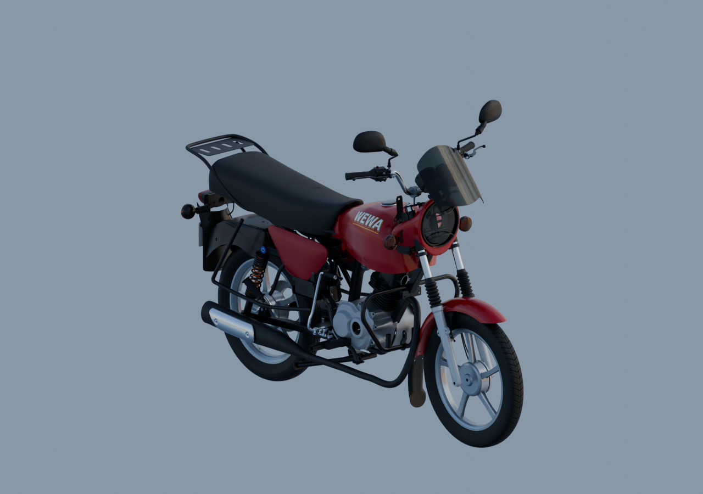

# Moto WEWA — livraison assemblée

Le moteur extérieur, l’intérieur visible du cadre, la batterie et son support, la selle, les protections latérales, les repose-pieds, les deux amortisseurs, quatre clignotants, les garde-boue, le porte-bagages et la plaque sont réunis dans la composition actuelle. Les répétitions provisoires ont été explicitement autorisées.



[Blender : trois vues détaillées96](../whole-exterior-material-preview-v7/README.md) · [Babylon : trois quarts](inspection-whole-v1/engine-quarter.png) · [Gauche](inspection-whole-v1/engine-left.png) · [Droite](inspection-whole-v1/engine-right.png) · [Face](inspection-whole-v1/engine-front.png) · [Arrière](inspection-whole-v1/engine-rear.png) · [Trois quarts arrière](inspection-whole-v1/engine-rear-quarter.png).

## Fichiers récupérables

- [Source Blender liée](../../../assets-src/moto-components/whole-exterior-material-preview-v7/whole-exterior-material-preview-v7.blend).
- [Assemblage glTF](../../../assets-src/moto-components/motorcycle-assembled-v1.gltf) et [preuve export](../../../assets-src/moto-components/motorcycle-assembled-v1.gltf.proof.json).
- [Manifeste exact des dépendances](../../research/motorcycle-assembled-v1/portable-files.json) : 283 ressources, 1 511 488 907 octets pour l’ensemble. Les photographies de référence privées ne sont pas distribuées.

Depuis la racine du dépôt contenant le script et le manifeste :

```sh
python tools/fetch_motorcycle_model_v1.py --destination /chemin/moto --format native
python tools/fetch_motorcycle_model_v1.py --destination /chemin/moto --format runtime
```

`--format all` récupère les deux formats ; `--ref SHA_DU_COMMIT` fige la révision. Les SHA256 sont contrôlés, les fichiers locaux différents ne sont pas écrasés. La vérification locale des 283 ressources a réussi ; un téléchargement distant intégral neuf n’a pas été exécuté. Le seul fichier .blend ou .gltf ne suffit pas : conserver l’arborescence relative, y compris les GLB utilisés comme tampons externes.

Pour la revue locale avec Vite, ouvrir :
`/tools/motorcycle-complete-review/?model=/assets-src/moto-components/motorcycle-assembled-v1.gltf`

## Contrôles et limites

140 parents liés, 123 GLB sources distincts, 506 maillages et 23 897 701 triangles. Ces comptes ne sont pas des pièces physiques terminées. Validation glTF : zéro erreur ; chargement réel Babylon, six canevas vérifiés, textures prêtes, zéro erreur page/HTTP. Réouverture native et comparaison indépendante des bornes : écart maximal 0,000002802 m, preuve de cohérence d’export uniquement.

Unités : mètres. glTF = (X natif, Z natif, −Y natif). Le sol actuel est à Y glTF ≈ −1,03 m ; une translation du parent de +1,03 m permet un sol à zéro sans changer les sources. Blender natif : +X gauche conducteur, +Y arrière, +Z haut.

Le modèle détaillé reste une source de travail lourde, sans LOD mobile. Unity n’a pas été testé ; les sources Blender et le format glTF permettent de préparer ce portage. Chromium logiciel ne qualifie pas les performances matérielles.

La moto n’est pas déclarée entièrement finalisée : le réflecteur nu du phare n’a pas de référence physique suffisamment identifiée ; les recherches FIEM/Varroc et les circuits antérieurs sont archivés. Le secteur inférieur du caoutchouc JK reste une omission diagnostique explicitement signalée, pas une fente physique attestée. Restent aussi les fixations cachées, l’attache avant du carter supérieur, les raccords de gaines et l’ajustement mécanique des variantes apparentées. Les tubes arrière suivent des observations indépendantes de la moto RDC ; leurs attaches cachées ne sont pas inventées. Le moteur apparenté et certaines profondeurs restent des estimations documentées. Aucun mécanisme interne caché ou faux bol optique n’a été ajouté. Pas de réception artistique G8 ni clôture fictive des trente paquets.
