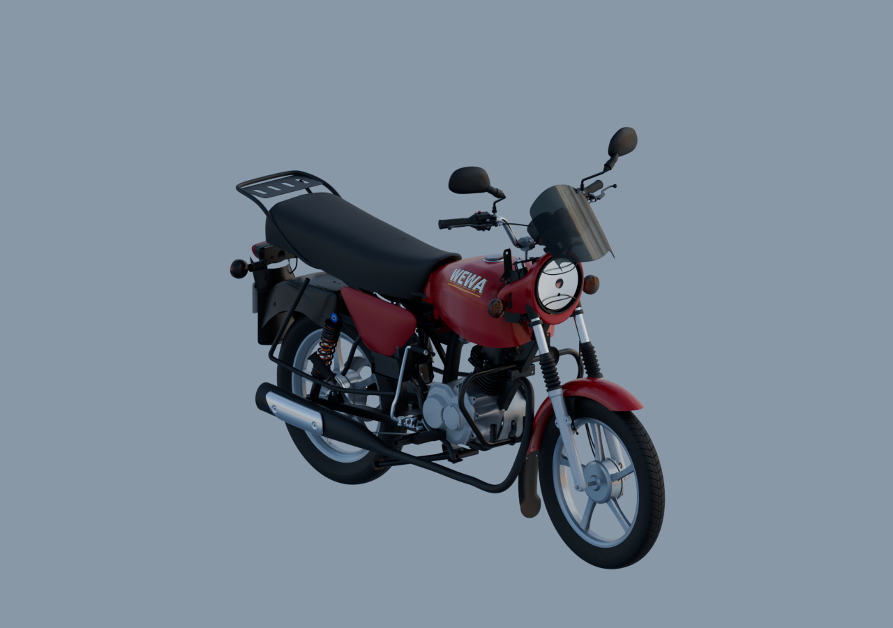

# Moto WEWA — livraison assemblée v3

La composition réunit161instances liées, contre140dans la livraison précédente. Les compléments documentés sont fabriqués ou réintégrés et les sources sont conservées. **Le réflecteur du phare reste une approximation frontale à reprendre ; la moto n’est pas déclarée intégralement finalisée ni réceptionnée.**



[Les trois rendus Blender96](../whole-exterior-material-preview-v8/README.md) · [Source grise v21](../whole-exterior-coverage-v21/README.md).

## Pièces ajoutées ou retrouvées dans les sources

| Ensemble | Livraison actuelle |
|---|---|
| Moteur | Bougie/capuchon v2, bouchon de filtre v2, deux couvercles de visite, corps OHC et son embout réintégrés aux datums du moteur existant ; les ouvertures correspondantes ne restent plus vides. |
| Frein arrière | Huit éléments : levier, bout d’axe visible, tringle, chape, axe de liaison, barillet, ressort et réglage. Posev2 corrigée, sans modifier les maillages ; trois interfaces contrôlées sans croisement de surfaces. |
| Roue avant | Axe proposé225mm dans la plage180–240mm et levier de came déjà documenté, placé hors des reliefs du flasque. |
| Carter de chaîne | Oreille percée et racine formée rattachées au retour inférieur, avec incertitudes de pose explicites. |
| Repose-pieds | Deux enveloppes de caoutchouc complétées ; la découpe longitudinale de diagnostic n’est plus présentée comme une fente physique. |
| Gaines | Deux courts départs supérieurs historiques et prolongement réellement observé de la gaine inférieureA. Pas de route cachée ou de connexion fonctionnelle inventée. |
| Klaxon | Façade cuppée, rebord, bouton, patte percée et cosses observées, dans une pose estimée. |
| Phare | Glace striée, lèvres et champ argenté ajouré. Ce dernier reste plan et apparaît trop uniforme ; il ne reproduit pas la vraie cuve ni ses facettes. |

Les carters majeurs, cadre intérieur visible, batterie/support/sangle, selle sombre, protections RDC, amortisseurs, quatre clignotants, porte-bagages, garde-boue rouge, plaqueWEWA001 et catadioptre des livraisons précédentes restent inclus. Les161parents et540maillages ne sont pas un compte de pièces physiques terminées.

## Contrôles visibles

[Face entière, cadrage corrigé](inspection-whole-v2/engine-front.png) · [Dos entier, cadrage corrigé](inspection-whole-v2/engine-rear.png) · [Gauche](inspection-whole-v1/engine-left.png) · [Droite](inspection-whole-v1/engine-right.png) · [Trois quarts](inspection-whole-v1/engine-quarter.png) · [Trois quarts arrière](inspection-whole-v1/engine-rear-quarter.png).

Les six premières captures réelles sont conservées. Face/dos y cadraient trop près des pneus ; les deux vues supplémentaires corrigent uniquement la caméra. La géométrie, les matériaux et le glTF restent identiques. Le visualiseurv2 intègre ces distances corrigées.

Trois vues Blender natives1280×900 à96échantillons avec EXR FLOAT32, six captures Babylon initiales et deux cadrages corrigés. Réouverture effective des161parents, vérification des bibliothèques/poses/SHA, zéro erreur glTF, zéro erreur de page/HTTP. Les bornes natives et celles de l’export importé indépendamment concordent à2,802µm au maximum : cohérence d’export uniquement, pas une mesure du véhicule réel.

[Rapport Babylon](inspection-whole-v1/engine-check.json) · [Cadrages corrigés](inspection-whole-v2/engine-check.json) · [Source rouverte](../whole-exterior-material-preview-v8/native-reopen-check.json) · [Comparaison native/export](../../research/motorcycle-assembled-v3/native-runtime-bounds-comparison.json).

## Récupérer le modèle

[Blender lié principal](../../../assets-src/moto-components/whole-exterior-material-preview-v8/whole-exterior-material-preview-v8.blend) · [glTF assemblé](../../../assets-src/moto-components/motorcycle-assembled-v3.gltf) · [preuve glTF](../../../assets-src/moto-components/motorcycle-assembled-v3.gltf.proof.json).

Le [manifeste exact](../../research/motorcycle-assembled-v3/portable-files.json) référence313fichiers,1 591 934 408octets, comprenant deux fichiers facultatifs du visualiseurv2 ajoutés après collecte native. Les originaux photographiques restent privés. Les313fichiers ont été vérifiés localement ; aucun téléchargement distant intégral neuf n’est prétendu.

Depuis la racine du dépôt contenant le script et le manifeste :

```sh
python tools/fetch_motorcycle_model_v1.py --manifest creative/research/motorcycle-assembled-v3/portable-files.json --destination /chemin/moto --format native
python tools/fetch_motorcycle_model_v1.py --manifest creative/research/motorcycle-assembled-v3/portable-files.json --destination /chemin/moto --format runtime
```

`--format all` récupère les deux formats ; `--ref SHA_DU_COMMIT` fige la révision. Les SHA256 sont contrôlés, les fichiers locaux différents préservés. Conserver toute l’arborescence : le seul .blend ou .gltf ne contient pas ses bibliothèques/tampons. Les GLB originaux servent de tampons binaires externes valides, avec leurs offsets conservés.

Revue locale via Vite :
`/tools/motorcycle-complete-review-v2/?model=/assets-src/moto-components/motorcycle-assembled-v3.gltf`

Unités : mètres. glTF=(Xnatif,Znatif,−Ynatif), +Xnatif à gauche du pilote,+Ynatif vers l’arrière,+Znatif en haut. Sol actuel autour deYglTF−1,03m : translation du parent+1,03m pour un sol à zéro, sans déformer les sources.

137GLB distincts,25 443 229triangles : source détaillée non optimisée pour mobile. Unity n’a pas été testé ; les sources Blender et le glTF permettent de préparer ce portage. Chromium logiciel ne qualifie pas les performances d’un téléphone.

## Limites encore ouvertes

Le défaut optique est visible et explicitement conservé en reprise : le champ plan n’est ni un réflecteur physiquement complet, ni un logement d’ampoule validé. Les dernières recherches sur deux circuits d’occasion et douze photographies n’ont pas fourni les vues nécessaires : [preuve bornée v5](../../research/headlamp-interior-completion-v5/README.md). Aucune cuve ou architecture de facettes arbitraire n’est ajoutée.

Les variantes apparentées, profondeurs, poses et interfaces cachées restent estimées ; fixations, continuités fonctionnelles des câbles, course des freins/suspensions et mécanismes internes ne sont pas reçus. Les sources ne prétendent pas être une mécanique industrielle étanche ou une reconstruction OEM exacte. Aucune réceptionG8 ou clôture fictive des trente paquets ; les prototypes et essais refusés restent accessibles.
