# Moto WEWA — extérieur v5

**177 groupes présents et examinables, avec 15 ajouts et deux rétroviseurs corrigés. La moto reste inachevée : les raccords incompatibles et la transmission finale ne sont pas résolus.** Cette livraison donne la priorité aux éléments extérieurs et à leur visibilité.

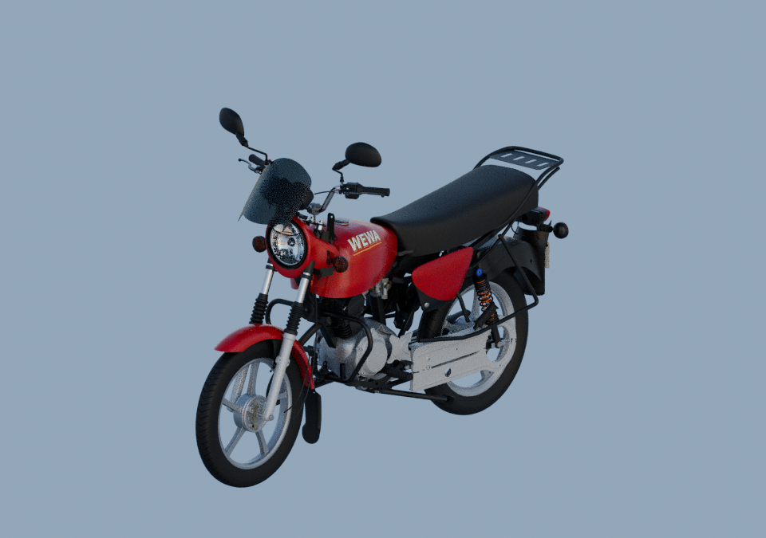
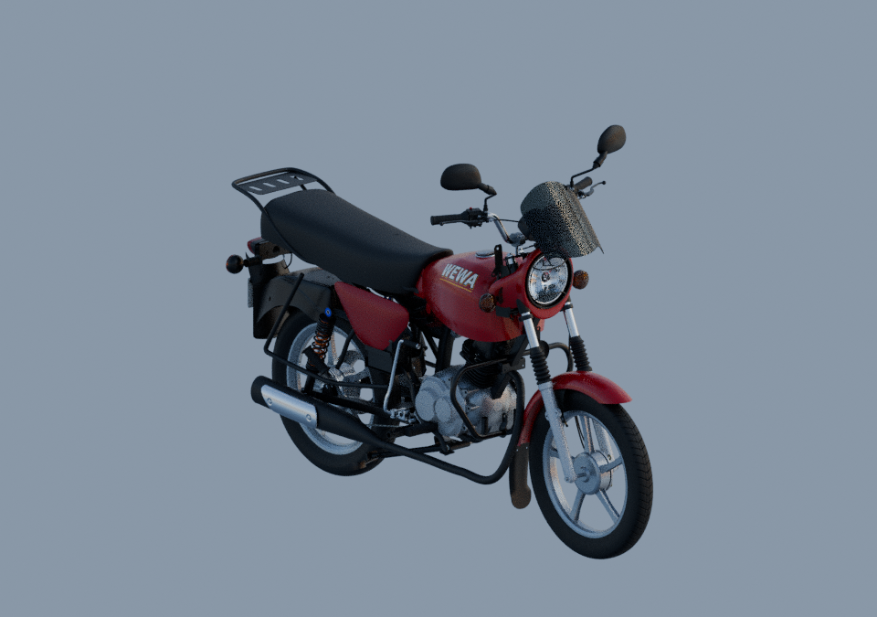

## Voir et récupérer la moto

- [GLB autonome pour examiner toutes les pièces](../../../assets-src/moto-components/motorcycle-exterior-v5/lod/motorcycle-lod.glb).
- [Source Blender éditable liée](../../../assets-src/moto-components/motorcycle-exterior-v5/motorcycle-exterior-v5.blend) ; récupérer aussi les dépendances du [manifeste portable](../../research/motorcycle-exterior-v5/portable-files.json).
- [glTF détaillé](../../../assets-src/moto-components/motorcycle-exterior-v5.gltf), avec ses ressources originales externes.
- [Inventaire des 177 groupes avec leurs sources et leur image isolée](INVENTORY.md).
- [Visionneuse interactive](../../../tools/motorcycle-exterior-review-v5/index.html), à servir localement avec les fichiers du dépôt.

Après `npm ci`, lancer `npx vite --host 0.0.0.0 --port 4143` à la racine, puis ouvrir `http://localhost:4143/tools/motorcycle-exterior-review-v5/`. Rechercher une pièce, puis choisir « Tout le groupe » ou une sous-pièce pour la cadrer et l’isoler. Les petits éléments d’un groupe composite restent ainsi examinables séparément. Le curseur écarte les groupes pour montrer les éléments masqués. « Moto assemblée » restaure toutes les positions. Le mode détaillé, plus lourd, est accessible avec `?model=source`.

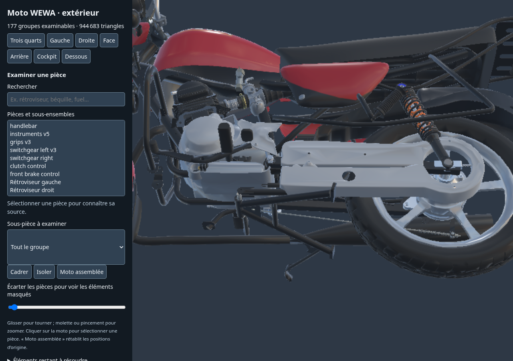

Les images isolées prouvent que chaque groupe retenu est affichable. Le contrôle moteur isole aussi les **560 éléments rendus** qui les composent, un par un, et mesure leurs pixels visibles. Certaines pièces sont naturellement cachées dans la moto montée : elles restent accessibles par isolation ou séparation. Groupes, éléments rendus et pièces physiques reçues sont des comptes distincts.

## Changements concrets

| Ensemble | Travail livré | Limite conservée |
|---|---|---|
| Rétroviseurs | Gauche v2 et droit v3, poses générales conservées | Raccords et variante restent à recevoir |
| Commandes | Commande d’accélérateur et support des compteurs ajoutés | Aucun prolongement de câble inventé ; pose du support estimée |
| Échappement | Deux vis existantes du pare-chaleur remises dans leur repère commun | Engagement caché non qualifié |
| Direction | Coiffe extérieure apparentée ajoutée | Dessous et filetage non établis |
| Arrière | Deux écrous de plaque et deux rondelles de clignotants | Implantations de revue, sans soudure ni adaptation cachée |
| Béquille centrale | Bras de manœuvre et axe extérieur ajoutés | Soudure, tolérances et débattement non certifiés |
| Béquille latérale | Ancrage, ressort et gaine conservés séparément | Précharge et second ancrage non établis |
| Robinet | [Corps extérieur fabriqué](../fuel-tap-visible-body-v1/README.md) et levier apparenté réunis | Photo PF171800 de famille voisine, échelle et profondeur estimées |

Les 160 autres poses sont conservées exactement dans Blender. Les bibliothèques d’origine restent inchangées. Les [17 vues rapprochées en contexte](context/report.json) permettent de lire les placements ; une pose de revue ne vaut pas un montage qualifié.

## Ce qui empêche de déclarer la moto terminée

| Élément | Constat | Travail encore nécessaire |
|---|---|---|
| Fixations basses du guidon | Les axes de goujons rencontrent la plaque ; les trous ne coïncident pas | Choisir une variante cohérente et reprendre le positionnement avant d’installer la pile écrou/rondelle/amortisseur |
| Vis de commande M6 | Alésage actuel de 4,3 mm | Résoudre l’identité et les cotes des pièces associées |
| Axe de béquille latérale | Épaulement étudié de 12 mm pour un œil actuel de 9 mm | Documenter puis corriger le couple axe/fourche |
| Transmission finale | Couronne à six trous et porte-couronne à quatre trous | Produire un ensemble compatible, puis la chaîne et son trajet |
| Câbles et durites | Segments observés présents, extrémités et routes incomplètes | Documenter les raccords et terminer les chemins visibles |
| Autres études non montées | Bague/silentbloc de feu arrière, attache interne du cache gauche et bras de réaction apparenté | Variante ou orientation non établie ; les études séparées ne prouvent pas leur montage |

Voir le [bilan détaillé des 30 paquets](../../workflow/motorcycle-completion-audit-2026-10-22/README.md) pour les travaux de fabrication, mouvements, optimisation mobile et réception encore ouverts. Ce bilan reste le relevé historique v4 à 162 parents ; le présent dossier décrit la livraison v5. Le jeu charge encore son modèle provisoire ; aucune intégration de ce modèle détaillé n’est déclarée.

Les études non montées restent examinables séparément : [bague de feu](../tail-lamp-collar-31201001-visible-v1/README.md), [silentbloc de support](../tail-support-damper-dd201011-v1/README.md), [attache interne du cache gauche](../side-cover-left-window-catch-v1-coordination-v1/README.md) et [bras de réaction apparenté](../front-completion-p23-torque-arm-front10-v2-coordination-v1/README.md). Leur présence dans la bibliothèque ne signifie pas qu’elles équipent déjà cet assemblage.

## Contrôles exécutés

Le [rapport courant](completion-report.json) et le [manifeste des fichiers livrés](production-manifest.json) associent les preuves à cette révision. Le [contrôle natif/export](../../research/motorcycle-exterior-v5/native-runtime-bounds-comparison.json) compare les 177 boîtes évaluées : écart maximal inférieur à 3 µm. Il mesure la cohérence d’export, pas la précision de la moto réelle.

Le [relevé de topologie natif/export](source-export-topology.json) retrouve les mêmes nombres de triangles pour les 17 groupes ajoutés ou remplacés. Quatre sources historiques conservent des comptes différents dans leurs exports existants : compteurs, commande gauche, jante avant et flasque de frein avant. Leurs exports sont conservés ; la comparaison de boîtes ne vaut pas identité de leurs surfaces ou subdivisions. Le LOD est comparé au glTF détaillé effectivement exporté.

Le [rapport du GLB allégé](../../../assets-src/moto-components/motorcycle-exterior-v5/lod/build-report.json) conserve tous les groupes et primitives, avec leurs poses : **26 308 215 → 944 683 triangles**, pour **41 258 188 octets**. Les [captures Babylon détaillées](source-engine-report.json), [allégées](lod-engine-report.json) et la [comparaison](comparison.json) contrôlent sept angles, chaque groupe isolé, le retour aux poses et les commandes sur écran étroit. Les mesures sont faites dans Chromium avec WebGL logiciel ; elles ne constituent pas un benchmark iPhone.

Le [sondage indépendant des triangles de direction](handlebar-mount-alignment.json), reproductible par [ce script](../../../tools/probe_handlebar_mount_alignment_v1.mjs), retrouve le conflit observé dans Blender : les axes de goujons à X=±45 mm rencontrent la plaque, alors que les axes voisins à ±38 mm traversent ses trous. Cela justifie de garder la pile de fixation non montée.

Le contrôle visuel a corrigé le lissage strié du nouveau robinet et un défaut de profondeur de caméra qui faisait scintiller les surfaces proches du réservoir et de la selle. La coiffe brillante de direction conserve sa géométrie complète dans le LOD. Les états rejetés sont identifiés dans `diagnostics/`.

Les deux vues Blender de composition sont calculées à **24 échantillons sans débruitage**, avec [EXR FLOAT32 contrôlés](raw-render-check.json). Les trois gros plans matière du robinet sont calculés à **96 échantillons sans débruitage**. Aucune réception artistique, conformité de montage, chaîne cinématique, animation ou performance mobile n’est déduite de ces contrôles.

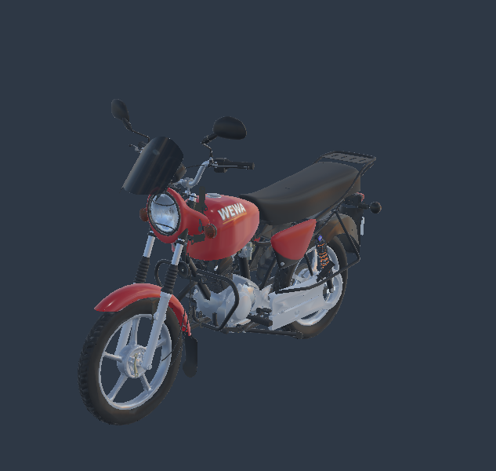
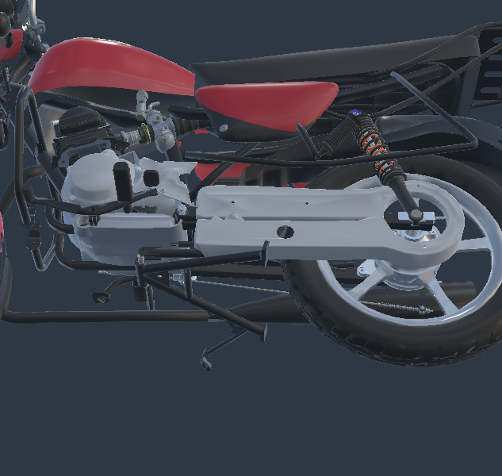
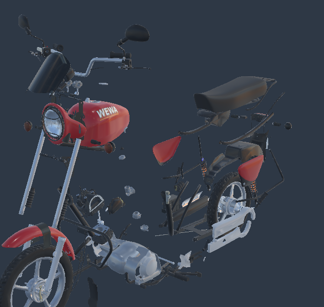

## Toutes les pièces retenues, isolées

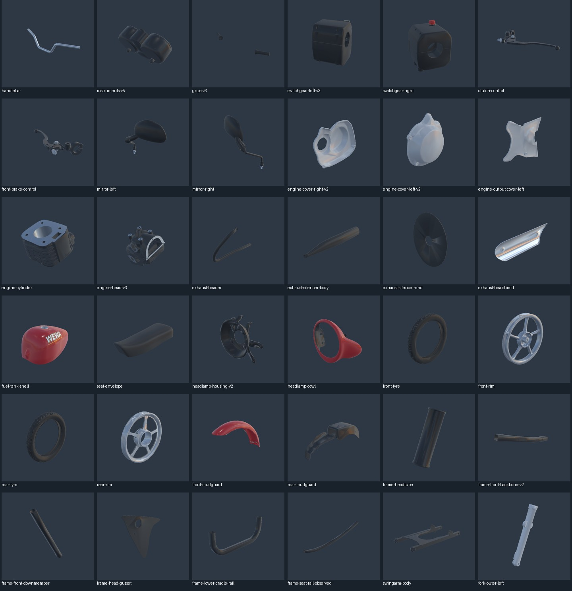
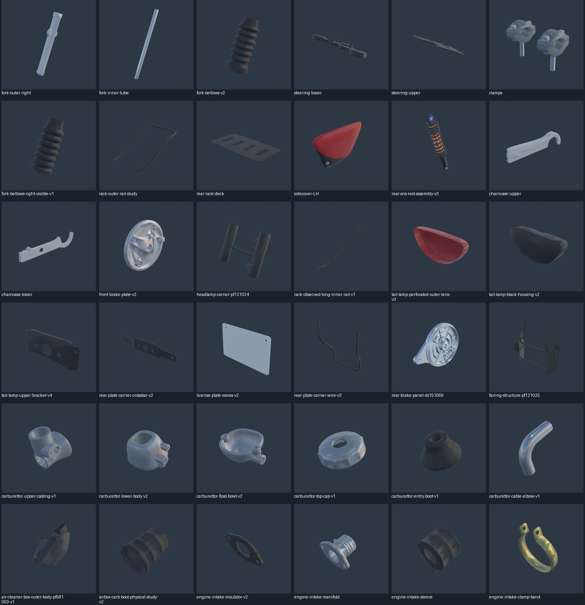
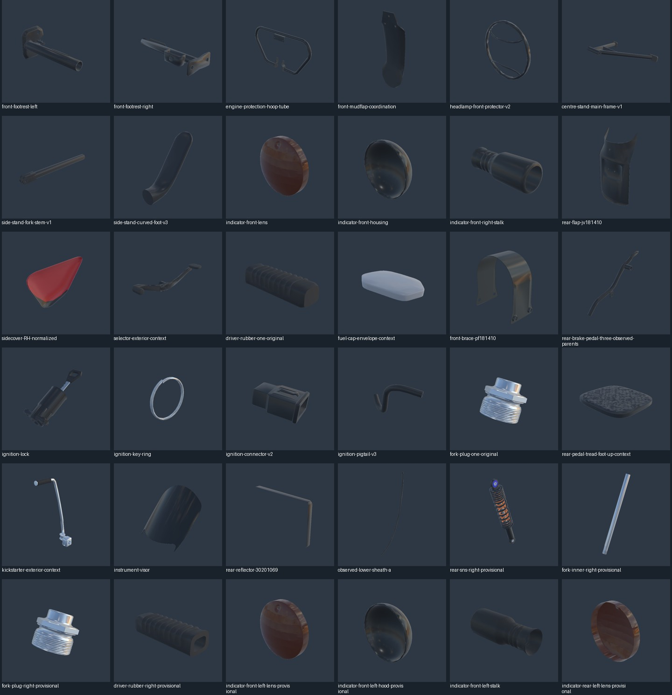
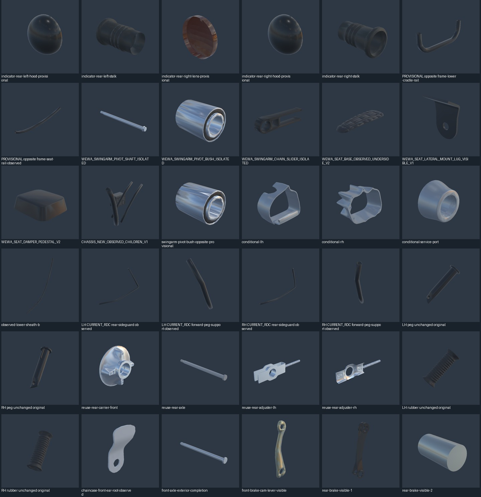
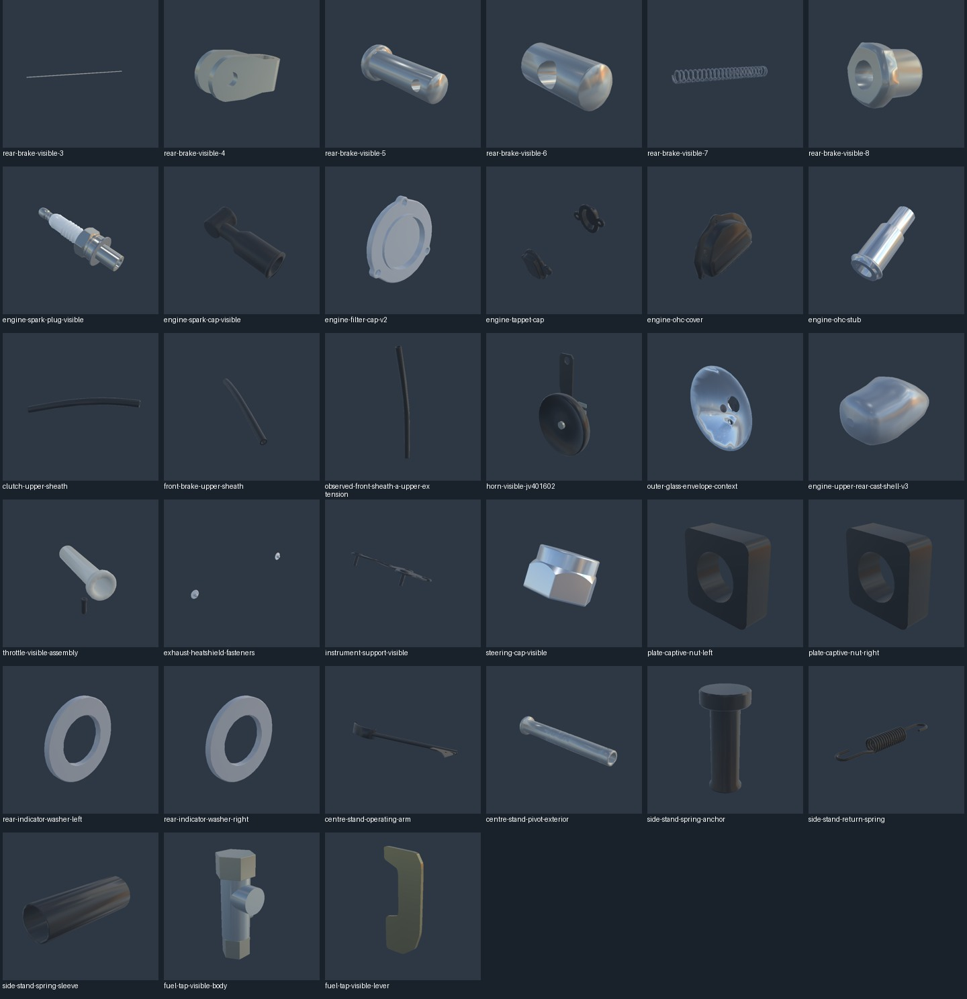
