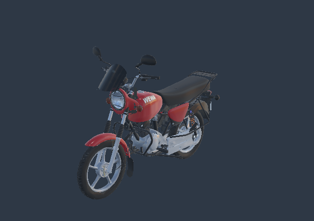

# Moto WEWA — candidat allégé, comparaison avec la source



**Export autonome de revue : 843 358 triangles et 39,18 Mo**, contre 25 463 261 triangles et 758,99 Mo de ressources pour l'assemblage détaillé v4. Réduction de triangles : **96,69 %**. Les 162 parents, les 502 nœuds maillés et les 541 occurrences de primitives sont conservés ; aucune pièce mécanique nouvelle n'est inventée.

[Télécharger le GLB autonome](../../../assets-src/moto-components/motorcycle-lod-review-v1/motorcycle-lod.glb) · [Construction et contrôles](../../../assets-src/moto-components/motorcycle-lod-review-v1/build-report.json) · [Assemblage détaillé et sources Blender](../motorcycle-assembled-v4/README.md) · [Bilan des éléments manquants](../../workflow/motorcycle-completion-audit-2026-10-22/README.md).

## Comparaison réelle, mêmes caméras

| Vue | Source détaillée | Candidat allégé |
|---|---|---|
| Trois quarts | [Source](source-quarter.png) | [LOD](lod-quarter.png) |
| Gauche | [Source](source-left.png) | [LOD](lod-left.png) |
| Droite | [Source](source-right.png) | [LOD](lod-right.png) |
| Face | [Source](source-front.png) | [LOD](lod-front.png) |
| Arrière | [Source](source-rear.png) | [LOD](lod-rear.png) |
| Cockpit rapproché | [Source](source-cockpit.png) | [LOD](lod-cockpit.png) |

Les douze images couleur et les douze masques sont de vrais rendus Babylon dans Chromium avec GPU logiciel, à 640×450. L'éclairage HDR de revue est identique pour les deux modèles, sans précalcul spéculaire ; il ne remplace pas les rendus Blender détaillés. [Rapport moteur, empreintes et matrices](engine-comparison.json).

La première réduction détériorait les reflets de la visière, de la selle et du réservoir. [État refusé et raison](diagnostics/first-pass/review.json) · [ancien cockpit](diagnostics/first-pass/lod-cockpit.png). La correction conserve toute la géométrie de visière et applique des paramètres plus fins au réservoir, à la selle, au carénage de phare et au guidon. Les six paires actuelles ont été relues : les grandes bandes et plages triangulaires de cette première réduction sont corrigées. De petites différences de reflets et de détail demeurent ; aucune identité de surface ou réception artistique utilisateur n'est déclarée.

## Contrôles et limites

- Les 140 ressources d'entrée sont vérifiées par taille et SHA-256 avant et après dérivation ; les sources gelées sont inchangées.
- Les 162 matrices de parents sont conservées dans la source, réouvertes dans le GLB et comparées dans Babylon. Écart maximal de borne par parent : **1,105 mm** ; cohérence d'export, sans mesure physique OEM ni borne de l'erreur sur toute la surface.
- Zéro erreur glTF ; un avertissement de tangentes générées hérité du flasque avant. Les UV hors de [0,1] restent conservés en flottants. Zéro erreur JavaScript ou HTTP dans les deux imports.
- Recouvrement des silhouettes à caméra identique : 99,40–99,80 %. Cette mesure décrit les masques opaques à cette résolution ; elle ne juge ni le réalisme, ni les surfaces intérieures, ni les optiques.
- **Le candidat reste au-dessus du budget mobile global** de 250 000 triangles et de 180 appels de dessin pour toute la scène. Ses 541 primitives ne constituent pas une mesure de tous les passages. Pas de benchmark Safari physique, de rig, de fonctionnement mécanique ni d'intégration au jeu.

[Deux profils du jeu existant contrôlés](game-regression/results.json) : clavier et émulation tactile Chromium, vue pilote, pause/perte de focus, nitro, reprise et fin du Rush. Les preuves de cette passe sont dans `game-regression/` ; les anciennes captures du dépôt ne sont pas écrasées. Les 33 tests logiciels et le build passent aussi. Ces contrôles du jeu ne prétendent pas que le nouveau GLB y est intégré.

## Reproduire

Depuis la racine du dépôt, avec Node 24 et les dépendances du lockfile :

```sh
npm ci
# Si le clone est partiel, récupérer les 140 ressources exactes :
python tools/fetch_motorcycle_model_v1.py --manifest creative/research/motorcycle-assembled-v4/portable-files.json --destination . --format runtime
node --max-old-space-size=10000 tools/build_motorcycle_lod_v1.mjs --out assets-src/moto-components/motorcycle-lod-review-rebuild --ratio .005 --error .002 --texture-size 1024
npm exec vite -- --host 127.0.0.1 --port 4143
```

Ouvrir `/tools/motorcycle-lod-review-v1/` sur le serveur local. Pour refaire les captures du candidat livré, installer Python Playwright, Pillow, NumPy et Chromium puis exécuter `python tools/capture_motorcycle_lod_v1.py`. Le constructeur refuse d'écraser un GLB existant ; choisir un nouveau dossier pour une nouvelle fabrication.

Les fichiers détaillés restent les maîtres éditables. Cet export est une dérivation de présentation ; les manques mécaniques, références de variante et données de montage restent détaillés dans le bilan P01–P30.
