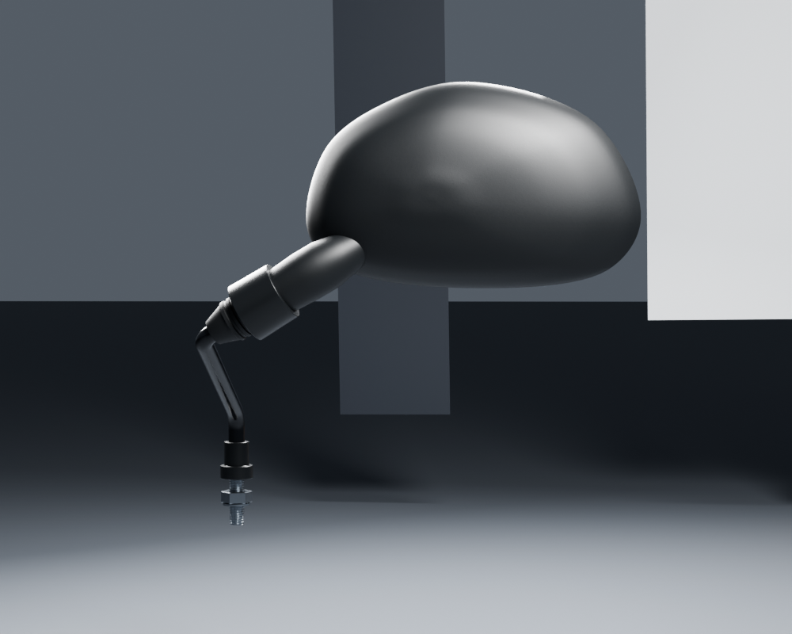
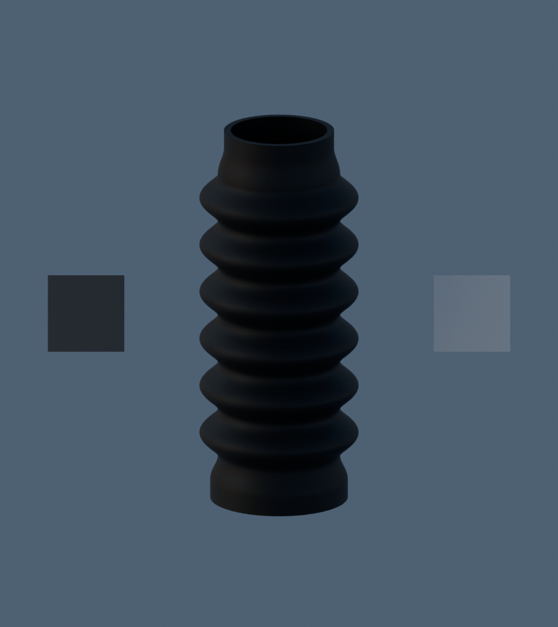

# Viva Wewa — fabrication moto, point de revue 03

Les18groupes sont en fabrication parallèle. Ce point conserve23fiches de composants candidats, avec leurs révisions : cela ne signifie pas23pièces reçues, ni18groupes terminés. La moto complète, le conducteur et l’intégration de ces nouveaux composants au jeu restent à faire.

## Rendus réels à examiner

Rétroviseur gauche, vue arrière — Blender96échantillons :

Poignée gauche corrigée — Blender96échantillons :

Commodo gauche : pictogrammes repris, sans modifier les dix nœuds protégés — Blender96échantillons :

Soufflet de fourche, matériau inchangé sous un HDR extérieur commun — **aperçu diagnostic16échantillons**, avec mires diffuse18%/80% :

Les [quatre vues studio96 du soufflet](fork-bellows-v1/README.md) et ses [cinq états de déformation vérifiés dans Babylon](fork-bellows-v1/browser-morph-parity.json) restent consultables séparément. Le studio produit de grands reflets argentés ; le test HDR conserve le caoutchouc noir, sans changer albédo ni spéculaire. Ce diagnostic ne mesure pas la réflectance réelle.

[Galerie locale complète, à ouvrir depuis le dépôt](motorcycle18-gallery/index.html) · [tableau de fabrication](../workflow/motorcycle-execution-18.json) · [sources et limites](../library/component-production.json)

## État des18groupes

|Lot|Construit / suite|
|---|---|
|1 Pontets et fixations|Pontets, berceaux, goujons et vis en revue ; écrou Nyloc en fabrication. Rondelles supérieures/inférieures et deux types d’amortisseurs de montage restent distincts.|
|2 Support compteurs|Support v2 construit et inspecté ; montage et réception visuelle restent ouverts.|
|3 Accélérateur|Manchon, bobine, guide et poignées v3 construits ; départ du câble suivi au lot10.|
|4 Commodo gauche|Coques et commandes construites ; pictogrammes lissés en v3, deux vues96 et quatre mouvements contrôlés.|
|5 Commodo droit|Coque et commande rouge observée construites ; fonction et inventaire exact RDC non résolus.|
|6 Embrayage|Levier, support, pivot et réglage v2 construits ; vis/écrous de bridage et câble restent suivis.|
|7 Frein au guidon|Ensemble à câble v2 construit ; fixations de bridage et câble à compléter.|
|8 Rétroviseurs|Gauche construit, trois vues96, deux réglages inspectés ; droit à fabriquer.|
|9 Contacteur|Corps, rotor et clé construits, deux vues96 ; petit anneau et connecteur à compléter.|
|10 Gaines/faisceau|Trois tronçons visibles construits, deux vues96 ; départs cockpit, faisceaux des commodos et connecteur restent à faire.|
|11 Visière|Documentation disponible, fabrication restante.|
|12 Éclairage avant|Documentation disponible, fabrication restante.|
|13 Fourche/direction|Tés supérieur/inférieur, tube intérieur et soufflet construits ; fourreaux, colonne et interfaces à compléter. Nouvelle face documentaire gauche retrouvée.|
|14 Ensemble avant|Candidats antérieurs pneu/jante/frein existants ; nouvelle revue, entraînement du compteur, axe, entretoises et compatibilité à traiter.|
|15 Garde-boue/cadre/bras|Décomposition documentaire faite ; fabrication restante.|
|16 Ensemble arrière|Décomposition documentaire faite ; fabrication restante, y compris transmission et doubles ressorts.|
|17 Moteur/échappement/commandes|Carters droit/gauche, bouchon filtre et cache de sortie construits ; vues finales en file pour certains. Kick en fabrication. Carter droit et bouchon ont une reprise de finition prévue. Cylindre/culasse, échappement, repose-pieds, pédales et béquilles restent à faire.|
|18 Carrosserie et arrière|Références classées ; réservoir WEWA, caches, selle, porte-bagages, garde-boue et éclairage arrière restent à fabriquer.|

Les dimensions locales non publiées, la variante exacte de plusieurs pièces et les poses d’assemblage restent estimées. Les dimensions globales documentées ne certifient pas chaque détail. Les masters détaillés ne sont pas encore des LOD mobiles qualifiés ; aucun test sur iPhone physique n’a été réalisé.

## Reprises conservées ouvertement

Le [contrôle indépendant du carter droit](../research/engine-rh-independent-visual-audit.README.md) relève des interruptions locales du chant arrière et une finition irrégulière des oreilles. Le bouchon présente aussi des reflets de bord à examiner. Les sources v1 restent préservées ; les corrections seront des révisions séparées. Les contrôles de fichiers et de mouvements ne valident pas leur réalisme.

Le jeu public reste à sa version antérieure. Ce point présente des composants réellement fabriqués et leurs limites, pas un nouveau rendu du jeu.
