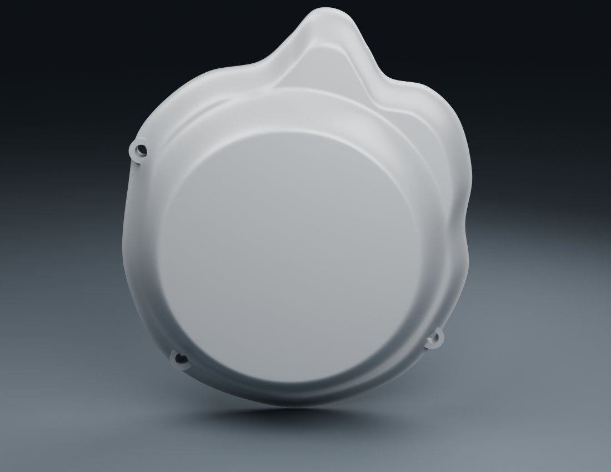
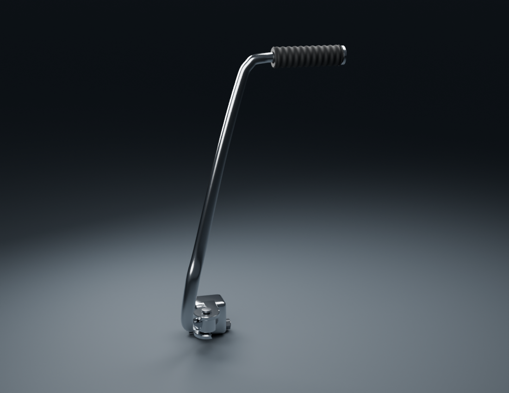
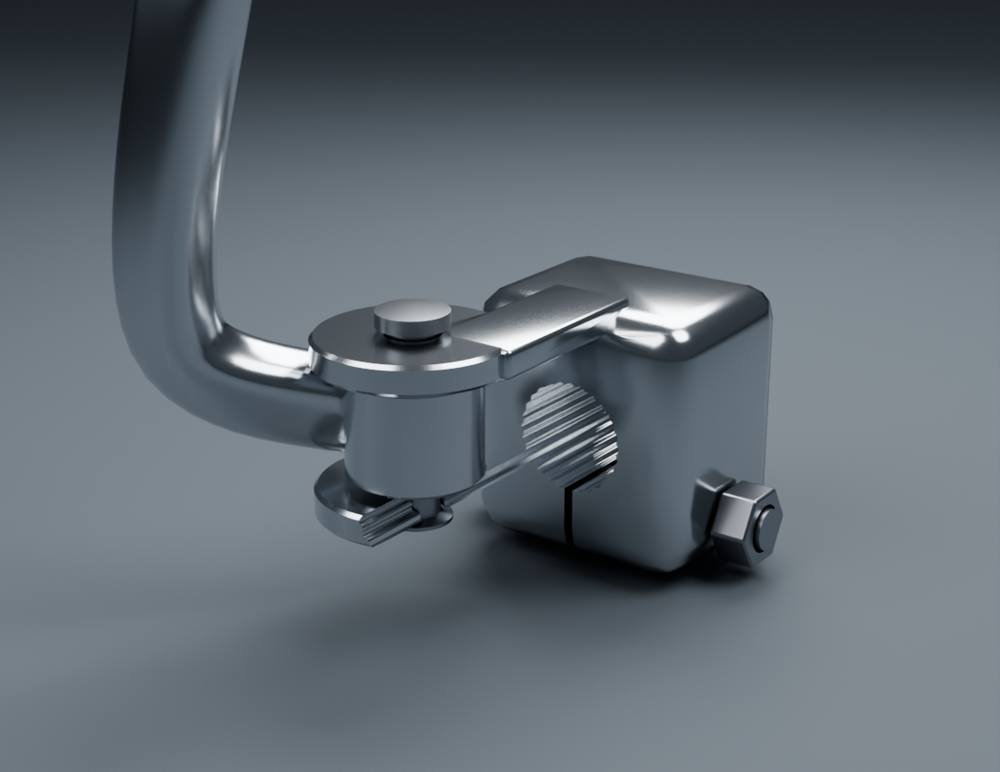

# Viva Wewa — fabrication moto, point de revue 04

Sources détaillées et rendus isolés pour examen ; aucun groupe ni véhicule complet réceptionné.

Instantané documentaire du 21 octobre 2026 : **26 composants uniques enregistrés**, 26 sources courantes retrouvées et 26 vues Blender prouvées dans la revue par composant. Ce nombre décrit les fiches uniques de cet instantané. Les révisions historiques et les candidats seulement gelés ne sont pas additionnés.

Les rendus ci-dessous montrent des candidats isolés, pas le jeu ni une moto terminée. Dimensions locales/variantes et interfaces restent estimées ou non confirmées. Aucun LOD mobile qualifié, essai iPhone physique ou accord artistique n’est acquis.

[Voir les images de tous les composants courants sur GitHub](motorcycle18-components.md) · [Registre courant](../library/component-production.json) · [Plan des 18 groupes](../workflow/motorcycle-execution-18.json) · [Point 03 conservé en historique](motorcycle18-checkpoint-03.md)

## Images réellement disponibles

### Carter droit v2 — correction des normales

La v2 enregistrée remplace la v1 dans la revue courante. Deux vues finales prouvées existent ; la mention ancienne « à produire » dans le README ne décrit plus la file de rendu. Cette correction de données de normales ne réceptionne ni la silhouette ni les profondeurs estimées.

Révision `engine-cover-right-v2` · [image entière](engine-cover-right-v2/outer-bosses.png) · [preuve source/PNG](engine-cover-right-v2/render-report.json) · [revue et limites](engine-cover-right-v2/README.md)
PNG SHA-256 : `f6607df8afacbc045e49e219d10a5e52ac296f16ffe88c817a66f9a48e675abc`.

### Carter gauche v1 — reprise locale restante

Petits plats/pincements et ruptures de reflet aux oreilles/lèvres de perçages ; grand bossage globalement continu. La peau autour des appuis est reprise ; seule la v1 enregistrée est montrée ici. Les essais intermédiaires refusés ne sont pas présentés comme des sources reçues.

Révision `engine-cover-left-v1` · [image entière](engine-cover-left-v1/outer-forward-boss.png) · [preuve source/PNG](engine-cover-left-v1/render-report.json) · [revue et limites](engine-cover-left-v1/README.md)
PNG SHA-256 : `42d8a937047a3be5ab59f700f526d28e88672a16188a5b41e041c91bd55bb4c1`.

### Cache de sortie gauche — candidat enregistré

Les trois vues source sont disponibles. La coque, sa matière et ses raccords restent des candidats estimés ; aucune certification de l’intérieur ou des interfaces.

Révision `engine-output-cover-left-v1` · [image entière](engine-output-cover-left-v1/outer-reference-direction.png) · [preuve source/PNG](engine-output-cover-left-v1/render-report.json) · [revue et limites](engine-output-cover-left-v1/README.md)
PNG SHA-256 : `7d2bbcfd275e90e4a496507c1e3c625e7c38bd23db85727a8241e9a0fb1ff32d`.

### Bouchon de filtre v2 — raccords arrondis

Trois vues Blender finales relues : face, revers et détail du raccord d’oreille. Les sections arrondies remplacent les ruptures de pente du v1. Les dimensions et rayons restent estimés, sans réception artistique.

[Source et limites](../../assets-src/moto-components/engine-filter-cap/README_v2.md) · [preuves du rendu](engine-filter-cap-v2/render-report.json).

### Kick v1 — candidat à reprendre

Source enregistrée avec quatre vues Blender et captures techniques distinctes. La course reste conditionnelle au déploiement ; la présence de ces contrôles ne reçoit pas le réalisme de la pièce.

Révision `kickstarter-v1` · [image entière](kickstarter-v1/folded-outer-quarter.png) · [preuve source/PNG](kickstarter-v1/render-report.json) · [revue et limites](kickstarter-v1/README.md)
PNG SHA-256 : `ce5cc4427c16d85ce27c52441e3c9d3a8d58933769fd81d638330329739cc6e5`.

### Kick v1 — macro du défaut à corriger

L’audit indépendant signale une fuite locale du cutter cannelé sur les oreilles/ponts de charnière, non documentée par les photographies. Une correction v2 suivra le gel LH. Cette macro est un détail volontairement recadré ; elle ne représente pas la pièce entière et ne masque pas la réserve.

Révision `kickstarter-v1` · [image entière](kickstarter-v1/base-clamp-and-folding-joint.png) · [preuve source/PNG](kickstarter-v1/render-report.json) · [revue et limites](kickstarter-v1/README.md)
PNG SHA-256 : `09f20bfb43101a3f666880282c9ee0d2939e232aaaee0b49194d2605857a0d82`.

[Audit indépendant du kick](../research/kickstarter-independent-visual-audit.README.md) · [rapport et empreintes](../research/kickstarter-independent-visual-audit.json) — SHA-256 `c2c711344a1defb740dee69179ff57b306c910b453b520b99813c9e954f229f4`.

## État par lot

| Lot | Composants courants dans la séquence | Construction et travail restant |
| --- | --- | --- |
| 01 · Pontets et fixations du guidon | 1 | Pontets et fixations déjà en revue ; Nyloc v2 en contrôle/rendus, non compté tant qu’il n’est pas enregistré. Rondelles et amortisseurs de montage restent distincts. |
| 02 · Support des compteurs | 1 | Support v2 enregistré ; interface de montage et réception ouvertes. |
| 03 · Accélérateur et entraînement de câble | 2 | Manchon/bobine/guide et poignées v3 enregistrés ; câbles et compatibilité restent à vérifier. |
| 04 · Commodo gauche | 1 | Commodo gauche v3 enregistré, détails des pictogrammes disponibles ; réception artistique ouverte. |
| 05 · Commodo droit | 1 | Commodo droit enregistré ; fonction de la commande rouge et inventaire exact RDC non résolus. |
| 06 · Levier embrayage et support | 1 | Levier/support d’embrayage v2 enregistrés ; raccord câble, bridage et montage restent ouverts. |
| 07 · Levier frein au guidon et support | 1 | Frein au guidon à câble v2 enregistré ; montage et commande complète restent ouverts. |
| 08 · Rétroviseurs gauche/droit | 1 | Gauche : trois vues finales prouvées et disponibles. Miroir droit en contrôle/rendus, non enregistré ici. |
| 09 · Contacteur et clé | 1 | Contacteur/rotor/clé enregistrés ; anneau et connecteur restent distincts. |
| 10 · Câbles et faisceau visibles | 1 | Trois tronçons partiels enregistrés ; pas de faisceau complet ni de routage caché certifié. |
| 11 · Visière et entourage des compteurs | Aucun enregistré | Documentation seule ; visière et entourage restent à fabriquer. |
| 12 · Phare et clignotants avant | Aucun enregistré | Documentation seule ; phare, optique et clignotants avant restent à fabriquer. |
| 13 · Fourche et direction | 4 | Tés supérieur/inférieur, tube intérieur et soufflet enregistrés ; fourreaux, colonne et interfaces restent à compléter. Déformation du soufflet estimée, pas course constructeur. |
| 14 · Ensemble avant et compatibilité des candidats existants | Préexistants hors décompte de compatibilité | Candidats antérieurs pneu/jante/flasque/levier existants en préexistants ; nouvelle compatibilité de l’ensemble avant, axe, entraînement et entretoises restent à traiter. |
| 15 · Garde-boue, cadre et bras oscillant | Aucun enregistré | Documentation/décomposition disponibles ; garde-boue, cadre et bras oscillant restent à fabriquer. |
| 16 · Roue arrière, frein, transmission et amortisseurs | Aucun enregistré | Documentation/décomposition disponibles ; roue/frein/transmission/amortisseurs arrière restent à fabriquer. |
| 17 · Moteur extérieur, échappement, repose-pieds, pédales et béquilles | 5 | RH v2 remplace RH v1 dans les composants courants. LH v1 reste à reprendre ; filtre v2 remplace maintenant le v1, avec trois vues finales relues. Cache de sortie gauche et kick v1 enregistrés ; kick v1 à reprendre. Cylindre/culasse, échappement, repose-pieds, pédales et béquilles restent à faire. |
| 18 · Réservoir WEWA, caches latéraux, selle, porte-bagages et éclairage arrière | Aucun enregistré | Références classées ; réservoir WEWA, caches, selle, porte-bagages, garde-boue et éclairage arrière restent à fabriquer. |

Les lots 11, 12, 15, 16 et 18 restent documentaires ; le lot 14 dispose déjà de candidats antérieurs mais sa nouvelle revue de compatibilité reste à faire. Aucun lot n’est déclaré intégralement terminé.

## Candidats en préparation, hors total courant

| Candidat | État à distinguer de la version enregistrée | Vérification à actualiser avant publication |
| --- | --- | --- |
| Compteurs v2 | Contrôles/rendus en cours ; compteurs v1 restent courants. | Preuves finales, révision enregistrée, contrôle d’export et éventuelle capture technique correspondante. |
| Nyloc v2 | Trois rendus finaux conservés comme diagnostic : ondulation géométrique locale à l’amorce basse, confirmée avec et sans débruitage. V3 séparée en préparation. | Aucun écrou enregistré/reçu ; correction des frontières du profil, puis nouvelles preuves. Montage non certifié. |
| Rétroviseur droit v2 | Cache de base rapproché de l’écrou après audit photographique ; nouvelle source gelée, quatre rendus en calcul. V1 conservé comme diagnostic. | Rendus finals et enregistrement restent à faire ; dimensions, courbure et jeu estimés. |
| Carter LH corrigé | V1 enregistrée et montrée ; correction suivante en cours. | Comparaison source/PNG avant/après, réserve locale levée ou conservée et révision enregistrée. |

Ces états de file sont des informations de préparation à relire au moment de publier ; ils ne préjugent pas de la fin d’un calcul ultérieur.

## Traçabilité de ce point

Le registre et les images liées définissent cet instantané. Les sources courantes peuvent remplacer une ancienne révision sous le même identifiant ; les diagnostics et leurs preuves restent conservés. Les contrôles de géométrie, glTF, UV et mouvements dans Babylon sont séparés de la réception artistique.

Source de fabrication publiée : [`4cb74ce8db2c844fae2ab2870f06343b9be5935c`](https://github.com/Mobutoo/wewa/commit/4cb74ce8db2c844fae2ab2870f06343b9be5935c). [GitHub Actions terminé avec succès](https://github.com/Mobutoo/wewa/actions/runs/39527969568) sur ce SHA. Le [contrôle de l’arbre Git](../../WEWA_Developpement_Web/validation/motorcycle18-source04-integrity.json) a vérifié 1 066 JSON, 70 manifestes, 1 434 empreintes, 11 images de checkpoints et 1 599 liens de revue, sans erreur. Il ne juge pas le réalisme.

Le PRD Ewutelo/Directus a été relu intégralement à la révision **26**, avec les **45 exigences conservées**. Les sources binaires sont dans GitHub ; cette synchronisation Directus porte sur les métadonnées. La [version source immuable de ce point](https://github.com/Mobutoo/wewa/blob/4cb74ce8db2c844fae2ab2870f06343b9be5935c/creative/reviews/motorcycle18-checkpoint-04.md) conserve son instantané de fabrication ; les résultats de publication sont ajoutés ensuite.

Cette page ne déploie pas ces pièces dans le jeu et ne mesure pas leur coût sur iPhone. Le jeu public reste inchangé.

La suite porte sur les défauts locaux du kick et du carter gauche, la fourche, puis les pièces observables restantes des 18 groupes. Les [appuis de montage du guidon](../research/handlebar-clamps/mounting-stack-remaining-v1.README.md) et le [réservoir WEWA](../research/tank18-preparation/README.md) disposent de nouvelles recherches ; leurs parties non documentées restent ouvertes.

## Historique préservé

Le [point03](motorcycle18-checkpoint-03.md) reste inchangé : SHA-256 de sa page `604dfa9e6ac94c8b925dbcca43cd2dd02abed7ddde5c1409d71db74fa641ab0d`. Ses liens, chiffres, révisions et preuves sont historiques ; aucune image de cette préparation ne réécrit une preuve antérieure.
