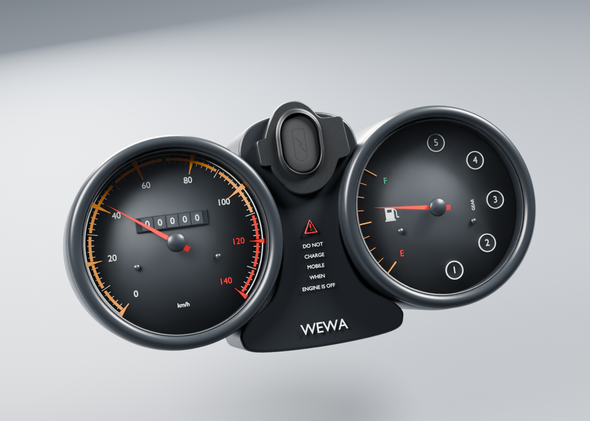

# Viva Wewa — fabrication moto, point de revue 06

**34 composants uniques enregistrés comme candidats examinables ; aucun des 18 groupes terminé ou réceptionné.** Ce point poursuit la fabrication de la moto seule, avec des sources Blender séparées, des exports 3D et de vrais rendus. Il ne livre pas encore une moto complète ou le rendu final du jeu.

[Images des 34 composants courants](motorcycle18-components.md) · [Plan des 18 lots](../workflow/motorcycle-execution-18.json) · [Point 05 conservé](motorcycle18-checkpoint-05.md)

## Compteurs — nouvelle révision du vitrage

Deux rendus détaillés à 96 échantillons relus. La séparation des normales face/tranche corrige les reflets segmentés, sans changer profils, graduations, aiguilles ou les 173 autres nœuds. Dimensions, calibration et nombre de rapports de la version RDC restent à confirmer. [Source et revue](instruments-v3/README.md).

## Carter gauche — raccords des fixations

Quatre rendus détaillés relus. La peau rejoint les appuis conservés ; le contour et les domaines troués sont contrôlés. Les dimensions, profondeurs et interfaces restent estimées. [Revue des quatre vues](engine-cover-left-v2/README.md).

## Rétroviseurs — corrections séparées gauche et droite

Chaque côté a ses deux vues détaillées relues, ses sources et ses témoins de rotation. Les filets cosmétiques suivent leurs ruptures hélicoïdales. L’intervalle fileté supérieur du gauche est conservé d’après sa propre photo ; la correction de placement du droit n’est pas transférée au gauche. Dimensions, pas, verre et réglages physiques restent estimés. [Droit](mirror-right-v3/README.md) · [Gauche](mirror-left-v2/README.md).

## Fourreau droit — source propre au côté

Quatre vues détaillées relues. La poche du gauche n’est pas recopiée sur une face non documentée du droit. Les surfaces, passages et matériaux ont leurs preuves ; leur correspondance exacte au modèle RDC et leur pose restent ouvertes. Le couple col de 48 mm/soufflet de 40,6 mm estimés n’est toujours pas apparié. [Revue](fork-outer-right-v1/README.md).

## Cadre — premières pièces isolées

La colonne a trois vues détaillées relues ; la descente avant en a quatre. Ce sont des enveloppes séparées : ni sièges de roulement, ni goujons, ni goussets, ni soudures, ni cadre complet ne sont déclarés présents. Les photographies de cadres nus PF111000 servent de référence apparentée ; cotes et faces cachées restent estimées. [Colonne](frame-head-tube-v1/README.md) · [Descente](frame-front-downmember-v1/README.md).

Le membre supérieur avant v1 est conservé comme candidat gelé non enregistré : un très léger motif diagonal du flanc est isolé sur un témoin sans carte. Une correction de normales v2 distincte est en cours, sans déformation du maillage pour absorber une différence de référence. Les chiffres seuls ne réceptionnent pas son rendu.

## Cylindre moteur — pièce seule

Quatre vues détaillées à 96 échantillons sont terminées et relues : deux quarts, face de joint et détail d’ailettes. Les passages et la séparation peinture/métal nu ont leurs contrôles ; la variante exacte RDC, les dimensions et l’inclinaison restent à confirmer. Chemise, culasse, joints et mécanismes sont absents de cette unité. Le README gelé conserve la prévision initiale ; le manifeste clôture les quatre images effectivement produites. [Source et revue](engine-cylinder-v1/README.md).

## Autres clôtures et fabrication en cours

La rondelle supérieure du guidon possède ses trois vues détaillées. Le kick v2 possède quatre vues : la fuite de cannelures sur les oreilles de charnière a disparu, la denture intérieure documentée reste présente. Une réserve de reflet au raccord bras/œil et les cotes estimées restent à revoir. [Rondelle](handlebar-mount-upper-washer-v1/README.md) · [Kick](kickstarter-v2/README.md).

La visière fumée a une source gelée et ses quatre vues détaillées viennent de se terminer ; elles figurent dans la galerie, avant son enregistrement comme composant courant. La visière reste sans ses fixations/retours cachés ; son absorption est vérifiée sur un témoin séparé, sans prétendre mesurer le matériau réel ou garantir le shader mobile. La culasse est reprise à partir de huit photos d’une variante identifiée ; les petits ports/nervures visibles doivent précéder ses longues vues. Le phare actuel est documenté séparément du premier godet voisin, retenu comme étude de variante.

## Lumière et matière — protocole d’exposition revu

Le premier preset extérieur était sous-exposé. La v2 utilise une vraie carte diffuse 18 % rendue en EXR linéaire pour référencer l’exposition, sans changer matériaux ou balance des blancs. Les trois familles [vitrage/plastique](instruments-v3-material-lighting-v2/README.md), [caoutchouc](fork-bellows-v1-material-lighting-v2/README.md) et [revêtement métallique](fork-outer-left-material-lighting-v2/README.md) sont examinées sous HDR puis soleil chaud. Ces aperçus à 12 échantillons restent distincts des images finales ; aucune calibration radiométrique ou réception artistique n’en est déduite. [Workflow réutilisable](../research/material-lighting-review-workflow-v2.md).

## Périmètre restant

Les roues, les assemblages avant/arrière, le reste du cadre, la transmission, la suspension et la carrosserie restent dans les 18 lots. A poursuit cadre/roues/transmission ; B moteur puis réservoir/selle/arrière ; C visière/phare/clignotants puis amortisseurs arrière SNS à double ressort. Maximum trois nouvelles pièces détaillées simultanées. Les trois éléments de pile guidon DS181008/9/10 restent non fabriqués faute de section exploitable, sans substitution générique.

Aucun conducteur, LOD mobile qualifié, test iPhone physique ou nouveau jeu publié dans ce point. Le [commit source a1964135](https://github.com/Mobutoo/wewa/commit/a19641353a8cbb7b42e3c4f8d02d629300f3a936) a passé [GitHub Actions](https://github.com/Mobutoo/wewa/actions/runs/39535734209). Son arbre exact a également passé les contrôles de 115 manifestes, 2 565 empreintes de fichiers, 24 PNG de checkpoints et 2 306 liens. Le [rapport](../../WEWA_Developpement_Web/validation/motorcycle18-source06-integrity.json) vise ce commit immuable, hors métadonnées ajoutées ensuite. Ewutelo a été relu à la révision31 : PRD complet identique à l’écriture et45 exigences conservées. Ces contrôles ne réceptionnent pas le réalisme.
