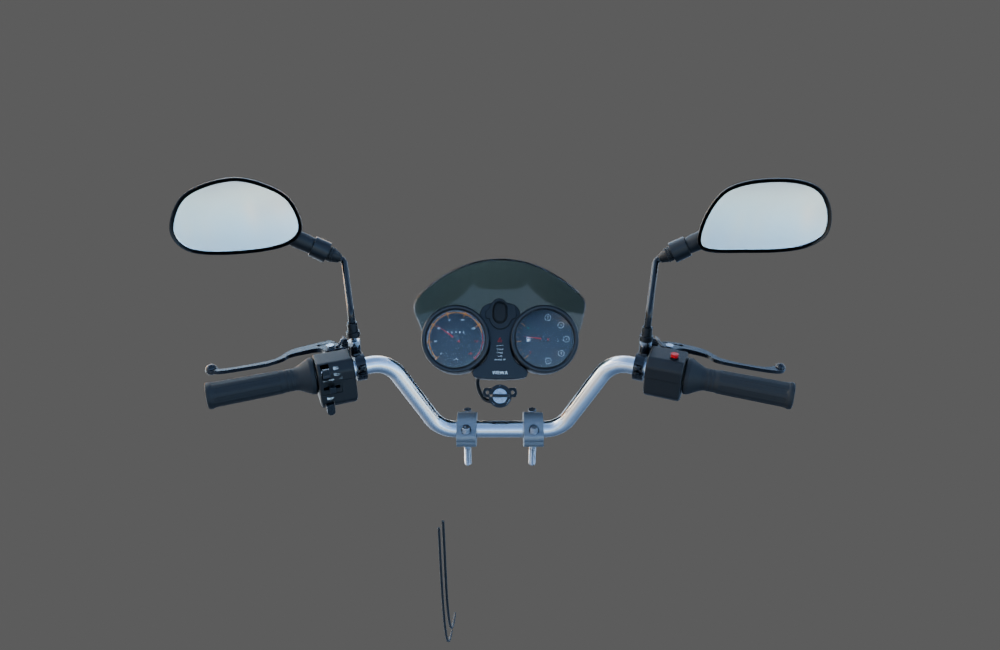
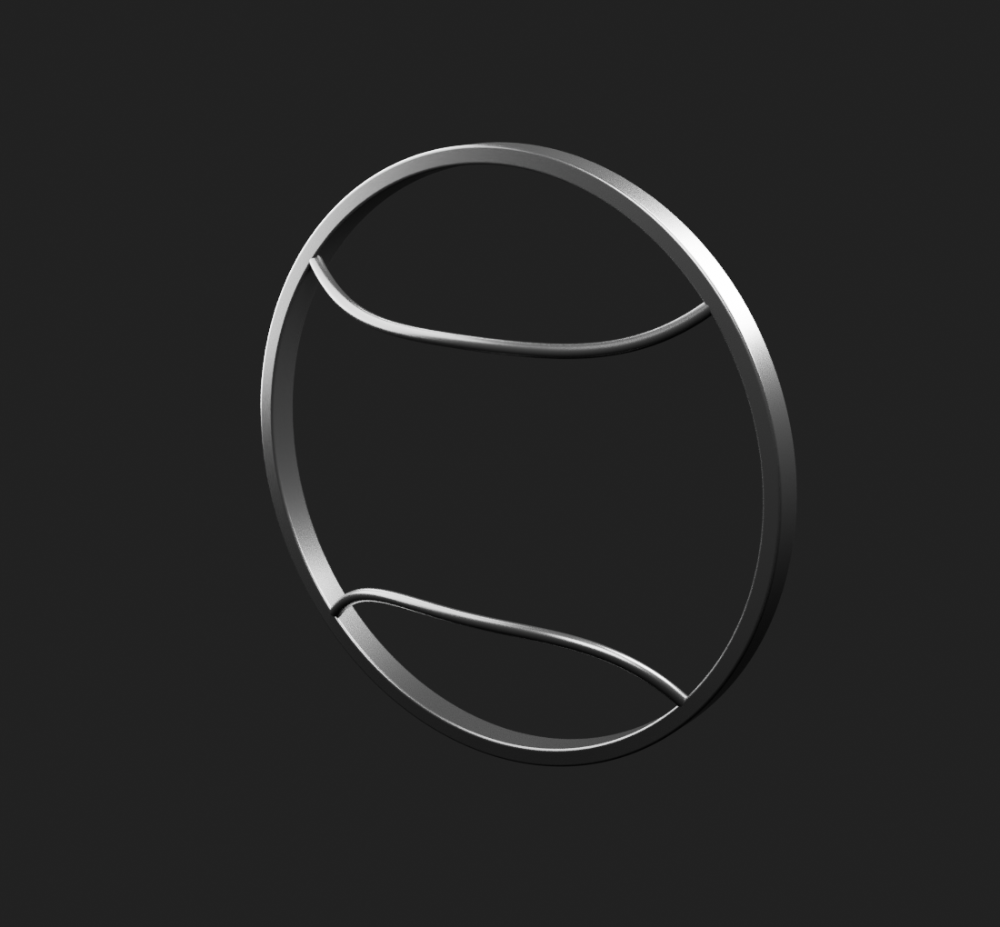

# Viva Wewa — fabrication moto, point de revue 07

**39 composants distincts enregistrés comme candidats examinables. Les18 lots continuent ; aucun lot, moto complète ou rendu de jeu n’est réceptionné.** Les cinq nouveaux enregistrements depuis le point 06 sont la visière, le membre supérieur avant corrigé, la protection avant du phare, le gousset de colonne et un longeron de berceau. Les révisions et assemblages de revue n’ajoutent pas de pièces au compte.

[Images des39 composants courants](motorcycle18-components.md) · [Plan des18 lots](../workflow/motorcycle-execution-18.json) · [Point06 conservé](motorcycle18-checkpoint-06.md)

## Poste de conduite — raccords réellement examinés

Quatorze sources actuelles sont liées sans nouveaux placements. La copie de poignée droite suit son rotor ; la copie d’aiguille reçoit un angle de démonstration. Les supports et tés isolés ne sont pas déposés à l’origine commune. Deux aperçus natifs perspectifs et trois captures du véritable export dans Babylon sont disponibles dans la [revue d’assemblage](cockpit-current-review-v1/README.md).

Le [contrôle indépendant](../research/cockpit-fit-preparation-v1/README.md) trouve une traversée du petit faisceau du contact dans le cache central des compteurs :32 paires de triangles, précisément localisées. Les176 autres tests ciblés de cette passe sont sans croisement. Les gaines basses ne relient pas encore les commandes. Une correction de la boucle est préparée en révision distincte ; ce point ne reçoit pas le montage. L’export reste un modèle détaillé d’inspection à1,45 million de triangles, sans qualification mobile.

## Visière fumée — coque seule

Quatre vues natives détaillées sont terminées. Le bord à section explicite corrige les pointes de l’ancienne étude de bevel. Fixations, trous et retours cachés restent absents ; teinte, grade, épaisseur et implantation sont estimés. Le témoin d’absorption ne certifie pas toute l’optique ou le shader mobile. [Revue](instrument-visor-v1/README.md).

## Protection avant du phare — bandeau et deux arceaux

Quatre vues détaillées, dont la jonction arceau/bandeau, sont terminées. Les normales suivent les surfaces réelles des volumes d’origine ; les anciens défauts de reflets de l’étude grise ne sont pas retrouvés. Pièce isolée non placée : dos, attaches et code exact RDC restent ouverts. Godet, réflecteur, vitre, ampoule, carénage et clignotants sont des unités séparées. [Revue](headlamp-front-protector-v2/README.md).

## Cadre — trois nouveaux candidats séparés

Le membre supérieur avant a quatre vues détaillées. La révision corrige les normales du flanc tout en conservant positions, UV, transformations et matière. [Revue](frame-front-backbone-v2/README.md).

Le gousset a trois vues détaillées et trois passages réels. Il représente une face documentée ; l’autre côté n’est pas dupliqué, le sens et la profondeur de forme restent estimés. [Revue](frame-head-gusset-v1/README.md).

Le longeron a trois vues détaillées, une paroi creuse et deux cintrages continus. Aucun rail opposé, traverse, platine ou soudure n’est compris. Leurs cotes, sections, côtés, variantes et raccords restent à résoudre ; ces trois sources ne constituent pas un cadre complet. [Revue](frame-lower-cradle-rail-v1/README.md).

## Suite de fabrication

A conserve le garde-boue comme étude grise incomplète, puis poursuit le longeron sous selle et la reprise documentée de la manchette du soufflet avant les autres éléments châssis/roues/transmission. B poursuit la culasse, puis la boucle électrique à corriger et les autres organes moteur/compléments cockpit. C poursuit le boîtier nu et les autres optiques avant, puis les amortisseurs SNS et le lot 18 complet. Le transfert du lot 18 est confirmé par B et C ; les recherches réservoir/carrosserie sont conservées et aucun modèle existant n’a été déplacé.

Les nouvelles photos de coques de garde-boue BM150 et d’amortisseurs sont apparentées ; elles ne donnent ni code ni dimensions exactes RDC. Les silentblocs/rondelles de pile guidon encore illisibles ne sont pas remplacés par des formes génériques.

Les [dépendances de génération](../research/motorcycle-source-dependencies-v1/publication-addendum-v1.md) de la visière et de la protection de phare sont jointes, avec leurs coordonnées, grilles, sources grises et scripts. Les versions Python de préparation et la triangulation trouée ont leur contrôle de capacité ; la reconstruction complète dans une copie séparée n’est pas déclarée exécutée.

Le jeu public reste inchangé, sans conducteur ajouté. Les contrôles exacts du commit et GitHub Actions seront reliés après publication ; ils restent distincts de la réception artistique et des essais iPhone physiques.
