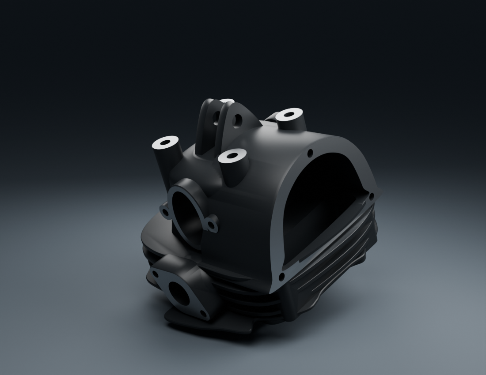

# Viva Wewa — fabrication moto, point de revue 08

**44 types distincts enregistrés comme candidats examinables. Les 18 lots restent en fabrication ; aucun lot complet ou véhicule n’est reçu.** Les cinq nouveaux types depuis le point 07 sont un longeron sous selle, le corps de culasse, le couvercle de visite, le corps du couvercle OHC et le boîtier nu de phare. Deux instances d’un même couvercle ne comptent pas pour deux types. Les révisions et assemblages de revue ne sont pas de nouvelles pièces.

[Images des composants courants](motorcycle18-components.md) · [Plan des 18 lots](../workflow/motorcycle-execution-18.json) · [Point 07 conservé](motorcycle18-checkpoint-07.md)

## Poste de conduite : correction vérifiée du petit faisceau

La petite boucle du contact ne traverse plus le cache central. Le [contrôle indépendant](../research/cockpit-fit-preparation-v2/README.md) reprend 177 tests et conserve le témoin historique de 32 paires de triangles. Les segments et points échantillonnés ne révèlent pas de conflit. Un [complément sur les véritables copies et triangles livrés](../research/cockpit-fit-preparation-v2-assembly-addendum-v1/README.md) relie ce résultat au nouvel assemblage, sans déplacer les sources.

La [revue v2](cockpit-current-review-v2/README.md) contient les deux aperçus natifs et trois vues du GLB réellement chargé dans Babylon. Les câbles supérieurs, connecteur, supports installés et braquage complet restent ouverts. La vue conserve les compteurs v3 : leurs normales arrière sont reprises en révision séparée après la découverte de facettes et de faux creux. Les anciens rendus gardent leur vraie révision.

## Corps moteur : pièces séparées et raccords négatifs conservés

Le corps de culasse dispose de quatre vues détaillées. Les trois centres d’une photo servent d’aide affine, sans calibration métrique ; le faux quatrième trou inférieur a été supprimé. Profondeurs, faces cachées, plans de joint, finition et variante RDC restent estimés. [Revue du corps](engine-head-v2/README.md) · [Deux lumières de contrôle](engine-head-v2-material-lighting-v1/README.md).

Le type de couvercle de visite a un maillage partagé et deux instances opposées. Ses trois vues incluent le dos simplifié non photographié. Le raccord à la culasse v2 présente encore 501 et 453 paires de triangles traversants. La [revue documentaire du raccord](../research/engine-head-ug5/tappet-interface-review-v1/README.md) montre une base continue et ne justifie aucune encoche de camouflage. [Revue du couvercle](engine-tappet-cap-v1/README.md).

Le corps OHC a trois vues détaillées et trois alésages dégagés. Embout métallique, vis et joint restent des unités distinctes non fabriquées. Les concentrations de reflets et le dos estimé restent réservés ; 358 paires de triangles traversent une ailette de la culasse v2. Une révision conjointe du corps de culasse est en préparation ; les pièces ne sont pas déplacées pour cacher les conflits de ce point. [Revue OHC](engine-ohc-cover-v1/README.md).

## Cadre et phare : sources séparées contrôlées

Un seul longeron creux observé est construit, avec trois vues détaillées. Portée, section et courbe 3D sont estimées ; aucun côté opposé, traverse, patte ou soudure n’est compris. [Revue](frame-seat-rail-observed-v1/README.md).

Le boîtier nu apparenté YDY02002 a été repris après que les gros plans v1 ont révélé des marches de reflets. Seules les normales des quatre nervures concernées changent ; les positions, UV et matières des triangles restent identiques. Deux nouvelles vues détaillées vérifient la correction. Clip, vis, identité et montage RDC restent ouverts. Optique, lentille, ampoule, carénage et clignotants sont séparés. [Revue v2](headlamp-housing-v2/README.md).

Le [soufflet v2](fork-bellows-v2/README.md) a ses quatre vues détaillées et une coupe des vrais triangles exportés. Les cinq états de longueur ont une parité vérifiée entre le décodage du GLB et les tableaux chargés dans Babylon. Lèvre, gorge et ponts sont réels ; dimensions, pose sur le col et élasticité restent estimées. La fabrication continue sur la jante arrière à cinq branches, la reprise des compteurs et le raccord culasse/couvercles. La [recherche arrière](../research/rear-wheel-16/README.md) confirme la taille nominale 3.00-17 tubeless et les cinq branches, sans identifier une marque ou un moule de pneu. Le lot 18 complet reste à fabriquer par la chaîne C.

Les [dépendances des nouvelles recettes](../research/motorcycle-source-dependencies-publication08-v1/README.md) sont jointes, avec les entrées complémentaires omises des premiers manifestes, qui restent intacts. Aucun pixel de photo privée n’est requis comme texture. La reconstruction complète depuis une copie propre n’est pas déclarée exécutée.

Le jeu public reste inchangé, sans conducteur ajouté. Le commit source exact est `a60a19c5cb535448bb69ee9618d79aa09d90f4fc` : le [rapport d’intégrité](../../WEWA_Developpement_Web/validation/motorcycle18-source08-integrity.json) vérifie 3 781 empreintes de fichiers et 2 922 liens, sans erreur. [GitHub Actions](https://github.com/Mobutoo/wewa/actions/runs/39543892291), y compris le contrôle des preuves moto du commit, est passé. Le PRD Ewutelo/Directus a été relu en révision 33 : égalité complète vérifiée et 45 exigences conservées. Cette synchronisation porte sur les métadonnées ; aucun dépôt de binaire Directus n’est déclaré. Le présent suivi de métadonnées est extérieur à l’arbre source contrôlé. Les contrôles techniques ne constituent pas une réception artistique ou un essai physique sur iPhone.
