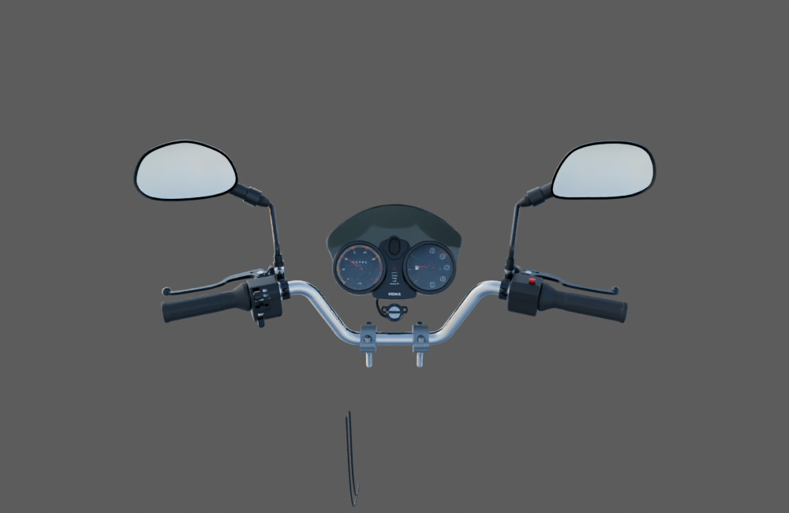
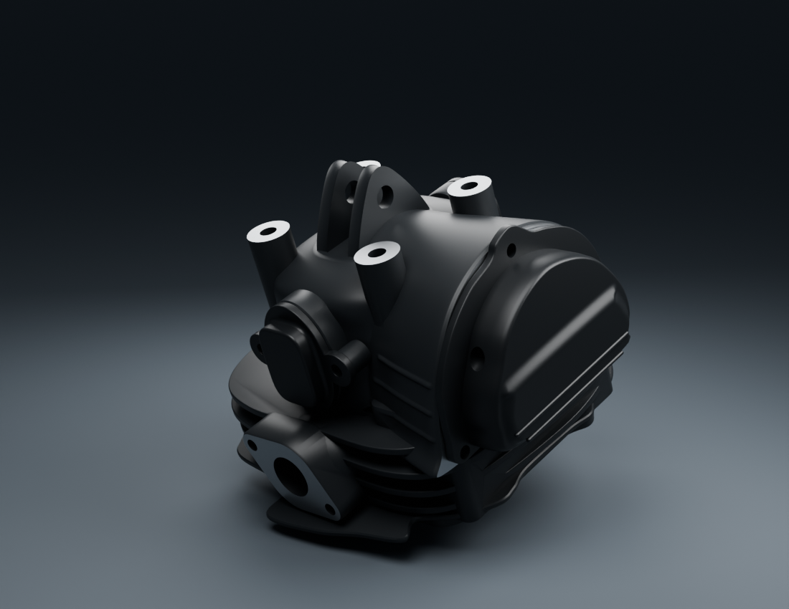
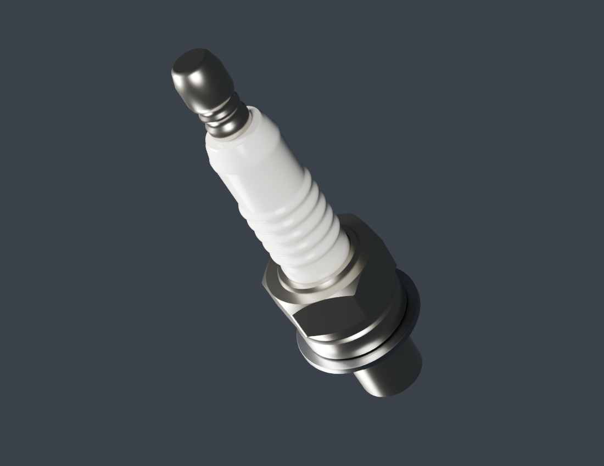
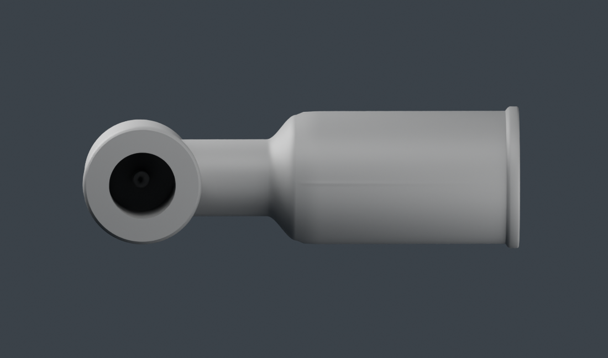

# Viva Wewa — fabrication moto, point de revue 09

**48 types distincts sont enregistrés comme candidats examinables. Les 18 lots restent en fabrication ; aucun lot complet ni véhicule n'est reçu.** Les quatre nouveaux types depuis le point 08 sont l'embout métallique OHC, le capuchon HT, la jante arrière partielle et la bougie extérieure. Les corrections de culasse et de compteurs restent des révisions de leurs types existants.

[Images des composants](motorcycle18-components.md) · [Plan des 18 lots](../workflow/motorcycle-execution-18.json) · [Pièces restant à fabriquer, nouveau pointage](../research/motorcycle18-remaining-physical-work-v2.md) · [Point 08 conservé](motorcycle18-checkpoint-08.md)

## Poste de conduite : compteurs corrigés dans les vraies copies

La [revue du guidon v3](cockpit-current-review-v3/README.md) remplace uniquement les compteurs v3 par les v5. Les treize autres bibliothèques, leurs placements et les liaisons sont identiques ; la boucle du contact reste corrigée en v2. La reprise des normales concerne le cache central et les fonds plans des deux boîtiers.

Le [contrôle indépendant](../research/cockpit-fit-preparation-v3-assembly-addendum-v1/README.md) rejoue 177 tests de paires et poses sur le véritable nouveau Blender, sans croisement détecté. Les bibliothèques chargées, les normales locales des neuf corps contrôlés et les 85 948 triangles GLB concernés sont vérifiés. Les trois captures Babylon et les deux aperçus natifs portent sur cette livraison. Le témoin historique des 32 paires est explicitement réemployé, sans être présenté comme recalculé ici. Câbles supérieurs, connecteur, fixations installées et braquage complet restent ouverts.

## Culasse : les couvercles restent à leur place

La [culasse v3](engine-head-v3/README.md) remplace l'extrusion OHC constante par des sections progressives et reprend les reliefs de flanc. Les sources et matrices des trois couvercles v1 sont inchangées. Les contrôles de surfaces ne retrouvent plus les 501, 453 et 358 paires traversantes du point 08 ; l'inclusion échantillonnée est également nulle. Les désaccords numériques sont résolus par des rayons directs consignés, sans vote majoritaire.

Ces résultats portent sur une paire de candidats au repère provisoire commun. Le minimum sommet/surface d'environ 0,400 mm est échantillonné : il ne mesure pas un jeu exact ou un joint réel. Sections, profondeurs, dessous, visserie et finition restent à qualifier. Les anciens raccords négatifs restent dans leurs preuves et dans l'historique des fiches des couvercles.

L'[embout OHC](engine-ohc-stub-v1/README.md) est un tube réellement creux avec épaulement et lèvre distale. Trois vues détaillées et quatre captures WebGL sont liées à sa source. Diamètres, insertion cachée, axe, métal et liaison de durite sont estimés ; aucun filetage ou raccord physique certifié n'est ajouté.

## Bougie : correction du chanfrein avant première inscription

La première version conserve son [gros plan de diagnostic](engine-spark-plug-v1/hex-ceramic-detail.png), avec un bord en marches. La [v2](engine-spark-plug-v2/README.md) reconstruit cette intersection dans la géométrie. Les trois autres pièces — rondelle, céramique et borne — conservent leurs vrais attributs exportés, matériaux et matrices. Les trois finales détaillées montrent la disparition du défaut observé.

Les dimensions 10 mm, clé de 16 mm et portée de 12,5 mm viennent d'une référence Champion apparentée ; la valeur vendeur de 12,7 mm reste distincte. Cela n'identifie pas la bougie RDC. L'insertion cachée reste lisse, sans électrode ni filetage fabriqué. La paire avec la culasse et le capuchon est contrôlée numériquement, sans qualification d'étanchéité ou de montage OEM.

## Arrière : première source de jante dédiée

La [jante arrière](rear-rim-v1/README.md) comprend le bord extérieur, les cinq branches observées et la paroi annulaire externe du centre. Ses quatre vues détaillées incluent deux macros ; les vrais triangles, UV, normales et tangentes restent identiques entre le gris et la matière. Les deux cartes sont originales.

Le nominal 17 pouces est documenté. Profil, largeur, centre et finition restent estimés. Le web central caché, roulements, couplage, axe et montage ne sont pas fabriqués par cette source ; il ne s'agit pas d'une roue complète. Le pneu arrière est encore en reprise : les macros ont arrêté sa première construction de sillons avant application du caoutchouc.

## Capuchon : reprise encore nécessaire

Le [capuchon v1](engine-spark-cap-v1/README.md) dispose de quatre vues détaillées et de son GLB contrôlé, mais **sa forme et sa finition restent à reprendre**. La [comparaison de deux profils](../research/engine-spark-cap/profile-comparison-v1/README.md) rend visible une transition en S trop arrondie par rapport aux portions plus droites/coniques des photos. Le substrat constant manque aussi du grain observé. Une révision séparée conserve les douilles, contact, cavités et datum ; elle ne remplace pas les preuves v1 de ce point.

Les [dépendances courantes](../research/motorcycle-source-dependencies-publication09-v1/README.md), leur [complément capuchon/jante](../research/motorcycle-source-dependencies-publication09-supplement-v1/README.md) et la [recette de bougie v2](../research/motorcycle-source-dependencies-publication09-spark2-v1/README.md) sont joints. Les maîtres gris originaux de jante omis du premier gel ont été conservés par copies binaires vérifiées. Aucun pixel photographique n'est utilisé comme texture ; aucune reconstruction complète depuis une copie propre n'est déclarée exécutée.

La fabrication continue sur le pneu, le carénage de phare et le capuchon. Après la coque de phare, la chaîne C passe au réservoir WEWA puis à la selle avant de reprendre les autres unités d'éclairage et les amortisseurs. Admission, échappement, commandes basses et bras oscillant disposent de recherches complémentaires ; leurs dossiers ne sont pas des modèles supplémentaires.

Le jeu public reste inchangé, sans conducteur ajouté. Les contrôles exacts du commit source, GitHub Actions et la relecture Ewutelo/Directus seront reliés après publication. Les vérifications techniques ne valent ni réception artistique, ni qualification physique sur iPhone.

## Publication vérifiée

Source immuable : [`1f525090`](https://github.com/Mobutoo/wewa/tree/1f525090cd0dbe9a795696a54c30ae9b0b5fd812). Son arbre `cb65a0ea8ec474975a344b0724efae8e7e9ee9ed` correspond exactement à celui contrôlé : 2 105 JSON,186 manifestes,4 641 empreintes de fichiers,36 empreintes PNG de checkpoints,3 265 liens de revue et65 entrées du catalogue, sans erreur. [GitHub Actions](https://github.com/Mobutoo/wewa/actions/runs/39549402837) a réussi sur ce commit exact, y compris l’étape de vérification des preuves de fabrication.

Ewutelo/Directus : PRD enregistré puis relu en révision34, égalité du contenu complet vérifiée et45 exigences préservées. Le [rapport de source09](../../WEWA_Developpement_Web/validation/motorcycle18-source09-integrity.json), ce pied de revue et les métadonnées de synchronisation sont postérieurs à l’arbre source revendiqué. Directus reçoit le suivi structuré ; aucun téléversement binaire n’est déclaré. Les travaux locaux suivants restent distincts des48 types de ce point.
