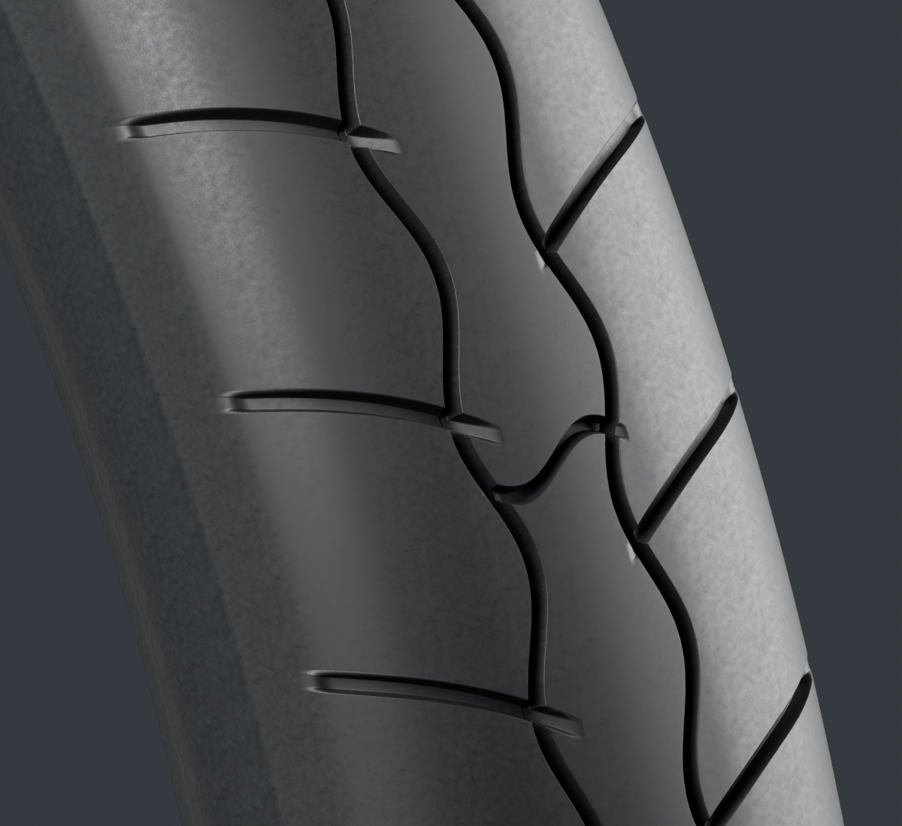

# Viva Wewa — fabrication moto, point de revue 10

**La fabrication des dix-huit lots continue.** Ce point réunit le pneu arrière v1, le capuchon HT corrigé et une scène liée du haut moteur. Le registre courant contient 49 types de candidats ; le capuchon v2 est une révision de son type existant. Aucun lot complet ni véhicule n'est reçu.

[Images des composants](motorcycle18-components.md) · [Galerie](motorcycle18-gallery/index.html) · [Plan des dix-huit lots](../workflow/motorcycle-execution-18.json) · [Point 09 conservé](motorcycle18-checkpoint-09.md)

## Haut moteur : les pièces courantes réunies

La [scène de revue](upper-engine-current-review-v1/README.md) lie sept bibliothèques : cylindre1, culasse3, couvercles de visite1, corps OHC1, embout1, bougie2 et capuchon2. Les copies conservent leurs repères provisoires et leurs attributs ; aucune pièce source n'est déplacée ou modifiée.

Les quatre aperçus Blender, deux angles sous deux lumières, servent à lire l'ensemble. Ils restent des aperçus à 12 échantillons ; chaque composant conserve ses propres finales détaillées. L'[audit indépendant](../research/upper-engine-current-review-v1-audit/README.md) vérifie douze copies physiques et les triangles orientés du vrai GLB. Les 587 164 triangles uniques deviennent 657 316 triangles dessinés avec la seconde instance du couvercle de visite. Les contacts existants sont réutilisés avec leurs limites, sans prétendre à un nouveau contrôle exhaustif de tous les jeux.

Trois captures Babylon vérifient le chargement du GLB livré et ses pixels. Elles ne démontrent pas une parité optique avec les rendus Blender. Fixations, joints, fil HT, admission, échappement et raccord avec le reste du moteur restent distincts. La finition noire, les sections et les interfaces ne sont pas des mesures OEM ni une réception artistique.

## Capuchon HT : épaulement et matière repris

Le [capuchon v2](engine-spark-cap-v2/README.md) remplace la transition en S par des portions coniques et de petits raccords bornés. Deux [profils gris intermédiaires](../research/engine-spark-cap/profile-comparison-v2/README.md) sont conservés séparément des cinq finales de matière. Les caméras de comparaison sont estimées ; elles ne donnent pas des angles ou rayons mesurés.

La matière emploie deux cartes originales cuites dans Blender. Le grain est lisible dans les macros et plus discret dans la vue entière. Les vrais buffers, UV, textures embarquées et quatre cadrages Babylon sont contrôlés. Onze paires ciblées avec bougie2/culasse3 n'ont pas montré de croisement ou inclusion échantillonnée ; cela ne certifie ni une connexion électrique, ni un joint, ni la monte RDC.

Les [deux compagnons de portabilité](../../assets-src/moto-components/engine-spark-cap/portable-source-v2/README.md) corrigent les liens de contexte dans des copies additives. L'[audit](../research/engine-spark-cap-portability-v2/README.md) ouvre réellement treize fichiers Blender dans un autre arbre et vérifie dix-huit liens sans recours au checkout original. Les composants, matières et transformations restent identiques. Le maître `bceb87f8…` des rendus et le GLB `2a924e6e…` restent inchangés ; aucun nouveau rendu ou export n'est attribué aux compagnons.

## Pneu arrière : candidat détaillé, raccords à reprendre

Le [pneu arrière v1](rear-tyre-v1/README.md) possède quatre finales détaillées, ses maîtres gris et ses cartes originales. Le nominal 3.00-17 TL est documenté ; largeur, diamètre extérieur, profil de tringle et moule restent estimés ou inconnus. Il s'agit d'une source d'inspection détaillée, sans LOD mobile, essai sous charge ou monte reçue sur jante.

**Le passage de forme reste à reprendre.** Les intersections entre sillons de profondeurs progressives différentes produisent des paliers et des pointes géométriques, confirmés par leur auteur. Les contrôles de fermeture, triangles, UV et quatre captures Babylon passent ; ils ne suppriment pas cette réserve visuelle. Le gel1 reste intact. Une révision séparée est prévue après le corps de bras actif, sur ces seuls raccords, en conservant diamètre, largeur et tringles.

L'[audit des recettes](../research/motorcycle-source-dependencies-publication10-tyre-cap2-v1/README.md) distingue géométrie propre, cartes originales et guides de contexte. Aucun maître nécessaire seulement privé n'a été trouvé. Les ancêtres, les erreurs diagnostiques et les limites de portabilité sont conservés ; aucune reconstruction complète de géométrie et matière depuis un clone propre n'est déclarée.

Les travaux actifs suivants restent le corps du bras oscillant, le collecteur métallique d’admission et les supports/retours observés du carénage de phare. L’isolant d’admission est gelé mais sa série de rendus détaillés reste hors de ce point. Réservoir WEWA et selle suivent le carénage. Le conducteur attend la moto ; le jeu public et la qualification physique iPhone restent inchangés. Les preuves de publication exacte et de synchronisation seront ajoutées après le gel de ce point.
