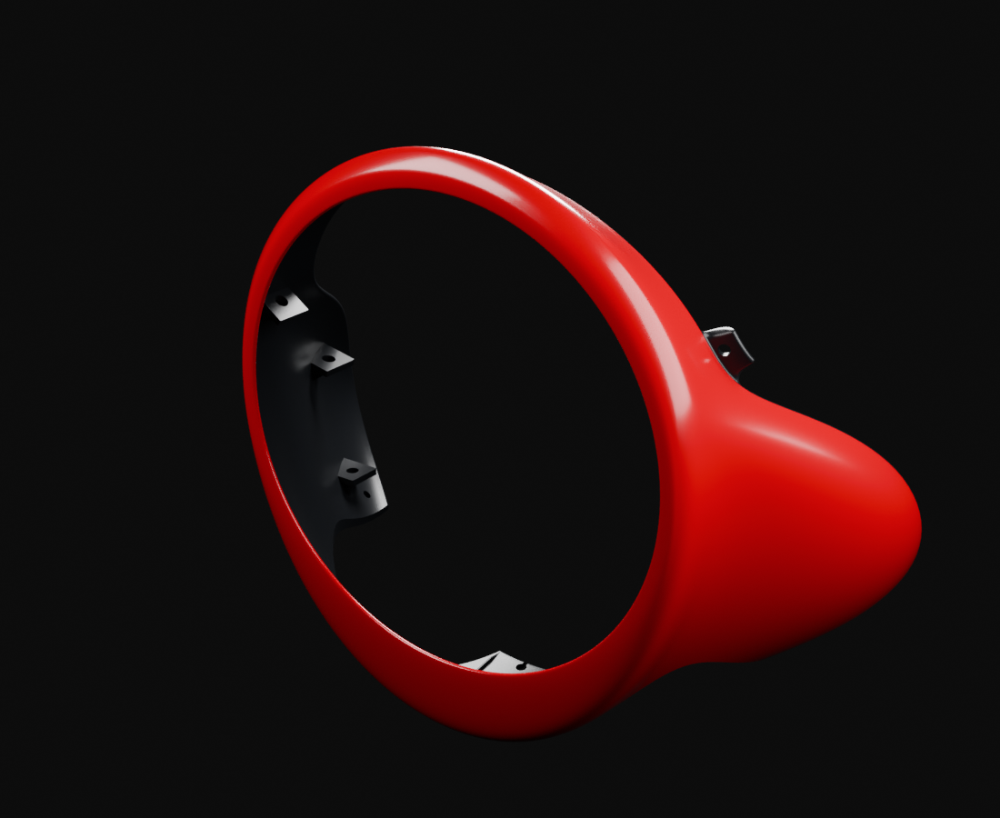
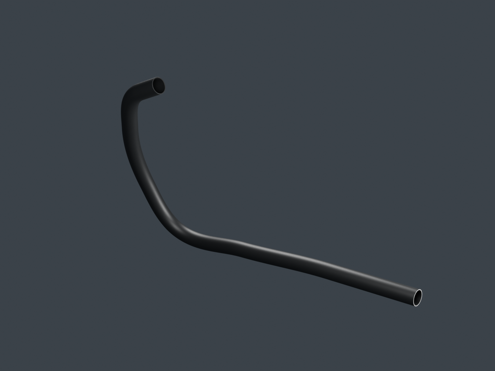
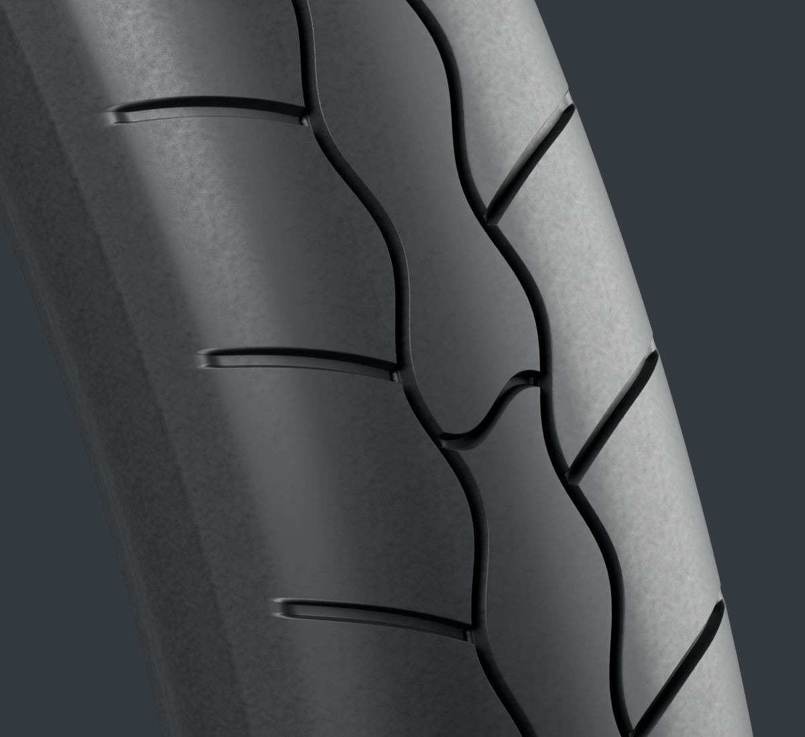

# Viva Wewa — fabrication moto, point de revue 12

La fabrication des dix-huit lots se poursuit, pièce par pièce. Cette revue présente la coiffe de phare, le tube avant d’échappement et la correction locale du pneu arrière. Le registre de cette coupe contient54ID candidats,62fiches déclarées et74choix de catalogue, auxquels s’ajoutent quatre révisions historiques de galerie. Les candidats restent à relire ; aucun lot n’est déclaré reçu ou terminé.

[Images courantes](motorcycle18-components.md) · [Galerie](motorcycle18-gallery/index.html) · [Plan18](../workflow/motorcycle-execution-18.json) · [Point11 conservé](motorcycle18-checkpoint-11.md)

## Coiffe de phare isolée

La [coiffe](headlamp-cowl-v1/README.md) conserve la couronne arrondie, les retours extérieurs, six supports perforés, deux ajours de paroi et sept nervures partielles observées. Les quatre vues Blender96, les quatre photos apparentées et les vrais cadrages Babylon sont réellement relus. Le maître gris14 et les deux matières originales rouge/noir restent séparément traçables ; aucun pixel de photo ne devient une texture.

Les caméras documentaires sont conditionnelles. Les profondeurs des supports, épaisseurs et correspondances entre vues ne sont pas mesurées ; le code RDC et la pose installée restent ouverts. Les plages blanches sur certains supports sont de vrais reflets du studio sur la matière sombre, sans surimpression grise. Leur présence ne constitue pas une réception du rendu. Le GLB416326triangles passe ses contrôles de buffers et ses quatre cadrages réels ; ses deux partitions de matière ne sont pas deux pièces physiques.

## Tube avant d’échappement, séparé du silencieux

Le [tube](exhaust-header-v1/README.md) possède deux bouches réellement ouvertes, une paroi finie et une trajectoire continue. Deux cartes originales de couleur et rugosité conservent la géométrie et les normales de la source grise. Quatre finales96 et quatre canvas Babylon sont associés à l’export118272triangles.

Les photos exactes du marché montrent plusieurs fragments de trajet, mais masquent une partie de la ligne basse. Son ondulation reste une hypothèse de construction ; aucune photo ne justifie un redressement métrique. Diamètres, courbures, épaisseur, marche avec la culasse et jeux sont estimés. Les contrôles ciblés contre les trois guides moteur ne montrent pas de traversée ou d’inclusion testée. Ils ne valident pas le montage réel. Bride, joint, supports et silencieux restent des unités séparées ; une frontière de fabrication ne devient pas un raccord démontable OEM.

## Pneu arrière : correction d’un défaut identifié

La [révision2](rear-tyre-v2/README.md) reprend le même type physique. Les incisions s’arrêtent désormais dans la gorge existante ; leurs anciennes pointes sur la couronne opposée ont disparu dans la comparaison grise au même cadrage. Le masque de terminaison a été étendu localement, puis le maillage raffiné. Les nouveaux sommets et indices sont déclarés : aucune identité des indices avec v1 n’est inventée. Enveloppe, flancs et talons conservent leurs protections documentées ; la matière et les pixels v1 sont repris sans changement.

La géométrie détaillée compte2182888triangles et reste une source d’inspection. Le nominal3.00-17TL est documenté ; diamètre598mm, largeur86mm, profil et moule sont estimés. La déformation en charge, la pression, la jante installée et le LOD mobile ne sont pas qualifiés. La [comparaison ciblée](rear-tyre-v2/geometry-coordinator-reading.json) conserve également les premiers essais refusés dans leur contexte, sans les présenter comme des finales.

## Recettes et travaux suivants

L’[admission documentaire](../research/motorcycle-source-dependencies-publication12-v1/README.md) distingue les entrées stables, les maîtres éditables fournis et les preuves finales. Pour la coiffe, le redémarrage depuis le vrai maître gris14 est documenté ; la reconstruction de tout son historique13→12→… n’est pas déclarée exécutée ou entièrement publiée. Les photos documentaires restent privées.

La fabrication continue sur la bague de pivot, le corps et les extrémités du silencieux, le réservoir puis la selle et les unités restantes du plan18. Ces travaux en cours ne sont pas présentés comme des pièces déjà livrées dans cette revue. Le conducteur attend la réception de la moto ; le jeu public et sa qualification physique iPhone restent inchangés.

Les [petites preuves documentaires héritées](../research/motorcycle-source12-inherited-doc-readback-v1/README.md) sont ajoutées sans aspirer les anciens essais 3D. Une version antérieure de plan de support demeure introuvable ; son ancienne empreinte est conservée comme limite historique, sans attribuer ses octets au plan disponible. La reprise depuis le maître gris14 n’en dépend pas.
