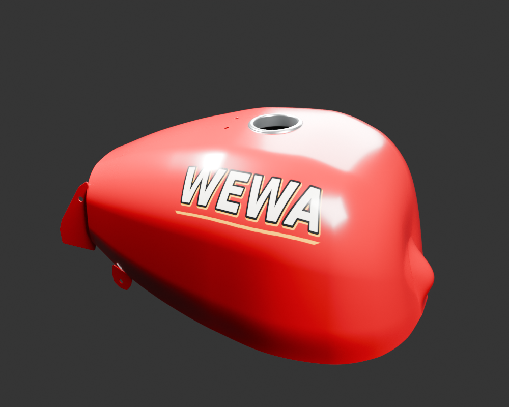
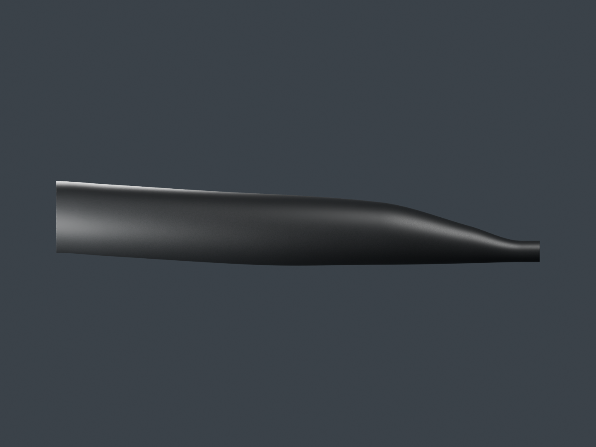
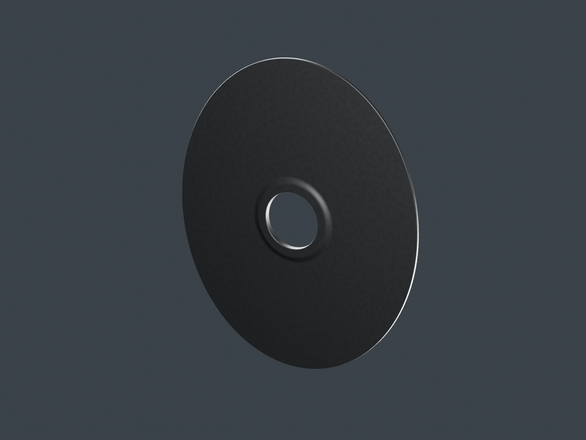
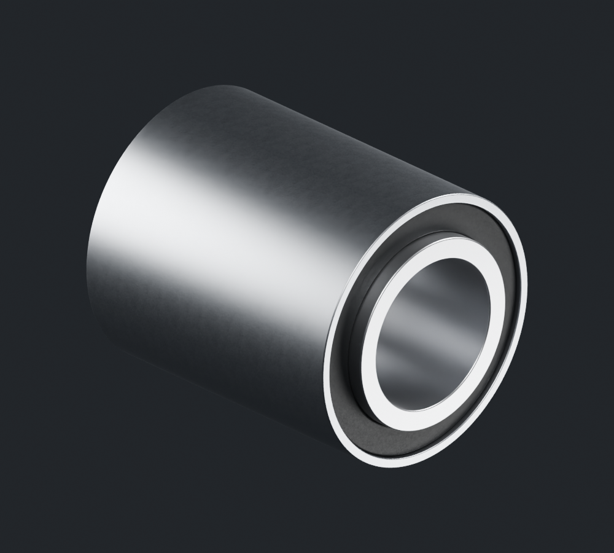
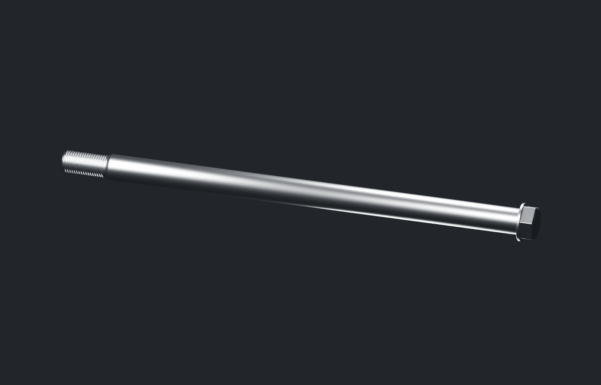

# Viva Wewa — fabrication moto, point de revue 13

Cinq nouvelles pièces isolées rejoignent la revue : corps du silencieux, fermeture arrière, bague et axe de pivot, coque extérieure du réservoir WEWA. Le registre contient désormais 59 identités physiques candidates. Les dix-huit groupes restent en fabrication ; aucun n’est déclaré terminé ou reçu artistiquement.

[Une image par composant](motorcycle18-components.md) · [Galerie détaillée](motorcycle18-gallery/index.html) · [Plan des 18 groupes](../workflow/motorcycle-execution-18.json) · [Point précédent conservé](motorcycle18-checkpoint-12.md)

## Réservoir WEWA : coque et attaches visibles

La [coque](fuel-tank-shell-v1/README.md) comprend la peau supérieure et latérale, la bouche, deux petits ajours, un retour avant et les deux appendices observés. La bride arrière a été corrigée après rejet de sa première orientation. Le graphisme blanc et or WEWA est original et lisible des deux côtés ; la police et sa notice sont fournies avec les sources.

Les quatre finales Blender et la comparaison sous ciel HDR ont été réellement ouvertes. Le dessus reste rose et les reflets studio très larges : cette finition est encore à revoir. Le GLB de 198 768 triangles conserve exactement les triangles orientés, normales et UV du maître gris 6. Cela ne constitue pas une mesure de fidélité photographique.

Le dessous reste ouvert : aucun fond, tunnel, bouchon ou volume de carburant fermé n’est inventé. Les contacts des appendices avec la coque restent estimés ; les traversées localisées relevées sont déclarées dans la [revue de coordination](fuel-tank-shell-v1/coordinator-review.json), sans réception du montage. Les photos rouge et noire représentent des exemplaires différents, sans calibration commune.

## Corps et fermeture arrière du silencieux

Le [corps](exhaust-silencer-body-v1/README.md) est une paroi creuse séparée. Son grand passage arrière de construction reçoit une [fermeture distincte](exhaust-silencer-end-v1/README.md), dont le petit orifice, la lèvre et la paroi sont explicitement modélisés.

Chaque pièce possède quatre finales Blender 96 échantillons et quatre cadrages Babylon effectivement calculés. Les cartes originales de couleur et rugosité conservent la géométrie grise. Le corps compte 135 680 triangles ; la fermeture 38 784. Les sections, l’épaisseur et les raccords restent estimés. Aucun tube interne, catalyseur ou système de chicanes caché n’est ajouté. Le pare-chaleur et ses fixations sont des unités suivantes, hors de cette publication.

## Bague et axe de pivot séparés

La [bague](swingarm-pivot-bush-v1/README.md) contient trois volumes pour une seule unité physique : enveloppe, anneau sombre et douille traversante. Les photos de la référence apparentée DP171006 ne donnent pas les dimensions de cette variante. Les trois finales, les cartes originales et le vrai chargement navigateur sont contrôlés ; la dureté, le collage et les ajustements ne sont pas certifiés.

L’[axe](swingarm-pivot-shaft-v1/README.md) conserve une géométrie continue de tête, collerette, tige et filet réduit. Les trois cotes fournisseur apparentées sont distinguées des estimations de tête, pas et longueur filetée. Les quatre finales ont été relues, y compris la tête et le filet. Un contrôle numérique de normales initialement refusé est expliqué par une reproduction exacte de l’encodage Float32, sans modification de source pour forcer le résultat.

Aucune de ces deux pièces n’est placée par supposition dans le bras oscillant. La présence de trois volumes de bague, de partitions de matière ou de multiples cadrages ne gonfle pas le nombre de pièces physiques.

## Sources et suite de fabrication

Les [entrées stables du silencieux et de la bague](../research/motorcycle-source-dependencies-publication13-v1/README.md) et l’[addendum axe/réservoir](../research/motorcycle-source-dependencies-publication13-axis-tank-addendum-v1/README.md) distinguent les recettes, leurs maîtres éditables et les preuves historiques. La clôture des manifestes du réservoir impose de fournir les états historiques nommés, dont certains ont été refusés ; ils gardent ce statut. Le checkpoint numérique privé exigé par le rendu possède une copie publique identique, avec consigne de restauration. Aucune reconstruction complète depuis zéro n’est déclarée exécutée par cet audit statique.

La suite porte sur les deux demi-carters de chaîne, les éléments de selle, le pare-chaleur et les fixations, puis les autres pièces de chaque groupe. Les défauts repérés dans les gris doivent être repris dans la source avant la matière. Les photos documentaires restent attribuées et privées ; les images de cette revue sont de vrais rendus des modèles fournis.

Les contrôles de fichiers et de navigateur ne remplacent ni la réception artistique, ni le contrôle des interfaces mesurées, ni les LOD et essais physiques sur iPhone 15/16. Le jeu public reste à sa version précédente ; le conducteur attend la réception de la moto.
