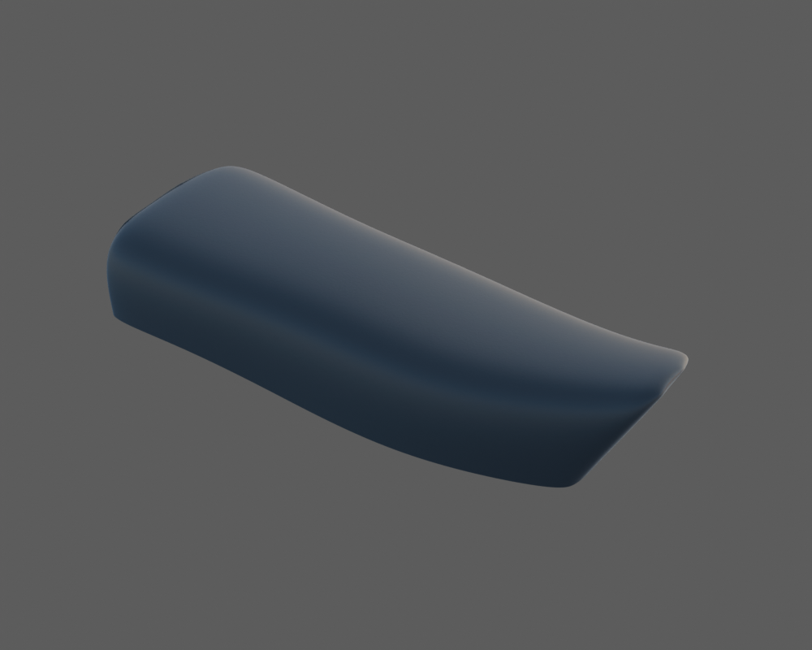
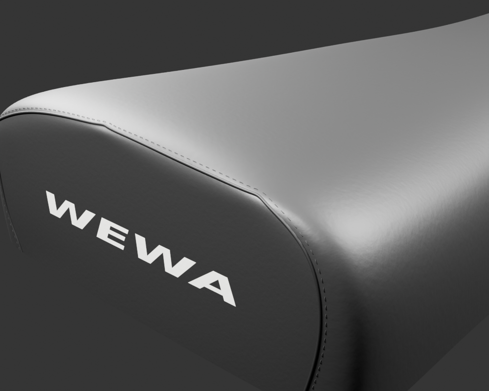
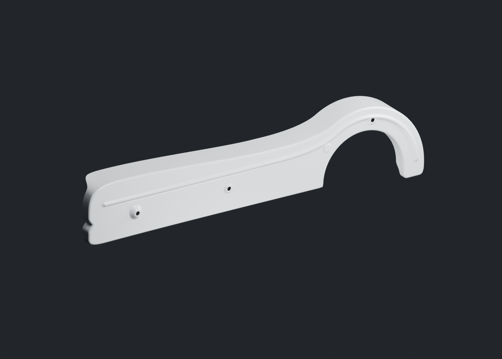
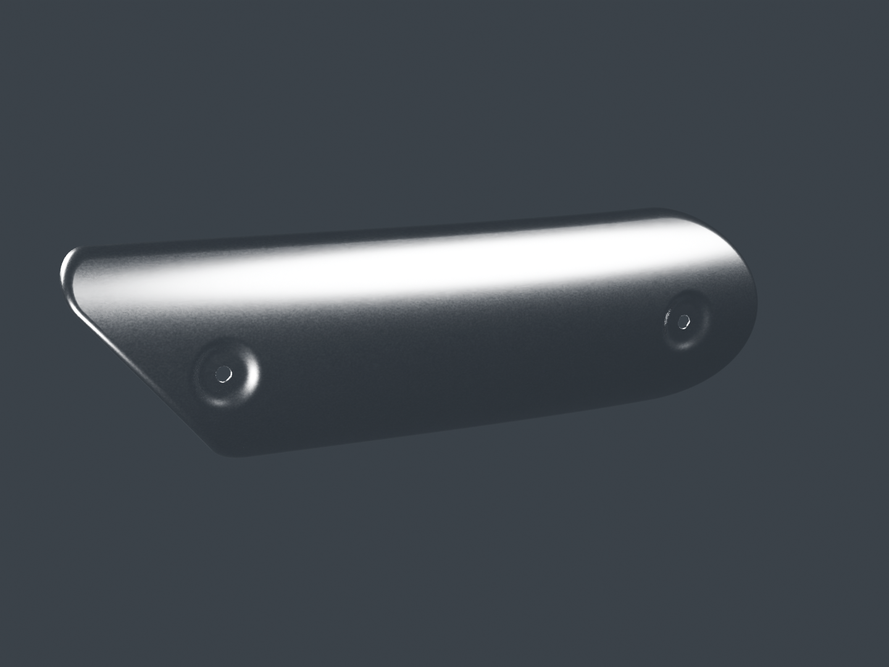
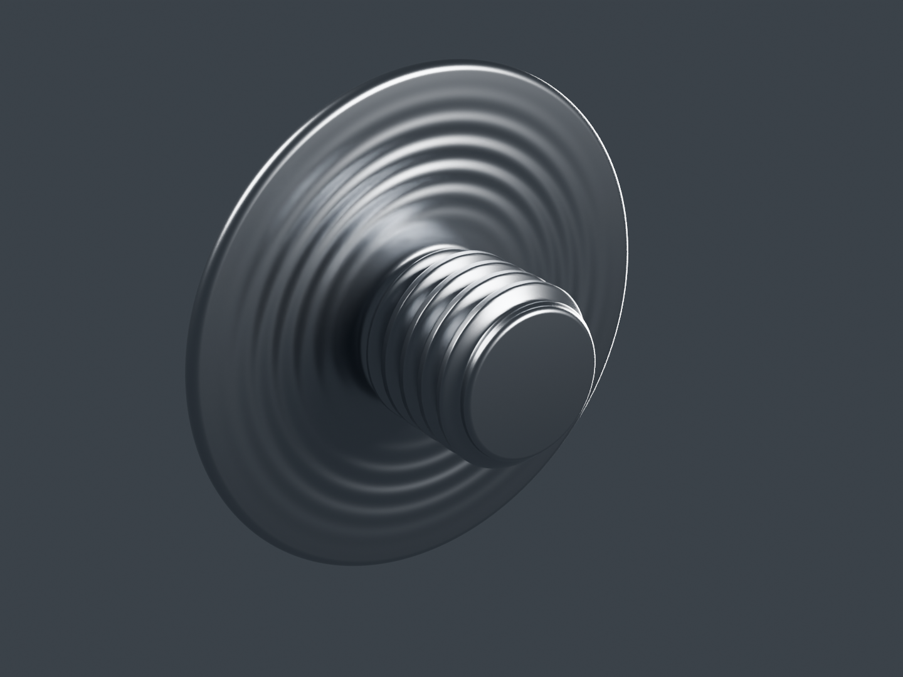

# Viva Wewa — fabrication moto, point de revue 14

Quatre pièces supplémentaires rejoignent la revue : pare-chaleur, fixations, demi-carter supérieur de chaîne et enveloppe de selle WEWA. Le registre compte 63 identités physiques candidates ; aucun des dix-huit groupes n’est déclaré terminé ou reçu artistiquement.

[Une image par composant](motorcycle18-components.md) · [Galerie détaillée](motorcycle18-gallery/index.html) · [Travail restant des 18 groupes](../research/motorcycle18-remaining-physical-work-v4.md) · [Point précédent conservé](motorcycle18-checkpoint-13.md)

## Selle : enveloppe, couture et graphisme WEWA

L’[enveloppe](seat-envelope-v1/README.md) possède un bourrelet arrière et des fils en géométrie. Deux premiers raccords ont été rejetés puis repris dans la source avant la matière. Les cinq finales Blender comprennent quatre vues studio et une vue sous ciel neutre au même cadrage. Le dessus très clair du studio et le reflet bleu du ciel sont conservés comme réponses à deux éclairages distincts.

Le graphisme et les cartes de vinyle sont originaux. La photo du siège apparenté présente un motif embouti ; la housse unie proposée ici ne certifie pas son absence sur la variante RDC. Silhouette, grain et sections restent estimés. Le dessous est ouvert : l’embase, les appuis et la mousse ne sont pas implicitement fabriqués avec la housse.

L’export de 101 320 triangles conserve les positions, normales et UV du gris corrigé. Une petite projection des tangentes de transport est explicitement documentée ; elle ne devient pas une affirmation d’identité de tous les octets avec l’export initial. Les trois primitives à normalmap n’ont aucun triangle UV effondré.

## Carter supérieur de chaîne, candidat partiel

Le [carter](chaincase-upper-v1/README.md) conserve la feuille formée, ses trois passages, sa demi-arche, le relief plein et les retours observables. Une encoche avant absente du premier contour a été corrigée dans la source. Les cinq finales incluent l’intérieur et les gros plans des deux extrémités.

L’oreille d’attache avant n’est pas encore construite : la pièce demeure partielle. Le code individuel, les dimensions, les sections et le montage ne sont pas reçus. La matière argentée et ses deux cartes originales normal/ORM conservent les attributs du gris ; la forte clarté studio ne certifie pas la peinture réelle. La demi-coque inférieure, les bouchons et la visserie sont des unités distinctes. L’export de 208 884 triangles est un modèle d’inspection.

## Pare-chaleur et fixations séparées

Le [pare-chaleur](exhaust-heatshield-v1/README.md) possède deux cuvettes percées et un bord retourné. Les cinq finales et les trois photos apparentées sont relues. Sa courbure et son décalage reposent sur le corps candidat du silencieux ; les contrôles de surfaces ne certifient pas un jeu réel ou le montage. Le grain spéculaire paraît encore trop moucheté : la finition reste en révision.

La [fixation](exhaust-heatshield-fastener-v1/README.md) est un type réutilisé deux fois. Le dessous marqué et le fût sont observables ; la calotte lisse est une enveloppe provisoire, sans empreinte inventée. Cette partie reste explicitement incomplète. Sa matière est constante, sans texture. Les deux occurrences dessinent 297 216 triangles pour une géométrie partagée de 148 608 triangles ; elles ne comptent pas comme deux nouveaux types.

## Recettes, limites et continuation

L’[audit des recettes](../research/motorcycle-source-dependencies-publication14-v1/README.md) fournit les entrées stables, les maîtres gris et le checkpoint numérique indispensable au rendu de selle. La police publique est réutilisée avec sa notice. Les études historiques de selle imposées par les manifestes gardent leur statut d’essais ; aucune reprise complète depuis un clone propre n’est annoncée.

Un [lien relatif historique déplacé](../research/motorcycle-source14-documentary-link-addendum-v1/README.md) reste décrit dans une annexe avec le bon accès à la source : les octets du document gelé ne sont pas réécrits. Les photographies documentaires demeurent privées et ne servent pas de textures.

Le pointage des [18 groupes](../research/motorcycle18-remaining-physical-work-v4.md), fondé sur Source13, corrige les anciennes listes qui annonçaient absentes des pièces déjà construites. La fabrication continue sur la demi-coque inférieure, l’embase de selle, le joint d’échappement puis les supports de repose-pieds et les autres unités restantes. Ces pièces suivantes restent hors de la présente coupe. Le conducteur attend la réception de la moto ; les modèles d’inspection restent à optimiser et à essayer sur iPhone 15/16.

## Vérification après publication

Source immuable : [`9d4e0af9`](https://github.com/Mobutoo/wewa/commit/9d4e0af95804adc696b241c0217d1fa853802b23), arbre `9685d5cc94238a6f049d586c3c7a0cb31291ee32`. Le contrôle du commit lit 2 961 JSON, 258 manifestes, 7 578 empreintes de fichiers, 49 empreintes PNG de checkpoints et 4 296 liens de revue ; aucune erreur dans ce périmètre. Le lien historique déplacé décrit plus haut demeure une limite explicite. Les 83 choix du catalogue et quatre révisions historiques de galerie restent distincts des 63 identités physiques et des 67 fiches déclarées ; 635 PNG figurent dans la galerie.

[GitHub Actions](https://github.com/Mobutoo/wewa/actions/runs/39571526105), dont l’étape de preuves moto, a réussi sur ce même commit. Le PRD complet Ewutelo est sauvegardé puis relu en révision 39 : égalité de tous ses champs, 45 exigences inchangées. L’état complet précédent reste dans son archive canonique Git immuable. Ce pied de revue et les [métadonnées de vérification](../../WEWA_Developpement_Web/validation/motorcycle18-source14-integrity.json) sont postérieurs au commit source ; les travaux suivants restent hors de cette coupe.
