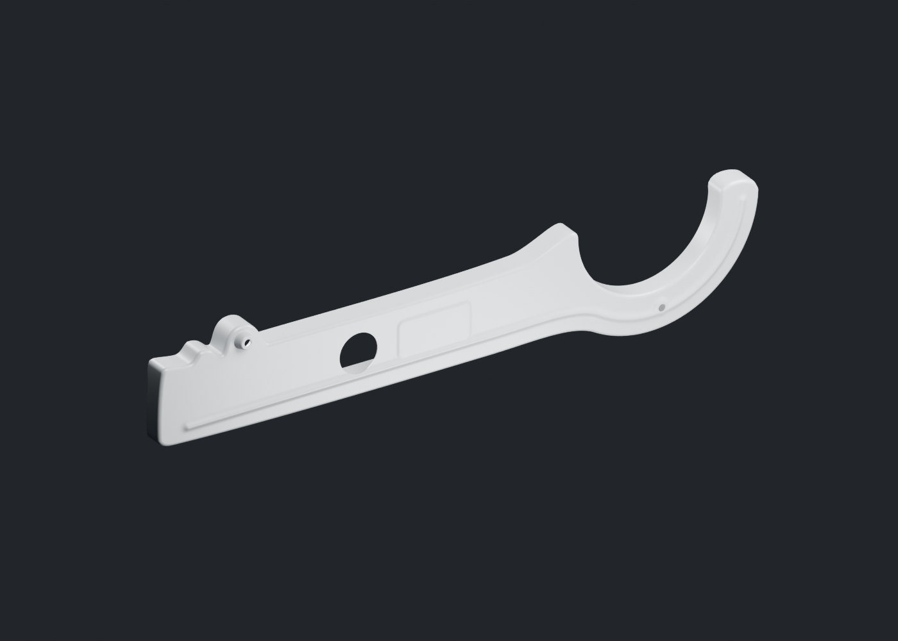
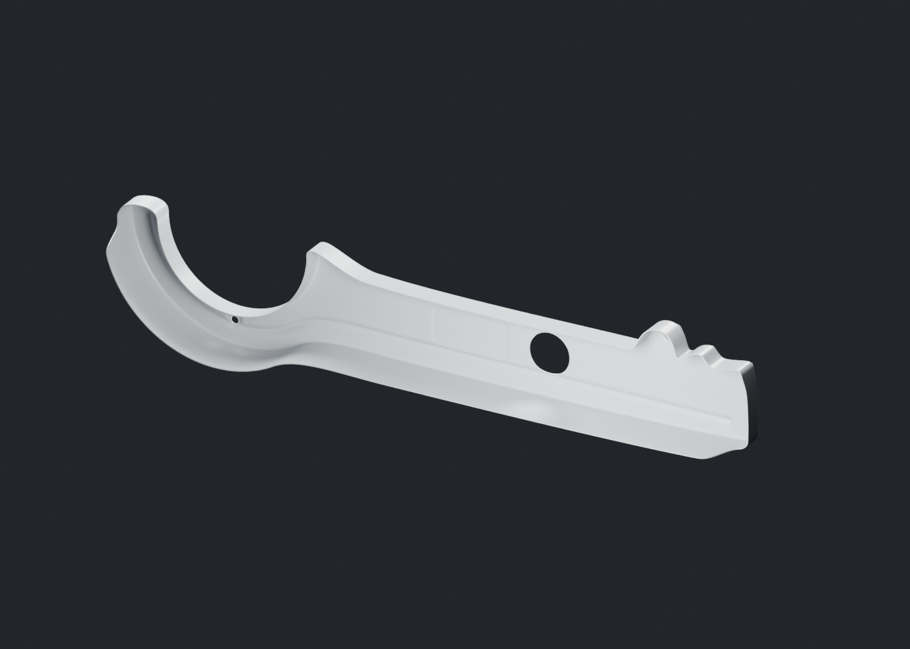
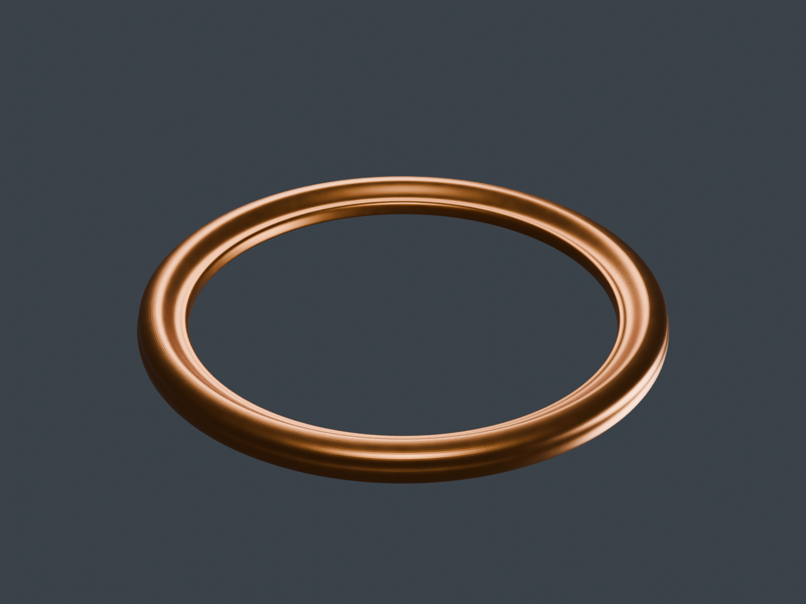

# Viva Wewa — fabrication moto, point de revue 15

Le demi-carter inférieur de chaîne rejoint la revue. Le joint d’échappement possède sa géométrie isolée, mais sa première matière est refusée pour un quadrillage artificiel : sa correction demeure une révision suivante. Le registre compte **65 identités physiques candidates** ; aucun des dix-huit groupes n’est terminé ou reçu artistiquement.

[Une image par composant](motorcycle18-components.md) · [Galerie détaillée](motorcycle18-gallery/index.html) · [Point précédent](motorcycle18-checkpoint-14.md)

## Carter inférieur : paroi, retours et passages

Le [carter](chaincase-lower-v1/README.md) possède une paroi finie, une demi-arche, le panneau observé, deux petits passages et une grande ouverture d’inspection. Les raccords du contour et du col ont été repris avant la matière. Cinq finales Blender, deux vues réelles du navigateur et deux photos apparentées ont été ouvertes indépendamment.

Les deux cartes normal/ORM sont originales. Les positions, normales, UV, tangentes, indices et matrices du gris corrigé restent identiques après application de la matière. La réponse studio très claire conserve son statut d’hypothèse de peinture argentée. Dimensions, variante RDC et montage ne sont pas reçus. Le bouchon, la visserie et la demi-coque supérieure restent des unités séparées ; aucun siège caché n’est ajouté derrière le grand trou. L’export d’inspection comporte 228 012 triangles, sans qualification mobile.

## Joint : défaut de matière démontré et reprise séparée

Le [joint](exhaust-header-gasket-v1/README.md) est un anneau isolé à passage réel, avec relief apparenté et revers estimé. Les diamètres 26/32 mm et la hauteur 2 mm restent des hypothèses ; la hauteur proposée ne correspond pas au gap candidat du tube de 1,2 mm. Aucune compression ou translation ne masque ce conflit et aucun montage n’est annoncé.

Le [diagnostic de matériau](../research/exhaust-header-gasket/material-diagnostic-v1/report.json) conserve trois vrais contrôles à caméra et lumière identiques. Le quadrillage disparaît quand seule la normale est débranchée et persiste quand seule la rugosité devient constante. La [lecture indépendante](../research/exhaust-header-gasket/material-diagnostic-v1/coordinator-review.json) confirme la carte normale comme cause dominante visible. La matière v1 est **refusée** ; le contrôle sans normale n’est pas une finition de remplacement reçue. Les sources et manifestes v1 restent conservés avant une nouvelle matière.

## Moteur : ombres vérifiées sans changer les matières

La [comparaison v4](upper-engine-sun-shadow-v4/README.md) a révélé des stries sur une paroi lisse et a été refusée. Le [seul essai correctif v5](upper-engine-sun-shadow-v5/README.md) dérive le bias de la taille réelle d’un texel. Les stries ne sont plus visibles à 1000×750 dans les deux vues contrôlées ; aucun nouveau détachement évident des ombres de contact n’a été identifié dans ces cadrages.

Les huit canvas v5 sont réels. Les témoins neutres restent exactement égaux, les vues sans ombres restent identiques à v4 et les buffers, matériaux, caméra et HDR sont conservés. Le résultat est un candidat de diagnostic sans adoption dans le jeu, sans équivalence photométrique Blender et sans essai iPhone. La recherche de bias s’arrête ici jusqu’aux vrais LOD ; aucune AO haute définition n’est utilisée.

## Recettes et continuation des 18 groupes

Les [entrées stables et reliquats](../research/motorcycle-source-dependencies-publication15-v1/README.md) et leur [complément labo/diagnostic](../research/motorcycle-source-dependencies-publication15-lab-diagnostic-addendum-v1/README.md) distinguent les sources, les preuves historiques et les dépendances d’installation. Les trois EXR du diagnostic sont des sorties originales imposées par son manifeste ; aucune photo documentaire privée n’est publiée ou employée comme texture.

Le repose-pied gauche, l’embase de selle, le patin et la matière suivante du joint poursuivent leur fabrication hors de cette coupe. Les optiques, amortisseurs et autres unités restent dans les chaînes des dix-huit groupes. Les sources d’inspection doivent encore être optimisées et essayées sur iPhone 15/16. Le conducteur attend la moto.
