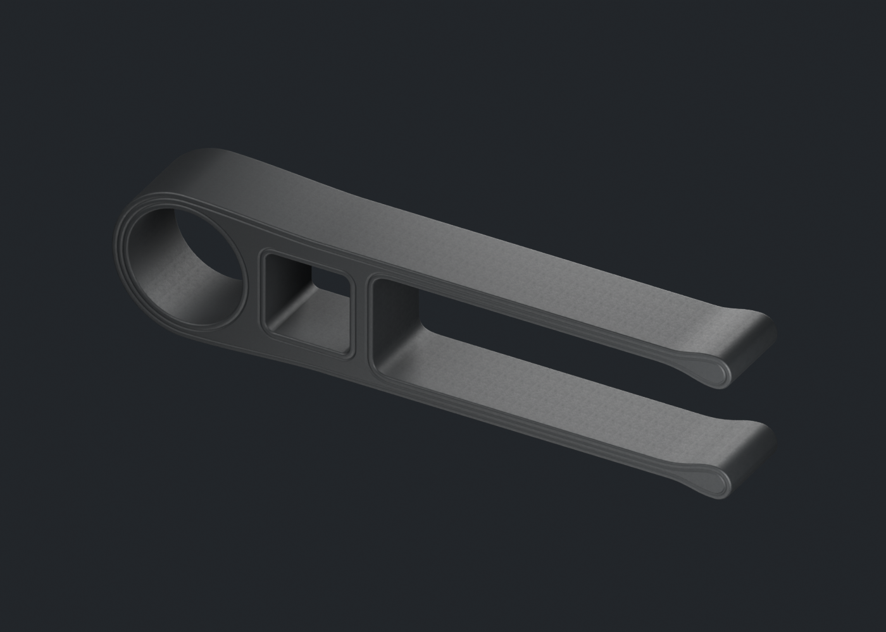
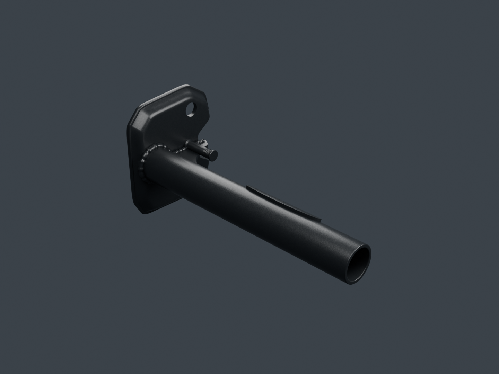
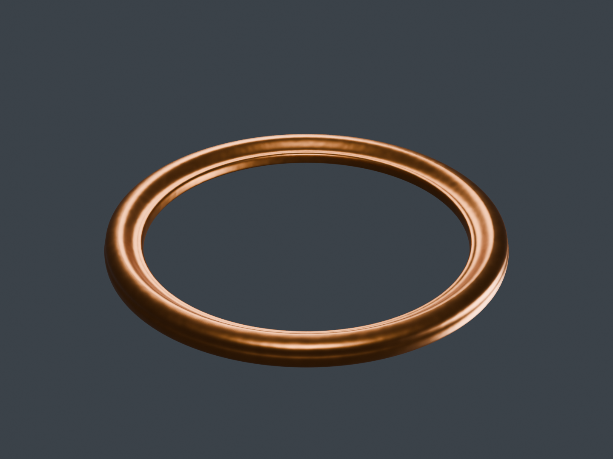
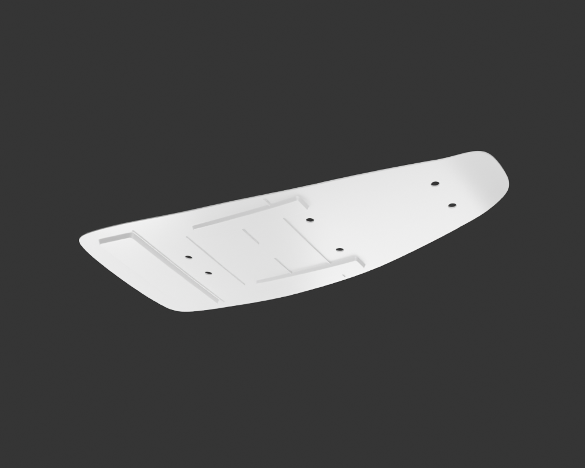

# Viva Wewa — fabrication moto, point de revue 16

Le patin de chaîne et le repose-pied avant gauche rejoignent les revues séparées. La matière2 du joint d’échappement remplace le quadrillage refusé, sans changer sa géométrie. Le registre compte **67 identités physiques candidates** ; aucun des dix-huit groupes n’est terminé ou reçu artistiquement. L’embase de selle reste une étude grise partielle, distincte de ce total de production.

[Une image par composant](motorcycle18-components.md) · [Galerie détaillée](motorcycle18-gallery/index.html) · [Point précédent](motorcycle18-checkpoint-15.md)

## Patin : anneau, fenêtre et branches

Le [patin](swingarm-chain-slider-v1/README.md) possède un anneau, une petite fenêtre ouverte, deux branches et une gorge. Les raccords et ondulations involontaires ont été repris dans la source avant la matière. Cinq finales96, deux vues réelles du navigateur et deux photos apparentées ont été ouvertes indépendamment. Les petites bouches des pointes visibles sur les références restent **non fabriquées** ; l’autre face est estimée. Ce candidat est donc partiel, sans montage ni contact de chaîne reçu.

## Repose-pied gauche : pièce distincte du côté droit

Le [repose-pied gauche](front-footrest-left-v1/README.md) comporte le tube creux, l’embase formée et percée, le renfort, les pattes, les soudures et un petit goujon proposé. Six finales96, deux vues réelles du navigateur et trois photos PF113000 ont été ouvertes indépendamment. Le caoutchouc reste une autre pièce ; le côté droit n’est pas obtenu par symétrie.

Le [comparatif de grain](../research/front-footrest-left/material-amplitude-comparison-v1/README.md) conserve les images originales des essais8 et2µm. Le premier grain dominait trop les reflets ; un seul essai d’amplitude a été retenu après lecture à caméra et lumière identiques. Les cinq buffers géométriques et les matrices restent exactement identiques entre ces deux matières. Le passage du gris au PBR avait, lui, créé56 sommets de tangente natifs supplémentaires : les coins orientés POSITION/N/UV restent exacts, sans prétendre les accesseurs bruts identiques. Sections, filetages, fonction du goujon, variante et montage restent à confirmer.

## Joint : matière corrigée, conflit de montage conservé

Le [joint matière2](exhaust-header-gasket-v2/README.md) conserve exactement les positions, normales, UV, tangentes, indices et matrices de la version1. Les quatre finales96 et deux nouveaux aperçus24 ne présentent plus le quadrillage refusé. La normale irrégulière et les deux autres cartes sont originales ; leur grain et la finition restent des estimations. La première version, son refus et ses diagnostics demeurent archivés.

Les hypothèses ID26/OD32/hauteur2mm restent en conflit avec l’espace candidat de1,2mm au tube. Le joint reste isolé : aucune compression, translation ou modification de forme ne masque cette incompatibilité.

## Selle : étude grise, manques visibles déclarés

L’[étude d’embase](seat-base-study-v7-handoff/README.md) contient une plaque, six ouvertures proposées, un retour arrière, deux appuis longs et sept nervures partielles. Trois vues grises12 et deux vues du navigateur ont été ouvertes avec la photo apparentée. Les autres nervures, l’épine avant, les amortisseurs, leurs supports, les montants, les ailettes arrière, le retour de garniture et les petites zones moulées restent explicitement **non fabriqués**. Il n’y a ni matière finale, ni rendu96 de réception, ni inscription de cette étude comme pièce de production terminée.

## Suite des dix-huit groupes

Le [pointage des dépendances](../research/motorcycle-source-dependencies-publication16-v1/README.md) distingue les recettes stables, les témoins historiques et les fichiers nécessaires à la reprise. Les photos documentaires demeurent privées et ne servent pas de textures.

Le pare-moteur, sa platine, le repose-pied droit, les clignotants et la suspension poursuivent leur fabrication hors de cette coupe. Les groupes continuent ensuite vers les autres pièces de la moto ; les détails visibles manquants restent à construire. Les exports actuels sont des sources détaillées d’inspection, pas des LOD mobiles qualifiés. Les essais physiques iPhone15/16, l’assemblage reçu et le conducteur viennent après ces contrôles.
