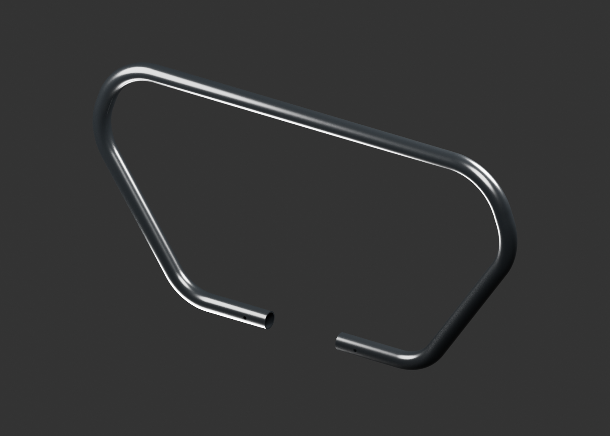
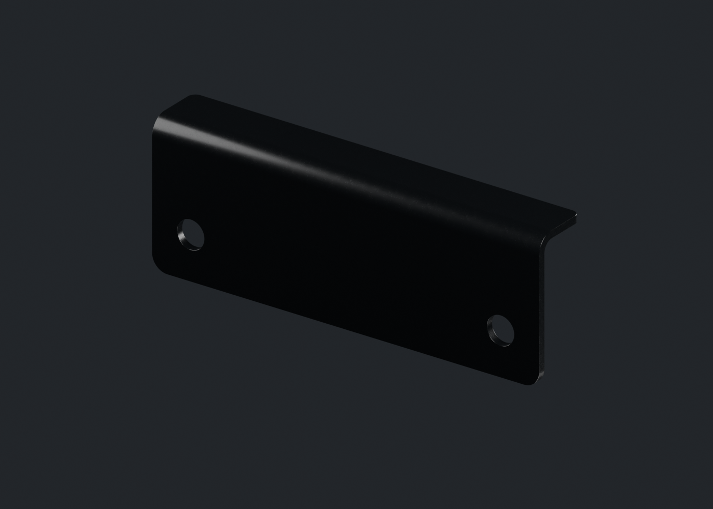
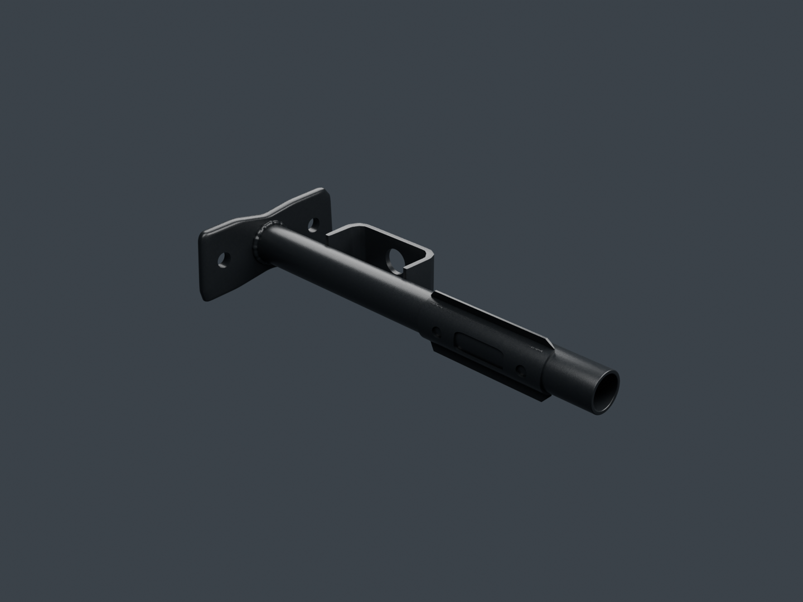
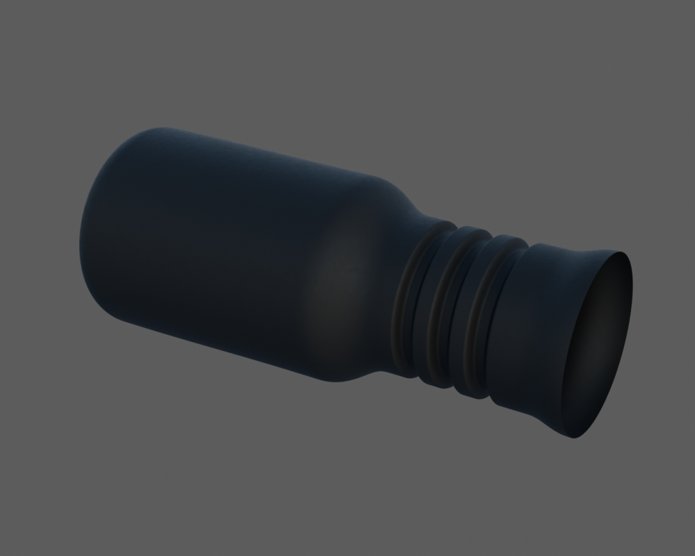
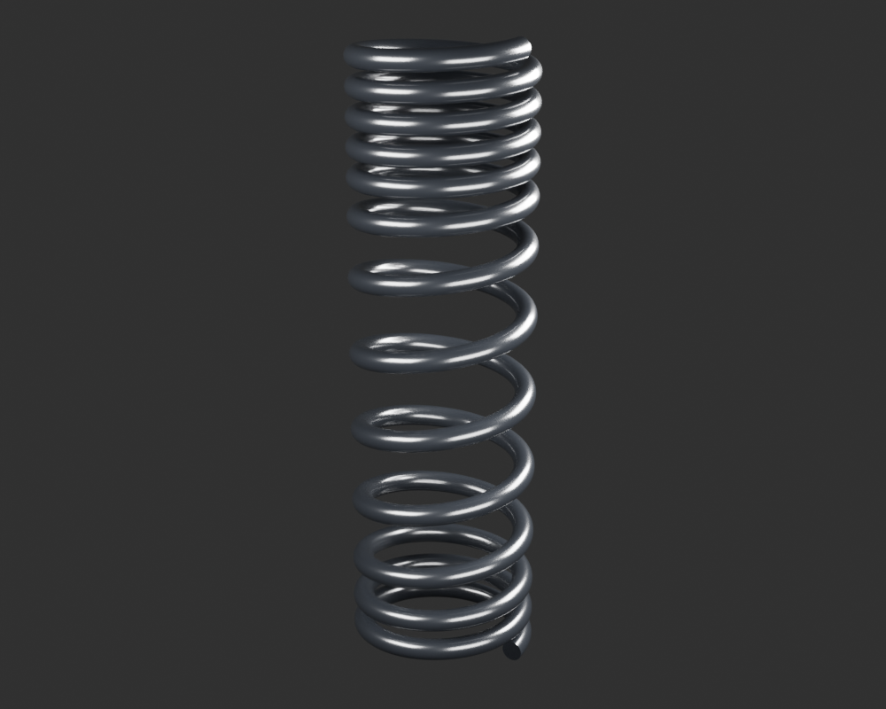

# Viva Wewa — fabrication moto, point de revue 17

Le tube et la platine du pare-moteur, le repose-pied droit, la peau de tige du clignotant gauche et le ressort extérieur arrière sont présentés séparément. Le registre compte **72 identités physiques candidates**. Aucun des dix-huit groupes n’est terminé ou reçu artistiquement. Ces unités ne constituent pas encore une moto assemblée. Les ajustements documentaires, le montage et la réception artistique restent ouverts.

[Une image par composant](motorcycle18-components.md) · [Galerie détaillée](motorcycle18-gallery/index.html) · [Point précédent](motorcycle18-checkpoint-16.md)

## Pare-moteur : tube et platine distincts

Le [tube](engine-protection-hoop-v1/README.md) possède une paroi finie, des coudes continus, deux petites bouches latérales et des extrémités ouvertes. La [platine](engine-protection-centre-plate-v1/README.md) est une tôle à retour formé avec deux perçages ouverts. Son contour a été repris avant la matière pour supprimer les ailettes diagonales qui apparaissaient dans le pli.

Les deux unités gardent leurs repères isolés ; aucune pose relative ni soudure n’est reçue. Embouts, crochet, entretoise, soudures et visserie ne sont pas inclus. Les deux jeux de cartes normal/ORM sont originaux et les buffers géométriques du gris corrigé restent exacts lors du passage à la matière. Les cotes, les finitions et le profil supérieur caché de la platine restent estimés. Le petit résidu numérique de normales du pli conserve son historique et sa cible non atteinte ; aucun défaut critique n’est établi dans les vues relues.

## Repose-pied droit : une forme propre

Le [support droit](front-footrest-right-v1/README.md) comporte un tube creux, une embase à deux trous, une patte médiane pliée avec un œil et une selle terminale percée. Il ne copie pas le support gauche par symétrie. Les passages ont des contrôles de vide et de matière environnante, puis une lecture dans les gris, les reflets et les rendus de matière. Le caoutchouc, les vis rapportées d’une autre photo et le montage au cadre restent séparés. La peinture noire et son grain sont proposés, pas mesurés.

## Clignotant : peau extérieure de tige

La [tige gauche](indicator-front-left-stalk-v1/README.md) possède son corps extérieur, son épaulement et trois gorges. Les deux coupes d’interface restent ouvertes : elles ne représentent pas des alésages OEM certifiés. La tête, la lentille, l’ergot, la fixation et le câblage ne sont pas inclus dans cette unité. Le studio montre une réponse claire et le HDR une réponse sombre avec le même matériau ; la vraie mire diffuse à18% règle l’exposition sans calibrer le HDR ni la matière.

## Suspension : ressort extérieur seul

Le [ressort extérieur](rear-sns-outer-spring-v1/README.md) est une hélice séparée à pas variable, avec une peinture noire originale uniforme. Tours, sens, dimensions, espacements et extrémités restent des hypothèses ; les disques de fermeture du modèle ne certifient pas un appui ou un meulage réel. Le ressort intérieur orange, le corps, la tige, les coupelles, les œillets, le second amortisseur et le montage restent des pièces suivantes. Aucune compression physique n’est déduite de ce modèle statique.

## Reprise et suite des dix-huit groupes

L’[audit des recettes](../research/motorcycle-source-dependencies-publication17-v1/README.md) et son [complément ressort](../research/motorcycle-source-dependencies-publication17-spring-v1/README.md) séparent les sources stables des témoins historiques de rendu. Les copies publiques des petits checkpoints numériques et de mires originales gardent leurs octets exacts ; les chemins de restauration sont documentés sans modifier les anciens gels ou renderers. Les photos de produits restent privées et ne servent pas de textures. Une clôture documentaire n’est pas une reprise propre exécutée.

Les chaînes poursuivent le garde-boue arrière, l’admission, le ressort intérieur et les autres pièces restantes des dix-huit groupes. Les sources actuelles sont détaillées pour inspection ; la réduction, les textures de jeu et les essais physiques iPhone15/16 restent à faire après le contrôle des formes. Le conducteur attend la moto.

## Vérification après publication

Source immuable : [`1945ba12`](https://github.com/Mobutoo/wewa/commit/1945ba121fac91516532c85c3f1f8038898ef478), arbre `31e2b2ef3f6379ff8989029a06d847cd99452f9c`. Le contrôle du commit lit 3 511 JSON, 288 manifestes, 8 957 empreintes de fichiers, 49 empreintes PNG de checkpoints et 4 945 liens de revue, sans erreur dans ce périmètre. Les 94 choix de catalogue et quatre révisions historiques restent distincts des 72 identités physiques et 77 fiches ; la galerie contient 729 PNG. La limite historique de lien Source14 reste documentée sans nouvelle exception.

[GitHub Actions](https://github.com/Mobutoo/wewa/actions/runs/39588489570), dont l’étape de preuves moto, a réussi sur ce même commit. Le PRD complet Ewutelo est sauvegardé puis relu en révision42 : égalité de tous ses champs et 45 exigences inchangées. Le PRD41 complet reste dans [son archive immuable](https://github.com/Mobutoo/wewa/blob/b8552068739dc0792b123a12946c69df24888db3/context/ewutelo/current-prd.json). Ce pied de revue et les [métadonnées de vérification](../../WEWA_Developpement_Web/validation/motorcycle18-source17-integrity.json) suivent le commit source ; intérieur orange, fût corrigé, manchon, anneaux, colliers et garde-boue ultérieurs restent hors de cette coupe.
