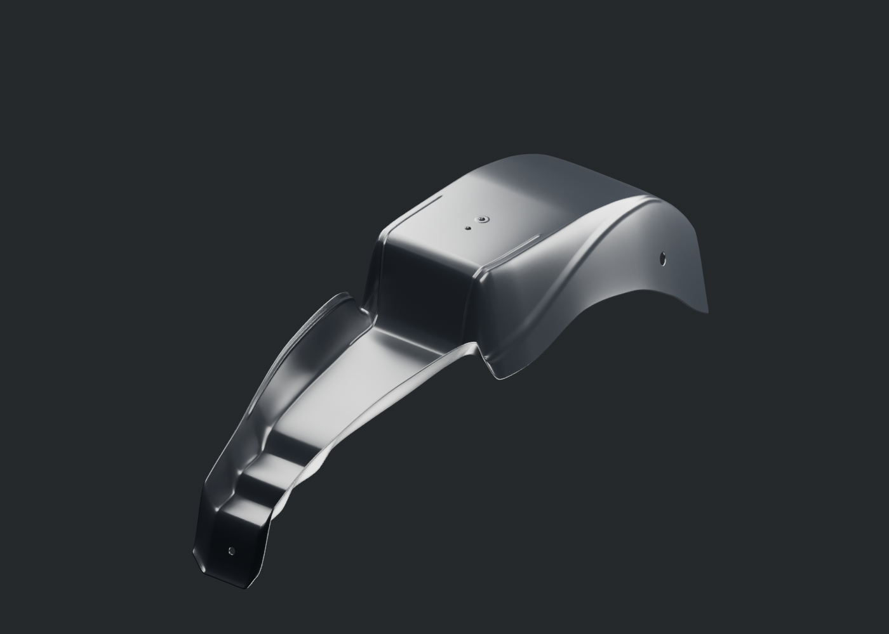
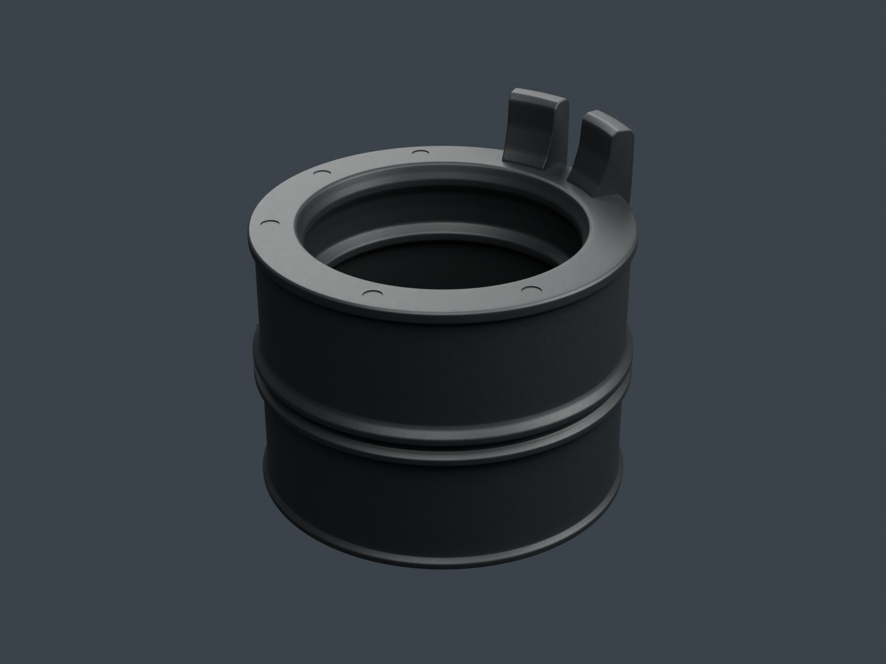
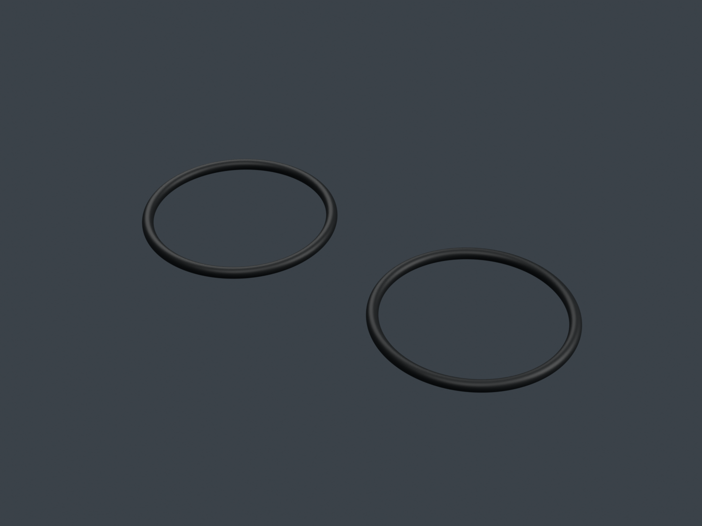
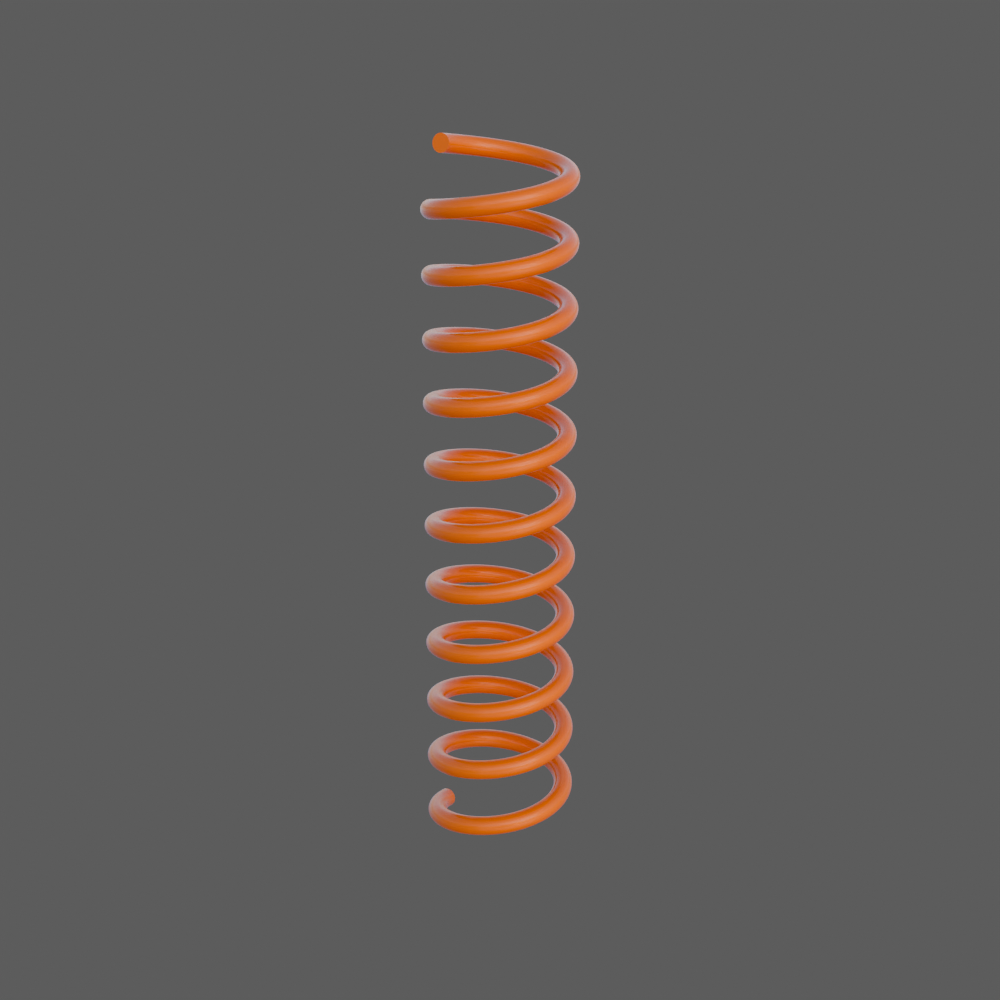
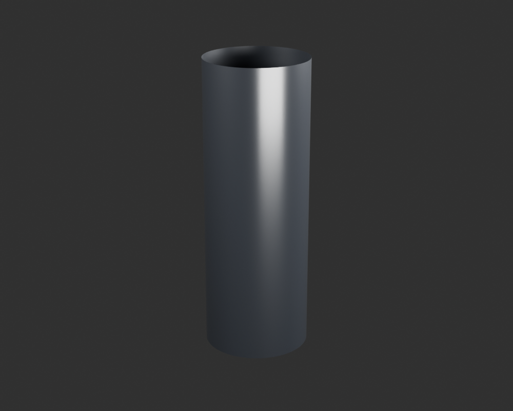
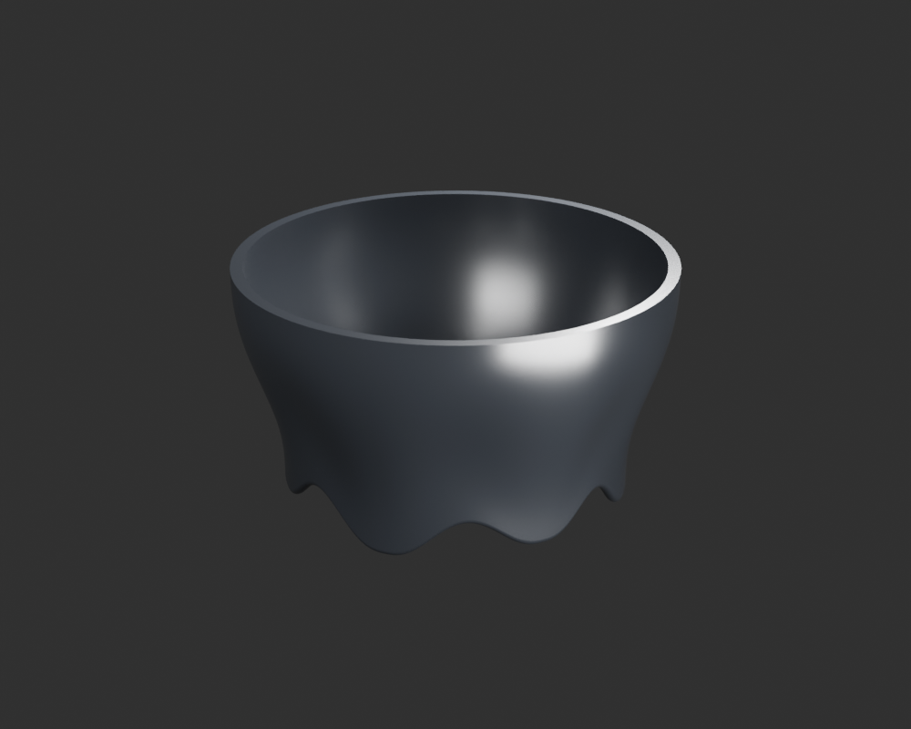
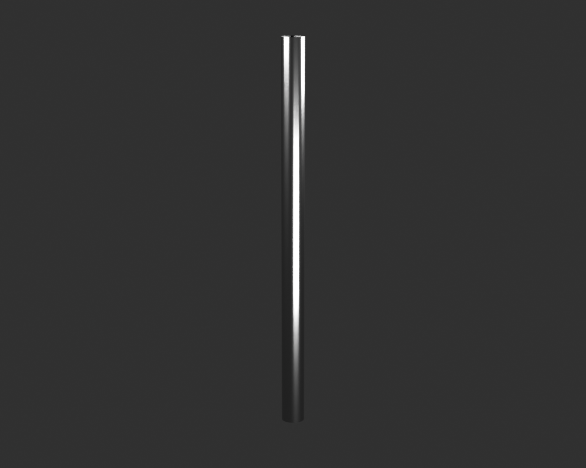

# Viva Wewa — fabrication moto, point de revue 18

Sept unités supplémentaires sont construites séparément : garde-boue arrière, manchon et joints d’admission, ressort intérieur orange, fût corrigé, collerette et tige d’amortisseur. Le registre compte **79 identités physiques candidates**, dont un seul type de joint torique présenté en deux occurrences. Les dix-huit groupes restent en cours ; ces pièces ne constituent pas une moto assemblée ou reçue artistiquement.

[Une image par composant](motorcycle18-components.md) · [Galerie détaillée](motorcycle18-gallery/index.html) · [Point précédent](motorcycle18-checkpoint-17.md)

## Garde-boue arrière

La [coque](rear-mudguard-shell-v1/README.md) possède une paroi finie, cinq passages, des bandes formées et un retour avant descendant. Le premier nez trop plat a été corrigé après comparaison des photos, avant le matériau et les six rendus finaux. La hauteur de la bouche latérale reste incertaine sur les vues obliques non calibrées. La bavette, le renfort, les attaches et les raccords à la selle et au cadre restent des pièces séparées.

La matière noire est originale ; les cartes normal/ORM ne contiennent aucun pixel de photographie. Les reflets studio parfois très clairs gardent le même matériau. Ce modèle détaillé de 693 776 triangles sert à l’inspection, sans qualification mobile.

## Admission : manchon et joints

Le [manchon](engine-intake-sleeve-v1/README.md) comporte deux lèvres intérieures, des cordons extérieurs, une fourche, une ligne de moulage et cinq marques à fond fermé. L’autre face et le code suivent une référence liée dont le moule et l’orientation ne sont pas confirmés pour la RDC. Les lettres illisibles ne sont pas inventées ; le code lisible est redessiné avec une police originale. Le grain et les dimensions restent estimés, sans emboîtement forcé sur le collecteur ou le collier.

Les [joints LJA00011](engine-intake-o-ring-v1/README.md) suivent le nominal documenté de diamètre intérieur 28,7 mm et de section 1,9 mm d’une branche liée. Ils représentent **un type physique et deux occurrences**, isolées et non comprimées. Tolérances, matière exacte, gorges et compatibilité RDC restent inconnues. Le contrôle conserve le premier échec numérique Float32 et son analyse ; sa borne de représentation ne constitue pas une tolérance de fabrication.

## Amortisseur : quatre nouvelles pièces distinctes

Le [ressort intérieur orange](rear-sns-inner-spring-v1/README.md) est séparé du ressort extérieur noir publié précédemment. Tours, sens, pas, fil, extrémités et dimensions restent estimés. Les disques de fermeture numériques ne certifient pas des surfaces d’appui ou un meulage réel.

Le [fût corrigé](rear-sns-damper-body-v2/README.md) ne fusionne plus l’évasement qui appartient à la collerette séparée. La première proposition a été refusée avant les rendus finaux. Il reste une peau cylindrique extérieure avec deux coupes d’interface couvertes ; aucune section hydraulique cachée n’est prétendue. L’inscription visible mais illisible reste non reproduite.

La [collerette](rear-sns-lower-collar-v1/README.md) reprend trois fragments avant observés ; l’arrière lisse sur 208° est explicitement estimé, sans inventer une répétition de crans ni une fonction de précharge. Le jeu avec le fût est un contrôle de coordonnées de candidat, pas un ajustement OEM.

La [tige](rear-sns-rod-v1/README.md) représente sa surface métallique visible. Ses deux coupes couvertes ne signifient pas qu’elle serait réellement creuse. Alliage, chrome, rugosité, dimensions, piston et raccords ne sont pas certifiés. Coupelles, œillets, second amortisseur et installation suivent séparément.

## Sources, contrôles et poursuite

Chaque unité possède son fichier Blender, son export GLB et ses vues réellement rendues. Les contrôles lisent les exports dans Babylon et vérifient les pixels du canevas ; ils ne valent ni réception artistique ni essai sur iPhone. Les passages gris/matière conservent les géométries contrôlées ; les changements de disposition des sommets dus aux tangentes du manchon sont déclarés et vérifiés par coins orientés, sans fausse identité des buffers bruts.

Les audits de dépendances sont distincts : [garde-boue](../research/motorcycle-source-dependencies-publication18-rear-mudguard-v1/README.md), [manchon](../research/motorcycle-source-dependencies-publication18-sleeve-v1/README.md), [joints](../research/motorcycle-source-dependencies-publication18-oring-v1/README.md), [ressort intérieur](../research/motorcycle-source-dependencies-publication18-inner-spring-v1/README.md), [fût](../research/motorcycle-source-dependencies-publication18-damper2-v1/README.md), [collerette](../research/motorcycle-source-dependencies-publication18-collar-v1/README.md) et [tige](../research/motorcycle-source-dependencies-publication18-rod-v1/README.md). Les petites copies de reprise nécessaires restent exactes ; les photos commerciales restent privées. Ces audits statiques ne prétendent pas qu’une reprise complète sur environnement vierge a été exécutée.

La fabrication continue avec patte du pare-moteur, collier d’admission, coupelles et œillets, puis fermeture du poste de conduite et autres pièces restantes des dix-huit groupes. Réduction des modèles, matériaux de jeu, assemblage complet et essais physiques iPhone15/16 suivront le contrôle des formes. Le conducteur attend la moto.
