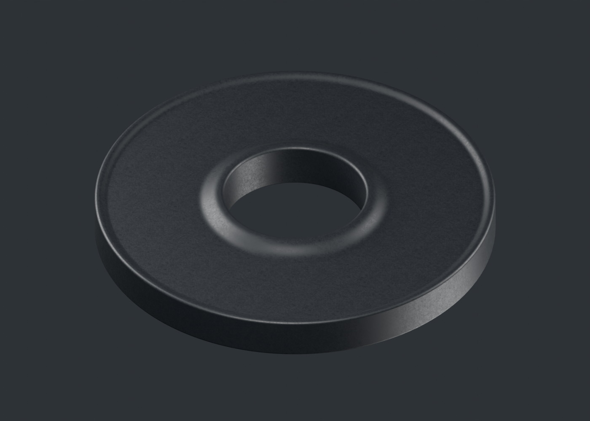
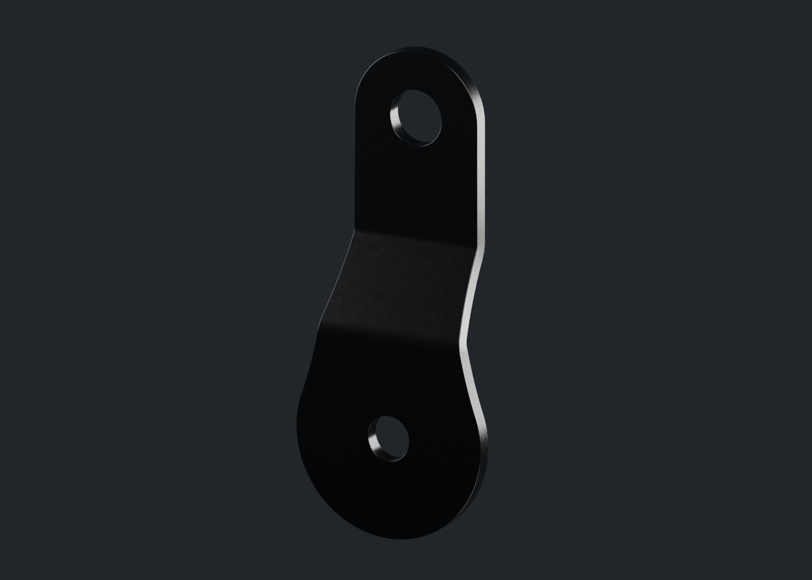
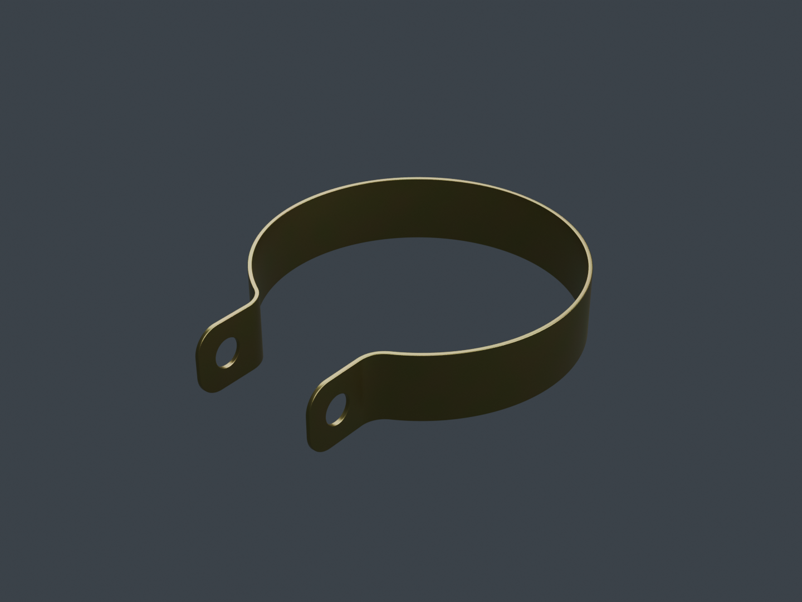
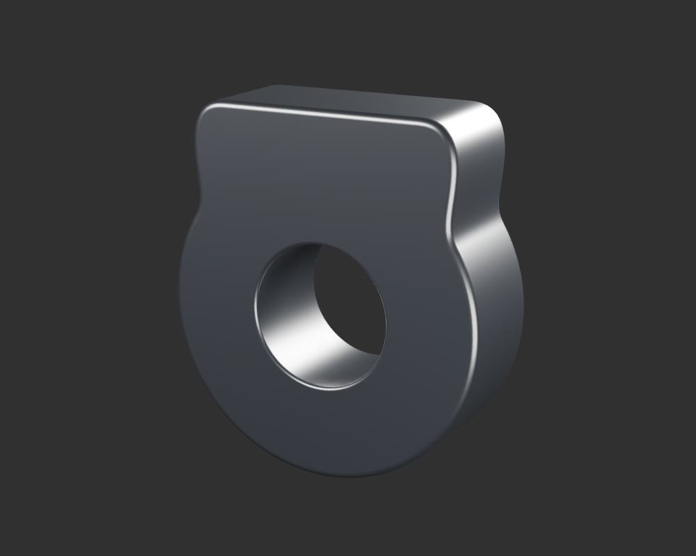
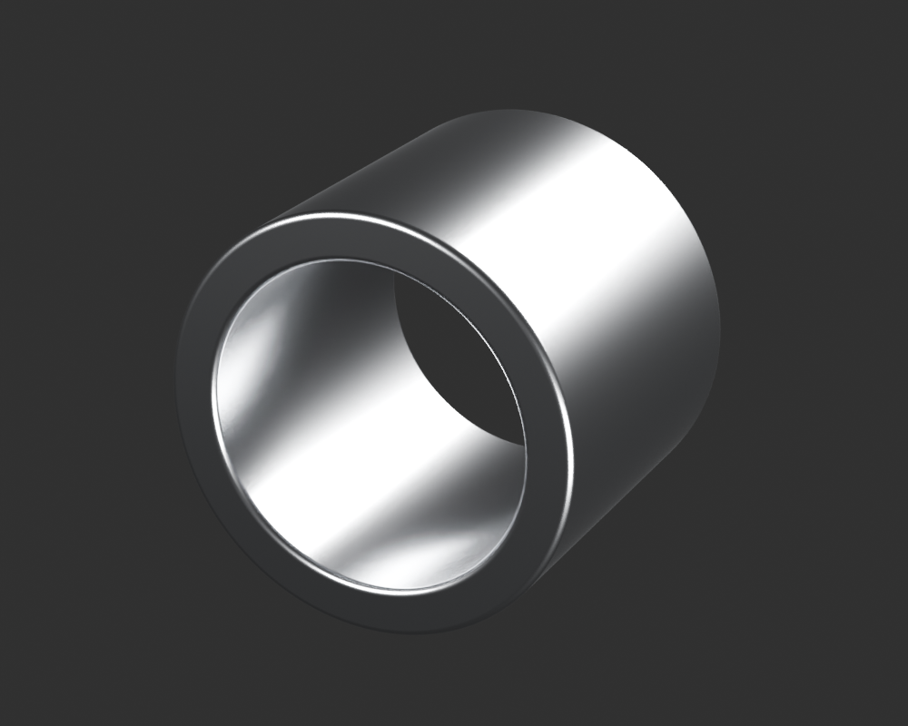
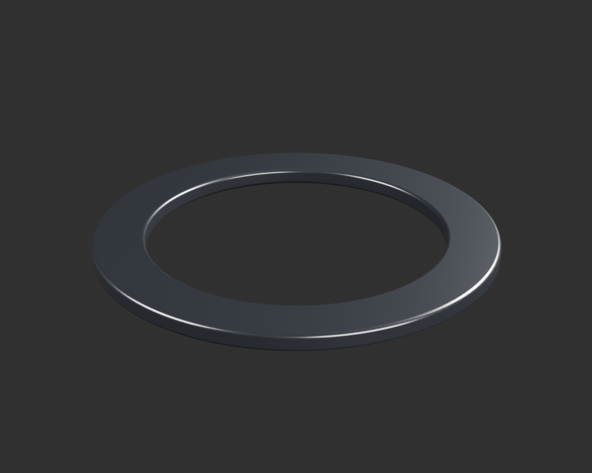
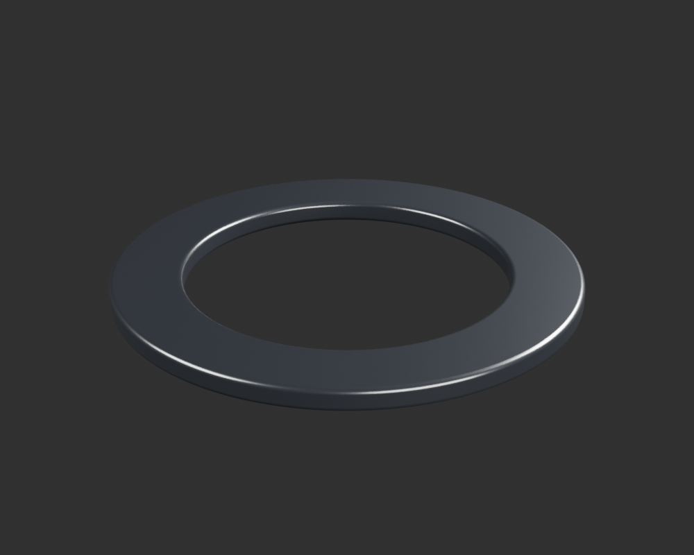

# Viva Wewa — fabrication moto, point de revue 19

Sept nouvelles pièces sont présentées séparément : bague supérieure de guidon, premier embout du pare-moteur, bande du collier d’admission, œil noir et manchon métallique côté fût, et deux bords de coupelle distincts. Le registre compte **86 identités physiques candidates**. Les dix-huit groupes restent en cours, sans réception artistique ni moto assemblée.

[Une image par composant](motorcycle18-components.md) · [Galerie détaillée](motorcycle18-gallery/index.html) · [Point précédent](motorcycle18-checkpoint-18.md)

## Fixation du guidon

La [bague supérieure liée DS181008](handlebar-mount-upper-damper-v1/README.md) reprend la face annulaire visible, son ouverture, sa collerette centrale et son rebord extérieur. Le revers et la paroi sont une fermeture estimée ; diamètre, section, compression et montage ne sont pas mesurés. Elle ne copie pas les DS181009/010 dont les faces physiques restent manquantes. Les anciennes rondelles et fixations restent distinctes.

## Pare-moteur : premier embout

Le [premier embout](engine-protection-terminal-a-v1/README.md) possède une tôle finie, deux passages et deux plis continus. « A » désigne la gauche de la photo, sans attribution au côté pilote. Le petit point sombre indécidable ne devient pas un troisième trou. La jonction soudée au tube, le second embout, le crochet, l’entretoise et la visserie restent séparés. Cotes et contact ne sont pas reçus. Les cartes de matière sont originales ; les chemins des compagnons PNG ont été corrigés avant le gel.

## Admission : bande seule du collier

La [bande liée DP101198](engine-intake-clamp-band-v1/README.md) est lisse, avec des oreilles pliées percées. La première langue dépassante du pli a été corrigée avant matière. La vis tangente et le pont intérieur ne sont pas inclus ; aucun mécanisme à vis sans fin n’est inventé.

Une carte couleur originale propose de très faibles nuances jaune-vert. Les vraies vues uniformes et texturées sont très similaires : cette hypothèse ne reproduit pas l’iridescence angulaire ni ne certifie la chimie du revêtement. Le nouvel atlas UV est déclaré, avec positions et normales protégées ; les buffers de la version uniforme et de la version texturée restent identiques. Les diamètres de travail45 et45,6mm du collier/manchon donnent une interférence rigide diamétrale0,6mm, conservée comme conflit de montage. La référence commerciale45×10 et la mention39mm ne certifient pas la varianteRDC.

## Amortisseur : œil et manchon côté fût

L’[extérieur de l’œil](rear-sns-body-side-eye-exterior-v1/README.md) possède son contour arrondi, son col court et son passage. Profondeur, dos, section, soudure et implantation restent estimés ou inconnus ; le petit bleu central ambigu n’est pas inventé. La grande bague bleue de l’œil opposé ne lui est pas transférée.

Le [manchon central](rear-sns-body-side-eye-sleeve-v1/README.md) est distinct, avec sa couronne et sa lèvre. Son argent est un shader original non mesuré, sans certification d’alliage ou de traitement. Le petit jeu positif entre les surfaces candidates ne vaut pas ajustement ou emmanchement réel. Les premières macros visaient le vide du passage ; elles ont été rejetées puis recadrées sur la lèvre avant les vues retenues.

## Deux bords de coupelle

Le [bord côté fût](rear-sns-body-side-seat-rim-v1/README.md) et le [bord opposé](rear-sns-opposite-seat-rim-v1/README.md) suivent des fragments observés distincts. Leurs continuations, sections et faces cachées restent estimées. Les plateaux centraux masqués et le nombre de plaques ne sont pas déclarés fabriqués. Les vides entre les candidats sont contrôlés ; ils ne constituent pas des contacts de siège reçus ni une preuve de support de ressort.

## Contrôles et suite

Chaque pièce possède son fichier Blender, son export GLB et ses vues réellement rendues et relues. Les imports Babylon contrôlent aussi les pixels du canevas. Les rendus neutres avec mire diffuse à18% règlent l’exposition de présentation sans calibrer les matériaux ou les HDR. Aucun essai physique iPhone ni qualification du modèle de jeu n’est déduit de ces contrôles.

Les audits de reprise sont séparés : [embout](../research/motorcycle-source-dependencies-publication19-terminal-a-v1/README.md), [bague DS181008](../research/motorcycle-source-dependencies-publication19-ds181008-v1/README.md), [collier](../research/motorcycle-source-dependencies-publication19-clamp-band-v1/README.md), [œil](../research/motorcycle-source-dependencies-publication19-sns-eye-v1/README.md), [manchon](../research/motorcycle-source-dependencies-publication19-sns-eye-sleeve-v1/README.md), [bord côté fût](../research/motorcycle-source-dependencies-publication19-sns-rim-v1/README.md) et [bord opposé](../research/motorcycle-source-dependencies-publication19-sns-opposite-rim-v1/README.md). Les dépendances effectives, copies exactes et restaurations sont documentées ; aucune reprise complète vierge n’est prétendue.

La fabrication continue sur les fixations et câbles du poste de conduite, l’avant, l’œil et la zone bleue opposés, puis la revue d’ensemble SNS au repos et les autres pièces des dix-huit groupes. Les huit catégories manquantes de l’embase de selle et les détails de lentille restent de vrais travaux à réaliser. Le conducteur attend la moto.
