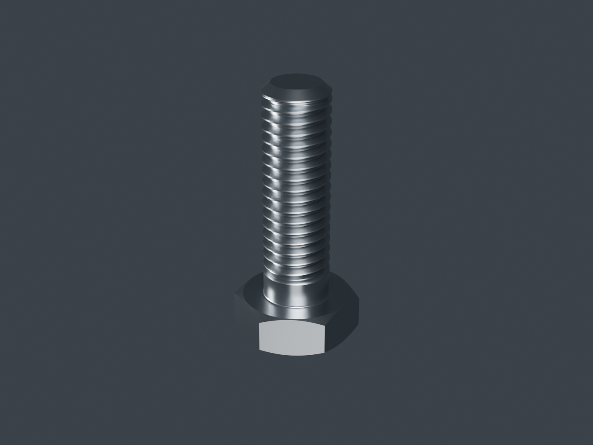
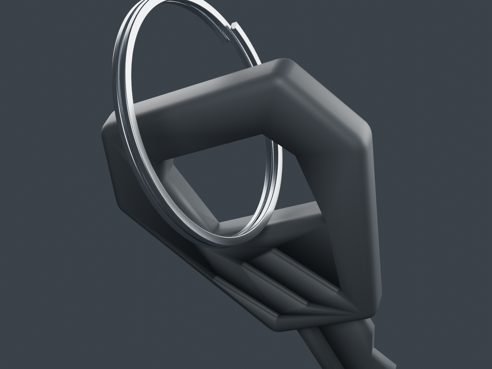
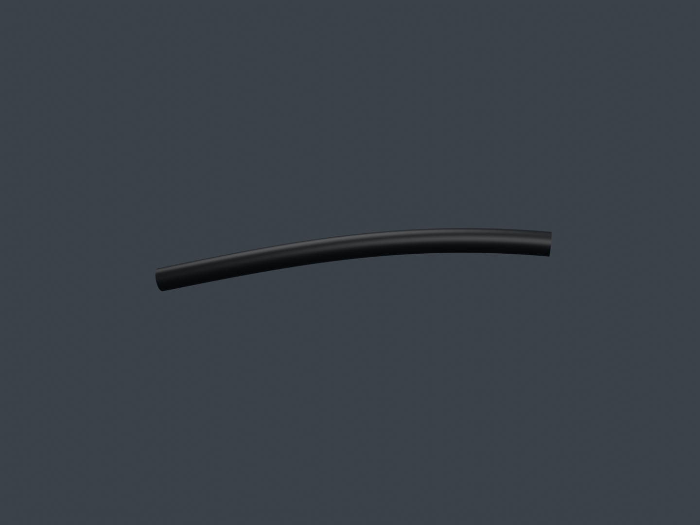
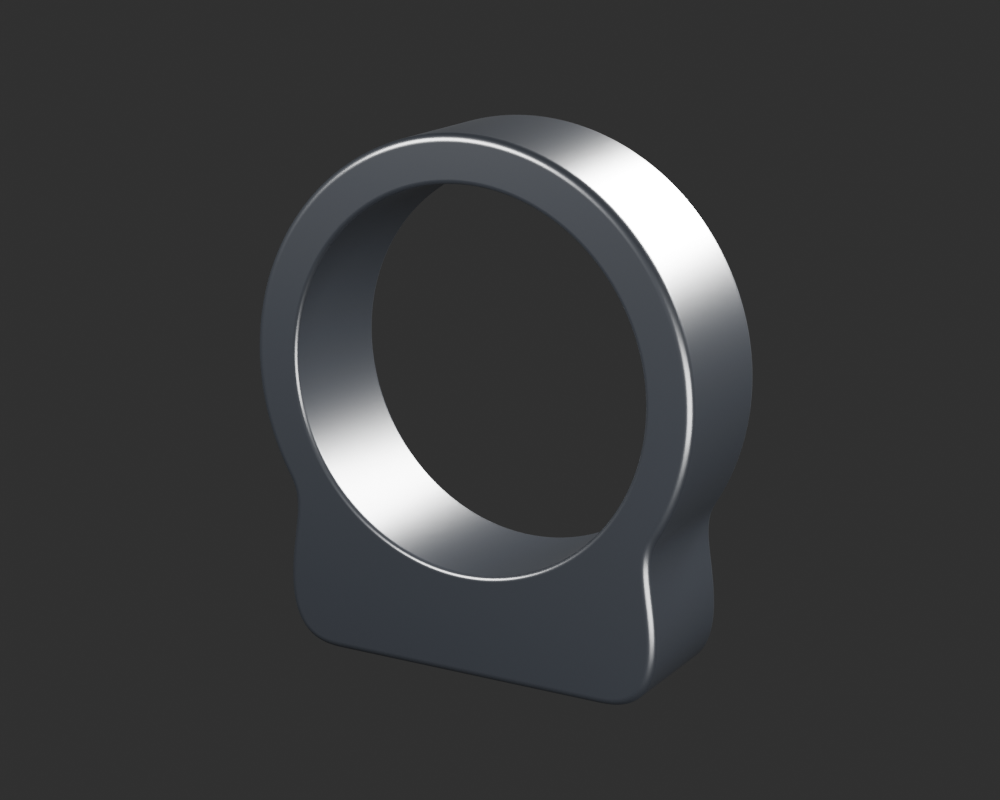
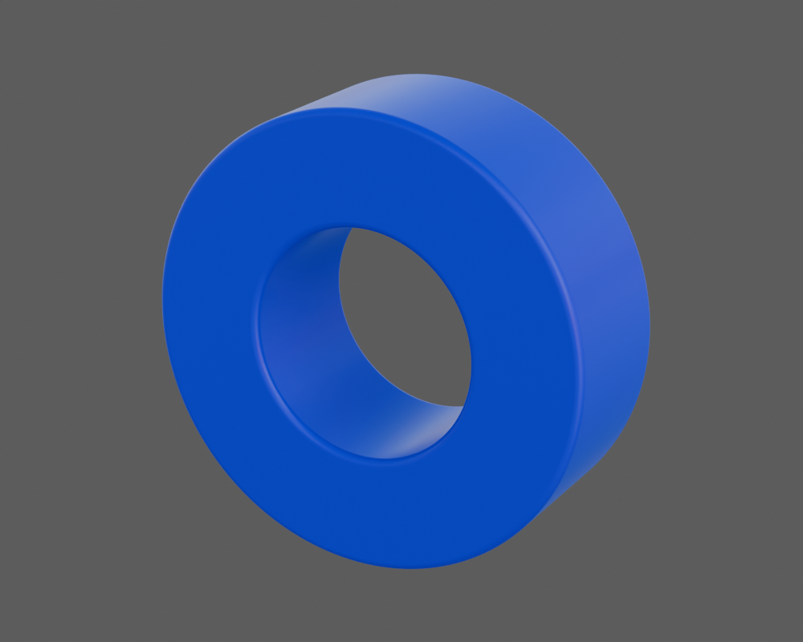
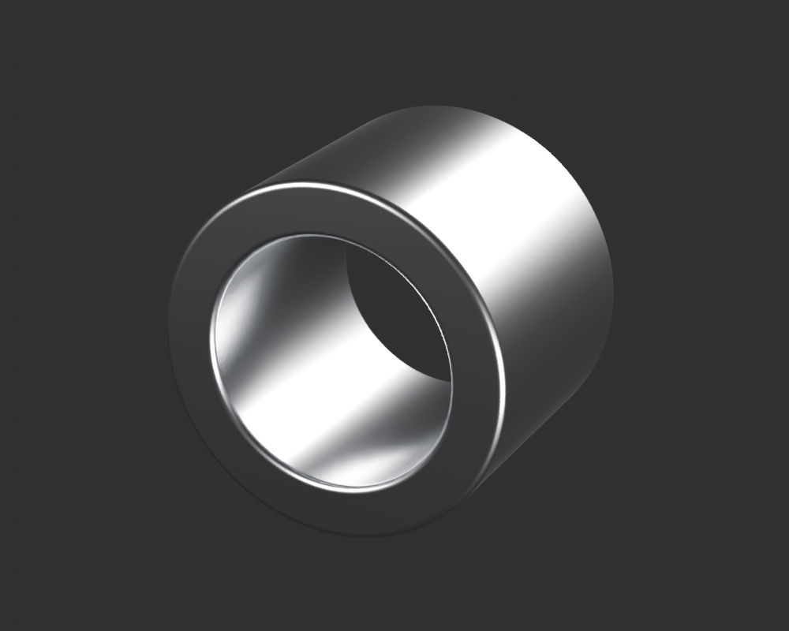
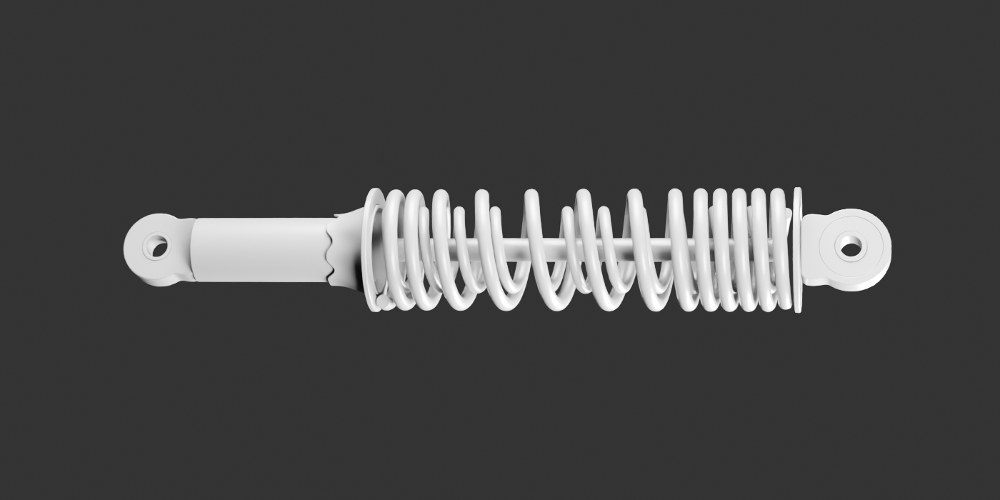
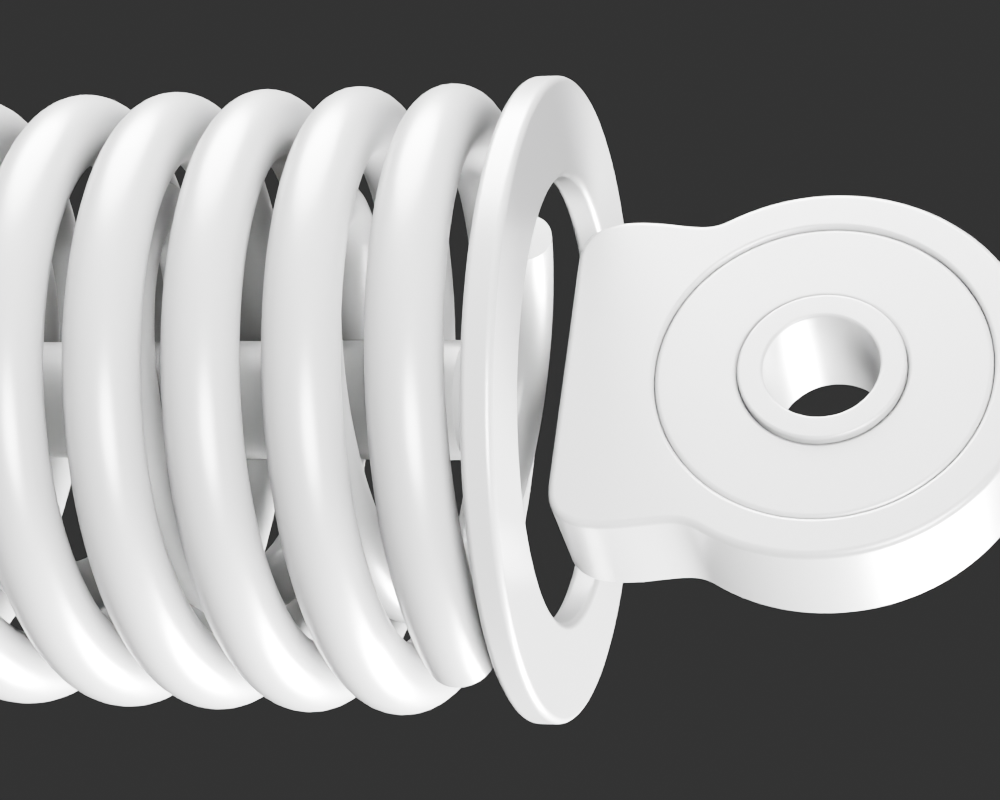

# Viva Wewa — fabrication moto, point de revue 20

Six nouvelles pièces sont vérifiées séparément : boulon de bridage, anneau de clé, court départ de gaine d’embrayage et les trois enveloppes de l’œil opposé de l’amortisseur. Le registre compte **92 identités physiques candidates**. La première composition de l’amortisseur reste un **diagnostic incomplet**, avec deux liaisons extérieures à fabriquer. Les dix-huit groupes continuent.

[Une image par composant](motorcycle18-components.md) · [Galerie détaillée](motorcycle18-gallery/index.html) · [Point précédent](motorcycle18-checkpoint-19.md) · [Priorités des dix-huit groupes](../research/motorcycle18-current-fabrication-priorities-source19-v1.md)

## Commandes et clé

Le [boulon de bridage](control-perch-clamp-bolt-v1/README.md) reprend le nominal M6×1 du kit BM150 apparenté, sans identifier la variante RDC. Les premiers escaliers de filet ont été rejetés puis corrigés par un échantillonnage aligné avec l’hélice. Tête, longueur et finition restent estimées. Le trou estimé4,3mm du support actuel demeure incompatible avec le nominal6mm : aucun montage n’est forcé. Les rendus Blender sont lisibles, mais **Babylon présente encore des stries sur les filets**. Cette divergence est conservée et ne devient pas une réception du rendu en jeu.

L’[anneau](ignition-key-ring-v1/README.md) possède deux tours estimés et des extrémités séparées, avec une section arrondie. Son passage dans la clé est contrôlé sur des guides géométriques attribués et trois poses conditionnelles ; les guides ne constituent pas une certification de montage. La pose sérialisée et son petit écart numérique sont documentés. Le nombre exact de tours, les cotes, l’élasticité et la finition ne sont pas mesurés.

La [gaine supérieure d’embrayage](clutch-upper-sheath-v1/README.md) est un tronçon local à paroi finie et lumière ouverte. Sa coupe distale est une **coupe de revue** ; elle ne représente pas un embout industriel. Le petit jeu au réglage est provisoire. Ferrule, soufflet, câble intérieur, continuation cachée et jonction au câble inférieur ne sont pas déclarés fabriqués. La macro noire montre peu de contraste dans la paroi interne ; la vue grise indépendante sert à examiner son ouverture. Une nouvelle composition du poste de conduite doit vérifier ces départs dans la vue utilisateur.

## Œil opposé de l’amortisseur

L’[extérieur noir](rear-sns-opposite-eye-exterior-v1/README.md), la [région bleue](rear-sns-opposite-blue-region-v1/README.md) et le [manchon argent](rear-sns-opposite-eye-sleeve-v1/README.md) sont trois enveloppes séparées, avec leurs vrais passages. Leurs profondeurs, revers et sections sont des hypothèses bornées. Le grand bleu opposé ne sert pas à inventer le petit bleu ambigu côté fût. Les jeux positifs entre candidats prouvent leur séparation numérique, sans prouver un ajustement mécanique. Leurs matières originales restent constantes entre studio et ciel ; ni composition, couleur OEM ni finition n’est mesurée.

## Première composition SNS : un défaut visible à reprendre

La [composition de contrôle](rear-sns-rest-assembly-v1/README.md) réunit les douze sources exactes, sans retoucher leurs formes ou matières. Les vrais attributs, indices et matrices des exports sont protégés. Les deux entières et la macro montrent une grande ouverture annulaire autour de la racine opposée, ainsi qu’un arrêt de tige non recouvert. Une fermeture extérieure côté fût manque aussi. Ce sont des **formes manquantes**, distinctes des cotes inconnues : deux nouvelles enveloppes de liaison sont à construire, puis une seconde composition grise vérifiera les deux extrémités avant finition. Cette revue n’ajoute aucune identité physique au registre et ne ferme pas le lot16.

## Reprise et suite

Les fichiers Blender, GLB, vues natives réellement relues et imports Babylon des six pièces sont disponibles. Les audits de dépendances utiles sont séparés : [boulon](../research/motorcycle-source-dependencies-publication20-cockpit-bolt-v1/README.md), [anneau](../research/motorcycle-source-dependencies-publication20-key-ring-v1/README.md), [œil noir](../research/motorcycle-source-dependencies-publication20-sns-opposite-eye-v1/README.md), [bleu](../research/motorcycle-source-dependencies-publication20-sns-blue-region-v1/README.md), [manchon](../research/motorcycle-source-dependencies-publication20-sns-opposite-eye-sleeve-v1/README.md), [gaine](../research/motorcycle-source-dependencies-publication20-clutch-upper-sheath-v1/README.md). Ils identifient les vrais ancêtres et les petits fichiers de reprise nécessaires, sans prétendre à une reconstruction vierge exécutée.

La reprise géométrique du pneu avant, le départ de frein, le connecteur visible d’allumage et les fermetures SNS continuent hors de cette série. Les grands éléments encore absents des lots12 à18 restent dans la file : optiques, garde-boue avant, frein/transmission arrière, carburateur, commandes basses/béquilles, caches, porte-bagages, éclairage arrière et huit catégories visibles d’embase de selle. La fabrication et les contrôles d’ensemble précèdent la validation artistique et l’optimisation pour iPhone ; le conducteur attend la moto seule.
