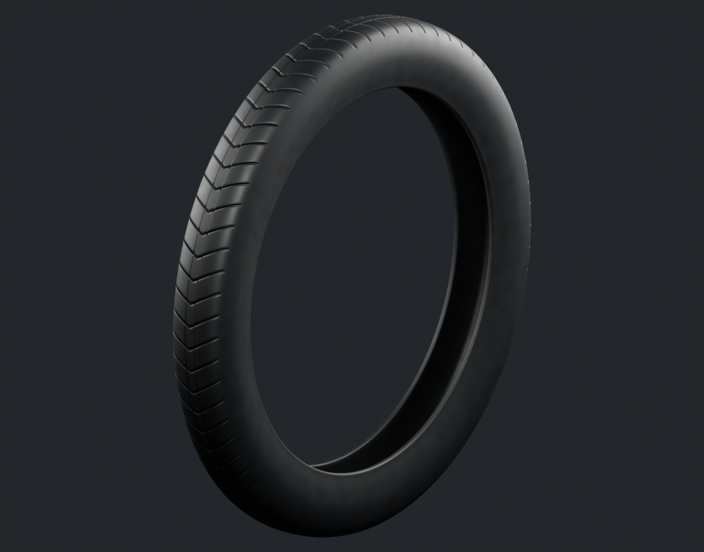
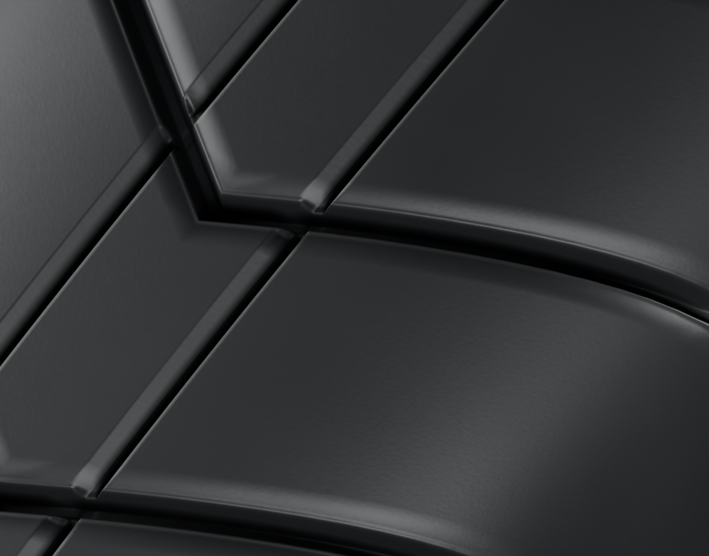
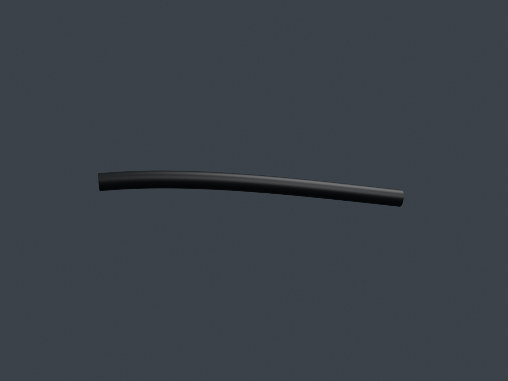
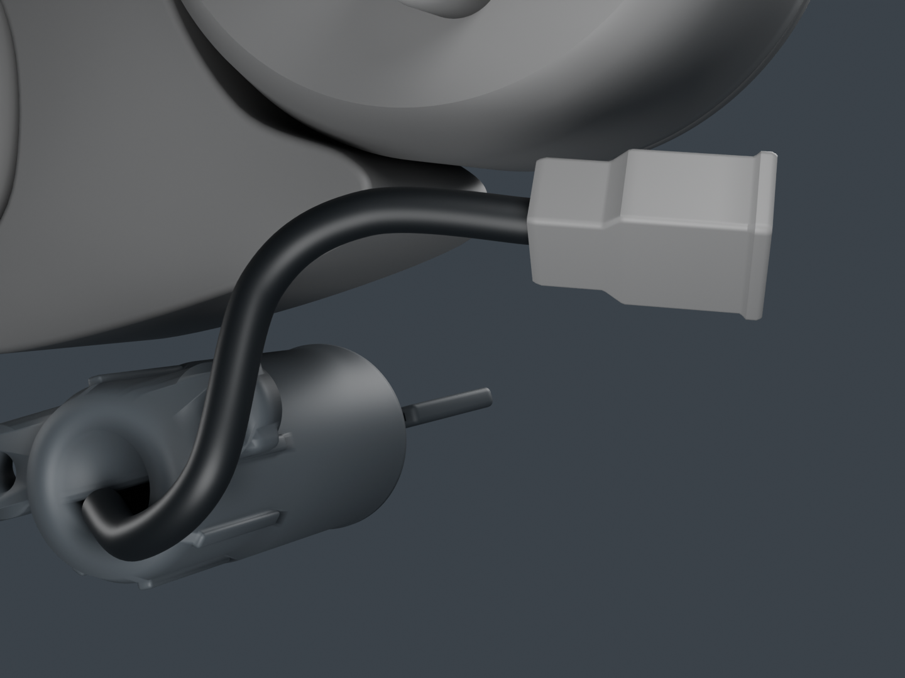
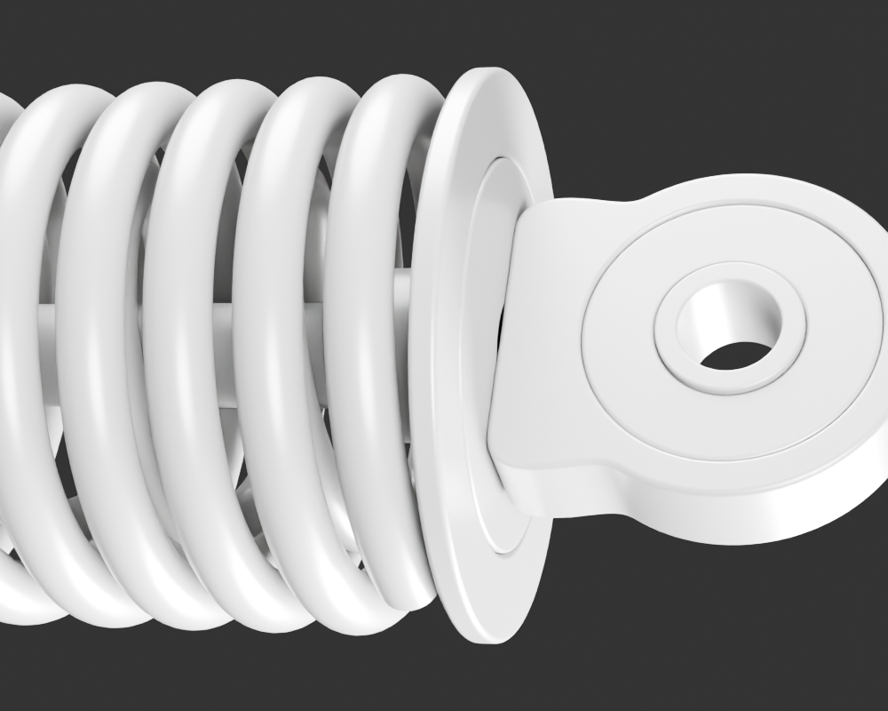

# Viva Wewa — fabrication moto, point de revue 21

Trois nouvelles pièces rejoignent la revue : le court départ supérieur de frein et les deux enveloppes extérieures manquantes de l’amortisseur. Le pneu avant et la route du petit faisceau sont corrigés sans créer de nouvelles identités physiques. Le registre contient **95 composants candidats** ; les dix-huit ensembles restent en cours de fabrication.

[Une image par composant](motorcycle18-components.md) · [Galerie détaillée](motorcycle18-gallery/index.html) · [Point précédent](motorcycle18-checkpoint-20.md) · [Fabrication des dix-huit ensembles](../workflow/motorcycle-execution-18.json)

## Pneu avant : correction de forme avant matière

La [révision 3](front-tyre-v3/README.md) corrige les pincements et marches aux jonctions des incisions existantes. Les premiers essais de raccord local et de grille restent conservés comme diagnostics refusés. La réparation continue couvre l’empreinte utile de la sculpture ; elle préserve le rayon, la largeur et les sommets protégés. De nouveaux échantillons proches des crêtes déplacent les extrêmes de boîte d’environ 1,3 µm : cette différence est publiée séparément du rayon conservé, sans écrêtage pour masquer le résultat. Le diamètre de portée de 17 pouces est documenté ; diamètre extérieur, largeur gonflée, section et moule restent estimés.

Les quatre vues finales sont réellement examinées. Les anciennes marches ne sont pas retrouvées dans ces témoins ; un petit reflet de terminaison reste réservé. Le matériau original a été recuit sur cette géométrie corrigée, avec deux PNG réellement intégrés au GLB et des compagnons relatifs dans Blender. Les coins orientés de géométrie sont protégés, sans prétendre que les indices bruts restent identiques après les nouveaux splits de tangentes. **Le grain est plus doux et filtré dans l’atlas**, notamment sur le flanc ; une égalité photographique parfaite entre le matériau procédural et l’export n’est pas acquise. Ce master détaillé n’est pas un LOD mobile.

## Départ de frein et faisceau

Le [départ supérieur de frein](front-brake-upper-sheath-v1/README.md) possède une paroi annulaire finie et un passage ouvert. Sa route utilise son propre réglage droit, sans copier métriquement la gaine d’embrayage. Les quatre finales et le détail gris sont examinés. La section distale demeure une **coupe de revue**, pas un embout manufacturé : ferrule, soufflet, câble intérieur et continuation vers les anciens tronçons inférieurs restent à fabriquer ou documenter.

Le [faisceau 3](cockpit-cables-v3/README.md) déplace seulement la fin de la boucle pour sortir la coque estimée du cache des compteurs. Les 36 premières stations et les deux gaines basses sont protégées ; l’ancienne route et la première coque en collision restent archivées. Les vues actuelles utilisent les vrais compteurs 5 et la coque géométrique 2 comme contexte neutre. La macro oblique masque une partie de l’entrée ; le diagnostic gris séparé en montre le vrai vide annulaire. Le petit jeu provisoire ne prouve ni un contact électrique ni un ajustement installé. Le rendu Babylon isolé cadre tout le faisceau et rend la petite boucle sombre : il ne constitue pas une réception du rendu conducteur. La coque finie et la nouvelle composition complète du cockpit suivent séparément.

## Amortisseur : les deux liaisons visibles ajoutées

Les [deux](rear-sns-opposite-end-closure-v1/README.md) [enveloppes](rear-sns-body-end-closure-v1/README.md) couvrent les grands vides extérieurs identifiés dans la première composition à douze sources. Elles conservent passages, épaisseurs et frontières distinctes ; profils, revers et sections sont des continuations artistiques bornées. Les voisins d’origine ne sont pas déformés. Les faibles jeux numériques ne sont pas des tolérances, des appuis certifiés ou une preuve de chemin de charge. Aucun piston, joint ou mécanisme hydraulique caché n’est inventé.

La nouvelle [composition de revue](rear-sns-rest-assembly-v3/README.md) conserve les quatorze géométries et leurs poses. Les vues grises permettent de lire les deux jonctions ; les vues noires et orange montrent les mêmes matières sous studio et ciel. Leur variation de teinte reste visible, sans recoloration entre les vues. Cette composition ajoute **zéro composant physique** ; elle ne valide ni pose sur la moto, ni compression, ni fabrication OEM, ni lot 16 complet.

## Reprise et suite

Les audits documentent les véritables dépendances de [forme du pneu](../research/motorcycle-source-dependencies-publication21-front-tyre-g3-strip-v1/README.md), [matière du pneu](../research/motorcycle-source-dependencies-publication21-front-tyre-material-v3-v1/README.md), [faisceau](../research/motorcycle-source-dependencies-publication21-cockpit-cables-v3-v1/README.md), [gaine frein](../research/motorcycle-source-dependencies-publication21-front-brake-upper-sheath-v1/README.md), [fermeture opposée](../research/motorcycle-source-dependencies-publication21-sns-opposite-end-closure-v1/README.md), [fermeture fût](../research/motorcycle-source-dependencies-publication21-sns-body-end-closure-v1/README.md), [composition grise](../research/motorcycle-source-dependencies-publication21-sns-gray-composition2-v1/README.md) et [composition matière](../research/motorcycle-source-dependencies-publication21-sns-pbr-composition3-v1/README.md). Ils ne prétendent pas à une reconstruction vierge exécutée. Le petit fichier de baseline réellement lu par le rendu gris du pneu et le complément de helpers du faisceau restent explicitement inclus hors des anciens gels.

La seconde terminaison du pare-moteur, la coque de connecteur, les nouvelles vues conducteur et les optiques continuent hors de cette série. Les formes encore absentes des lots 12 à 18 restent dans la file : phare/clignotants, garde-boue avant, roue/frein/transmission arrière, carburateur, commandes basses/béquilles, caches, porte-bagages, éclairage arrière et catégories manquantes du dessous de selle. La moto seule précède son conducteur ; l’optimisation et la mesure sur iPhone viennent après les contrôles des formes et des assemblages.

## Vérification après publication

Source immuable : [`adf8c667`](https://github.com/Mobutoo/wewa/commit/adf8c667914278398ca57e0c645e703eb3df79ee), arbre `71cc84fa1b7926b8e930e44ac150f2578a5e76a5`. Le contrôle local du commit lit 4 647 JSON, 380 manifestes, 12 456 empreintes de fichiers, 62 empreintes PNG de checkpoints et 6 325 liens de revue, sans erreur dans ce périmètre. Le catalogue compte 120 choix, la galerie 123 révisions avec trois historiques et 921 PNG ; 95 identités physiques et 99 fiches restent distinctes.

[GitHub Actions](https://github.com/Mobutoo/wewa/actions/runs/39616838008) est en attente au moment de cette publication ; aucune réussite distante n’est annoncée. Le PRD complet Ewutelo est sauvegardé et relu en révision 46, avec égalité de tous les champs et 45 exigences inchangées. Ces métadonnées et le [rapport de contrôle](../../WEWA_Developpement_Web/validation/motorcycle18-source21-integrity.json) suivent le commit source. Les autres fichiers de travail complets et préparations sont ensuite poussés séparément à la demande de l’utilisateur.
