# Viva Wewa — revue des composants moto

**52 composants uniques enregistrés · 52 vues Blender prouvées · aucune réception artistique.**

Une seule vue originale par composant, à la révision exacte de sa fiche. Les anciennes révisions et les sources seulement cataloguées ou gelées sans enregistrement central ne sont pas ajoutées. Ces rendus montrent des candidats isolés, pas le jeu ni une moto terminée.

Les dimensions locales et variantes restent estimées ou non confirmées. Les interfaces complètes, les LOD, le coût mobile et Safari sur iPhone physique ne sont pas validés. Un contrôle de fichier ou une importation Babylon ne vaut pas réception de forme ou de matière.

[Registre des composants](../library/component-production.json) · [Plan des 18 groupes](../workflow/motorcycle-execution-18.json) · [Galerie HTML à servir dans un navigateur](motorcycle18-gallery/index.html)

## Les 18 groupes

**2 groupes restent sans nouvelle pièce enregistrée dans cette séquence.** Le groupe 14 dispose de candidats antérieurs ci-dessous ; sa compatibilité actuelle reste à recontrôler.

| Groupe | Composants enregistrés dans la séquence | État |
| --- | --- | --- |
| [01 · Pontets et fixations du guidon](#groupe-1) | 3 | Candidats partiels en revue ; groupe non terminé |
| [02 · Support des compteurs](#groupe-2) | 1 | Candidats partiels en revue ; groupe non terminé |
| [03 · Accélérateur et entraînement de câble](#groupe-3) | 2 | Candidats partiels en revue ; groupe non terminé |
| [04 · Commodo gauche](#groupe-4) | 1 | Candidats partiels en revue ; groupe non terminé |
| [05 · Commodo droit](#groupe-5) | 1 | Candidats partiels en revue ; groupe non terminé |
| [06 · Levier embrayage et support](#groupe-6) | 1 | Candidats partiels en revue ; groupe non terminé |
| [07 · Levier frein au guidon et support](#groupe-7) | 1 | Candidats partiels en revue ; groupe non terminé |
| [08 · Rétroviseurs gauche/droit](#groupe-8) | 2 | Candidats partiels en revue ; groupe non terminé |
| [09 · Contacteur et clé](#groupe-9) | 1 | Candidats partiels en revue ; groupe non terminé |
| [10 · Câbles et faisceau visibles](#groupe-10) | 1 | Candidats partiels en revue ; groupe non terminé |
| [11 · Visière et entourage des compteurs](#groupe-11) | 1 | Candidats partiels en revue ; groupe non terminé |
| [12 · Phare et clignotants avant](#groupe-12) | 2 | Candidats partiels en revue ; groupe non terminé |
| [13 · Fourche et direction](#groupe-13) | 6 | Candidats partiels en revue ; groupe non terminé |
| [14 · Ensemble avant et compatibilité des candidats existants](#groupe-14) | Voir les préexistants ; aucun nouveau composant compté | Candidats antérieurs existants à recontrôler ; compatibilité restante |
| [15 · Garde-boue, cadre et bras oscillant](#groupe-15) | 7 | Candidats partiels en revue ; groupe non terminé |
| [16 · Roue arrière, frein, transmission et amortisseurs](#groupe-16) | 2 | Candidats partiels en revue ; groupe non terminé |
| [17 · Moteur extérieur, échappement, repose-pieds, pédales et béquilles](#groupe-17) | 14 | Candidats partiels en revue ; groupe non terminé |
| [18 · Réservoir WEWA, caches latéraux, selle, porte-bagages et éclairage arrière](#groupe-18) | 0 | À fabriquer ; aucune pièce enregistrée |

## 01 · Pontets et fixations du guidon

### Pontets du guidon — candidat séparé

`MOTO-HANDLEBAR-CLAMPS-001` · révision `handlebar-clamps-v1` · **candidat non reçu**

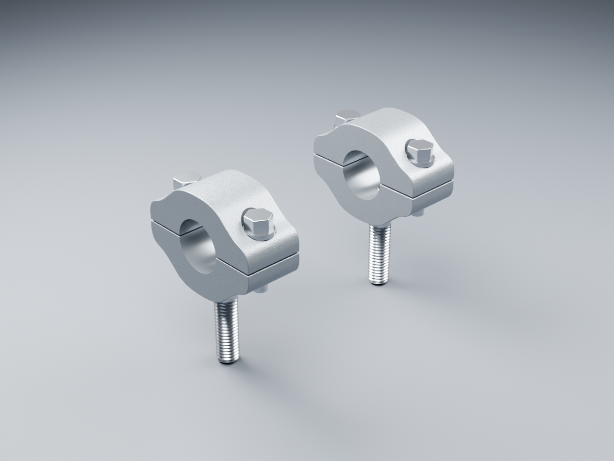

[Image entière](handlebar-clamps-v1/quarter.png) · [Preuve du rendu](handlebar-clamps-v1/render-report.json) · vue `quarter`

Source SHA-256 : `416fd21980fe4425628bf7414607c8c37c12dea4f70965e0bac67c721d7e14c5`  
PNG SHA-256 : `4805c716dc4d445e9676ac476c68b4866e82fe1c41860af3df30bc24e79aeb0b`

[Blender](../../assets-src/moto-components/handlebar-clamps/handlebar-clamps-v1.blend) · [GLB](../../assets-src/moto-components/handlebar-clamps/handlebar-clamps-inspection.glb) · [README source](../../assets-src/moto-components/handlebar-clamps/README.md) · [Revue et limites](handlebar-clamps-v1/README.md) · [Fiche](../workflow/records/moto-handlebar-clamps-001.json)

Autres vues Blender prouvées de cette révision

- [material-close](handlebar-clamps-v1/material-close.png) · [preuve](handlebar-clamps-v1/render-report.json)

### Écrou Nyloc v3 — frontières du filet corrigées

`MOTO-HANDLEBAR-MOUNT-NYLOC-001` · révision `handlebar-mount-nyloc-v3` · **candidat non reçu**

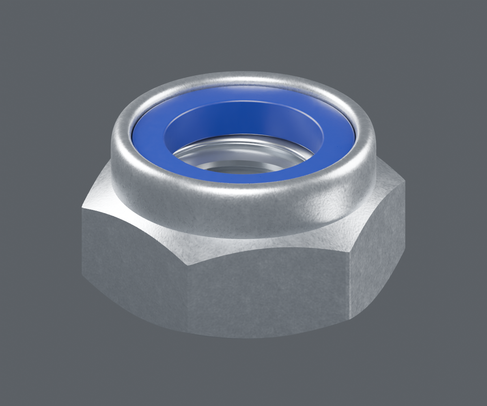

[Image entière](handlebar-mount-nyloc-v3/quarter.png) · [Preuve du rendu](handlebar-mount-nyloc-v3/render-report.json) · vue `quarter`

Source SHA-256 : `c82851ea5e7434de3477c9f1c91eb227f37729b946499ee688c0f825278c487e`  
PNG SHA-256 : `ca0eeff9d73e7bf7bf0f8f220f79e0cb851e31fc7d721d032d0b7efaf284a325`

[Blender](../../assets-src/moto-components/handlebar-clamps/mounting-nyloc-v3/handlebar-mount-nyloc-v3.blend) · [GLB](../../assets-src/moto-components/handlebar-clamps/mounting-nyloc-v3/handlebar-mount-nyloc-v3-inspection.glb) · [README source](../../assets-src/moto-components/handlebar-clamps/mounting-nyloc-v3/README.md) · [Revue et limites](handlebar-mount-nyloc-v3/README.md) · [Fiche](../workflow/records/moto-handlebar-mount-nyloc-001.json)

Autres vues Blender prouvées de cette révision

- [underside-thread](handlebar-mount-nyloc-v3/underside-thread.png) · [preuve](handlebar-mount-nyloc-v3/render-report.json)
- [crown-material](handlebar-mount-nyloc-v3/crown-material.png) · [preuve](handlebar-mount-nyloc-v3/render-report.json)

### Rondelle supérieure du guidon — DS181007 apparentée

`MOTO-HANDLEBAR-MOUNT-UPPER-WASHER-001` · révision `handlebar-mount-upper-washer-v1` · **candidat non reçu**

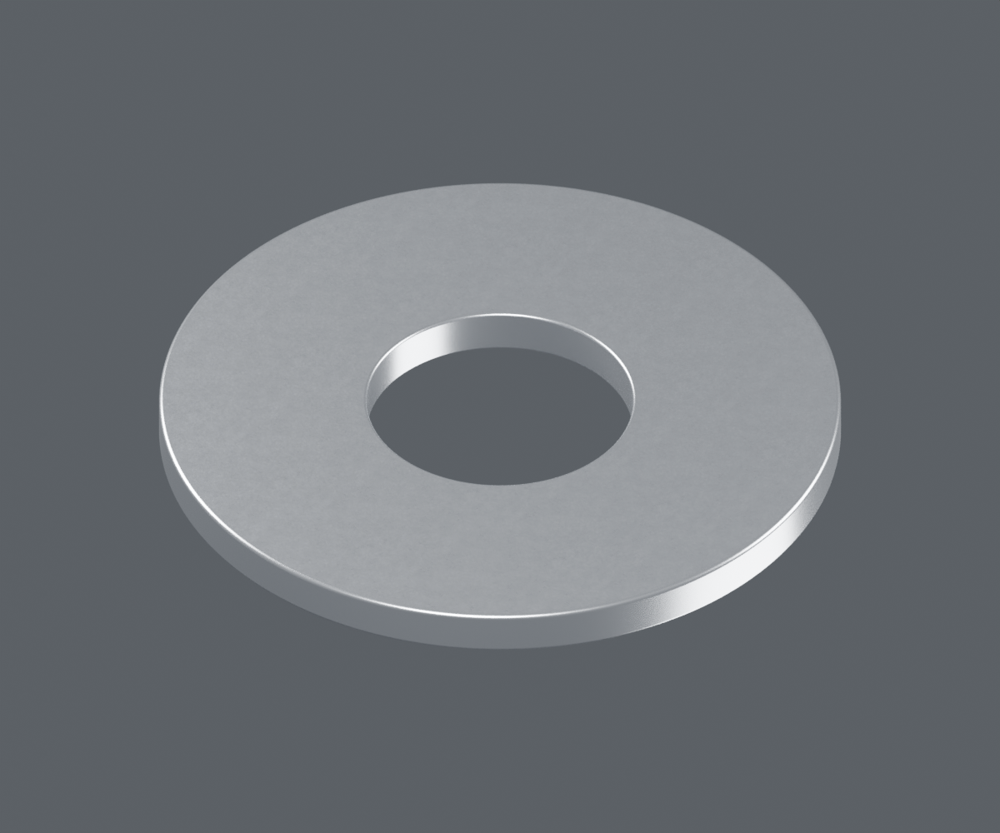

[Image entière](handlebar-mount-upper-washer-v1/quarter.png) · [Preuve du rendu](handlebar-mount-upper-washer-v1/render-report.json) · vue `quarter`

Source SHA-256 : `9486e5526cb7d126f17499bde267f880d3cf59fecc371fe76b8ba048a4a7d7ee`  
PNG SHA-256 : `7905216d91a69aadc17d489d53be8eb5d095eb3d6ed38532e6350fe064d8e845`

[Blender](../../assets-src/moto-components/handlebar-clamps/mounting-upper-washer/handlebar-mount-upper-washer-v1.blend) · [GLB](../../assets-src/moto-components/handlebar-clamps/mounting-upper-washer/handlebar-mount-upper-washer-inspection.glb) · [README source](../../assets-src/moto-components/handlebar-clamps/mounting-upper-washer/README.md) · [Revue et limites](handlebar-mount-upper-washer-v1/README.md) · [Fiche](../workflow/records/moto-handlebar-mount-upper-washer-001.json)

Autres vues Blender prouvées de cette révision

- [reverse](handlebar-mount-upper-washer-v1/reverse.png) · [preuve](handlebar-mount-upper-washer-v1/render-report.json)
- [face-material](handlebar-mount-upper-washer-v1/face-material.png) · [preuve](handlebar-mount-upper-washer-v1/render-report.json)

Périmètre prévu : demi-pontets supérieurs; berceaux inférieurs avec goujons; visserie visible.

## 02 · Support des compteurs

### Support des compteurs v2 — nervure élargie

`MOTO-INSTRUMENT-BRACKET-001` · révision `instrument-bracket-v2` · **candidat non reçu**

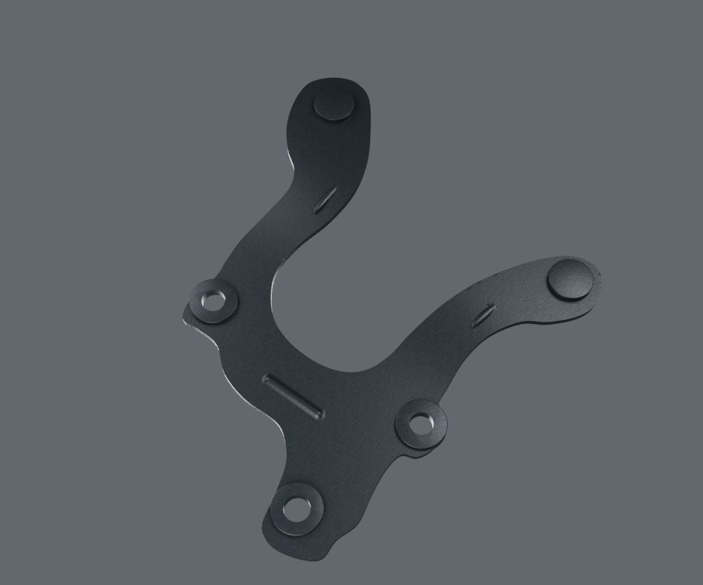

[Image entière](instrument-bracket-v2/front-quarter.png) · [Preuve du rendu](instrument-bracket-v2/render-report.json) · vue `front-quarter`

Source SHA-256 : `52d89cdeb675610ef4f89d8ea10a17c95f79824c68aa8953d6c503b5ce245759`  
PNG SHA-256 : `5c0a5f33c5b816ffa9656d3c1384d36454fe6d26acb9966681e657aa95ba5c6e`

[Blender](../../assets-src/moto-components/instrument-bracket/instrument-bracket-v2.blend) · [GLB](../../assets-src/moto-components/instrument-bracket/instrument-bracket-v2-inspection.glb) · [README source](../../assets-src/moto-components/instrument-bracket/README_v2.md) · [Revue et limites](instrument-bracket-v2/README.md) · [Fiche](../workflow/records/moto-instrument-bracket-001.json)

Autres vues Blender prouvées de cette révision

- [reverse-quarter](instrument-bracket-v2/reverse-quarter.png) · [preuve](instrument-bracket-v2/render-report.json)

Périmètre prévu : support ajouré et collerettes.

## 03 · Accélérateur et entraînement de câble

### Manchon accélérateur et entraînement de câble

`MOTO-THROTTLE-CONTROL-001` · révision `throttle-control-v1` · **candidat non reçu**

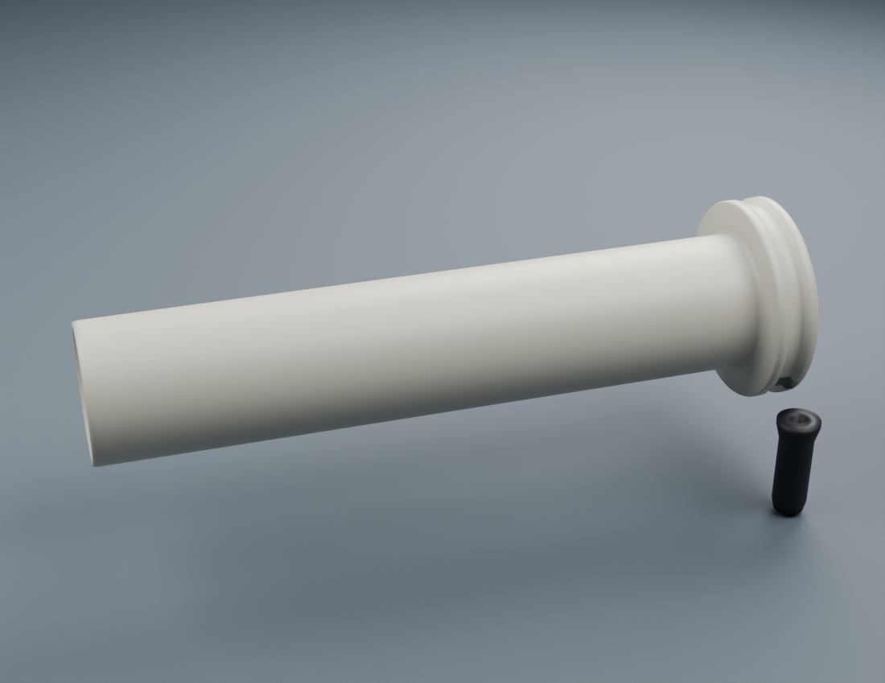

[Image entière](throttle-control-v1/quarter-rest.png) · [Preuve du rendu](throttle-control-v1/render-report.json) · vue `quarter-rest`

Source SHA-256 : `1c0747975fbdcd2ada2140f2461ff359940967aa1a3036e2b7e0a3d24221237f`  
PNG SHA-256 : `7e9e9a067f1cd60d9a3b4b0815e85570d3d5f43fd2f1e53be2b5cacf271b6f9f`

[Blender](../../assets-src/moto-components/throttle-control/throttle-control-v1.blend) · [GLB](../../assets-src/moto-components/throttle-control/throttle-control-inspection.glb) · [README source](../../assets-src/moto-components/throttle-control/README.md) · [Revue et limites](throttle-control-v1/README.md) · [Fiche](../workflow/records/moto-throttle-control-001.json)

Autres vues Blender prouvées de cette révision

- [spool-working-50deg](throttle-control-v1/spool-working-50deg.png) · [preuve](throttle-control-v1/render-report.json)

### Poignées v3 — motifs arrondis élargis

`MOTO-HANDLEBAR-GRIPS-001` · révision `handlebar-grips-v3` · **candidat non reçu**

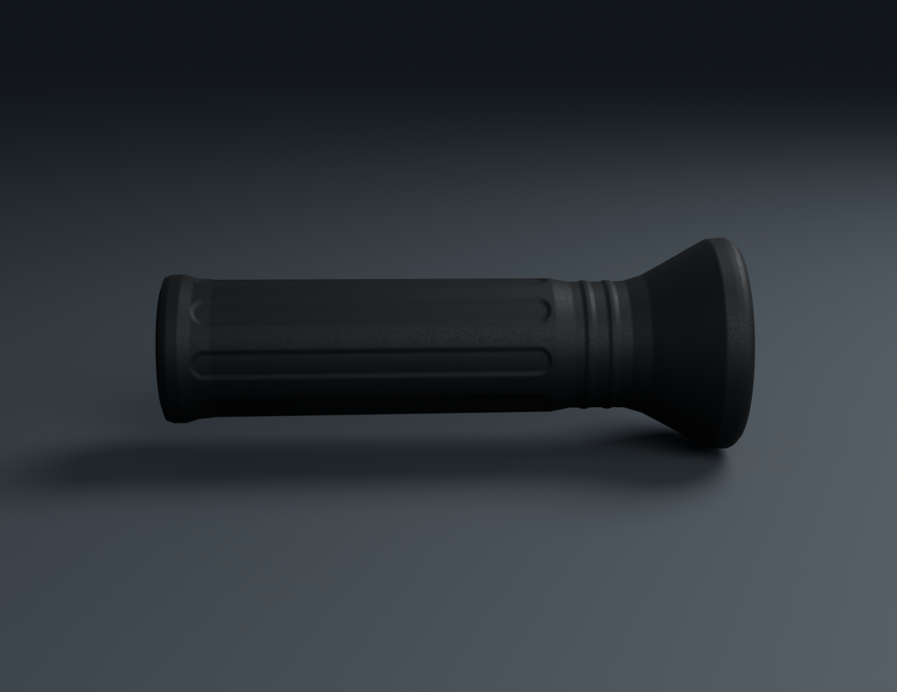

[Image entière](handlebar-grips-v3/left-reference-side.png) · [Preuve du rendu](handlebar-grips-v3/render-report.json) · vue `left-reference-side`

Source SHA-256 : `8ba577ea4078850569394d7d17e6e6d868e590bb287b329da3c0600706351381`  
PNG SHA-256 : `c8dca4c734646d2f2dc6b1320f0c0b885932ce38a4e211f71bec3349850b1049`

[Blender](../../assets-src/moto-components/handlebar-grips/handlebar-grips-v3.blend) · [GLB](../../assets-src/moto-components/handlebar-grips/handlebar-grips-v3-inspection.glb) · [README source](../../assets-src/moto-components/handlebar-grips/README_v3.md) · [Revue et limites](handlebar-grips-v3/README.md) · [Fiche](../workflow/records/moto-handlebar-grips-001.json)

Autres vues Blender prouvées de cette révision

- [right-quarter](handlebar-grips-v3/right-quarter.png) · [preuve](handlebar-grips-v3/render-report.json)

Périmètre prévu : poignées droite/gauche v3, motifs de travail estimés; manchon et bobine; guide de câble fixe.

## 04 · Commodo gauche

### Commodo gauche v3 — pictogrammes lissés

`MOTO-SWITCHGEAR-LEFT-001` · révision `switchgear-left-v3` · **candidat non reçu**

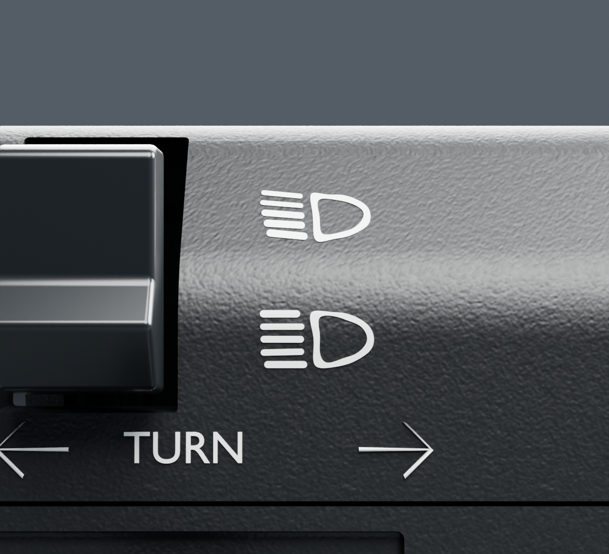

[Image entière](switchgear-left-v3/symbols-high-low.png) · [Preuve du rendu](switchgear-left-v3/render-report.json) · vue `symbols-high-low`

Source SHA-256 : `a8cde7758ea9c96f2eac7c2d7ba817b4a353935a0a62ac2d53d0003e8e9bdeea`  
PNG SHA-256 : `9eea16c6dabb10c643a46eee944214c3e03154408efb99d48188177a085e8f08`

[Blender](../../assets-src/moto-components/switchgear-left/switchgear-left-v3.blend) · [GLB](../../assets-src/moto-components/switchgear-left/switchgear-left-v3-inspection.glb) · [README source](../../assets-src/moto-components/switchgear-left/README_v3.md) · [Revue et limites](switchgear-left-v3/README.md) · [Fiche](../workflow/records/moto-switchgear-left-001.json)

Autres vues Blender prouvées de cette révision

- [symbol-horn](switchgear-left-v3/symbol-horn.png) · [preuve](switchgear-left-v3/render-report.json)

Périmètre prévu : coques gauche; bascule éclairage; sélecteur clignotants et rappel; poussoir klaxon.

## 05 · Commodo droit

### Commodo droit — fonction rouge inconnue

`MOTO-SWITCHGEAR-RIGHT-001` · révision `switchgear-right-v1` · **candidat non reçu**

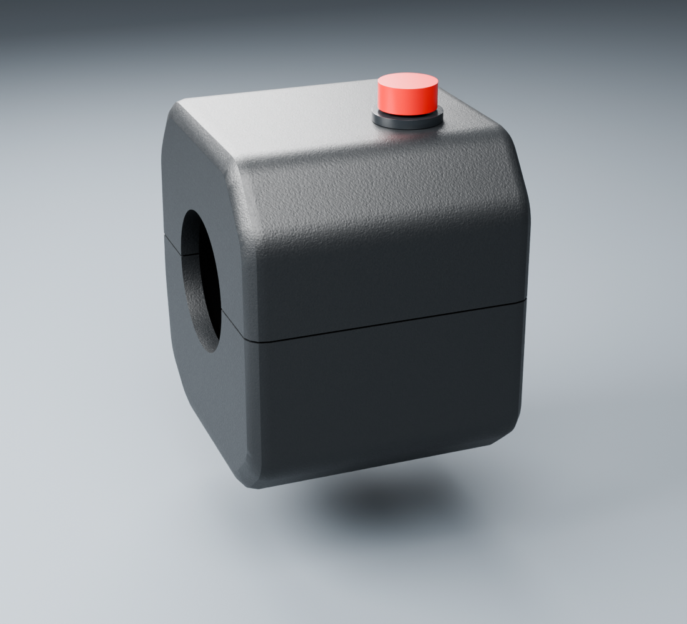

[Image entière](switchgear-right-v1/quarter.png) · [Preuve du rendu](switchgear-right-v1/render-report.json) · vue `quarter`

Source SHA-256 : `84182072eb72607cf3b9a029cf4e09964f8b4a86df612bfed912d0d666e9087c`  
PNG SHA-256 : `40467295c4d906c9a7e3012a53e246e2eeb369e8b760140b57e0e0eb5e8cfd61`

[Blender](../../assets-src/moto-components/switchgear-right/switchgear-right-v1.blend) · [GLB](../../assets-src/moto-components/switchgear-right/switchgear-right-inspection.glb) · [README source](../../assets-src/moto-components/switchgear-right/README.md) · [Revue et limites](switchgear-right-v1/README.md) · [Fiche](../workflow/records/moto-switchgear-right-001.json)

Autres vues Blender prouvées de cette révision

- [front](switchgear-right-v1/front.png) · [preuve](switchgear-right-v1/render-report.json)
- [underside](switchgear-right-v1/underside.png) · [preuve](switchgear-right-v1/render-report.json)

Périmètre prévu : coques droite; commande rouge observée de fonction inconnue.

## 06 · Levier embrayage et support

### Levier embrayage et support

`MOTO-CLUTCH-CONTROL-001` · révision `clutch-control-v2` · **candidat non reçu**

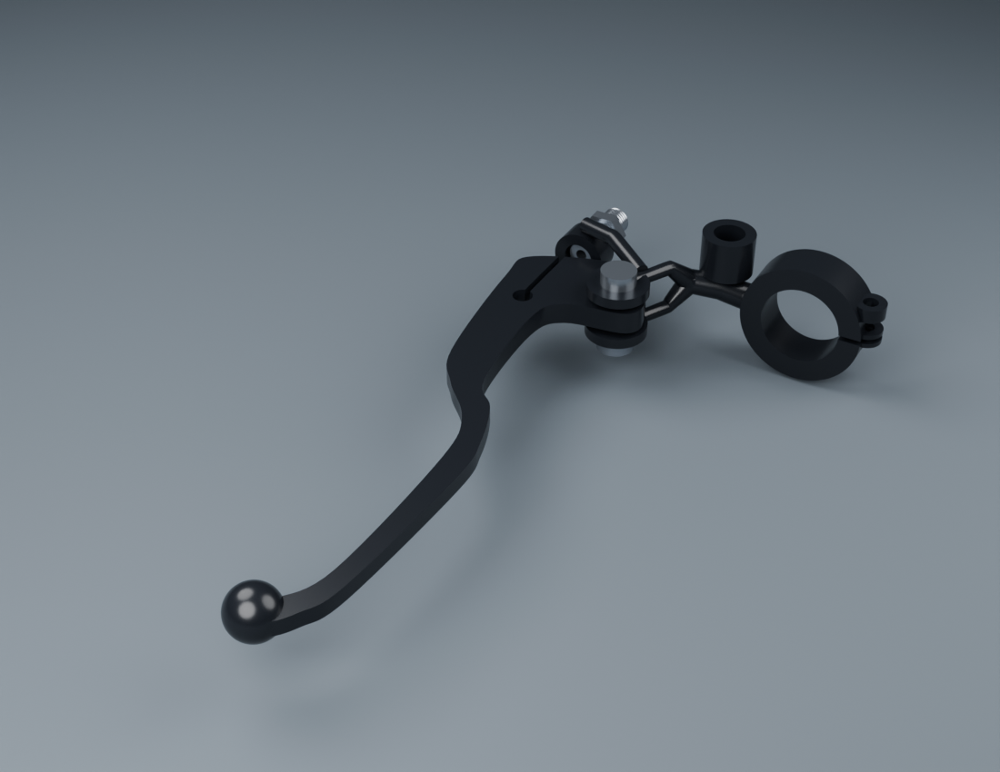

[Image entière](clutch-control-v2/quarter-rest.png) · [Preuve du rendu](clutch-control-v2/render-report.json) · vue `quarter-rest`

Source SHA-256 : `586b41d08fd0cb8a9caad66e7cbe83af1592aad42e6def823135f99b6f200059`  
PNG SHA-256 : `f7aa85d259f48966906f2248352fbc94a465ebcb6fae02b8ed59e59aa7392e0c`

[Blender](../../assets-src/moto-components/clutch-control/clutch-control-v2.blend) · [GLB](../../assets-src/moto-components/clutch-control/clutch-control-v2-inspection.glb) · [README source](../../assets-src/moto-components/clutch-control/README_v2.md) · [Revue et limites](clutch-control-v2/README.md) · [Fiche](../workflow/records/moto-clutch-control-001.json)

Autres vues Blender prouvées de cette révision

- [pivot-working-12deg](clutch-control-v2/pivot-working-12deg.png) · [preuve](clutch-control-v2/render-report.json)

Périmètre prévu : lame embrayage; support et collier; pivot et réglage de câble.

## 07 · Levier frein au guidon et support

### Levier du frein avant à câble

`MOTO-FRONT-BRAKE-CONTROL-001` · révision `front-brake-control-v2` · **candidat non reçu**

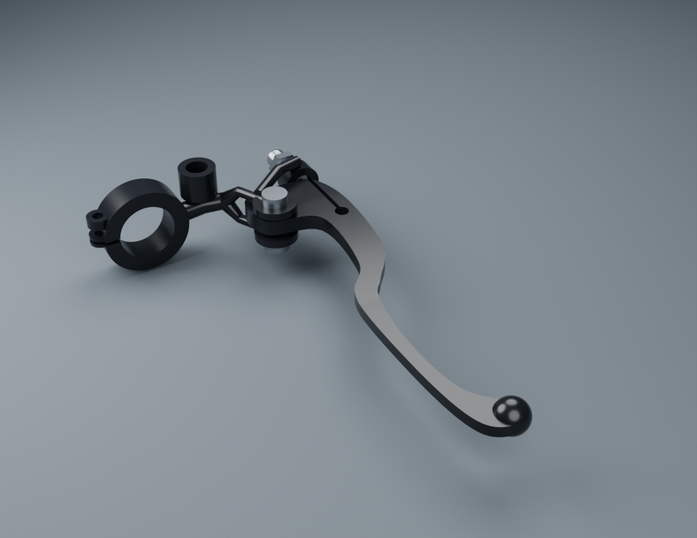

[Image entière](front-brake-control-v2/quarter-rest.png) · [Preuve du rendu](front-brake-control-v2/render-report.json) · vue `quarter-rest`

Source SHA-256 : `6ab2f1ecb322f92a1f26643a149e7b2b93691dc91d3fb2e965c8b8f55733b2e1`  
PNG SHA-256 : `0e76f4d1dc85b9256a387a89fe97d1febc5993bd1d167f123216b2ef7cfdd996`

[Blender](../../assets-src/moto-components/front-brake-control/front-brake-control-v2.blend) · [GLB](../../assets-src/moto-components/front-brake-control/front-brake-control-v2-inspection.glb) · [README source](../../assets-src/moto-components/front-brake-control/README_v2.md) · [Revue et limites](front-brake-control-v2/README.md) · [Fiche](../workflow/records/moto-front-brake-control-001.json)

Autres vues Blender prouvées de cette révision

- [pivot-working-12deg](front-brake-control-v2/pivot-working-12deg.png) · [preuve](front-brake-control-v2/render-report.json)

Périmètre prévu : lame frein à câble; support et collier; pivot et réglage de câble.

## 08 · Rétroviseurs gauche/droit

### Rétroviseur droit v3 — filet aligné sur le profil

`MOTO-MIRROR-RIGHT-001` · révision `mirror-right-v3` · **candidat non reçu**

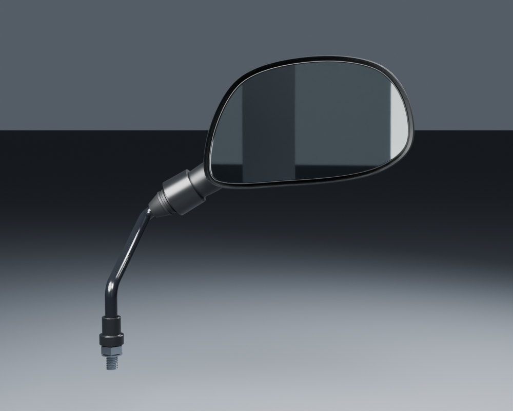

[Image entière](mirror-right-v3/whole-front.png) · [Preuve du rendu](mirror-right-v3/render-report.json) · vue `whole-front`

Source SHA-256 : `4be6e74518d7e0a6baccfc66c136cba148882183bf1d6020ac329ed9c0c32c60`  
PNG SHA-256 : `3a41594453ae18c29c60b1af1fc4c2cd445b77843e2050854c86f2f29255e025`

[Blender](../../assets-src/moto-components/mirrors/mirror-right-v3.blend) · [GLB](../../assets-src/moto-components/mirrors/mirror-right-v3.glb) · [README source](../../assets-src/moto-components/mirrors/README-right-v3.md) · [Revue et limites](mirror-right-v3/README.md) · [Fiche](../workflow/records/moto-mirror-right-001.json)

Autres vues Blender prouvées de cette révision

- [base-close](mirror-right-v3/base-close.png) · [preuve](mirror-right-v3/render-report.json)

### Rétroviseur gauche v2 — filet aligné sur le profil

`MOTO-MIRROR-LEFT-001` · révision `mirror-left-v2` · **candidat non reçu**

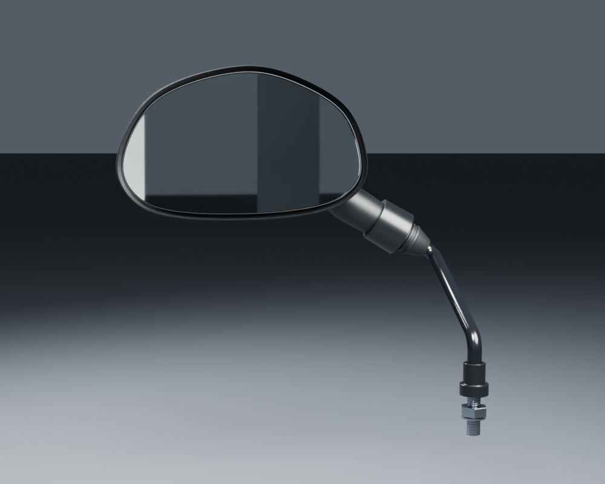

[Image entière](mirror-left-v2/whole-front.png) · [Preuve du rendu](mirror-left-v2/render-report.json) · vue `whole-front`

Source SHA-256 : `7725731e869b6edeea744965054518659eeb6355f6acc670718738a8144b1a30`  
PNG SHA-256 : `060c5dba1756563e88f2e321aa03f61708203b1ac227ba21284fe873356591fb`

[Blender](../../assets-src/moto-components/mirrors/mirror-left-v2.blend) · [GLB](../../assets-src/moto-components/mirrors/mirror-left-v2.glb) · [README source](../../assets-src/moto-components/mirrors/README-left-v2.md) · [Revue et limites](mirror-left-v2/README.md) · [Fiche](../workflow/records/moto-mirror-left-001.json)

Autres vues Blender prouvées de cette révision

- [base-close](mirror-left-v2/base-close.png) · [preuve](mirror-left-v2/render-report.json)

Périmètre prévu : rétroviseur gauche: coque, verre, col, tige; rétroviseur droit: coque, verre, col, tige.

## 09 · Contacteur et clé

### Contacteur et clé — position estimée

`MOTO-IGNITION-LOCK-001` · révision `ignition-lock-v1` · **candidat non reçu**

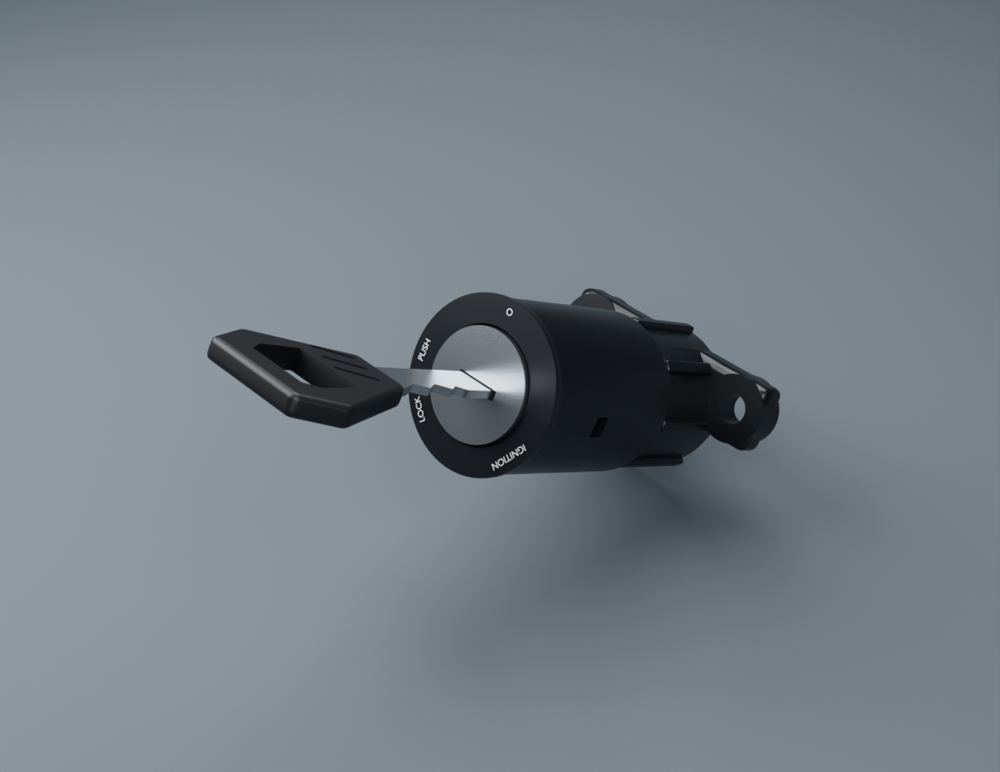

[Image entière](ignition-lock-v1/quarter-off.png) · [Preuve du rendu](ignition-lock-v1/render-report.json) · vue `quarter-off`

Source SHA-256 : `63447081802d85b8d9b61463f59aea6cc3db8aa72380ee9f66a960113707c4ef`  
PNG SHA-256 : `a0a99b09477fe43dd2bfa90e686ecf0086ccb8417ebda43a865d8e6f26e3725e`

[Blender](../../assets-src/moto-components/ignition-lock/ignition-lock-v1.blend) · [GLB](../../assets-src/moto-components/ignition-lock/ignition-lock-inspection.glb) · [README source](../../assets-src/moto-components/ignition-lock/README.md) · [Revue et limites](ignition-lock-v1/README.md) · [Fiche](../workflow/records/moto-ignition-lock-001.json)

Autres vues Blender prouvées de cette révision

- [rear-mount-on](ignition-lock-v1/rear-mount-on.png) · [preuve](ignition-lock-v1/render-report.json)

Périmètre prévu : barillet/contacteur extérieur; clé générique non fonctionnelle.

## 10 · Câbles et faisceau visibles

### Cockpit — faisceau partiel v2, boucle du contact corrigée

`MOTO-COCKPIT-CABLES-001` · révision `cockpit-cables-v2` · **candidat non reçu**

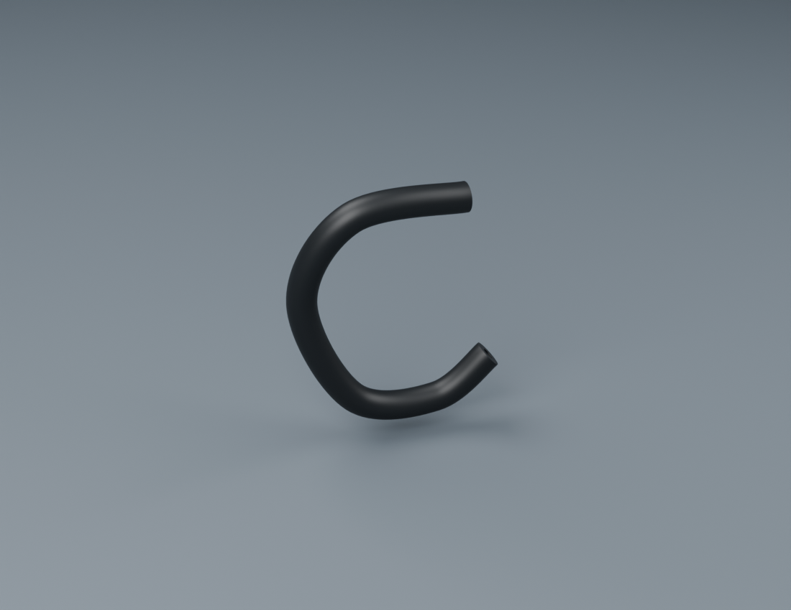

[Image entière](cockpit-cables-v2/ignition-pigtail-free-end.png) · [Preuve du rendu](cockpit-cables-v2/render-report.json) · vue `ignition-pigtail-free-end`

Source SHA-256 : `1e836f483c6d682a47dc072377971d35aa927f50a53a51e9ab0cef37e0d18279`  
PNG SHA-256 : `b3593fff26e49aeae75c7e24eab3c491806a7803c8aaa004232ec5c211dcc0fe`

[Blender](../../assets-src/moto-components/cockpit-cables/cockpit-cables-v2.blend) · [GLB](../../assets-src/moto-components/cockpit-cables/cockpit-cables-v2-inspection.glb) · [README source](../../assets-src/moto-components/cockpit-cables/README_v2.md) · [Revue et limites](cockpit-cables-v2/README.md) · [Fiche](../workflow/records/moto-cockpit-cables-001.json)

Autres vues Blender prouvées de cette révision

- [ignition-interface-current](cockpit-cables-v2/ignition-interface-current.png) · [preuve](cockpit-cables-v2/render-report.json)

Périmètre prévu : départs de gaines visibles; faisceau visible et attaches documentées.

## 11 · Visière et entourage des compteurs

### Visière fumée — coque extérieure seule

`MOTO-INSTRUMENT-VISOR-001` · révision `instrument-visor-v1` · **candidat non reçu**

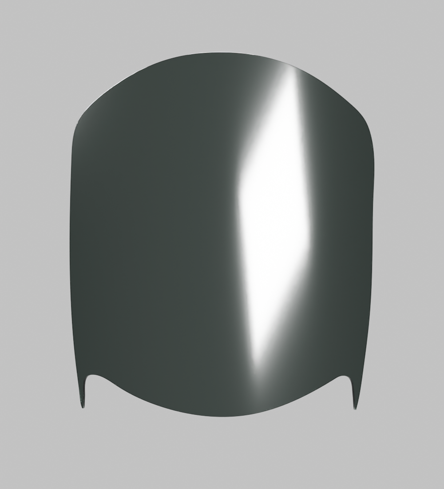

[Image entière](instrument-visor-v1/whole-front.png) · [Preuve du rendu](instrument-visor-v1/render-report.json) · vue `whole-front`

Source SHA-256 : `c790ffbba0a49f4d63e2dcf85a30cf88eb1aa8c6edd847514c041e5c0fa70f15`  
PNG SHA-256 : `a742e58a3f8591c46f5a74699cf8484e80ed3be6fdca772f6b91afe852680f08`

[Blender](../../assets-src/moto-components/instrument-visor/instrument-visor-v1.blend) · [GLB](../../assets-src/moto-components/instrument-visor/instrument-visor-v1.glb) · [README source](../../assets-src/moto-components/instrument-visor/README_v1.md) · [Revue et limites](instrument-visor-v1/README.md) · [Fiche](../workflow/records/moto-instrument-visor-001.json)

Autres vues Blender prouvées de cette révision

- [whole-profile](instrument-visor-v1/whole-profile.png) · [preuve](instrument-visor-v1/render-report.json)
- [whole-inside](instrument-visor-v1/whole-inside.png) · [preuve](instrument-visor-v1/render-report.json)
- [edge-lower-right](instrument-visor-v1/edge-lower-right.png) · [preuve](instrument-visor-v1/render-report.json)

Périmètre prévu : visière extérieure; entourage/supports observables.

## 12 · Phare et clignotants avant

### Phare — bandeau et deux arceaux avant isolés

`MOTO-HEADLAMP-FRONT-PROTECTOR-001` · révision `headlamp-front-protector-v2` · **candidat non reçu**

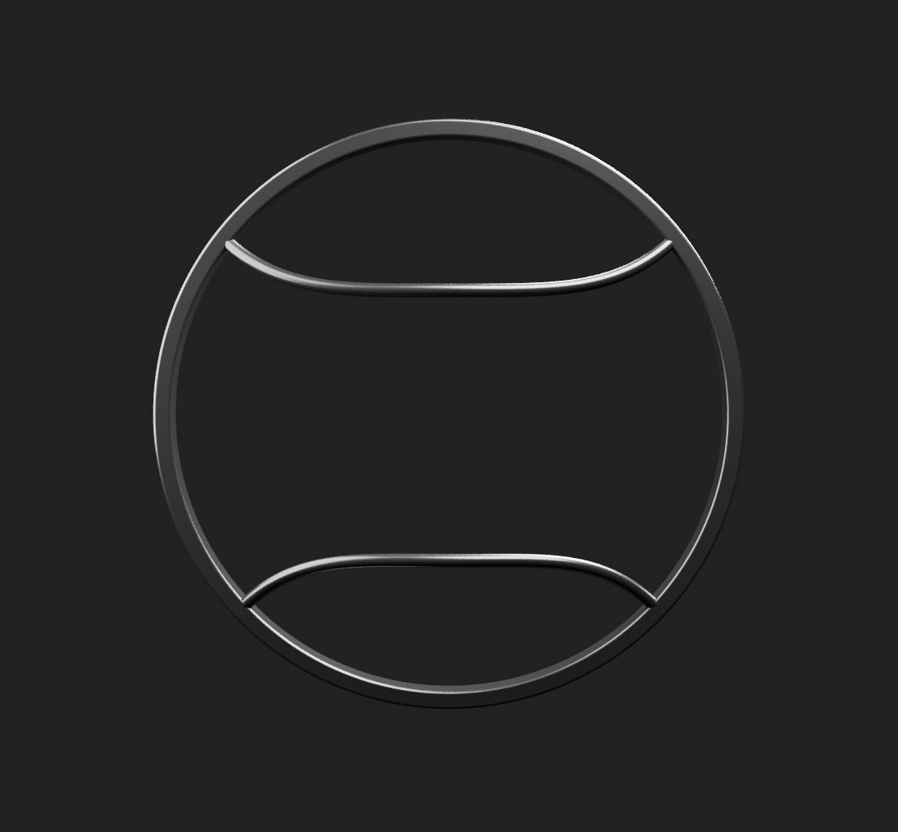

[Image entière](headlamp-front-protector-v2/whole-front.png) · [Preuve du rendu](headlamp-front-protector-v2/render-report.json) · vue `whole-front`

Source SHA-256 : `b9a7e64ecc08ed9de44e2bf5e411fb76fabf2be40d43d9c405f4b7160c96c9fd`  
PNG SHA-256 : `1887e12779ae9b084f6e2c976a1b20be9809f5868f73f7b920795d9ffbf5e9f5`

[Blender](../../assets-src/moto-components/headlamp/headlamp-front-protector-v2.blend) · [GLB](../../assets-src/moto-components/headlamp/headlamp-front-protector-v2.glb) · [README source](../../assets-src/moto-components/headlamp/README-protector-v2.md) · [Revue et limites](headlamp-front-protector-v2/README.md) · [Fiche](../workflow/records/moto-headlamp-front-protector-001.json)

Autres vues Blender prouvées de cette révision

- [whole-quarter](headlamp-front-protector-v2/whole-quarter.png) · [preuve](headlamp-front-protector-v2/render-report.json)
- [whole-back](headlamp-front-protector-v2/whole-back.png) · [preuve](headlamp-front-protector-v2/render-report.json)
- [rod-band-junction](headlamp-front-protector-v2/rod-band-junction.png) · [preuve](headlamp-front-protector-v2/render-report.json)

### Phare — boîtier nu v2, normales des nervures corrigées

`MOTO-HEADLAMP-HOUSING-001` · révision `headlamp-housing-v2` · **candidat non reçu**

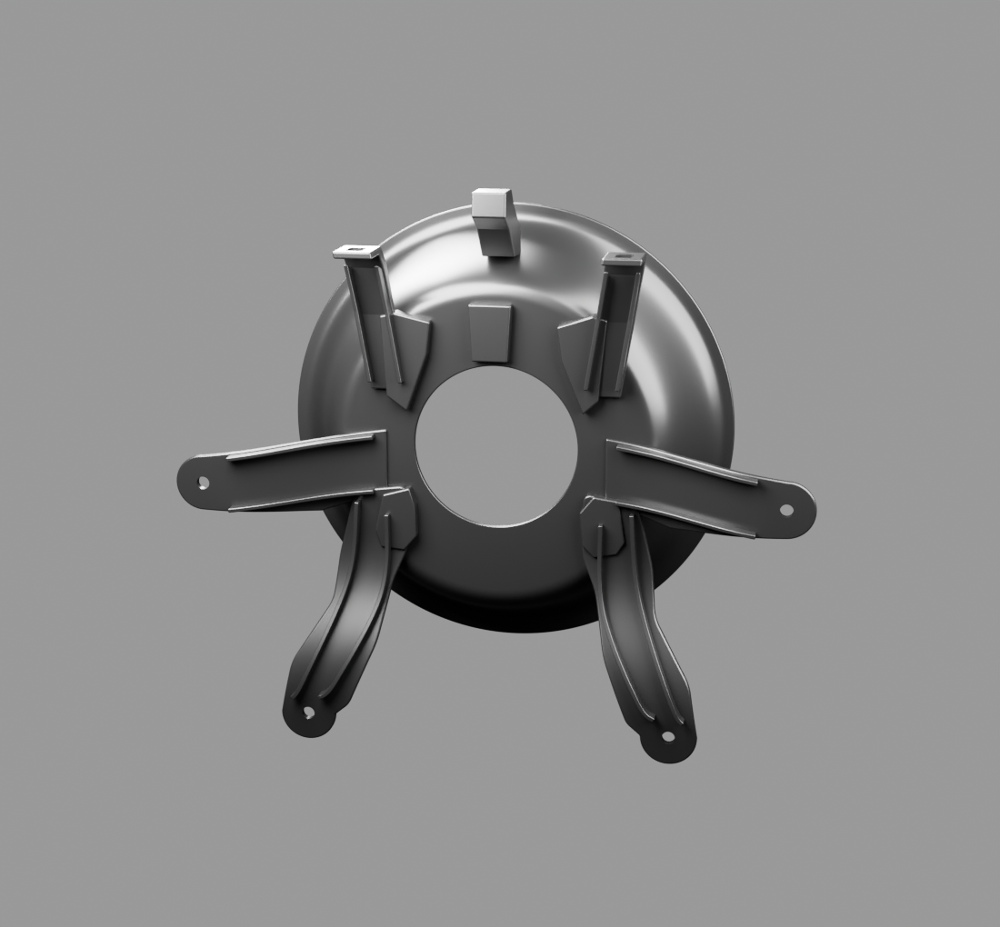

[Image entière](headlamp-housing-v2/whole-back.png) · [Preuve du rendu](headlamp-housing-v2/render-report.json) · vue `whole-back`

Source SHA-256 : `28dc0546d85f95c13e7903d2c8232517b88d2fdbb1a5c108ec9708b2bd729bd3`  
PNG SHA-256 : `4ec4ded59f3c1420c367dcbf9fd62f76bf5bb1bdfbcc7d137da4c9781fa78d36`

[Blender](../../assets-src/moto-components/headlamp/housing/headlamp-housing-v2.blend) · [GLB](../../assets-src/moto-components/headlamp/housing/headlamp-housing-v2.glb) · [README source](../../assets-src/moto-components/headlamp/housing/README_v2.md) · [Revue et limites](headlamp-housing-v2/README.md) · [Fiche](../workflow/records/moto-headlamp-housing-001.json)

Autres vues Blender prouvées de cette révision

- [lower-rounded-tip](headlamp-housing-v2/lower-rounded-tip.png) · [preuve](headlamp-housing-v2/render-report.json)

Périmètre prévu : coque du phare; réflecteur et optique; clignotant avant gauche; clignotant avant droit.

## 13 · Fourche et direction

### Tube intérieur de fourche — pièce isolée

`MOTO-FORK-INNER-TUBE-001` · révision `front-fork-inner-tube-v1` · **candidat non reçu**

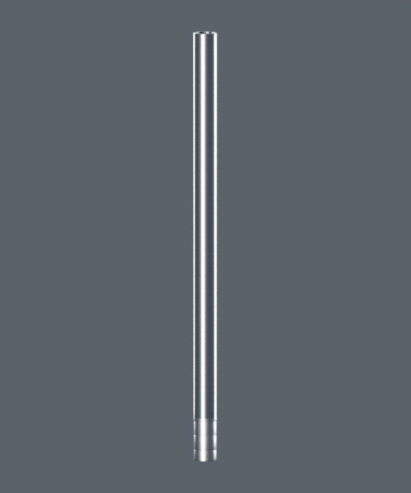

[Image entière](front-fork-inner-tube-v1/whole.png) · [Preuve du rendu](front-fork-inner-tube-v1/render-report.json) · vue `whole`

Source SHA-256 : `dca2502286663e14f80bdcd35365bc61bedab849a2df2c612e48438e456d0294`  
PNG SHA-256 : `1ab3fd7a3aec8a251756f224659340cda0019fbcddc79124df62793d67468394`

[Blender](../../assets-src/moto-components/front-fork/inner-tube/front-fork-inner-tube-v1.blend) · [GLB](../../assets-src/moto-components/front-fork/inner-tube/front-fork-inner-tube-inspection.glb) · [README source](../../assets-src/moto-components/front-fork/inner-tube/README.md) · [Revue et limites](front-fork-inner-tube-v1/README.md) · [Fiche](../workflow/records/moto-fork-inner-tube-001.json)

Autres vues Blender prouvées de cette révision

- [upper-thread](front-fork-inner-tube-v1/upper-thread.png) · [preuve](front-fork-inner-tube-v1/render-report.json)
- [lower-machining](front-fork-inner-tube-v1/lower-machining.png) · [preuve](front-fork-inner-tube-v1/render-report.json)

### Té supérieur — plaque isolée

`MOTO-STEERING-UPPER-001` · révision `steering-upper-v1` · **candidat non reçu**

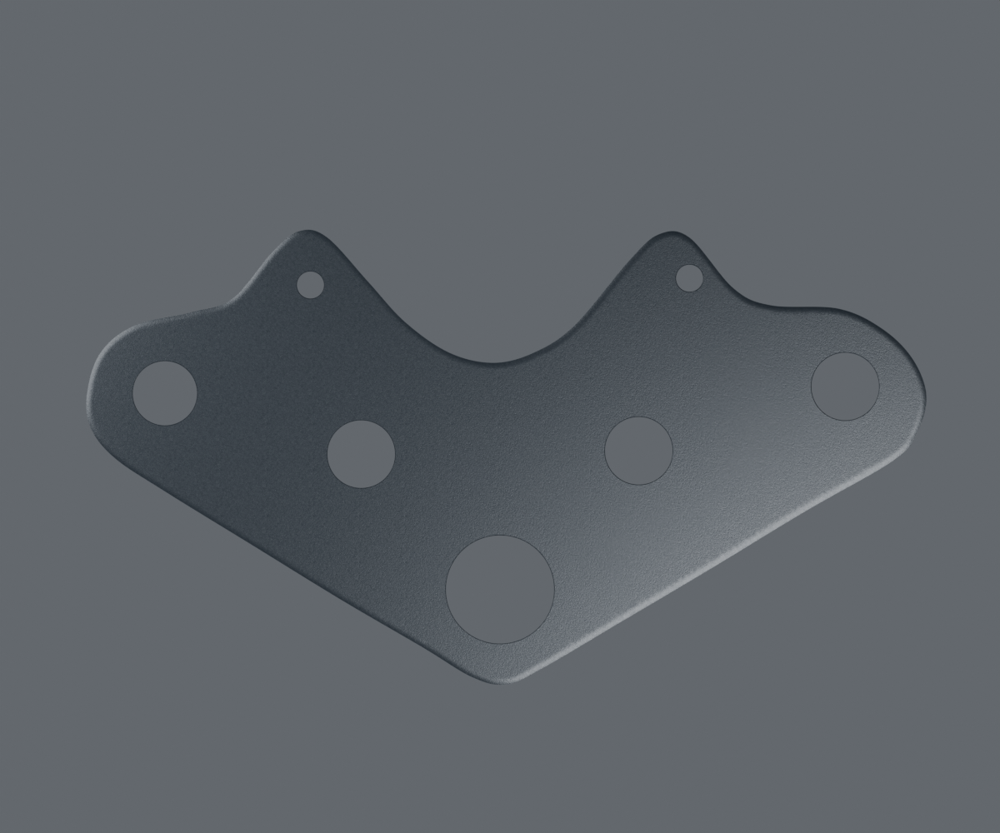

[Image entière](steering-upper-v1/front-shape.png) · [Preuve du rendu](steering-upper-v1/render-report.json) · vue `front-shape`

Source SHA-256 : `ba2bf24d27f3ef2092d3997823f2c792cec4af268aa527ee4730ba23f064e47f`  
PNG SHA-256 : `d3c9b569ad8303e5aaa693c9babe09f468fb9a953ebcf64a86dc8d0d07302f2e`

[Blender](../../assets-src/moto-components/steering-triples/upper/steering-upper-v1.blend) · [GLB](../../assets-src/moto-components/steering-triples/upper/steering-upper-inspection.glb) · [README source](../../assets-src/moto-components/steering-triples/upper/README.md) · [Revue et limites](steering-upper-v1/README.md) · [Fiche](../workflow/records/moto-steering-upper-001.json)

Autres vues Blender prouvées de cette révision

- [reverse-rim](steering-upper-v1/reverse-rim.png) · [preuve](steering-upper-v1/render-report.json)

### Corps du té inférieur — pièce isolée

`MOTO-STEERING-LOWER-001` · révision `steering-lower-v1` · **candidat non reçu**

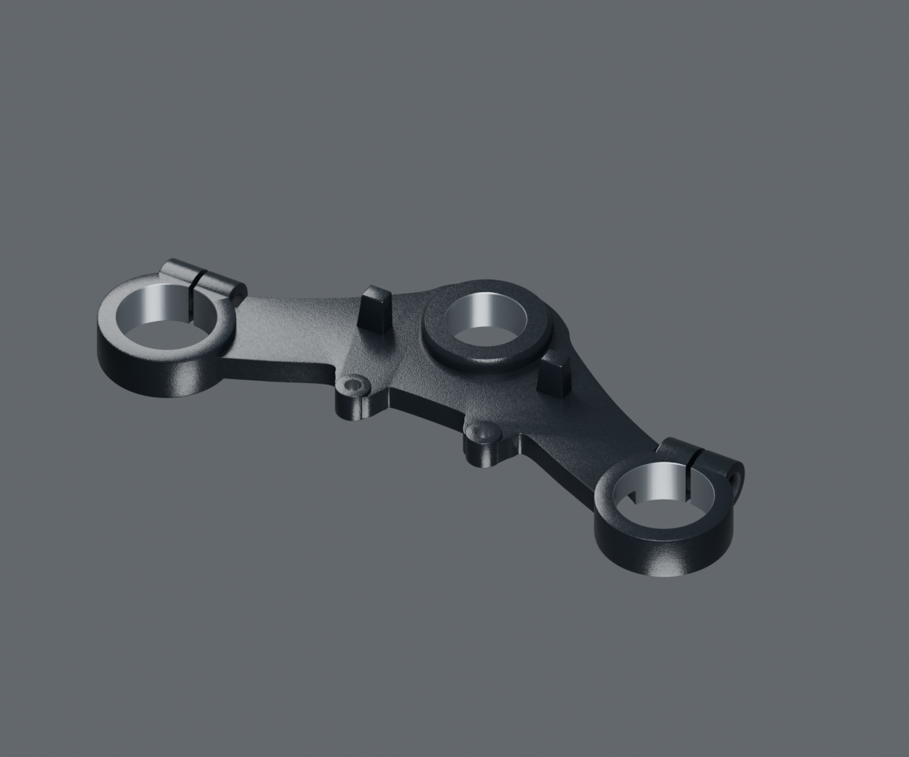

[Image entière](steering-lower-v1/upper-quarter.png) · [Preuve du rendu](steering-lower-v1/render-report.json) · vue `upper-quarter`

Source SHA-256 : `c49ccb6cf81383736a895f611393a0f30adb318103d88e4f3beb8ca90ef31866`  
PNG SHA-256 : `737c1f861c810194196e6a7682f77ec498cfffbd75a13f115e2e98497b6c0b2d`

[Blender](../../assets-src/moto-components/steering-triples/lower/steering-lower-v1.blend) · [GLB](../../assets-src/moto-components/steering-triples/lower/steering-lower-inspection.glb) · [README source](../../assets-src/moto-components/steering-triples/lower/README.md) · [Revue et limites](steering-lower-v1/README.md) · [Fiche](../workflow/records/moto-steering-lower-001.json)

Autres vues Blender prouvées de cette révision

- [underside-ribs](steering-lower-v1/underside-ribs.png) · [preuve](steering-lower-v1/render-report.json)

### Fourreau de fourche gauche — talon continu

`MOTO-FORK-OUTER-LEFT-001` · révision `fork-outer-left-v1` · **candidat non reçu**

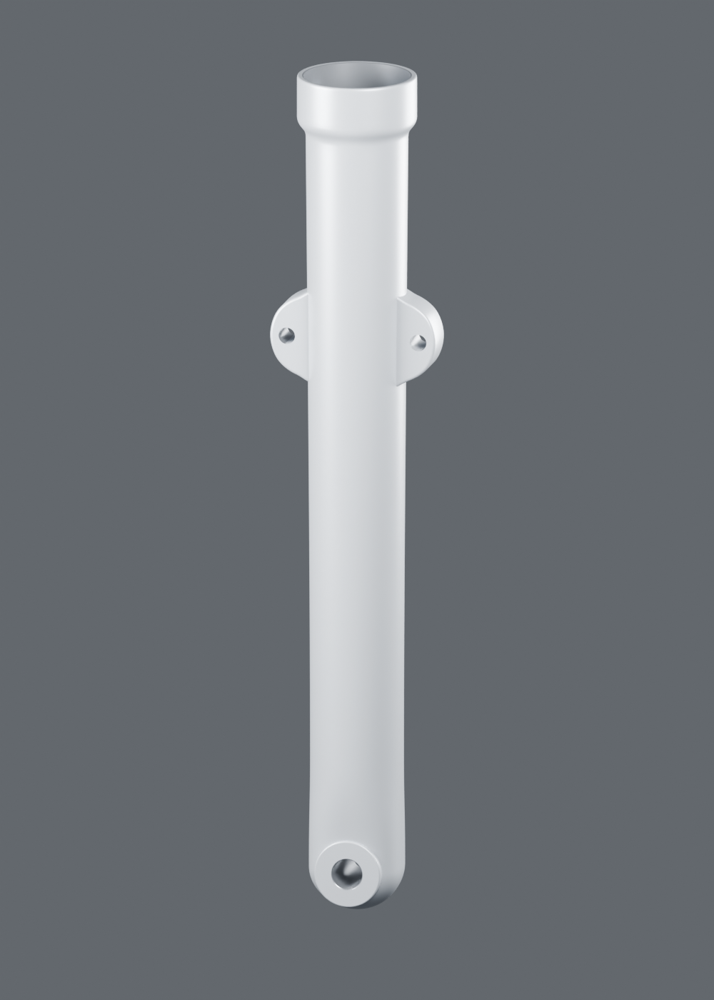

[Image entière](fork-outer-left-v1/outer-quarter.png) · [Preuve du rendu](fork-outer-left-v1/render-report.json) · vue `outer-quarter`

Source SHA-256 : `8c310db96ce2b7aacab52e49ea9305ceda833fca5a080754a4a43a3b0901e472`  
PNG SHA-256 : `bfed2a99196ca9eeb28d5e3411e1a2b37b06fd5da71455a8fde23a80339e2328`

[Blender](../../assets-src/moto-components/front-fork/outer-left/fork-outer-left-v1.blend) · [GLB](../../assets-src/moto-components/front-fork/outer-left/fork-outer-left-inspection.glb) · [README source](../../assets-src/moto-components/front-fork/outer-left/README.md) · [Revue et limites](fork-outer-left-v1/README.md) · [Fiche](../workflow/records/moto-fork-outer-left-001.json)

Autres vues Blender prouvées de cette révision

- [inboard-quarter](fork-outer-left-v1/inboard-quarter.png) · [preuve](fork-outer-left-v1/render-report.json)
- [inboard-pocket](fork-outer-left-v1/inboard-pocket.png) · [preuve](fork-outer-left-v1/render-report.json)
- [outer-foot](fork-outer-left-v1/outer-foot.png) · [preuve](fork-outer-left-v1/render-report.json)
- [top-opening](fork-outer-left-v1/top-opening.png) · [preuve](fork-outer-left-v1/render-report.json)

### Fourreau de fourche droit — référence propre au côté

`MOTO-FORK-OUTER-RIGHT-001` · révision `fork-outer-right-v1` · **candidat non reçu**

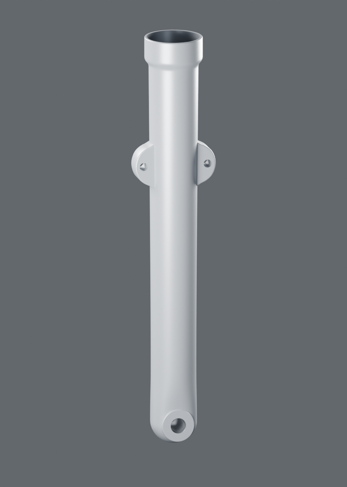

[Image entière](fork-outer-right-v1/outer-quarter.png) · [Preuve du rendu](fork-outer-right-v1/render-report.json) · vue `outer-quarter`

Source SHA-256 : `5d08454e9da7fbf85df3532a23d0965475559d94cb13e23dfdae9e8056c14ac6`  
PNG SHA-256 : `88ab33fed08700338279233cfa2d5f6dc5d46ab3eaf8747c5602d2bf4adf28f1`

[Blender](../../assets-src/moto-components/front-fork/outer-right/fork-outer-right-v1.blend) · [GLB](../../assets-src/moto-components/front-fork/outer-right/fork-outer-right-inspection.glb) · [README source](../../assets-src/moto-components/front-fork/outer-right/README.md) · [Revue et limites](fork-outer-right-v1/README.md) · [Fiche](../workflow/records/moto-fork-outer-right-001.json)

Autres vues Blender prouvées de cette révision

- [inboard-quarter](fork-outer-right-v1/inboard-quarter.png) · [preuve](fork-outer-right-v1/render-report.json)
- [outer-foot](fork-outer-right-v1/outer-foot.png) · [preuve](fork-outer-right-v1/render-report.json)
- [top-opening](fork-outer-right-v1/top-opening.png) · [preuve](fork-outer-right-v1/render-report.json)

### Soufflet v2 — lèvre et gorge, animation de longueur estimée

`MOTO-FORK-BELLOWS-001` · révision `fork-bellows-v2` · **candidat non reçu**

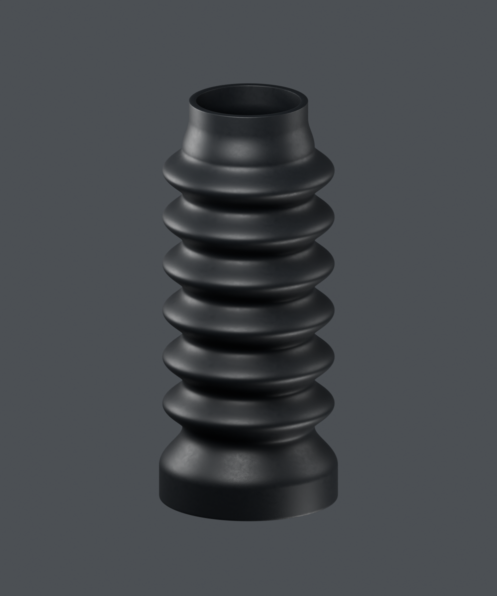

[Image entière](fork-bellows-v2/quarter.png) · [Preuve du rendu](fork-bellows-v2/render-report.json) · vue `quarter`

Source SHA-256 : `4e7c2f823f0737a159b62528f9683d97ba3e285b8f685bc23f4ef40826bbc590`  
PNG SHA-256 : `f5b0edd39ea46ac9aa9eb01c1369ad192f17d09b0e0bd0b276189701badfcfe6`

[Blender](../../assets-src/moto-components/front-fork/bellows-v2/fork-bellows-v2.blend) · [GLB](../../assets-src/moto-components/front-fork/bellows-v2/fork-bellows-v2-inspection.glb) · [README source](../../assets-src/moto-components/front-fork/bellows-v2/README.md) · [Revue et limites](fork-bellows-v2/README.md) · [Fiche](../workflow/records/moto-fork-bellows-001.json)

Autres vues Blender prouvées de cette révision

- [lower-opening](fork-bellows-v2/lower-opening.png) · [preuve](fork-bellows-v2/render-report.json)
- [compression-estimated](fork-bellows-v2/compression-estimated.png) · [preuve](fork-bellows-v2/render-report.json)
- [extension-estimated](fork-bellows-v2/extension-estimated.png) · [preuve](fork-bellows-v2/render-report.json)

Périmètre prévu : té supérieur et colonne; té inférieur; tube et fourreau gauche; tube et fourreau droit; soufflets et joints visibles.

## 14 · Ensemble avant et compatibilité des candidats existants

Les pièces antérieures existent dans la section des [préexistants](#preexistants). La compatibilité de l’ensemble avant reste à recontrôler ; aucun ensemble terminé n’est déclaré.

Périmètre prévu : pneu avant existant à revoir; jante/moyeu existant à revoir; flasque et levier de came existants à revoir; axe et entretoises visibles.

## 15 · Garde-boue, cadre et bras oscillant

### Colonne de cadre — enveloppe extérieure isolée

`MOTO-FRAME-HEADTUBE-001` · révision `frame-head-tube-v1` · **candidat non reçu**

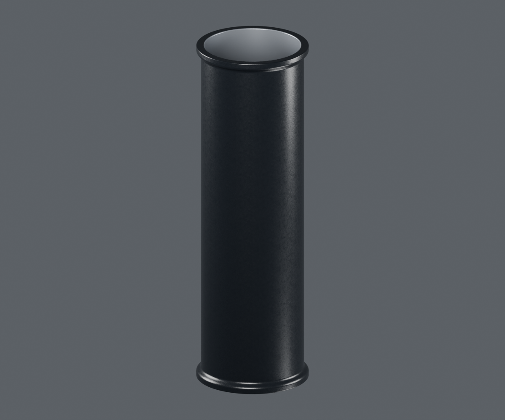

[Image entière](frame-head-tube-v1/quarter.png) · [Preuve du rendu](frame-head-tube-v1/render-report.json) · vue `quarter`

Source SHA-256 : `12832eb665a9ba9f3dbd1f6e1501bcafa0ebf66bf4395a05e0d23bf7d0f90ccc`  
PNG SHA-256 : `9918e193362354a41079654023fde75ab572c534df8db8310cf437e67b6275fe`

[Blender](../../assets-src/moto-components/frame/head-tube/frame-head-tube-v1.blend) · [GLB](../../assets-src/moto-components/frame/head-tube/frame-head-tube-inspection.glb) · [README source](../../assets-src/moto-components/frame/head-tube/README.md) · [Revue et limites](frame-head-tube-v1/README.md) · [Fiche](../workflow/records/moto-frame-headtube-001.json)

Autres vues Blender prouvées de cette révision

- [reverse](frame-head-tube-v1/reverse.png) · [preuve](frame-head-tube-v1/render-report.json)
- [upper-lip](frame-head-tube-v1/upper-lip.png) · [preuve](frame-head-tube-v1/render-report.json)

### Cadre — descente avant non ronde

`MOTO-FRAME-DOWNMEMBER-001` · révision `frame-front-downmember-v1` · **candidat non reçu**

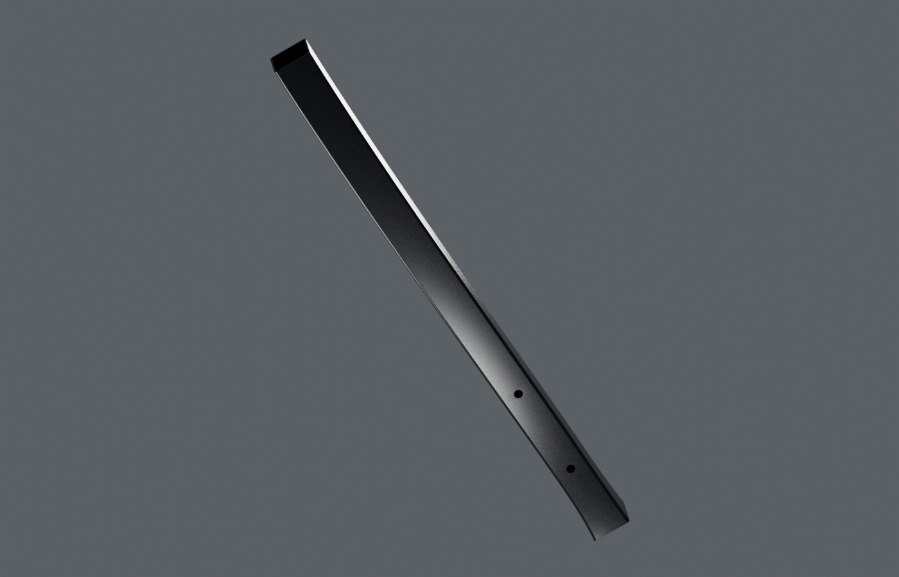

[Image entière](frame-front-downmember-v1/quarter.png) · [Preuve du rendu](frame-front-downmember-v1/render-report.json) · vue `quarter`

Source SHA-256 : `df14820aef2164aa280432b2ba951001315be956ce85b04a5ac5464932dd3cee`  
PNG SHA-256 : `3e979591d644bb7259fb85cd8dc0803c8ecfa524bbe556c2a97c27e3b0fa69ca`

[Blender](../../assets-src/moto-components/frame/front-downmember/frame-front-downmember-v1.blend) · [GLB](../../assets-src/moto-components/frame/front-downmember/frame-front-downmember-inspection.glb) · [README source](../../assets-src/moto-components/frame/front-downmember/README.md) · [Revue et limites](frame-front-downmember-v1/README.md) · [Fiche](../workflow/records/moto-frame-downmember-001.json)

Autres vues Blender prouvées de cette révision

- [reverse](frame-front-downmember-v1/reverse.png) · [preuve](frame-front-downmember-v1/render-report.json)
- [side-openings](frame-front-downmember-v1/side-openings.png) · [preuve](frame-front-downmember-v1/render-report.json)
- [lower-opening](frame-front-downmember-v1/lower-opening.png) · [preuve](frame-front-downmember-v1/render-report.json)

### Cadre — membre supérieur avant v2, normales corrigées

`MOTO-FRAME-BACKBONE-001` · révision `frame-front-backbone-v2` · **candidat non reçu**

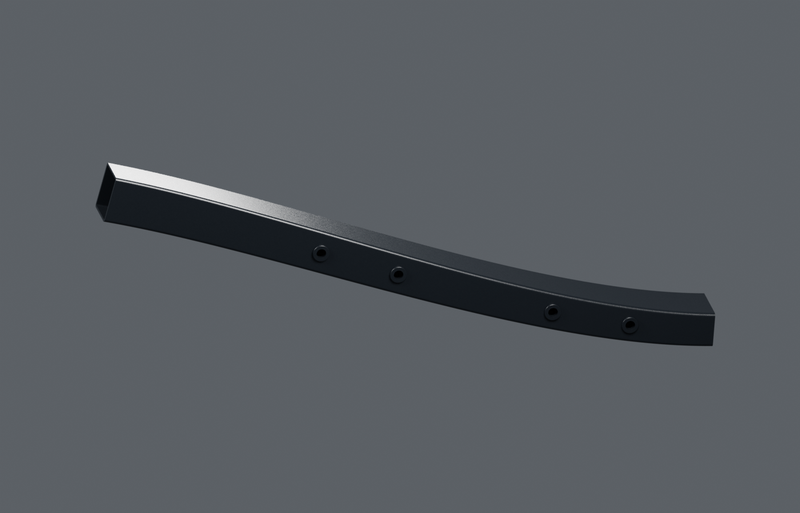

[Image entière](frame-front-backbone-v2/quarter.png) · [Preuve du rendu](frame-front-backbone-v2/render-report.json) · vue `quarter`

Source SHA-256 : `cf2d2c141a501eb633eba9730ee926122db1fb90bc4a544097e6a2233a05f070`  
PNG SHA-256 : `344b36dcd7ad9b08835a9546d1054c4ff92f9fe5464c163aae5a1e193322ad91`

[Blender](../../assets-src/moto-components/frame/front-backbone-v2/frame-front-backbone-v2.blend) · [GLB](../../assets-src/moto-components/frame/front-backbone-v2/frame-front-backbone-v2-inspection.glb) · [README source](../../assets-src/moto-components/frame/front-backbone-v2/README.md) · [Revue et limites](frame-front-backbone-v2/README.md) · [Fiche](../workflow/records/moto-frame-backbone-001.json)

Autres vues Blender prouvées de cette révision

- [reverse](frame-front-backbone-v2/reverse.png) · [preuve](frame-front-backbone-v2/render-report.json)
- [side-features](frame-front-backbone-v2/side-features.png) · [preuve](frame-front-backbone-v2/render-report.json)
- [front-opening](frame-front-backbone-v2/front-opening.png) · [preuve](frame-front-backbone-v2/render-report.json)

### Cadre — gousset de colonne, face documentée seule

`MOTO-FRAME-HEAD-GUSSET-001` · révision `frame-head-gusset-v1` · **candidat non reçu**

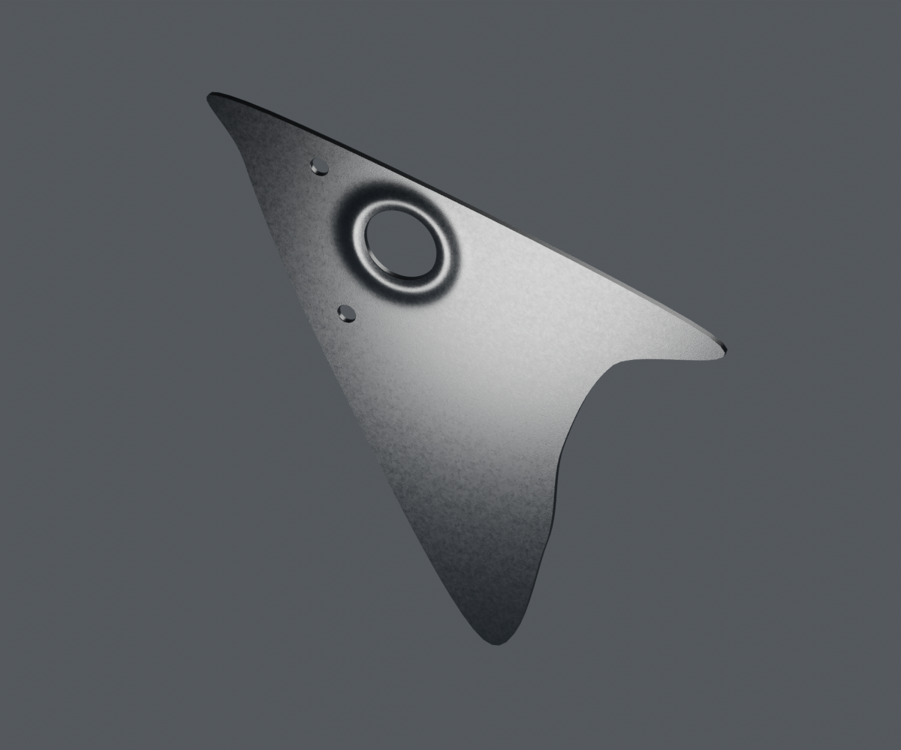

[Image entière](frame-head-gusset-v1/quarter.png) · [Preuve du rendu](frame-head-gusset-v1/render-report.json) · vue `quarter`

Source SHA-256 : `c26005741e3ff96beb5b7582c477c5e1f7b22be2c129c77c7044a1c2b4bae145`  
PNG SHA-256 : `0a472171a2972e42853844db6d40240a2ee397fabd3b578ff39a2425df3c0333`

[Blender](../../assets-src/moto-components/frame/head-gusset/frame-head-gusset-v1.blend) · [GLB](../../assets-src/moto-components/frame/head-gusset/frame-head-gusset-inspection.glb) · [README source](../../assets-src/moto-components/frame/head-gusset/README.md) · [Revue et limites](frame-head-gusset-v1/README.md) · [Fiche](../workflow/records/moto-frame-head-gusset-001.json)

Autres vues Blender prouvées de cette révision

- [reverse](frame-head-gusset-v1/reverse.png) · [preuve](frame-head-gusset-v1/render-report.json)
- [formed-opening](frame-head-gusset-v1/formed-opening.png) · [preuve](frame-head-gusset-v1/render-report.json)

### Cadre — un longeron inférieur de berceau

`MOTO-FRAME-LOWER-CRADLE-RAIL-001` · révision `frame-lower-cradle-rail-v1` · **candidat non reçu**

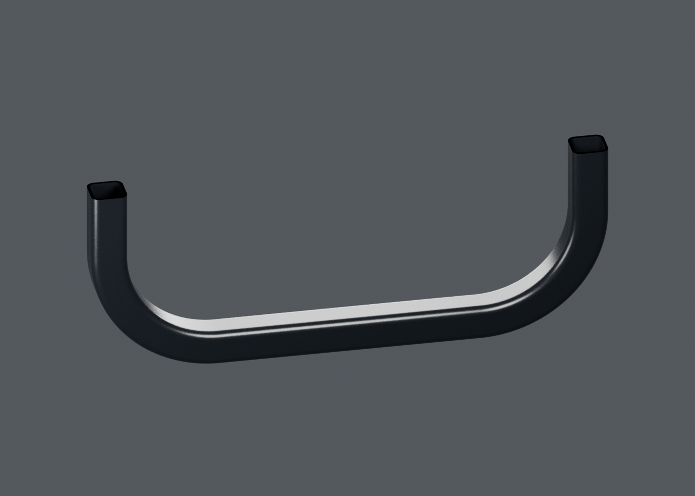

[Image entière](frame-lower-cradle-rail-v1/quarter.png) · [Preuve du rendu](frame-lower-cradle-rail-v1/render-report.json) · vue `quarter`

Source SHA-256 : `b2646434f124396701f7eb9508cc5f59cfe2e846b1ea84c54af20af56f5b42f3`  
PNG SHA-256 : `3738f3ef12cd52de61dd1b63248c463458f26a87d7d1f8277dff994e7e6ed3b6`

[Blender](../../assets-src/moto-components/frame/lower-cradle-rail/frame-lower-cradle-rail-v1.blend) · [GLB](../../assets-src/moto-components/frame/lower-cradle-rail/frame-lower-cradle-rail-inspection.glb) · [README source](../../assets-src/moto-components/frame/lower-cradle-rail/README.md) · [Revue et limites](frame-lower-cradle-rail-v1/README.md) · [Fiche](../workflow/records/moto-frame-lower-cradle-rail-001.json)

Autres vues Blender prouvées de cette révision

- [reverse](frame-lower-cradle-rail-v1/reverse.png) · [preuve](frame-lower-cradle-rail-v1/render-report.json)
- [front-bend](frame-lower-cradle-rail-v1/front-bend.png) · [preuve](frame-lower-cradle-rail-v1/render-report.json)

### Cadre — un longeron observé sous selle

`MOTO-FRAME-SEAT-RAIL-001` · révision `frame-seat-rail-observed-v1` · **candidat non reçu**

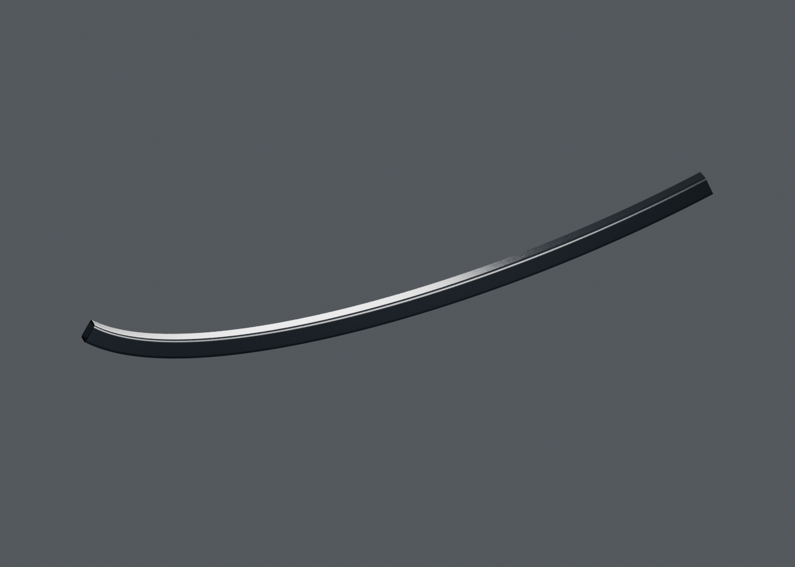

[Image entière](frame-seat-rail-observed-v1/quarter.png) · [Preuve du rendu](frame-seat-rail-observed-v1/render-report.json) · vue `quarter`

Source SHA-256 : `d56874f3b68866f4ffe5f1f948de832352087e8ee83096ac43f133361b01b52f`  
PNG SHA-256 : `146404347298ef496b88186926bfa7f2c29b61dee0ba539136c41723127828e1`

[Blender](../../assets-src/moto-components/frame/seat-rail-observed/frame-seat-rail-observed-v1.blend) · [GLB](../../assets-src/moto-components/frame/seat-rail-observed/frame-seat-rail-observed-inspection.glb) · [README source](../../assets-src/moto-components/frame/seat-rail-observed/README.md) · [Revue et limites](frame-seat-rail-observed-v1/README.md) · [Fiche](../workflow/records/moto-frame-seat-rail-001.json)

Autres vues Blender prouvées de cette révision

- [reverse](frame-seat-rail-observed-v1/reverse.png) · [preuve](frame-seat-rail-observed-v1/render-report.json)
- [front-joining](frame-seat-rail-observed-v1/front-joining.png) · [preuve](frame-seat-rail-observed-v1/render-report.json)

### Corps de bras oscillant — candidat apparenté

`MOTO-SWINGARM-BODY-001` · révision `swingarm-body-v1` · **candidat non reçu**

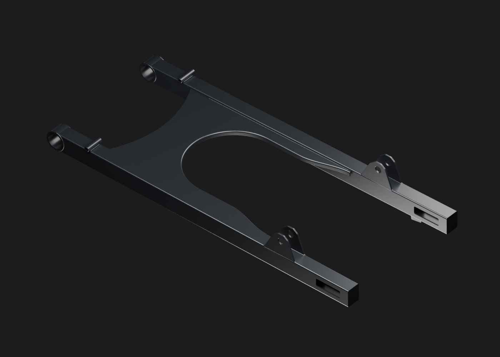

[Image entière](swingarm-body-v1/quarter.png) · [Preuve du rendu](swingarm-body-v1/render-report.json) · vue `quarter`

Source SHA-256 : `e829f89ea0d6594ceb43830c20d8d8698f41ef0a297b3a503c96b15b1d9df20c`  
PNG SHA-256 : `e2b4a53f3e600dd5dfd12fddc5706fd726b1b18d9c959818bee2c0bf0e39b112`

[Blender](../../assets-src/moto-components/swingarm/body/swingarm-body-v1.blend) · [GLB](../../assets-src/moto-components/swingarm/body/swingarm-body-v1-inspection.glb) · [README source](../../assets-src/moto-components/swingarm/body/README.md) · [Revue et limites](swingarm-body-v1/README.md) · [Fiche](../workflow/records/moto-swingarm-body-001.json)

Autres vues Blender prouvées de cette révision

- [reverse-quarter](swingarm-body-v1/reverse-quarter.png) · [preuve](swingarm-body-v1/render-report.json)
- [weld-detail](swingarm-body-v1/weld-detail.png) · [preuve](swingarm-body-v1/render-report.json)
- [return-detail](swingarm-body-v1/return-detail.png) · [preuve](swingarm-body-v1/render-report.json)

Périmètre prévu : garde-boue avant; cadre: tubes et jonctions visibles; bras oscillant et pivots visibles.

## 16 · Roue arrière, frein, transmission et amortisseurs

### Jante arrière — cinq branches et enveloppe annulaire partielle

`MOTO-RIM-REAR-001` · révision `rear-rim-v1` · **candidat non reçu**

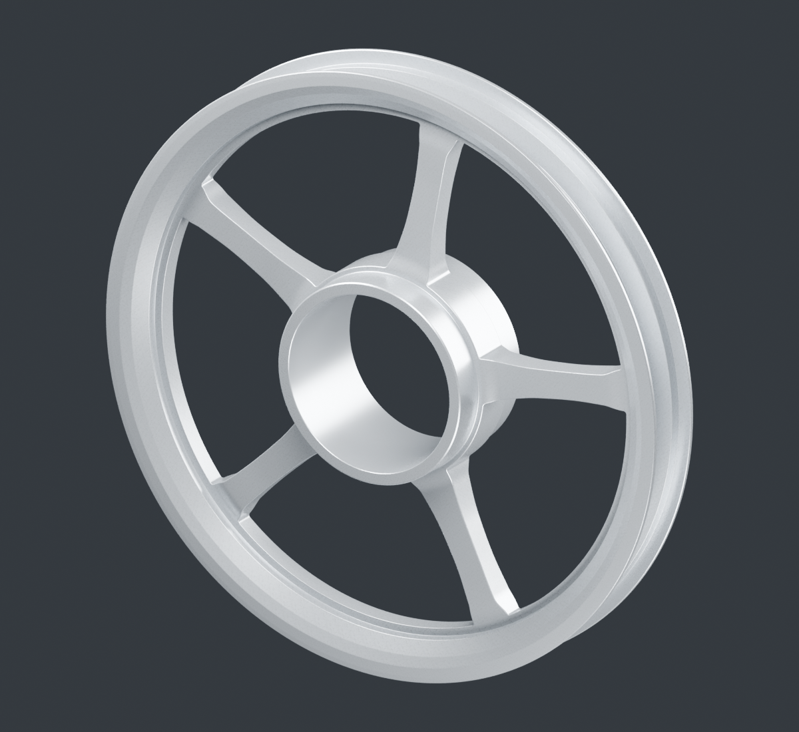

[Image entière](rear-rim-v1/quarter.png) · [Preuve du rendu](rear-rim-v1/render-report.json) · vue `quarter`

Source SHA-256 : `f97ddc5f4db07d0b97961a7a7282a9937efd68e16b82c159d581719948bb43d9`  
PNG SHA-256 : `d17fd8a5dbefa5d646551d9432b9e0a74c7f6971128898082903ddc06a1f98eb`

[Blender](../../assets-src/moto-components/rear-rim/rear-rim-v1.blend) · [GLB](../../assets-src/moto-components/rear-rim/rear-rim-inspection.glb) · [README source](../../assets-src/moto-components/rear-rim/README.md) · [Revue et limites](rear-rim-v1/README.md) · [Fiche](../workflow/records/moto-rim-rear-001.json)

Autres vues Blender prouvées de cette révision

- [reverse](rear-rim-v1/reverse.png) · [preuve](rear-rim-v1/render-report.json)
- [spoke-root-detail](rear-rim-v1/spoke-root-detail.png) · [preuve](rear-rim-v1/render-report.json)
- [rim-channel-detail](rear-rim-v1/rim-channel-detail.png) · [preuve](rear-rim-v1/render-report.json)

### Pneu arrière — candidat isolé 3.00-17 TL

`MOTO-TYRE-REAR-001` · révision `rear-tyre-v1` · **candidat non reçu**

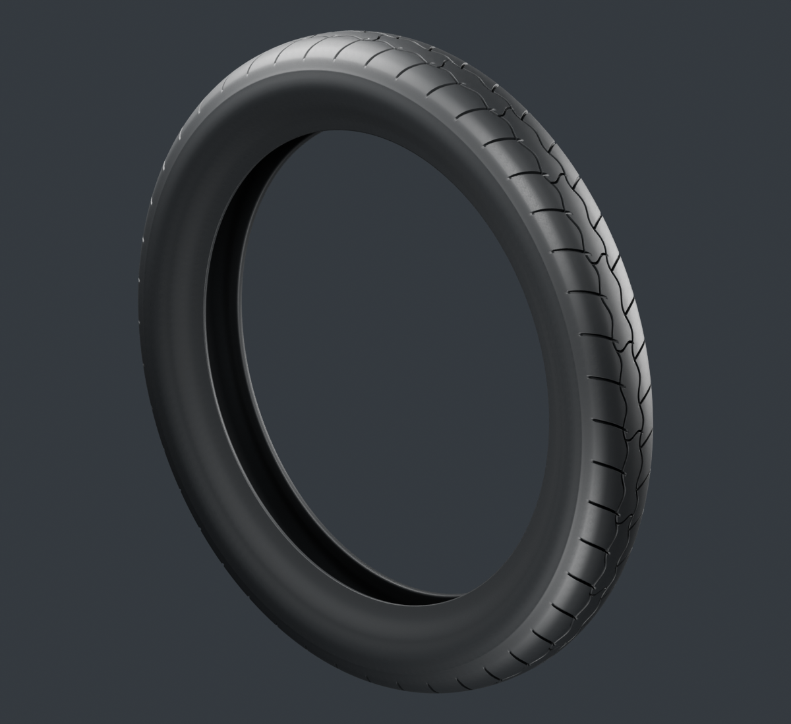

[Image entière](rear-tyre-v1/quarter.png) · [Preuve du rendu](rear-tyre-v1/render-report.json) · vue `quarter`

Source SHA-256 : `612388ce8f1fb5850a01c3329e23fc39ad42e631c4a517e56576a0a359066b5c`  
PNG SHA-256 : `62fc1b710c745db21a873b28b6062cfc3e02b11e331f118d94d91d620b4c512d`

[Blender](../../assets-src/moto-components/rear-tyre/rear-tyre-v1.blend) · [GLB](../../assets-src/moto-components/rear-tyre/rear-tyre-inspection.glb) · [README source](../../assets-src/moto-components/rear-tyre/README.md) · [Revue et limites](rear-tyre-v1/README.md) · [Fiche](../workflow/records/moto-tyre-rear-001.json)

Autres vues Blender prouvées de cette révision

- [rear-tread](rear-tyre-v1/rear-tread.png) · [preuve](rear-tyre-v1/render-report.json)
- [tread-detail](rear-tyre-v1/tread-detail.png) · [preuve](rear-tyre-v1/render-report.json)
- [bead-opening](rear-tyre-v1/bead-opening.png) · [preuve](rear-tyre-v1/render-report.json)

Périmètre prévu : pneu arrière; jante/moyeu arrière; flasque et commande du frein arrière; couronne/chaîne et protection; amortisseur gauche; amortisseur droit.

## 17 · Moteur extérieur, échappement, repose-pieds, pédales et béquilles

### Cache sortie de boîte gauche — coque extérieure

`MOTO-ENGINE-OUTPUT-COVER-LEFT-001` · révision `engine-output-cover-left-v1` · **candidat non reçu**

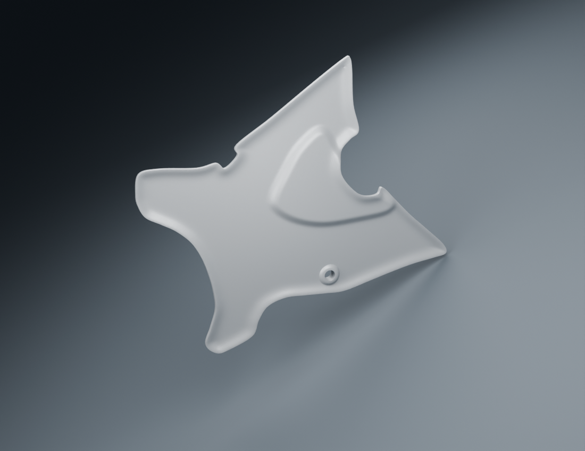

[Image entière](engine-output-cover-left-v1/outer-reference-direction.png) · [Preuve du rendu](engine-output-cover-left-v1/render-report.json) · vue `outer-reference-direction`

Source SHA-256 : `92f528236a8d9e94669b0eed18e186cb8a2c46612bfb7200907cd6a9abc79399`  
PNG SHA-256 : `7d2bbcfd275e90e4a496507c1e3c625e7c38bd23db85727a8241e9a0fb1ff32d`

[Blender](../../assets-src/moto-components/engine-output-cover-left/engine-output-cover-left-v1.blend) · [GLB](../../assets-src/moto-components/engine-output-cover-left/engine-output-cover-left-inspection.glb) · [README source](../../assets-src/moto-components/engine-output-cover-left/README.md) · [Revue et limites](engine-output-cover-left-v1/README.md) · [Fiche](../workflow/records/moto-engine-output-cover-left-001.json)

Autres vues Blender prouvées de cette révision

- [back-formed-wall](engine-output-cover-left-v1/back-formed-wall.png) · [preuve](engine-output-cover-left-v1/render-report.json)
- [coating-grazing-detail](engine-output-cover-left-v1/coating-grazing-detail.png) · [preuve](engine-output-cover-left-v1/render-report.json)

### Carter moteur droit v2 — normales corrigées

`MOTO-ENGINE-COVER-RIGHT-001` · révision `engine-cover-right-v2` · **candidat non reçu**

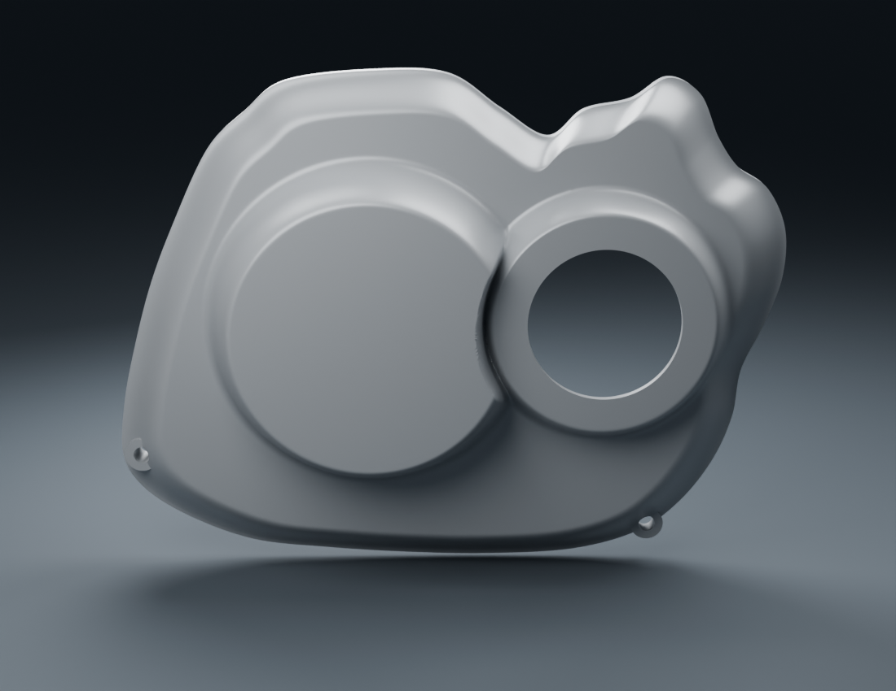

[Image entière](engine-cover-right-v2/outer-bosses.png) · [Preuve du rendu](engine-cover-right-v2/render-report.json) · vue `outer-bosses`

Source SHA-256 : `2558ea2479a02caf14e9feddad3f953f5587269083ae7b125a177acd4621515a`  
PNG SHA-256 : `f6607df8afacbc045e49e219d10a5e52ac296f16ffe88c817a66f9a48e675abc`

[Blender](../../assets-src/moto-components/engine-cover-right/engine-cover-right-v2.blend) · [GLB](../../assets-src/moto-components/engine-cover-right/engine-cover-right-v2-inspection.glb) · [README source](../../assets-src/moto-components/engine-cover-right/README_v2.md) · [Revue et limites](engine-cover-right-v2/README.md) · [Fiche](../workflow/records/moto-engine-cover-right-001.json)

Autres vues Blender prouvées de cette révision

- [rear-hollow-shell](engine-cover-right-v2/rear-hollow-shell.png) · [preuve](engine-cover-right-v2/render-report.json)

### Bouchon de filtre v2 — raccords et arrondis repris

`MOTO-ENGINE-FILTER-CAP-001` · révision `engine-filter-cap-v2` · **candidat non reçu**

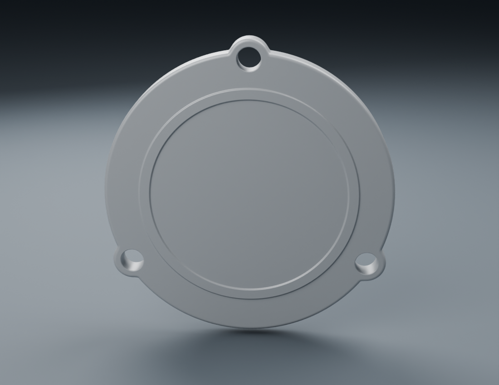

[Image entière](engine-filter-cap-v2/outer-face.png) · [Preuve du rendu](engine-filter-cap-v2/render-report.json) · vue `outer-face`

Source SHA-256 : `dc8ded5d6b392eee0f3084da1d66a647efcd3ca44d6cd148fad48f1fa9875436`  
PNG SHA-256 : `63629b026cf65e236a34532594fd0d500ae0c05f14c0226e35d815d739c08f38`

[Blender](../../assets-src/moto-components/engine-filter-cap/engine-filter-cap-v2.blend) · [GLB](../../assets-src/moto-components/engine-filter-cap/engine-filter-cap-v2-inspection.glb) · [README source](../../assets-src/moto-components/engine-filter-cap/README_v2.md) · [Revue et limites](engine-filter-cap-v2/README.md) · [Fiche](../workflow/records/moto-engine-filter-cap-001.json)

Autres vues Blender prouvées de cette révision

- [rear-spigot](engine-filter-cap-v2/rear-spigot.png) · [preuve](engine-filter-cap-v2/render-report.json)
- [tangent-ear-detail](engine-filter-cap-v2/tangent-ear-detail.png) · [preuve](engine-filter-cap-v2/render-report.json)

### Carter magnéto gauche v2 — raccords des fixations

`MOTO-ENGINE-COVER-LEFT-001` · révision `engine-cover-left-v2` · **candidat non reçu**

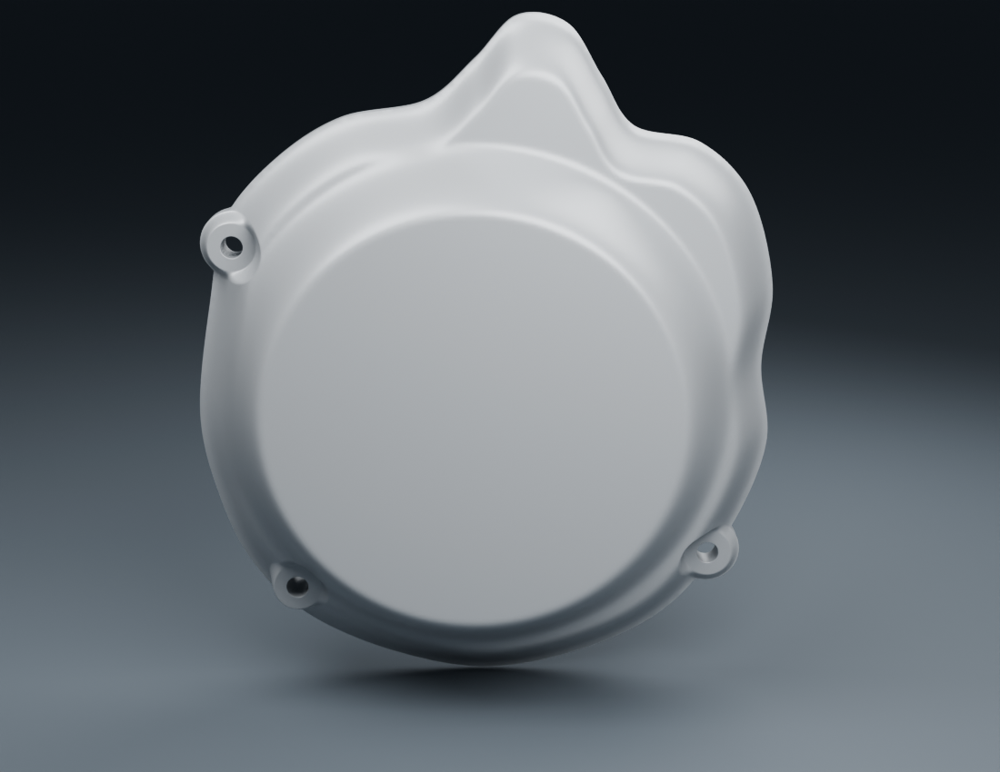

[Image entière](engine-cover-left-v2/outer-forward-boss.png) · [Preuve du rendu](engine-cover-left-v2/render-report.json) · vue `outer-forward-boss`

Source SHA-256 : `f168aa9ef3e3c6e9b7bc2e884309d69da6fab736660ec6c8d1eaa29e7ecffe74`  
PNG SHA-256 : `bcb2d89ade3110b2f4f37c8ae6f5cebdebe96e0fdd1ab1e44b4428caf04c3718`

[Blender](../../assets-src/moto-components/engine-cover-left/engine-cover-left-v2.blend) · [GLB](../../assets-src/moto-components/engine-cover-left/engine-cover-left-v2-inspection.glb) · [README source](../../assets-src/moto-components/engine-cover-left/README_v2.md) · [Revue et limites](engine-cover-left-v2/README.md) · [Fiche](../workflow/records/moto-engine-cover-left-001.json)

Autres vues Blender prouvées de cette révision

- [rear-hollow-shell](engine-cover-left-v2/rear-hollow-shell.png) · [preuve](engine-cover-left-v2/render-report.json)
- [front-fixation-transition](engine-cover-left-v2/front-fixation-transition.png) · [preuve](engine-cover-left-v2/render-report.json)
- [rear-fixation-root](engine-cover-left-v2/rear-fixation-root.png) · [preuve](engine-cover-left-v2/render-report.json)

### Kick articulé v2 — cannelure et fente bornées au moyeu

`MOTO-KICKSTARTER-001` · révision `kickstarter-v2` · **candidat non reçu**

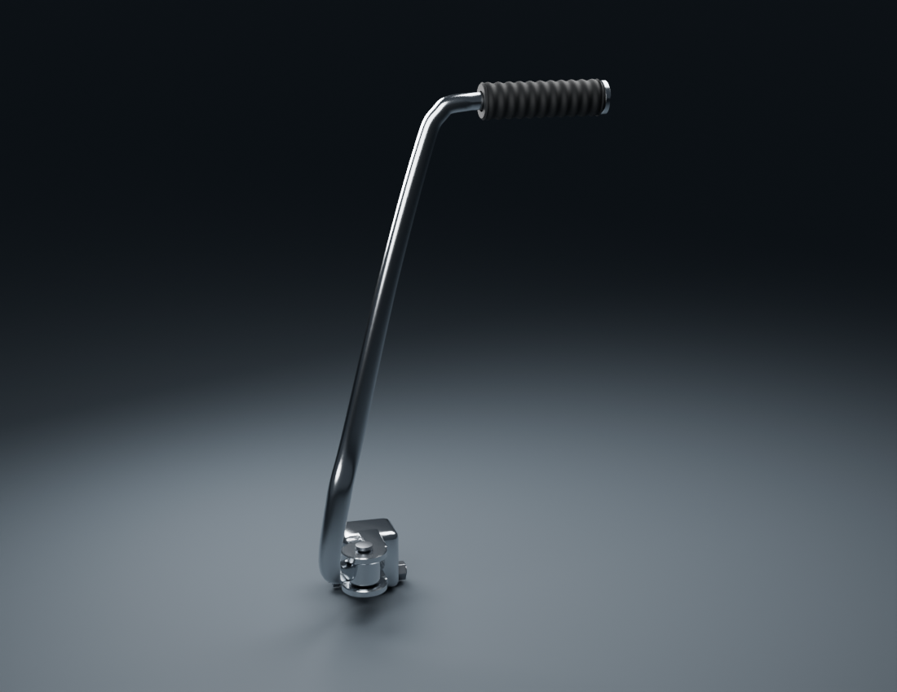

[Image entière](kickstarter-v2/folded-outer-quarter.png) · [Preuve du rendu](kickstarter-v2/render-report.json) · vue `folded-outer-quarter`

Source SHA-256 : `94a2aa0b4359738e1f701445d196f2bf39d91a75d57bc0f58ca81242061491b4`  
PNG SHA-256 : `fa02b90756c1d585e134c01e070355d3ec0de040b9e879344e62e5d4a67818d7`

[Blender](../../assets-src/moto-components/kickstarter/kickstarter-v2.blend) · [GLB](../../assets-src/moto-components/kickstarter/kickstarter-v2-inspection.glb) · [README source](../../assets-src/moto-components/kickstarter/README_v2.md) · [Revue et limites](kickstarter-v2/README.md) · [Fiche](../workflow/records/moto-kickstarter-001.json)

Autres vues Blender prouvées de cette révision

- [folded-inner-quarter](kickstarter-v2/folded-inner-quarter.png) · [preuve](kickstarter-v2/render-report.json)
- [base-clamp-and-folding-joint](kickstarter-v2/base-clamp-and-folding-joint.png) · [preuve](kickstarter-v2/render-report.json)
- [deployed-pedal-90deg](kickstarter-v2/deployed-pedal-90deg.png) · [preuve](kickstarter-v2/render-report.json)

### Cylindre moteur à ailettes — barillet extérieur

`MOTO-ENGINE-CYLINDER-001` · révision `engine-cylinder-v1` · **candidat non reçu**

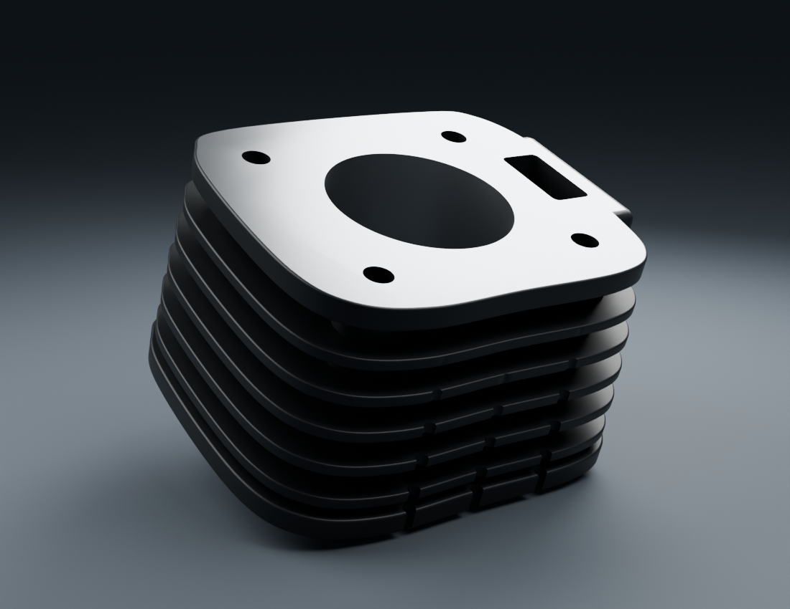

[Image entière](engine-cylinder-v1/front-right-quarter.png) · [Preuve du rendu](engine-cylinder-v1/render-report.json) · vue `front-right-quarter`

Source SHA-256 : `d78696eb6af8fb23a4917237aa75cfce3389d4759348984a9924fc4845be08c6`  
PNG SHA-256 : `cd6b0343b05e99c629ed522e6e7a3ad9efb1d77705d3cec34ba4032dc94228e4`

[Blender](../../assets-src/moto-components/engine-cylinder/engine-cylinder-v1.blend) · [GLB](../../assets-src/moto-components/engine-cylinder/engine-cylinder-inspection.glb) · [README source](../../assets-src/moto-components/engine-cylinder/README.md) · [Revue et limites](engine-cylinder-v1/README.md) · [Fiche](../workflow/records/moto-engine-cylinder-001.json)

Autres vues Blender prouvées de cette révision

- [rear-left-quarter](engine-cylinder-v1/rear-left-quarter.png) · [preuve](engine-cylinder-v1/render-report.json)
- [top-mating-passages](engine-cylinder-v1/top-mating-passages.png) · [preuve](engine-cylinder-v1/render-report.json)
- [fin-edge-detail](engine-cylinder-v1/fin-edge-detail.png) · [preuve](engine-cylinder-v1/render-report.json)

### Culasse — couvercle de visite, type unique en deux instances

`MOTO-ENGINE-TAPPET-CAP-001` · révision `engine-tappet-cap-v1` · **candidat non reçu**

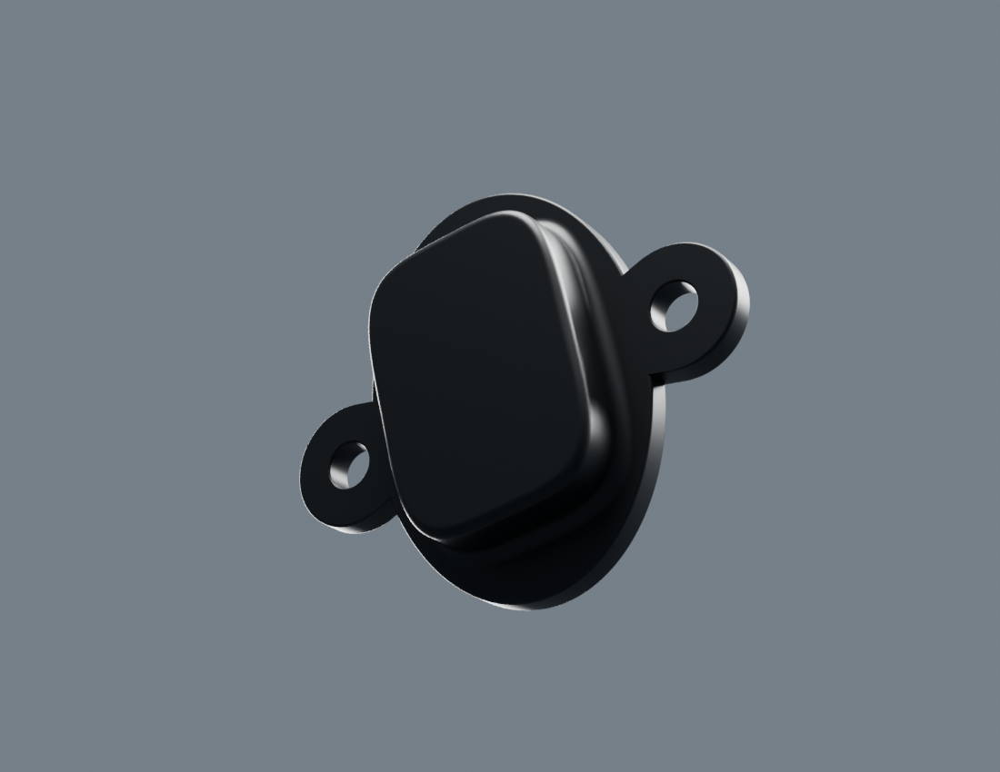

[Image entière](engine-tappet-cap-v1/front-quarter.png) · [Preuve du rendu](engine-tappet-cap-v1/render-report.json) · vue `front-quarter`

Source SHA-256 : `357a46ba78cc244153abf66ccfd1596532d7d14df7131c08a039efc10b66ffb9`  
PNG SHA-256 : `12071a3d4ed30f96464b93ce98cf86526a881285c18aa141f3af58f4ee232d8c`

[Blender](../../assets-src/moto-components/engine-tappet-cap/engine-tappet-cap-v1.blend) · [GLB](../../assets-src/moto-components/engine-tappet-cap/engine-tappet-cap-inspection.glb) · [README source](../../assets-src/moto-components/engine-tappet-cap/README.md) · [Revue et limites](engine-tappet-cap-v1/README.md) · [Fiche](../workflow/records/moto-engine-tappet-cap-001.json)

Autres vues Blender prouvées de cette révision

- [front-normal](engine-tappet-cap-v1/front-normal.png) · [preuve](engine-tappet-cap-v1/render-report.json)
- [rear-cavity](engine-tappet-cap-v1/rear-cavity.png) · [preuve](engine-tappet-cap-v1/render-report.json)

### Culasse — corps du couvercle OHC seul

`MOTO-ENGINE-OHC-COVER-001` · révision `engine-ohc-cover-v1` · **candidat non reçu**

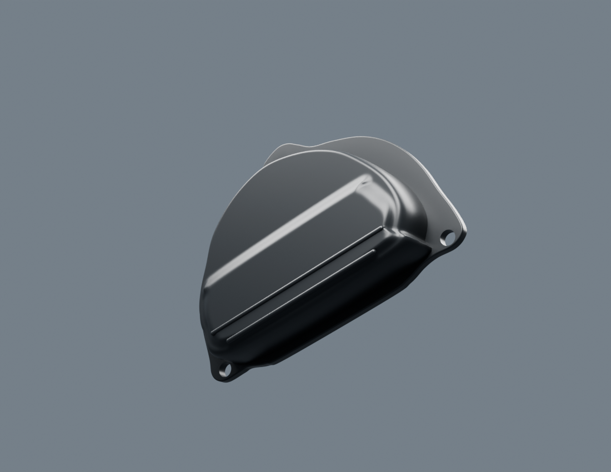

[Image entière](engine-ohc-cover-v1/front-quarter.png) · [Preuve du rendu](engine-ohc-cover-v1/render-report.json) · vue `front-quarter`

Source SHA-256 : `92db7d154bcc841d2a8ea7b15f89b14836c50a9d5b10d75be9de1aadf8119d45`  
PNG SHA-256 : `6f5e4f0930f49ba09f7fb0c815a94f25490b5f2f534a4acdce8ed2633d7f6a8f`

[Blender](../../assets-src/moto-components/engine-ohc-cover/engine-ohc-cover-v1.blend) · [GLB](../../assets-src/moto-components/engine-ohc-cover/engine-ohc-cover-inspection.glb) · [README source](../../assets-src/moto-components/engine-ohc-cover/README.md) · [Revue et limites](engine-ohc-cover-v1/README.md) · [Fiche](../workflow/records/moto-engine-ohc-cover-001.json)

Autres vues Blender prouvées de cette révision

- [front-normal](engine-ohc-cover-v1/front-normal.png) · [preuve](engine-ohc-cover-v1/render-report.json)
- [rear-cavity](engine-ohc-cover-v1/rear-cavity.png) · [preuve](engine-ohc-cover-v1/render-report.json)

### Culasse v3 — sections OHC raccordées, interfaces estimées

`MOTO-ENGINE-HEAD-001` · révision `engine-head-v3` · **candidat non reçu**

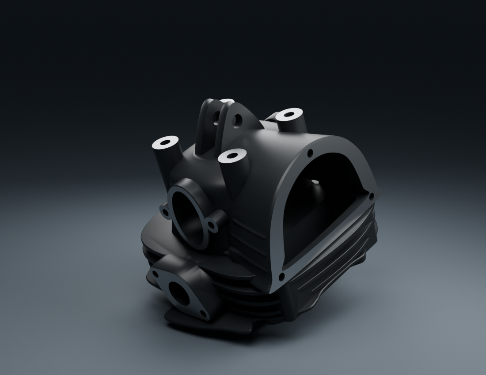

[Image entière](engine-head-v3/OHC-side-quarter.png) · [Preuve du rendu](engine-head-v3/render-report.json) · vue `OHC-side-quarter`

Source SHA-256 : `fbbec8d9766f0fbb4ed257ecec8eebc909a956bc75a6024a9cbdae6139078dcf`  
PNG SHA-256 : `55cb1a149b97c7c940e751c880be2f1ecf96d2d583d0accc987cff2219996895`

[Blender](../../assets-src/moto-components/engine-head/engine-head-v3.blend) · [GLB](../../assets-src/moto-components/engine-head/engine-head-v3-inspection.glb) · [README source](../../assets-src/moto-components/engine-head/README_v3.md) · [Revue et limites](engine-head-v3/README.md) · [Fiche](../workflow/records/moto-engine-head-001.json)

Autres vues Blender prouvées de cette révision

- [opposite-plug-well](engine-head-v3/opposite-plug-well.png) · [preuve](engine-head-v3/render-report.json)
- [joint-front-quarter](engine-head-v3/joint-front-quarter.png) · [preuve](engine-head-v3/render-report.json)
- [joint-rear-quarter](engine-head-v3/joint-rear-quarter.png) · [preuve](engine-head-v3/render-report.json)

### Culasse — embout métallique OHC seul

`MOTO-ENGINE-OHC-STUB-001` · révision `engine-ohc-stub-v1` · **candidat non reçu**

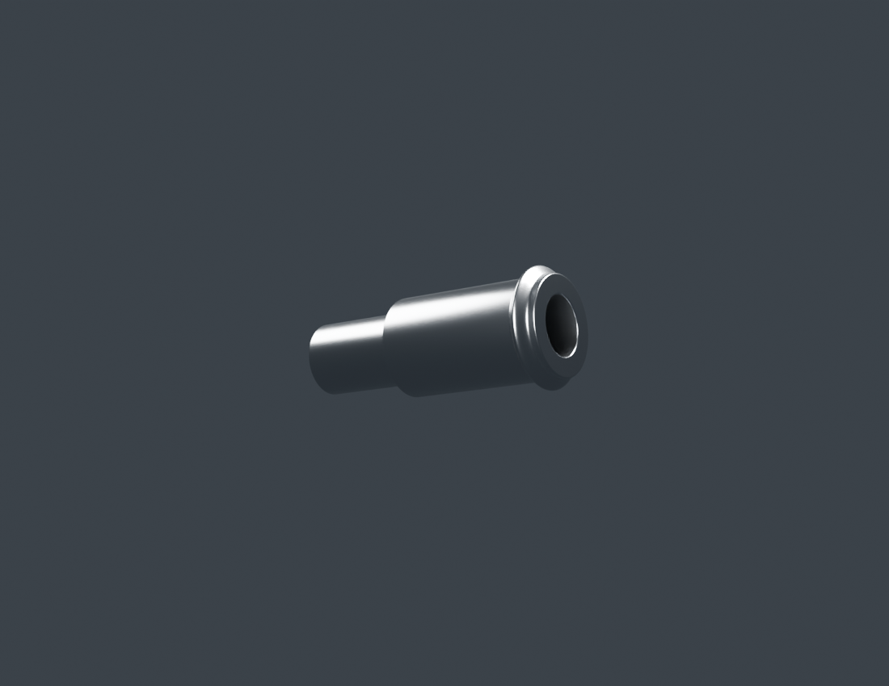

[Image entière](engine-ohc-stub-v1/tube-quarter.png) · [Preuve du rendu](engine-ohc-stub-v1/render-report.json) · vue `tube-quarter`

Source SHA-256 : `285eca8f5345efbfe31da9d2cc95464edcd9070a2e2e902e1e74990b2fb110c0`  
PNG SHA-256 : `45c940a8755ee8e1a511f049d2a332486f7a078130620a50c0b0ed55ebd89b42`

[Blender](../../assets-src/moto-components/engine-ohc-stub/engine-ohc-stub-v1.blend) · [GLB](../../assets-src/moto-components/engine-ohc-stub/engine-ohc-stub-inspection.glb) · [README source](../../assets-src/moto-components/engine-ohc-stub/README.md) · [Revue et limites](engine-ohc-stub-v1/README.md) · [Fiche](../workflow/records/moto-engine-ohc-stub-001.json)

Autres vues Blender prouvées de cette révision

- [mouth-end](engine-ohc-stub-v1/mouth-end.png) · [preuve](engine-ohc-stub-v1/render-report.json)
- [cover-interface](engine-ohc-stub-v1/cover-interface.png) · [preuve](engine-ohc-stub-v1/render-report.json)

### Bougie extérieure v2 — chanfrein reconstruit

`MOTO-ENGINE-SPARK-PLUG-001` · révision `engine-spark-plug-v2` · **candidat non reçu**

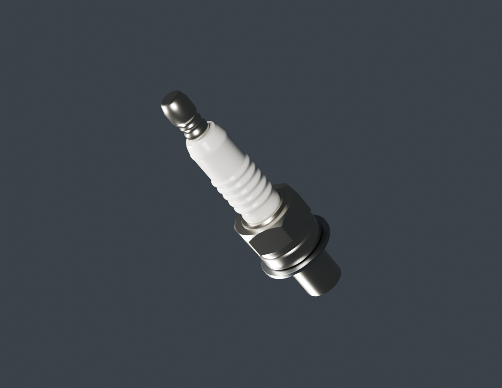

[Image entière](engine-spark-plug-v2/exterior-quarter.png) · [Preuve du rendu](engine-spark-plug-v2/render-report.json) · vue `exterior-quarter`

Source SHA-256 : `35648efb8880f8ca2cad8533083683542331fa2a87a20d5ee87a041128994bd5`  
PNG SHA-256 : `88f71d2d4fbc60b38e7ecd58d626c588fa9de3588e4bbe8b5d3143477f6ce0d2`

[Blender](../../assets-src/moto-components/engine-spark-plug/engine-spark-plug-v2.blend) · [GLB](../../assets-src/moto-components/engine-spark-plug/engine-spark-plug-v2-inspection.glb) · [README source](../../assets-src/moto-components/engine-spark-plug/README_v2.md) · [Revue et limites](engine-spark-plug-v2/README.md) · [Fiche](../workflow/records/moto-engine-spark-plug-001.json)

Autres vues Blender prouvées de cette révision

- [hex-ceramic-detail](engine-spark-plug-v2/hex-ceramic-detail.png) · [preuve](engine-spark-plug-v2/render-report.json)
- [installed-context](engine-spark-plug-v2/installed-context.png) · [preuve](engine-spark-plug-v2/render-report.json)

### Capuchon HT v2 — épaules coniques et grain original

`MOTO-ENGINE-SPARK-CAP-001` · révision `engine-spark-cap-v2` · **candidat non reçu**

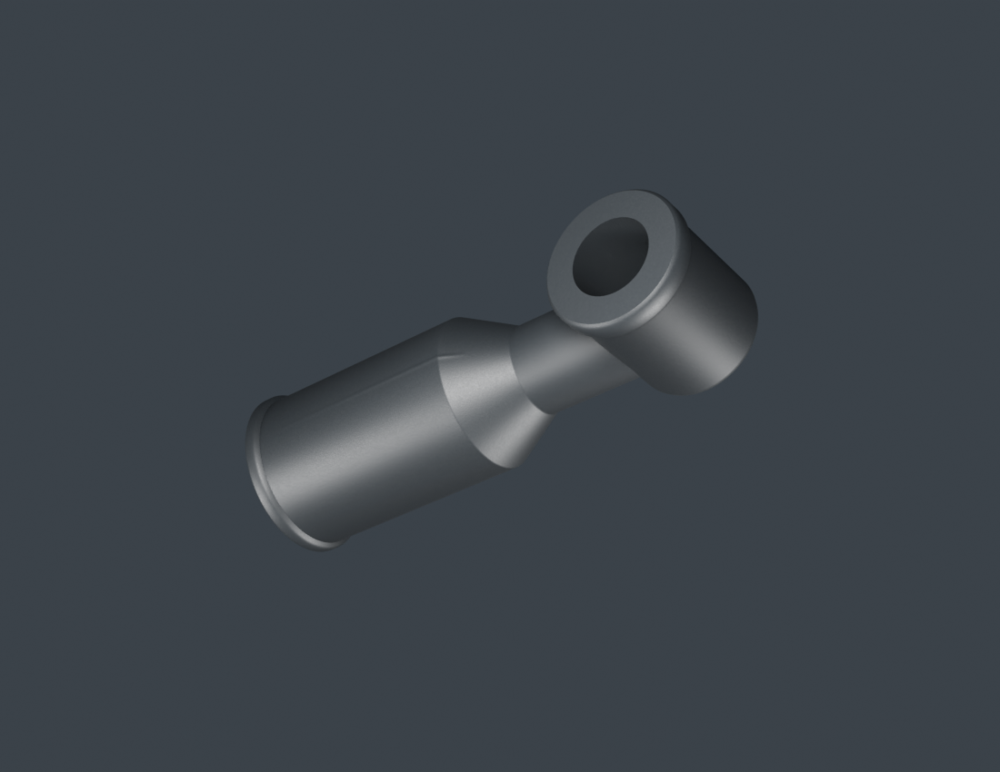

[Image entière](engine-spark-cap-v2/cap-quarter.png) · [Preuve du rendu](engine-spark-cap-v2/render-report.json) · vue `cap-quarter`

Source SHA-256 : `bceb87f8a34bcfd2354bccef2cf236ed6a0103a2725b4a76e3e3e3721da883e3`  
PNG SHA-256 : `60ad9248798f142e0d52502ac7aceefdca1c6935ead126d244e3cf8bf09c96af`

[Blender](../../assets-src/moto-components/engine-spark-cap/engine-spark-cap-v2.blend) · [GLB](../../assets-src/moto-components/engine-spark-cap/engine-spark-cap-v2-inspection.glb) · [README source](../../assets-src/moto-components/engine-spark-cap/README_v2.md) · [Revue et limites](engine-spark-cap-v2/README.md) · [Fiche](../workflow/records/moto-engine-spark-cap-001.json)

Autres vues Blender prouvées de cette révision

- [main-socket-mouth](engine-spark-cap-v2/main-socket-mouth.png) · [preuve](engine-spark-cap-v2/render-report.json)
- [short-port-contact](engine-spark-cap-v2/short-port-contact.png) · [preuve](engine-spark-cap-v2/render-report.json)
- [installed-context](engine-spark-cap-v2/installed-context.png) · [preuve](engine-spark-cap-v2/render-report.json)
- [grain-control](engine-spark-cap-v2/grain-control.png) · [preuve](engine-spark-cap-v2/render-report.json)

### Collecteur d’admission — variante conditionnelle

`MOTO-ENGINE-INTAKE-MANIFOLD-001` · révision `engine-intake-manifold-v1` · **candidat non reçu**

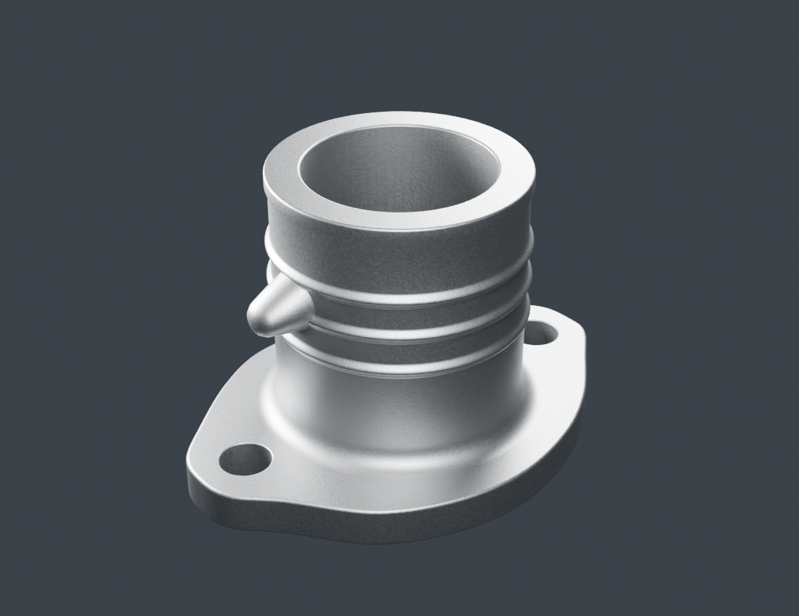

[Image entière](engine-intake-manifold-v1/reference-like-quarter.png) · [Preuve du rendu](engine-intake-manifold-v1/render-report.json) · vue `reference-like-quarter`

Source SHA-256 : `428eecbc58be7eb7cbcce12eb52b5d4e45549554964772a4f75a950f4508efab`  
PNG SHA-256 : `0cdd27ce13915256f3f82e9f0e57c4be8bf5add9077c302ff91890250133849c`

[Blender](../../assets-src/moto-components/engine-intake-manifold/engine-intake-manifold-v1.blend) · [GLB](../../assets-src/moto-components/engine-intake-manifold/engine-intake-manifold-inspection.glb) · [README source](../../assets-src/moto-components/engine-intake-manifold/README.md) · [Revue et limites](engine-intake-manifold-v1/README.md) · [Fiche](../workflow/records/moto-engine-intake-manifold-001.json)

Autres vues Blender prouvées de cette révision

- [opposite-quarter](engine-intake-manifold-v1/opposite-quarter.png) · [preuve](engine-intake-manifold-v1/render-report.json)
- [mouth-bands-detail](engine-intake-manifold-v1/mouth-bands-detail.png) · [preuve](engine-intake-manifold-v1/render-report.json)
- [estimated-base-reverse](engine-intake-manifold-v1/estimated-base-reverse.png) · [preuve](engine-intake-manifold-v1/render-report.json)

### Isolant d’admission v2 — stries originales sans relief

`MOTO-ENGINE-INTAKE-INSULATOR-001` · révision `engine-intake-insulator-v2` · **candidat non reçu**

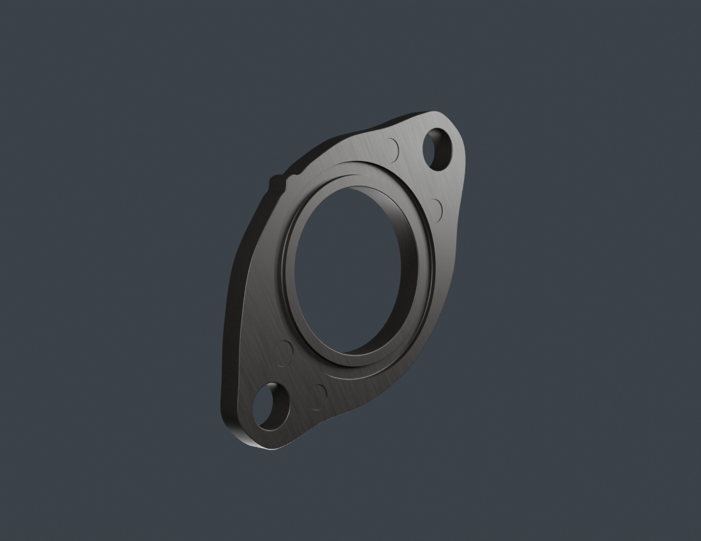

[Image entière](engine-intake-insulator-v2/front-quarter.png) · [Preuve du rendu](engine-intake-insulator-v2/render-report.json) · vue `front-quarter`

Source SHA-256 : `caa2dcbdb6d2e16f5b46916f0e9ede6e1d1d211205b8e5ae3912d9db9f17bf31`  
PNG SHA-256 : `bfe4522c7203c2dcb87f5acb3952d892a920aa4ccf93a617d9241b7ba7bc744f`

[Blender](../../assets-src/moto-components/engine-intake-insulator/engine-intake-insulator-v2.blend) · [GLB](../../assets-src/moto-components/engine-intake-insulator/engine-intake-insulator-v2-inspection.glb) · [README source](../../assets-src/moto-components/engine-intake-insulator/README_v2.md) · [Revue et limites](engine-intake-insulator-v2/README.md) · [Fiche](../workflow/records/moto-engine-intake-insulator-001.json)

Autres vues Blender prouvées de cette révision

- [groove-ear-detail](engine-intake-insulator-v2/groove-ear-detail.png) · [preuve](engine-intake-insulator-v2/render-report.json)
- [raking-finish-detail](engine-intake-insulator-v2/raking-finish-detail.png) · [preuve](engine-intake-insulator-v2/render-report.json)

Périmètre prévu : carter moteur gauche; carter moteur droit; cylindre et culasse à ailettes; admission et détails extérieurs visibles; collecteur et silencieux; repose-pieds avant/arrière; pédale frein et tringlerie; sélecteur et kick visibles; béquille latérale; béquille centrale.

## 18 · Réservoir WEWA, caches latéraux, selle, porte-bagages et éclairage arrière

**À fabriquer : aucun composant enregistré pour ce groupe.** Une recherche documentaire ne compte pas comme un modèle fini.

Périmètre prévu : réservoir WEWA et bouchon; cache gauche; cache droit; selle et dessous documenté; porte-bagages et attaches; garde-boue arrière visible; feu arrière; clignotants arrière gauche/droit; support plaque.

## Préexistants hors décompte de compatibilité des 18 groupes

Ces candidats sont enregistrés et illustrés une seule fois. Leur existence ne certifie pas les raccords de l’ensemble avant ni la réception de la moto.

### Pneu avant de la moto utilitaire de référence

`MOTO-TYRE-FRONT-001` · révision `front-tyre-v1` · **candidat non reçu**

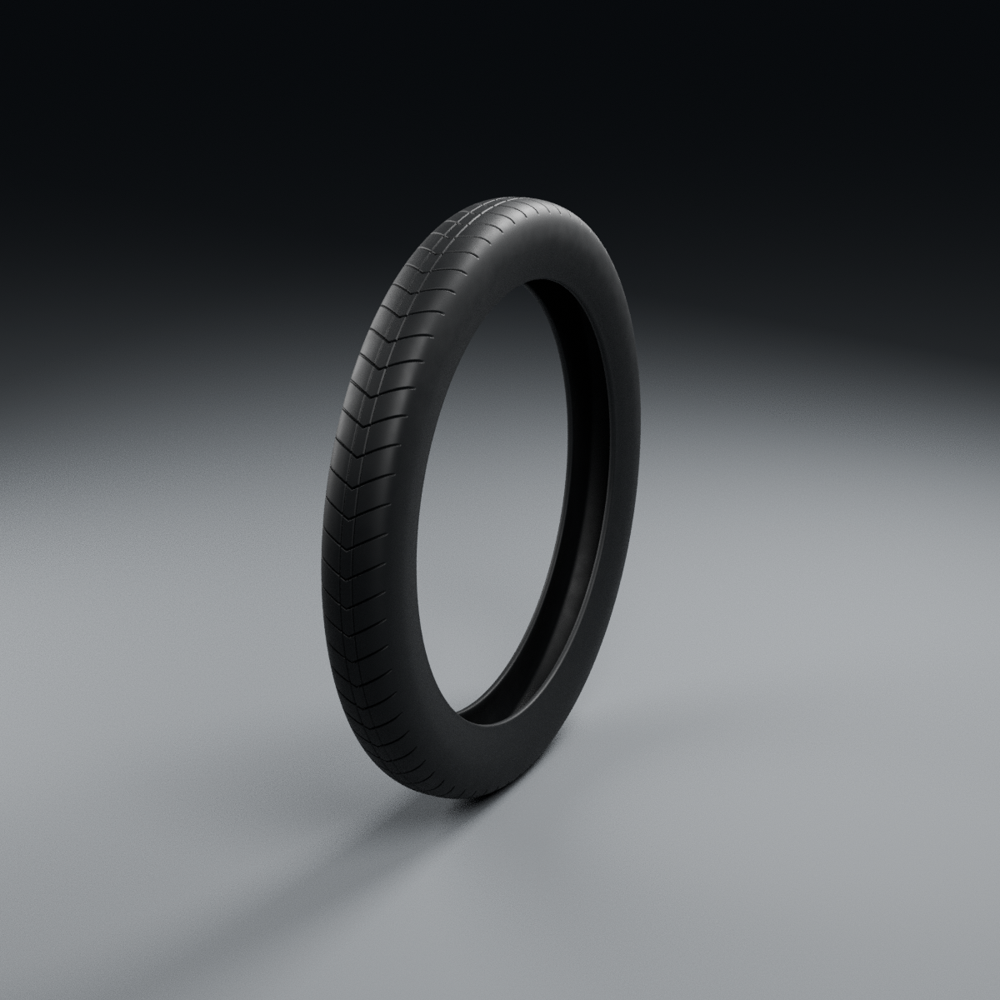

[Image entière](front-tyre-v1/neutral-quarter.png) · [Preuve du rendu](front-tyre-v1/manifest.json) · vue `neutral-quarter`

Source SHA-256 : `33bf2d29063cf267da47323cf7d2a126f803166caf5e2ea410dc56e89072326c`  
PNG SHA-256 : `40e0afb2af254ee8f86a8794d9b8e57f70db3dfcd783fe5ab5e93a4073295a28`

[Blender](../../assets-src/moto-components/front-tyre/front-tyre-v1.blend) · [GLB](../../assets-src/moto-components/front-tyre/front-tyre-inspection.glb) · [README source](../../assets-src/moto-components/front-tyre/README.md) · [Revue et limites](front-tyre-v1/README.md) · [Fiche](../workflow/records/moto-tyre-front-001.json)

Autres vues Blender prouvées de cette révision

- [neutral-side](front-tyre-v1/neutral-side.png) · [preuve](front-tyre-v1/manifest.json)
- [tread-close](front-tyre-v1/tread-close.png) · [preuve](front-tyre-v1/manifest.json)
- [cinematic-quarter](front-tyre-v1/cinematic-quarter.png) · [preuve](front-tyre-v1/manifest.json)

### Jante avant Wewa à cinq branches moulées

`MOTO-RIM-FRONT-001` · révision `front-rim-v1` · **candidat non reçu**

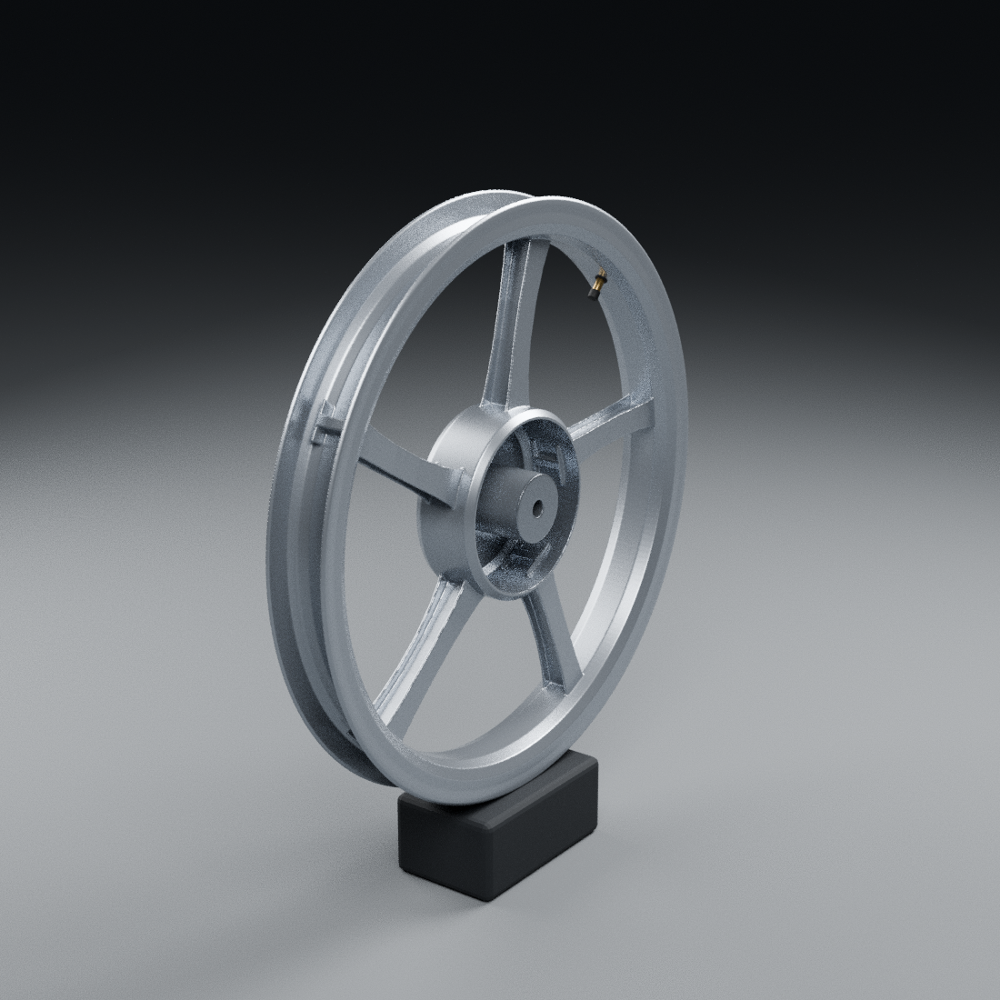

[Image entière](front-rim-v1/isolated-quarter.png) · [Preuve du rendu](front-rim-v1/manifest.json) · vue `isolated-quarter`

Source SHA-256 : `77f351d89b29f39dc435b434278bb556cff41a8c509edccd979dc9c8c1173c3a`  
PNG SHA-256 : `40e064a7c7b70426540f67f332deaf71c7ef2ad5970ba1163ea0d9ce021f13d7`

[Blender](../../assets-src/moto-components/front-rim/front-rim-v1.blend) · [front-rim-inspection.glb](../../assets-src/moto-components/front-rim/front-rim-inspection.glb) · [front-wheel-fit-inspection.glb](../../assets-src/moto-components/front-rim/front-wheel-fit-inspection.glb) · [README source](../../assets-src/moto-components/front-rim/README.md) · [Revue et limites](front-rim-v1/README.md) · [Fiche](../workflow/records/moto-rim-front-001.json)

Autres vues Blender prouvées de cette révision

- [isolated-side](front-rim-v1/isolated-side.png) · [preuve](front-rim-v1/manifest.json)
- [joint-close](front-rim-v1/joint-close.png) · [preuve](front-rim-v1/manifest.json)
- [tyre-fit-cinematic](front-rim-v1/tyre-fit-cinematic.png) · [preuve](front-rim-v1/manifest.json)
- [tyre-fit-neutral](front-rim-v1/tyre-fit-neutral.png) · [preuve](front-rim-v1/manifest.json)

### Corps moulé du flasque de frein avant Wewa

`MOTO-BRAKE-PLATE-FRONT-001` · révision `front-brake-plate-v2` · **candidat non reçu**

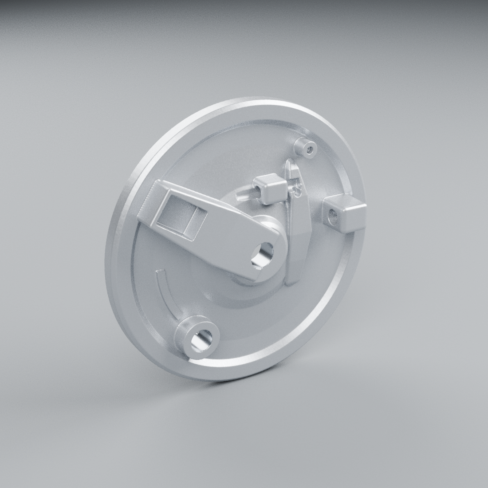

[Image entière](front-brake-plate-v2/quarter.png) · [Preuve du rendu](front-brake-plate-v2/render-report.json) · vue `quarter`

Source SHA-256 : `b22bab7f58f4456c74b227610e7f30e51e07793b0420106a9ad9df71e69f71ec`  
PNG SHA-256 : `0fe44d99c2c125877cd5644b0bf363ff93bc6fcc1f9b2157da7be42ec8d97b37`

[Blender](../../assets-src/moto-components/front-brake-plate/front-brake-plate-v2.blend) · [front-brake-plate-v2-inspection.glb](../../assets-src/moto-components/front-brake-plate/front-brake-plate-v2-inspection.glb) · [front-wheel-panel-v2-fit-inspection.glb](../../assets-src/moto-components/front-brake-plate/front-wheel-panel-v2-fit-inspection.glb) · [README source](../../assets-src/moto-components/front-brake-plate/README_v2.md) · [Revue et limites](front-brake-plate-v2/README.md) · [Fiche](../workflow/records/moto-brake-plate-front-001.json)

Autres vues Blender prouvées de cette révision

- [front](front-brake-plate-v2/front.png) · [preuve](front-brake-plate-v2/render-report.json)
- [rear](front-brake-plate-v2/rear.png) · [preuve](front-brake-plate-v2/render-report.json)
- [macro](front-brake-plate-v2/macro.png) · [preuve](front-brake-plate-v2/render-report.json)
- [cinematic-quarter](front-brake-plate-v2/cinematic-quarter.png) · [preuve](front-brake-plate-v2/render-report.json)

### Levier de came de frein avant seul

`MOTO-BRAKE-LEVER-FRONT-001` · révision `front-brake-lever-v1` · **candidat non reçu**

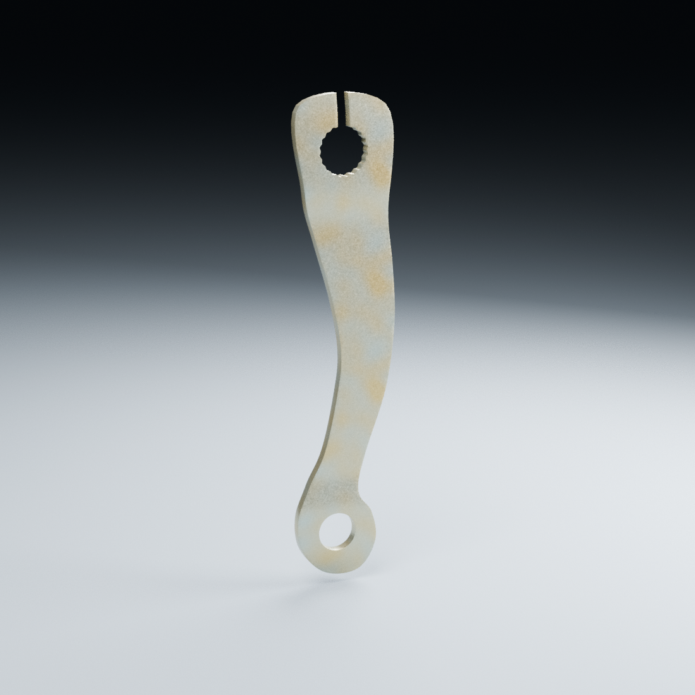

[Image entière](front-brake-lever-v1/quarter.png) · [Preuve du rendu](front-brake-lever-v1/render-report.json) · vue `quarter`

Source SHA-256 : `57b7313863157608a679563cfd80f3b6b6a29b8febebafb44e42c68819337a0d`  
PNG SHA-256 : `cab2c28d178c6ef8f35f72620511ab24a7ab915737a0d3ee74ae57b1fa1fbde7`

[Blender](../../assets-src/moto-components/front-brake-lever/front-brake-lever-v1.blend) · [GLB](../../assets-src/moto-components/front-brake-lever/front-brake-lever-inspection.glb) · [README source](../../assets-src/moto-components/front-brake-lever/README.md) · [Revue et limites](front-brake-lever-v1/README.md) · [Fiche](../workflow/records/moto-brake-lever-front-001.json)

Autres vues Blender prouvées de cette révision

- [front](front-brake-lever-v1/front.png) · [preuve](front-brake-lever-v1/render-report.json)
- [rear](front-brake-lever-v1/rear.png) · [preuve](front-brake-lever-v1/render-report.json)
- [head-detail](front-brake-lever-v1/head-detail.png) · [preuve](front-brake-lever-v1/render-report.json)

### Guidon — tube nu et zones de serrage

`MOTO-HANDLEBAR-001` · révision `handlebar-v1` · **candidat non reçu**

[Image entière](handlebar-v1/quarter.png) · [Preuve du rendu](handlebar-v1/render-report.json) · vue `quarter`

Source SHA-256 : `1385ccc667f30681e334ce96aff71d2214794238c5b31e0a1fd4b75b8ad6652a`  
PNG SHA-256 : `3e1d8de77bb47d314051462cf48b1a149da87265b0ae04e0ec3c063917f3924d`

[Blender](../../assets-src/moto-components/handlebar/handlebar-v1.blend) · [GLB](../../assets-src/moto-components/handlebar/handlebar-inspection.glb) · [README source](../../assets-src/moto-components/handlebar/README.md) · [Revue et limites](handlebar-v1/README.md) · [Fiche](../workflow/records/moto-handlebar-001.json)

Autres vues Blender prouvées de cette révision

- [cockpit](handlebar-v1/cockpit.png) · [preuve](handlebar-v1/render-report.json)
- [clamp-detail](handlebar-v1/clamp-detail.png) · [preuve](handlebar-v1/render-report.json)

### Compteurs v5 — carter continu et fonds plans

`MOTO-INSTRUMENTS-001` · révision `instruments-v5` · **candidat non reçu**

[Image entière](instruments-v5/whole-rear.png) · [Preuve du rendu](instruments-v5/render-report.json) · vue `whole-rear`

Source SHA-256 : `3d662c0c35ec9d7ff6b00315d28fc9b3bd2e519771b3fc3f48470a0033ef3951`  
PNG SHA-256 : `ec1de07af0735a5a428100210369cf1256c77bacabae5f5714d12f5fe3687fee`

[Blender](../../assets-src/moto-components/instruments/instruments-v5.blend) · [GLB](../../assets-src/moto-components/instruments/instruments-v5-inspection.glb) · [README source](../../assets-src/moto-components/instruments/README_v5.md) · [Revue et limites](instruments-v5/README.md) · [Fiche](../workflow/records/moto-instruments-001.json)

Autres vues Blender prouvées de cette révision

- [cover-context](instruments-v5/cover-context.png) · [preuve](instruments-v5/render-report.json)

---

Régénération : `python tools/build_motorcycle18_markdown_review.py`. Les images restent dans leurs dossiers de preuve ; aucune photographie documentaire privée, image générée ou composition nouvelle n’est utilisée.
