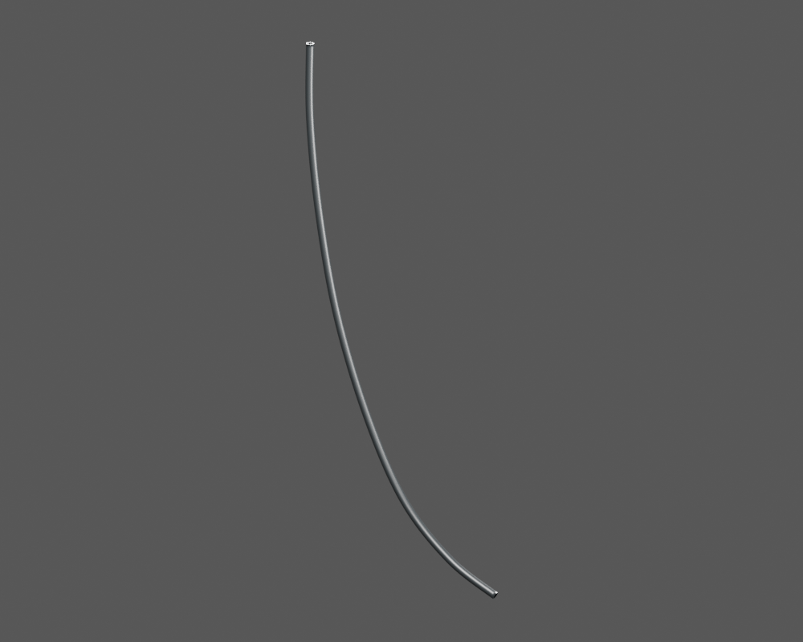
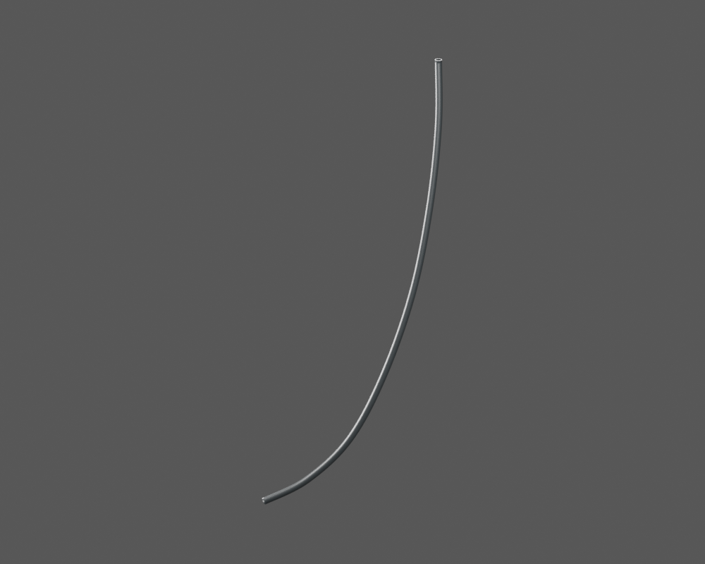
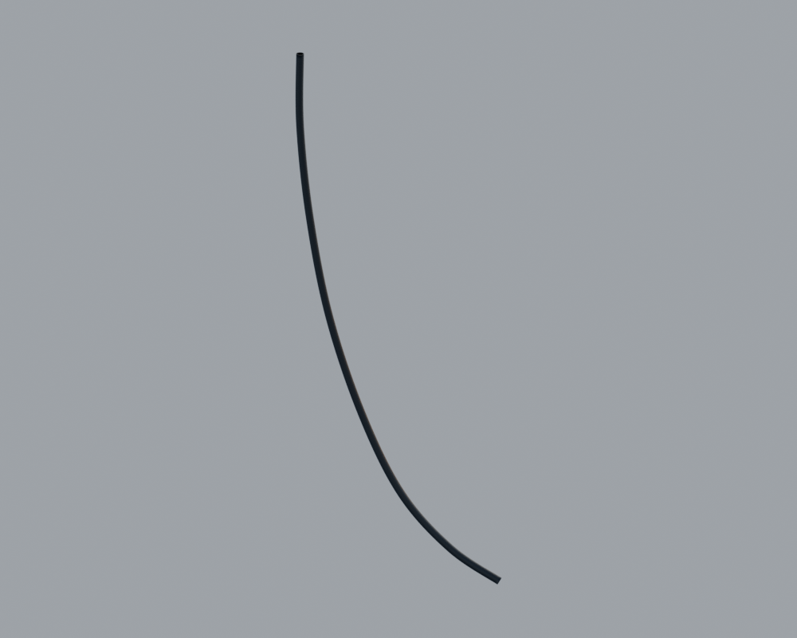

# P29 — Observed lower front sheath A — mechanical function unassigned

[Source Blender](../../../assets-src/moto-components/p29-lower-front-sheath-observed-a-v1/sheath-material.blend) · [GLB](../../../assets-src/moto-components/p29-lower-front-sheath-observed-a-v1/p29-lower-front-sheath-observed-a-v1-inspection.glb) · [Dossier](../../../creative/research/p29-lower-front-sheath-observed-a-v1/G0-G2.json) · [Étude auteur](../p29-lower-front-sheath-observed-a-v1/README.md)

[Source rouverte](source-geometry-check.json), [export réel](export-buffer-check.json), [rendus96 associés à la source figée](render-report.json), [EXR FLOAT32](raw-render-check.json), [quatre vues Babylon de coordination](inspection-v5/engine-check.json), [lecture réelle](coordinator-review.json), [manifestes](production-manifest.json). Les images et rapports auteur restent inchangés. Leur association à la source est vérifiée dans le lot figé. Une éventuelle vue indépendante `coordination-neutral` est identifiée séparément avec sa provenance ; elle ne modifie pas la source.

Une gaineA courbe seule, extérieure et tronquée, sans embouts ni mécanique inventée. Source figée conservée. Trois natifs96 dont neutre relus ; buffersGLB et Babylon contrôlés indépendamment. Apparence noire peu contrastée dans le moteur stock, vue opposée proche de tranche : pas de réception matière. Fonction/continuité/fit restent inconnus. Publication technique autorisée par main ; aucune réception artistique ni paquet complet.

Les dimensions et interfaces restent estimées. Aucune réception artistique ou qualification matérielle n’est transmise. Le paquet reste ouvert pour ses enfants et raccords manquants.
