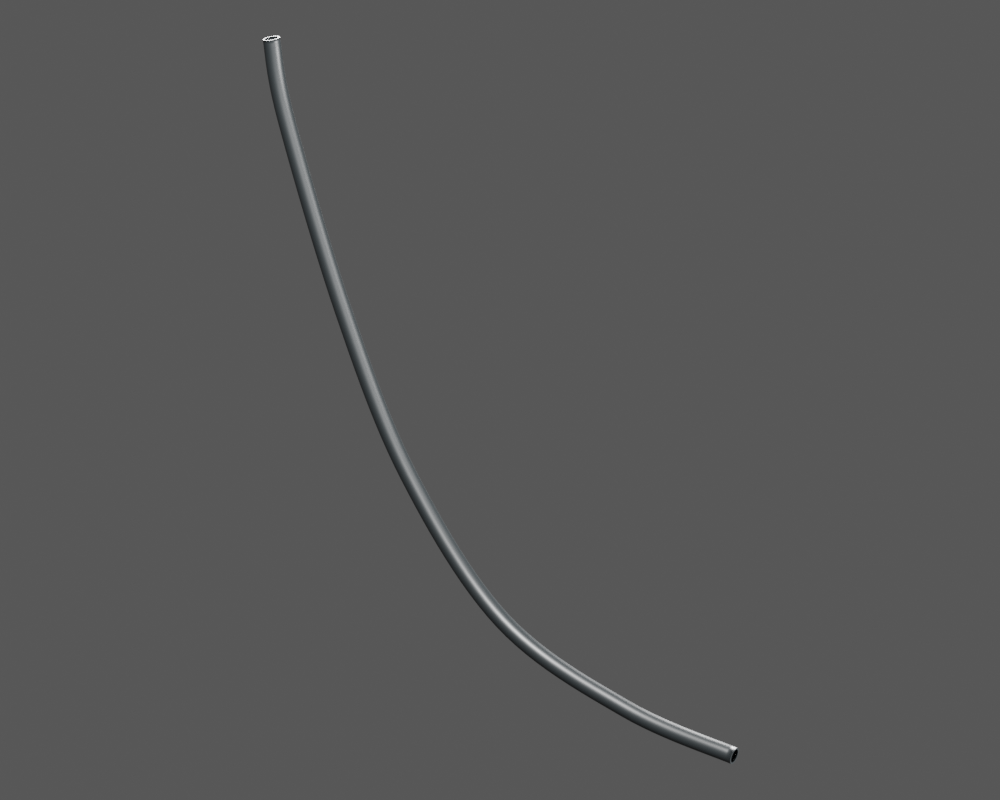
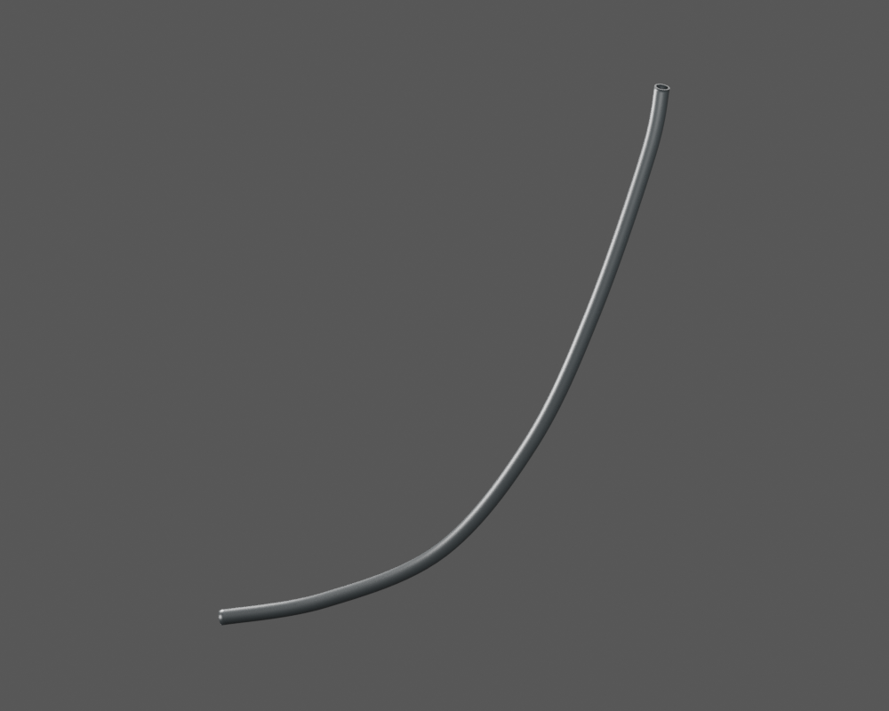
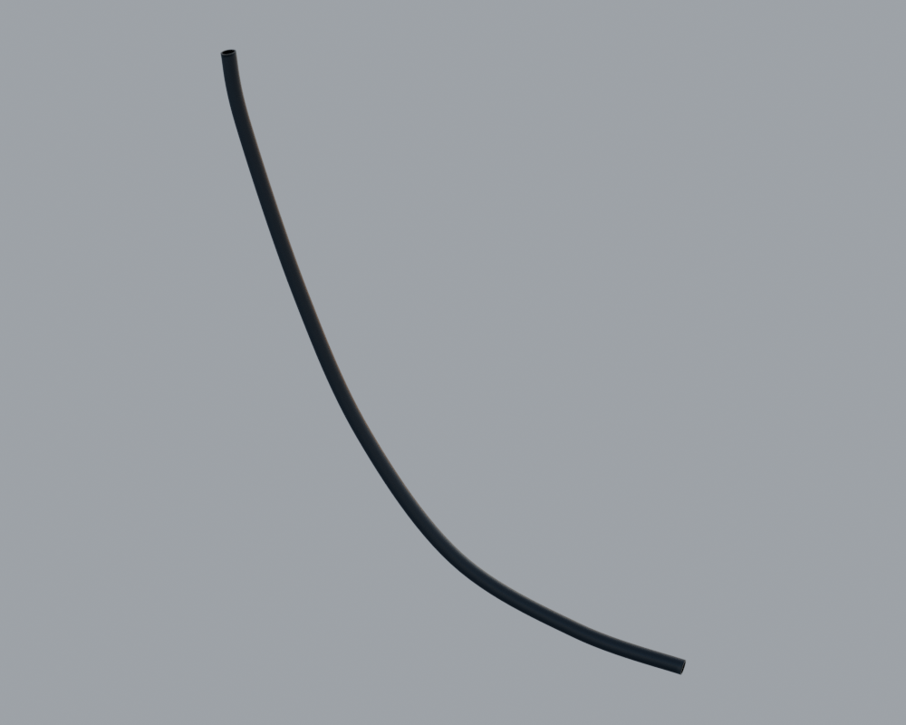

# P29 — Observed lower front sheath B — mechanical function unassigned

[Source Blender](../../../assets-src/moto-components/p29-lower-front-sheath-observed-b-v1/sheath-material.blend) · [GLB](../../../assets-src/moto-components/p29-lower-front-sheath-observed-b-v1/p29-lower-front-sheath-observed-b-v1-inspection.glb) · [Dossier](../../../creative/reviews/p29-lower-front-sheath-observed-b-v1-coordination-v1/G0-plan.json) · [Étude auteur](../p29-lower-front-sheath-observed-b-v1/README.md)

[Source rouverte](source-geometry-check.json), [export réel](export-buffer-check.json), [rendus96 associés à la source figée](render-report.json), [EXR FLOAT32](raw-render-check.json), [quatre vues Babylon de coordination](inspection-v5/engine-check.json), [lecture réelle](coordinator-review.json), [manifestes](production-manifest.json). Les images et rapports auteur restent inchangés. Leur association à la source est vérifiée dans le lot figé. Une éventuelle vue indépendante `coordination-neutral` est identifiée séparément avec sa provenance ; elle ne modifie pas la source.

B est une portion courbe seule avec deux coupes annulaires de revue, sans embout. Trois natifs96 quarter/reverse/neutral et trois vues moteur quarter/driver/reverse réellement lus. Une gaine indépendante observée au-dessus du runA dans RDC04 ; aucune attribution frein/vitesse, correspondance historique ou pose montée. Babylon sombre et deux vues proches de tranche : preuve de présence/export technique, pas réception de matière. Publication technique root autorisée par main ; fonctions, ancienne bijection et montage toujours non attribués.

Les dimensions et interfaces restent estimées. Aucune réception artistique ou qualification matérielle n’est transmise. Le paquet reste ouvert pour ses enfants et raccords manquants.
