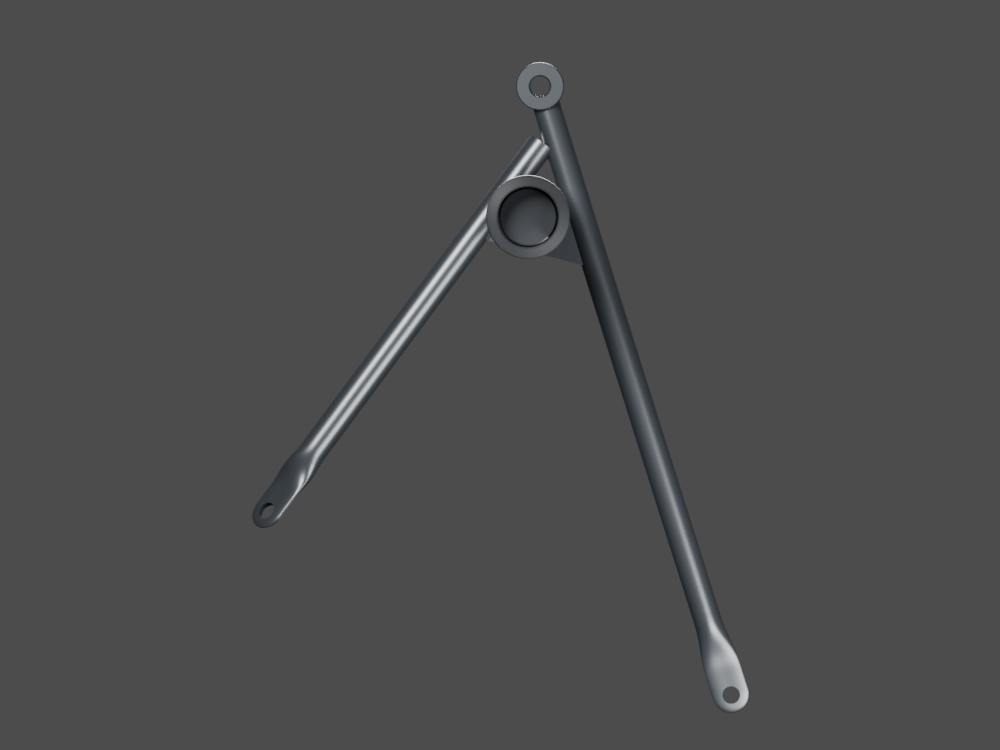
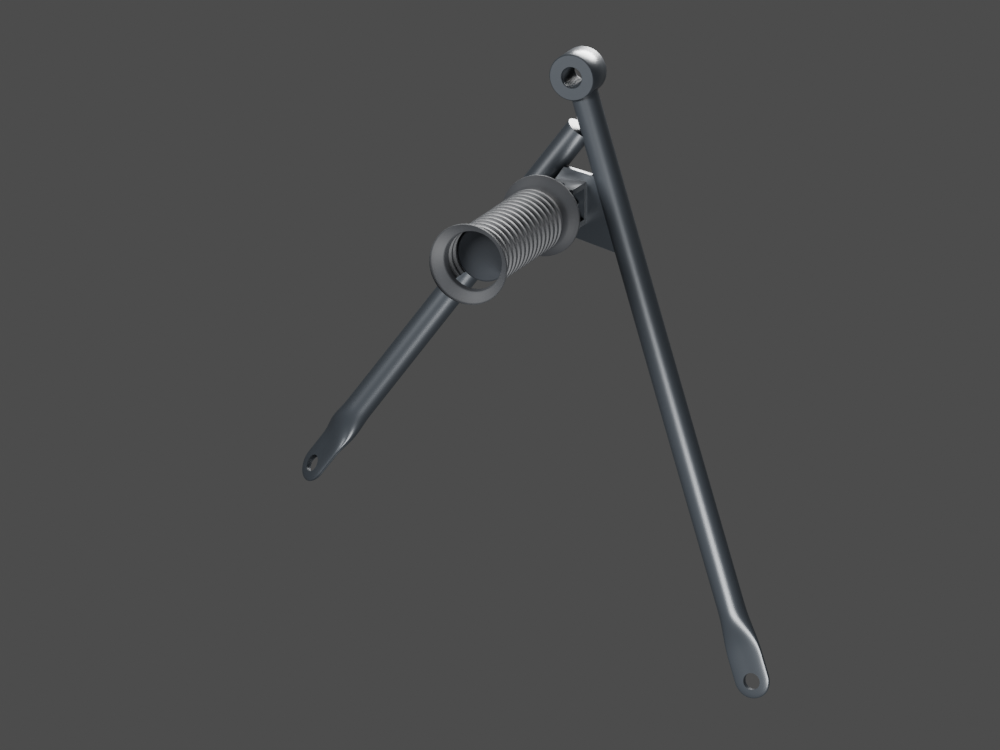
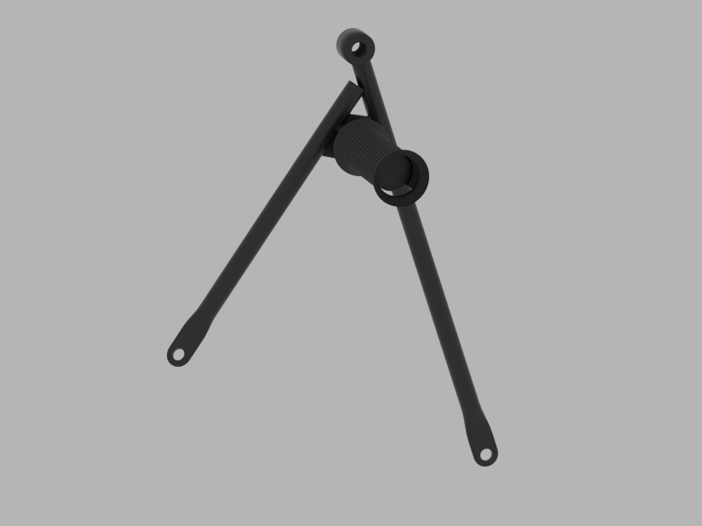
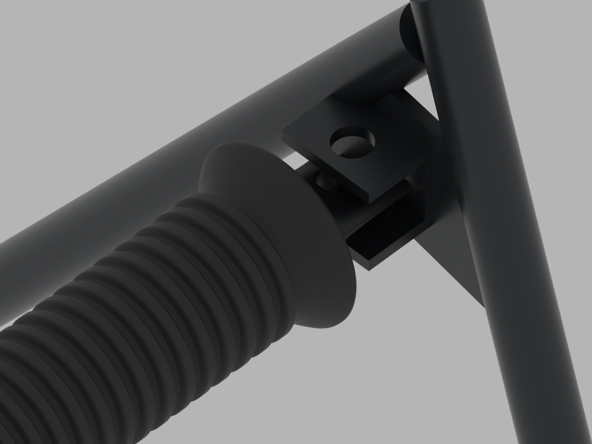

# P16 — One reused LH passenger exterior unit — mounting unqualified

[Source Blender](../../../assets-src/moto-components/passenger-footrest-left-exterior-context-v1/passenger-footrest-left-exterior-context-v1.blend) · [GLB](../../../assets-src/moto-components/passenger-footrest-left-exterior-context-v1/passenger-footrest-left-exterior-context-v1-inspection.glb) · [Dossier](../../../creative/research/passenger-footrest-left-exterior-context-v1-coordination-v1/G0-G2-plan-v1.json) · [Étude auteur](../passenger-footrest-left-exterior-context-v1/README.md)

[Source rouverte](source-geometry-check.json), [export réel](export-buffer-check.json), [rendus96 associés à la source figée](render-report.json), [EXR FLOAT32](raw-render-check.json), [quatre vues Babylon de coordination](inspection-v5/engine-check.json), [lecture réelle](coordinator-review.json), [manifestes](production-manifest.json). Les images et rapports auteur restent inchangés. Leur association à la source est vérifiée dans le lot figé. Une éventuelle vue indépendante `coordination-neutral` est identifiée séparément avec sa provenance ; elle ne modifie pas la source.

Une unité extérieure passager gauche réemployée, trois parents et zéro nouvelle forme/identité. Les quatre natifs et quatre captures Babylon sont réellement relus : support formé, métal et enveloppe caoutchouc restent distincts. Le rendu moteur est sombre et son orientation de présentation diffère des caméras natives ; aucune réception matière ou pose moto. Raccord au cadre non identifié : unité conservée hors moto, transformation mondiale null.

Les dimensions et interfaces restent estimées. Aucune réception artistique ou qualification matérielle n’est transmise. Le paquet reste ouvert pour ses enfants et raccords manquants.
