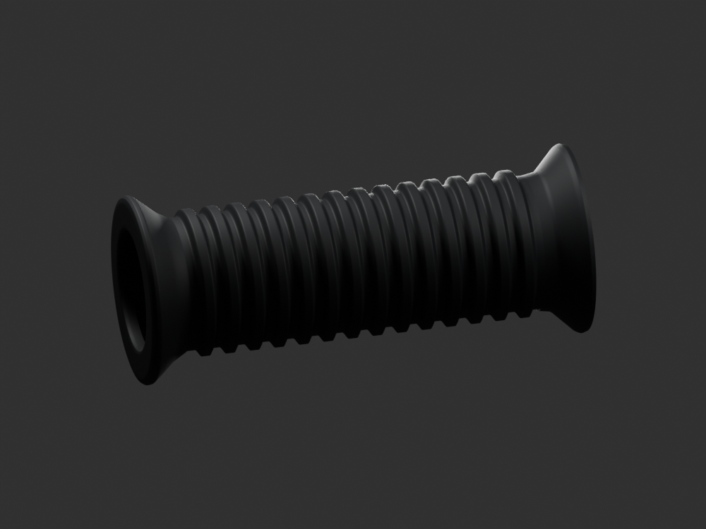
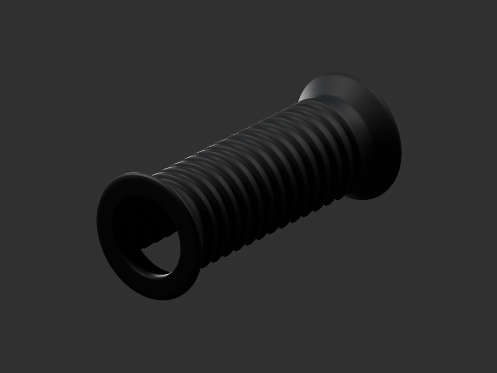
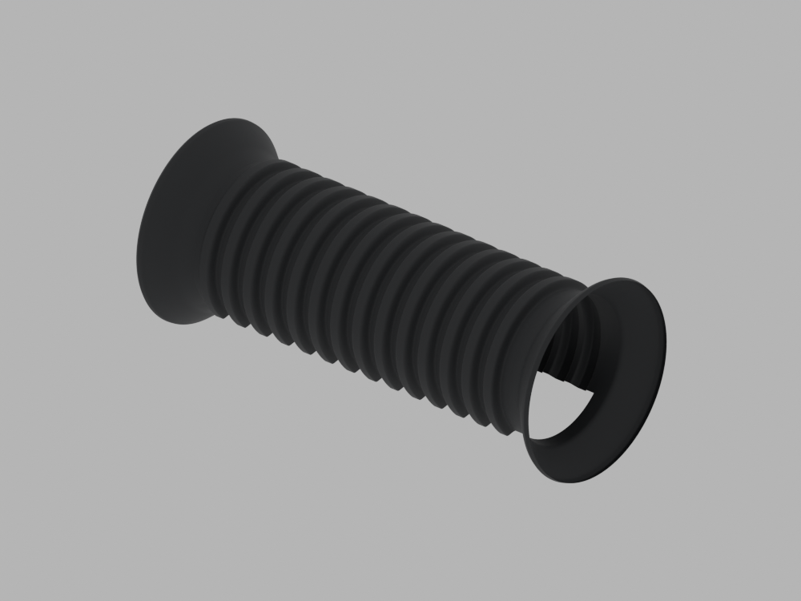
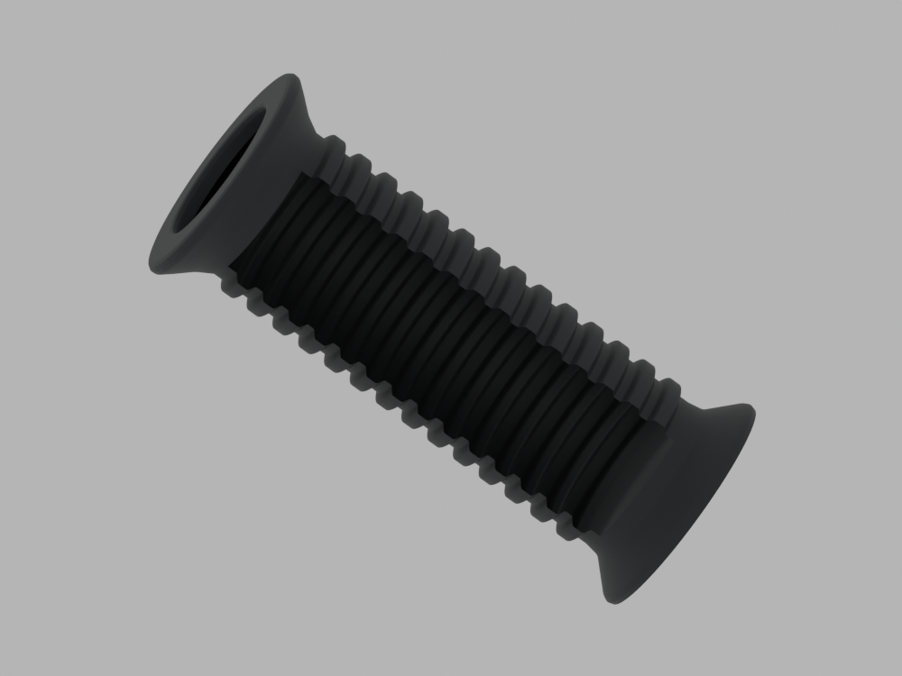

# P16 — JK113008 passenger rubber — single bounded visible-envelope exemplar

[Source Blender](../../../assets-src/moto-components/passenger-footrest-rubber-jk113008-v1/child-candidate.blend) · [GLB](../../../assets-src/moto-components/passenger-footrest-rubber-jk113008-v1/child-candidate.glb) · [Dossier](../../../creative/research/passenger-footrest-rubber-jk113008-v1-coordination-v1/G0-G2-plan-v1.json) · [Étude auteur](../passenger-footrest-rubber-jk113008-v1/README.md)

[Source rouverte](source-geometry-check.json), [export réel](export-buffer-check.json), [rendus96 associés à la source figée](render-report.json), [EXR FLOAT32](raw-render-check.json), [quatre vues Babylon de coordination](inspection-v5/engine-check.json), [lecture réelle](coordinator-review.json), [manifestes](production-manifest.json). Les images et rapports auteur restent inchangés. Leur association à la source est vérifiée dans le lot figé. Une éventuelle vue indépendante `coordination-neutral` est identifiée séparément avec sa provenance ; elle ne modifie pas la source.

Un manchon passagerJK113008 distinct du conducteurDF161413 : corps annelé, extrémités évasées et collet proche complet lisibles. Le quart inférieur du milieu est une omission de diagnostic, visible à travers la bouche ; ce n’est pas une rainure ou une ouverture attestée du produit. Matière noire proposée non mesurée ; relation au métalDP161170 et dessous complet non reçus.

Les dimensions et interfaces restent estimées. Aucune réception artistique ou qualification matérielle n’est transmise. Le paquet reste ouvert pour ses enfants et raccords manquants.
