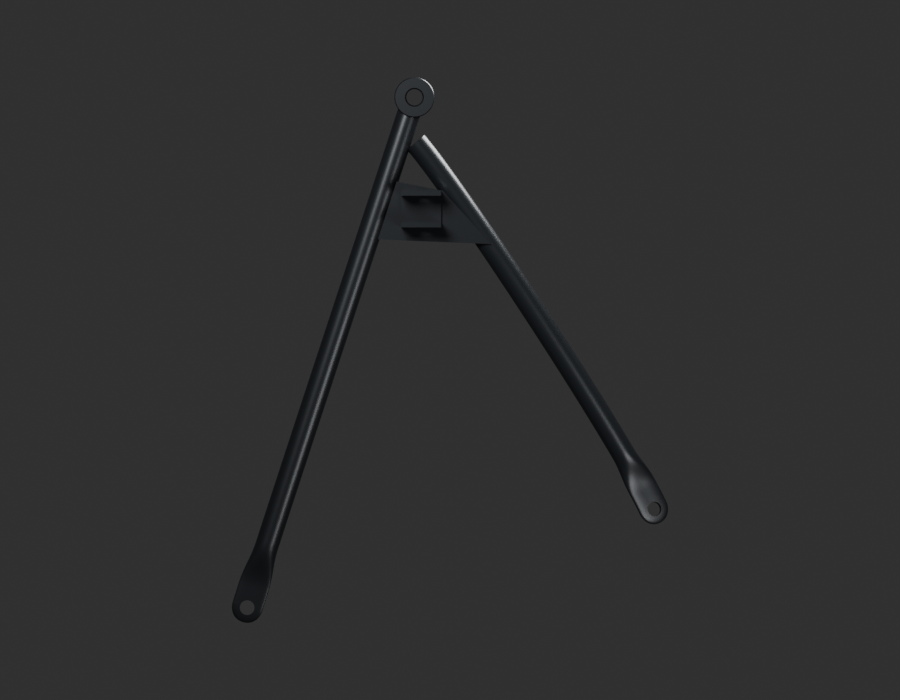
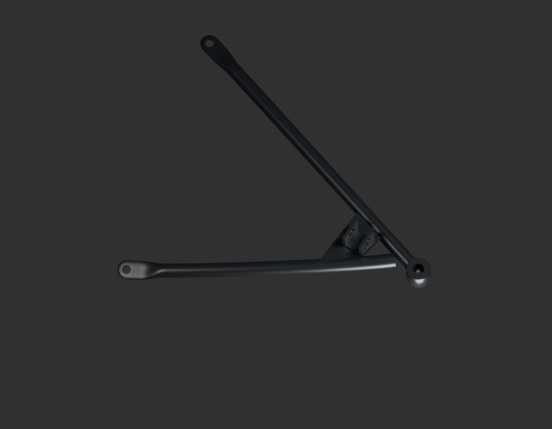
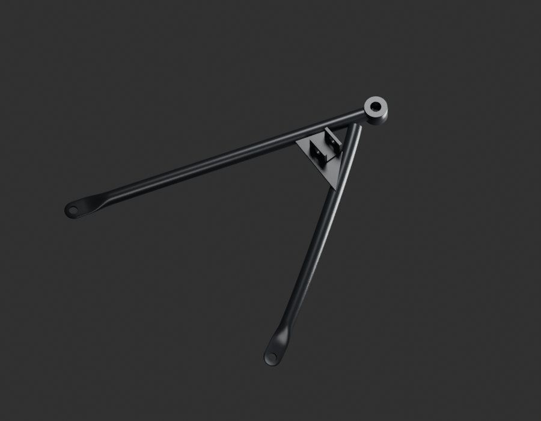
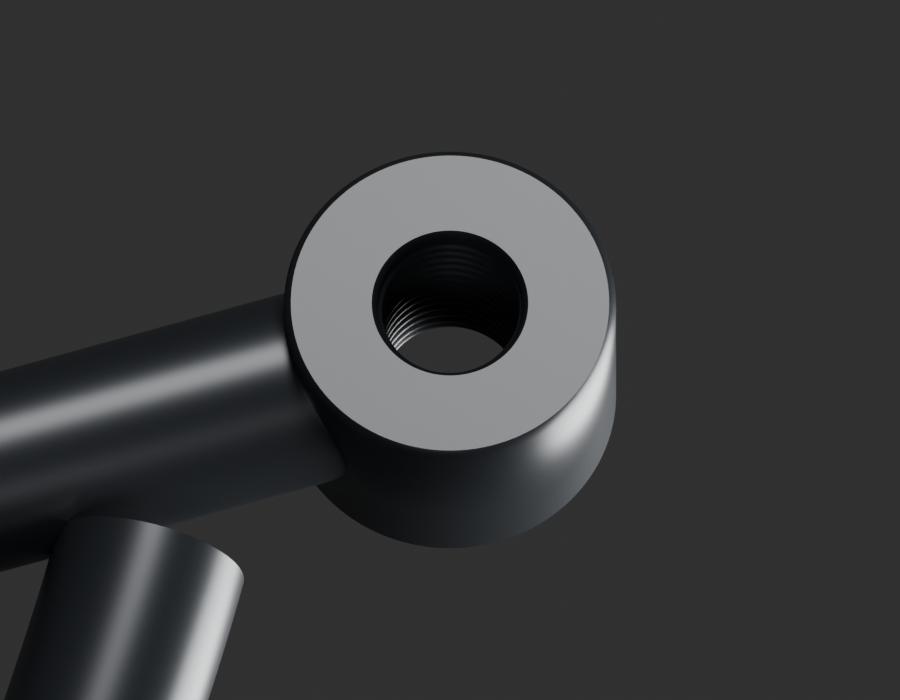

# P16 — MOTO-PASSENGER-FOOTREST-STAY-RIGHT-001 — bounded exterior candidate

[Source Blender](../../../assets-src/moto-components/passenger-footrest-stay-right-v1/child-candidate.blend) · [GLB](../../../assets-src/moto-components/passenger-footrest-stay-right-v1/child-candidate.glb) · [Dossier](../../../creative/research/passenger-footrest-stay-right-v1-coordination-v1/G0-G2-plan-v1.json) · [Étude auteur](../passenger-footrest-stay-right-v1/delivery.json)

[Source rouverte](source-geometry-check.json), [export réel](export-buffer-check.json), [rendus96 associés à la source figée](render-report.json), [EXR FLOAT32](raw-render-check.json), [quatre vues Babylon de coordination](inspection-v5/engine-check.json), [lecture réelle](coordinator-review.json), [manifestes](production-manifest.json). Les images et rapports auteur restent inchangés. Leur association à la source est vérifiée dans le lot figé. Une éventuelle vue indépendante `coordination-neutral` est identifiée séparément avec sa provenance ; elle ne modifie pas la source.

Support passager droit PF113003 : source indépendante, asymétries conservées ; quatre natifs et macro œil relus. Filetage, épaisseurs, orientation et montage restent estimés, pas un miroir accepté.

Les dimensions et interfaces restent estimées. Aucune réception artistique ou qualification matérielle n’est transmise. Le paquet reste ouvert pour ses enfants et raccords manquants.
