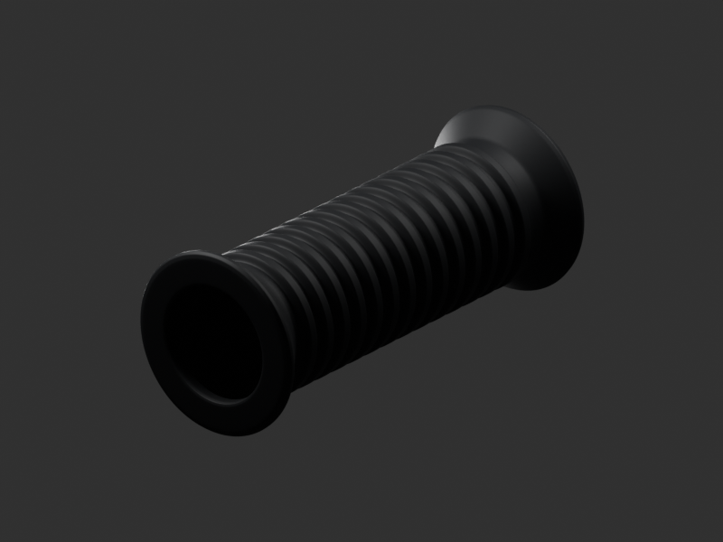
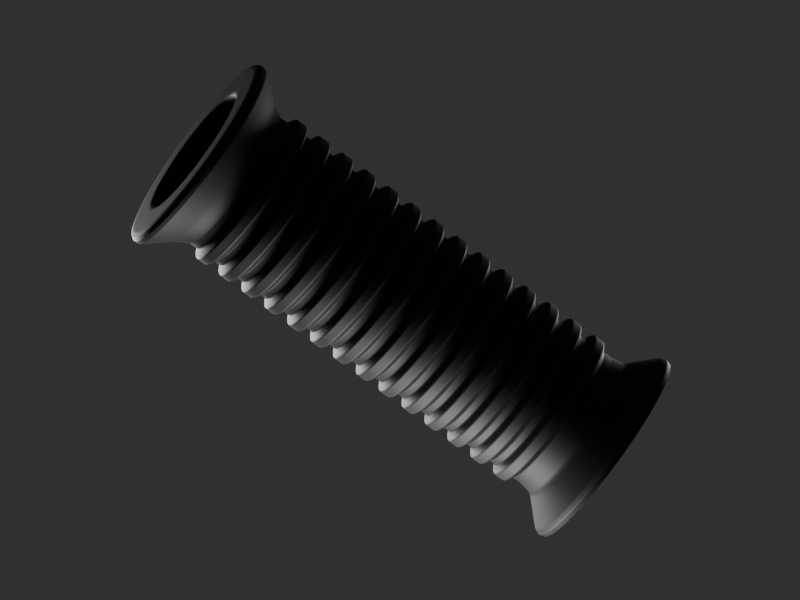
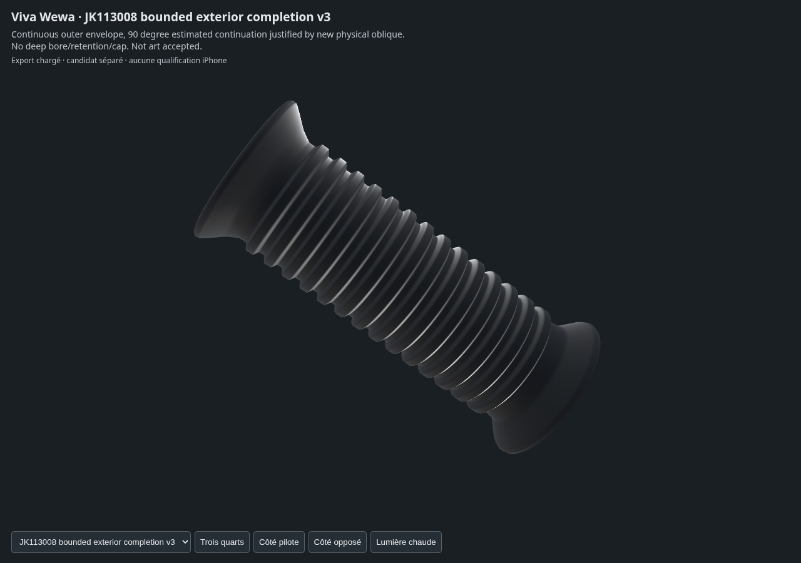

# Caoutchouc passager JK113008 — enveloppe extérieure v3

Nouvelle source fabriquée : le secteur longitudinal de 90° auparavant omis **diagnostiquement** est remplacé par une continuation de révolution estimée et bornée. Ce n’était pas une vraie fente physique. Les anciennes sources restent intactes.

La nouvelle [photo physique Scooter City, code JK113008](https://www.scooter-city.ru/spares/item_96414.html) montre la bouche et le retour des nervures sur le bord inférieur. Une [nouvelle vue physique de profil Prom](https://prom.ua/p2783492734-rezinovaya-nakladka-podnozhki.html) confirme l’enveloppe cylindrique nervurée. Elles ne photographient pas toute la circonférence : la continuation du quart caché demeure une **estimation de forme**, sans certification du moulage RDC exact. Les images originales restent privées ; URL, empreinte et observations figurent dans [la décision G0–G2](../../research/passenger-rubber-completion-v3/G0-G2-decision.json).

## Livraison

- [Source Blender éditable](../../../assets-src/moto-components/passenger-rubber-completion-v3/child-candidate.blend), collection `WEWA_PASSENGER_RUBBER_COMPLETION_V3`.
- [Export GLB](../../../assets-src/moto-components/passenger-rubber-completion-v3/child-candidate.glb).
- [Fragment de remplacement LH/RH](../../../assets-src/moto-components/passenger-rubber-completion-v3/integration-fragment.json) : remplace exactement `LH rubber unchanged original` et `RH rubber unchanged original`, matrices conservées, total140 parents conservé. Assemblage partagé non modifié par cette mission ; intégration à effectuer par son propriétaire.

Les coordonnées de tous les anciens sommets sont conservées exactement ; le profil axial, les cotes de travail estimées et la matière restent identiques. La longueur de100mm n’est pas une mesure constructeur. Les deux extrémités restent ouvertes : **aucun alésage profond, fond distal, épaisseur ou retenue cachée inventé**. Ce n’est pas un solide mécanique étanche, ni une pièce qualifiée pour fabrication physique.

## Contrôles exécutés

Source rouverte et GLB réellement réimporté : écart de position nul, connectivité orientée identique, écart maximal des normales0,000118. Deux GLB valides sans erreur ; géométrie gris/matière identique.253056 triangles. Deux boucles de bord terminales de192 sommets, plus de bord longitudinal diagnostique.

Un gris16 échantillons et trois vues matière96 échantillons,800×600, avec quatre EXR FLOAT32 contrôlés. Images réellement ouvertes et relues. Babylon réel : un maillage, quatre captures non vides, aucune erreur page/HTTP, cadrages contrôlés ; Chromium logiciel, pas une qualification iPhone ou performance jeu.

L’écart à la nouvelle référence reste visible : section et évasements reprennent l’ancien profil estimé, non un relevé photographique calibré. Les nervures peuvent varier de moulage. Les sources nouvelles permettent cette proposition extérieure, pas de certifier le dessous caché, le bore, la retenue ou le montage sur le métal. G5 mécanique reste ouvert ; G7/G8 non reçus.
