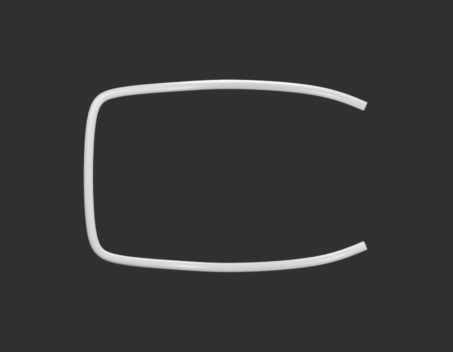
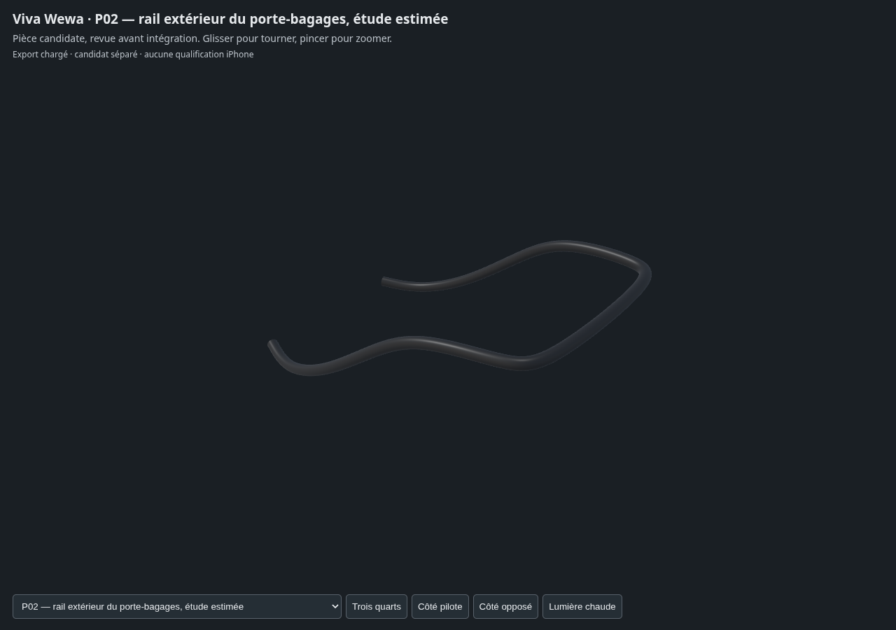

# P02 — première fabrication du rail de porte-bagages

**Étude d’un enfant, paquet P02 encore ouvert.** Source originale d’un rail
extérieur en U. Plateforme, terminaisons aplaties, attaches et montage restent
à fabriquer/documenter ; aucune réception artistique n’est déclarée.

## Sources et contrôles

- [Blender, GLB et paramètres](../../../assets-src/moto-components/rack-outer-rail/README.md).
- [Références et inconnues](../../research/rack-p02/G0-G2-plan-v1.json).
- [Géométrie construite](geometry-check.json), [source matière rouverte](source-geometry-check.json), [GLB réel indépendant](independent-export-check.json), [transfert de matière](material-transfer-check.json).
- Gris : [dessus](gray-profile.png), [trois-quarts](gray-quarter.png), [côté opposé](gray-edge.png), [lecture réelle](gray-review.json).
- Aperçus : [studio](preview-studio.png), [ciel neutre](preview-neutral.png), [lecture réelle](preview-review.json).
- Vues détaillées96 : [dessus](whole-profile.png), [trois-quarts](whole-quarter.png), [ciel neutre](neutral-outdoor.png), [rapport](render-report.json).
- [Contrôles des EXR FLOAT32](raw-render-check.json), [manifestes](production-manifest.json).
- [Babylon : quatre vues non vides et journal d’erreurs](inspection-v3/engine-check.json), [lecture de coordination](coordinator-review.json).
- [Corrections documentées](curve-correction.json), [première courbe rejetée](rejected-uniform-centreline-v1/), [échantillonnage d’extrémité rejeté](rejected-endpoint-sampling-v2/).

## Limites retenues

La photo isolée PF231405 est une référence apparentée de fournisseur. Les vues
montées officielles RDC justifient la famille d’aspect, sans certifier la forme
exacte du fournisseur. Les dimensions, rayon extérieur7,5mm et symétrie des bras
sont des hypothèses de travail explicitement bornées ; aucune cote OEM mesurée.
La plateforme ajourée de la photo voisine n’est pas adoptée comme fait RDC.

Le rail possède deux coupes ouvertes avant les terminaisons à documenter. Leur
apparence ne prouve ni tube creux réel ni épaisseur de paroi. Les bras sont inclus
dans cette première peau continue, mais pas leurs faces terminales, trous ou
supports. Le revêtement noir est original, propre et uniforme ; alliage inconnu.
Aucun pixel, watermark ni graphisme fournisseur n’est incorporé.

Le tracé initial avait un repli de surface. La première B-spline créait des
anneaux trop rapprochés en bout. Les sources rejetées sont conservées. La courbe
corrigée est rééchantillonnée à2mm ; le GLB réel a90 000 triangles, deux frontières
ouvertes et une cohérence normale/face minimale d’environ0,998. Ce résultat ne
certifie ni fidélité au catalogue ni montage ; les reflets longitudinaux et les
sections restent à affiner avec les références.

Exposition0, gamma1, AgX Medium High Contrast ; ciel HDRI artistique de force0,65,
sans étalonnage radiométrique. Aucune optimisation ou qualification iPhone.
Aucun changement du jeu public, aucun conducteur.

## Suite de P02

Comparer la plateforme actuelle RDC avant d’en faire les enfants séparés ;
documenter supports, entretoises, terminaisons et fixations, puis vérifier la pose
avec la selle et le garde-boue existants. Garder les écarts de variante explicites.
