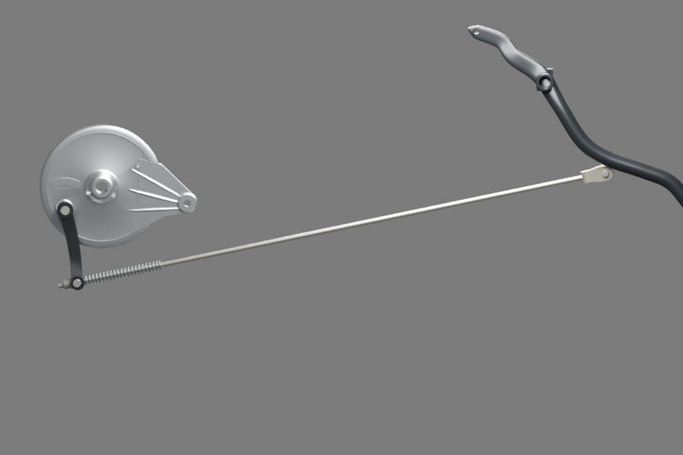
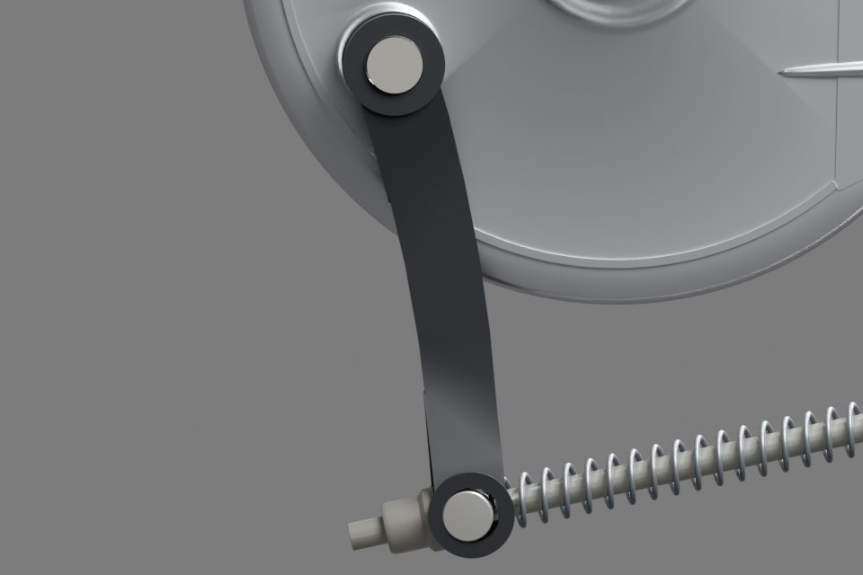
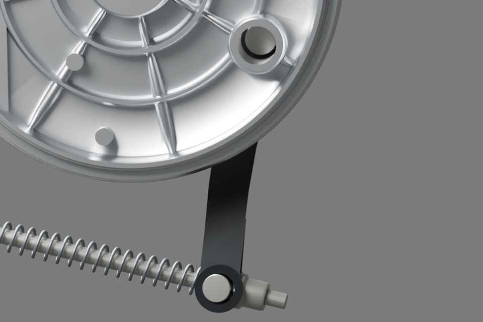

# Liaison extérieure du frein arrière — candidat v1

**Huit ajouts prêts pour v19**, sans retrait ni remplacement du flasque ou de la pédale. Le fragment porte140→148 parents si appliqué seul ; les autres ajouts du coordinateur se cumulent séparément.

## Intégrer

- [Fragment natif exact](../../../assets-src/moto-components/rear-brake-exterior-completion-v1/integration-fragment.json).
- [Routes du composeur, huit sélections exactes](../../research/rear-brake-exterior-completion-v1/export-routes.json).
- [Source Blender](../../../assets-src/moto-components/rear-brake-exterior-completion-v1/rear-brake-exterior.blend), collection `WEWA_REAR_BRAKE_EXTERIOR_COMPLETION_V1`.
- [GLB partagé unique](../../../assets-src/moto-components/rear-brake-exterior-completion-v1/rear-brake-exterior.glb),3,3Mo environ.

Les huit parents d’intégration ont une matrice **identité** : les objets source portent déjà leur placement global v19. Ne pas appliquer une seconde fois ces transformations. `selected_objects` contient exactement un nom natif/GLB par parent. La collection `CONTEXT_ONLY_EXISTING_V19_PANEL_PEDAL` sert uniquement aux vues : **ne pas exporter ni ajouter ses pièces**. Les anciennes sources et l’assemblage global ne sont pas modifiés par cette mission.

| Ajout | Fabrication |
|---|---|
| JW131601, levier courbe et yeux dédoublés | Nouvelle géométrie originale sur deux photos physiques opposées |
| Bout d’axe de came extérieur | Court volume apparent estimé ; aucun mécanisme de mâchoires fabriqué |
| PF161001, tringle d’actionnement | Nouveau candidat de longueur calée ; ne pas confondre avec le tirant de réaction JW122004 |
| Chape | Copie géométrique exacte du candidat existant, nouvelle pose |
| Axe de chape30191038 | Copie géométrique exacte, nouvelle pose |
| BarilletJB161002 | Copie géométrique exacte, nouvelle pose |
| Ressort de compression30191035 | Copie géométrique exacte, nouvelle pose |
| Écrou de réglage30191036 | Nouvelle enveloppe extérieure à épaulement polygonal arrondi, d’après photo physique ; pas un écrou hexagonal générique substitué au seul nom |

## Références et estimations

Les [deux photos JW131601 de Parts My Bike](https://partsmybike.com/product/lever-brake-for-xcd-135-boxer-bm150-bajaj/) montrent le corps courbe, les joues dédoublées et leurs perçages. La [photo physique30191036 de Maxy Group](https://maxygroup.co.ke/product/nut-brake-adjuster-bm100-bm125-bm150-30191036/) montre l’épaulement et le fût. URL, SHA et observations dans le [plan G0–G2](../../research/rear-brake-exterior-completion-v1/G0-G2-plan.json). Les originaux restent privés, aucun pixel vendeur n’est incorporé au modèle.

La tringle mesure **654mm dans cette proposition**, définie par les interfaces du modèle v19, pas par une mesure constructeur. L’ancien essai de490mm, avec sa plage de travail430–570mm, reste inchangé et n’est pas présenté comme compatible avec ce calage. Nouvelle plage de travail610–700mm, déduite des incertitudes de position des extrémités du modèle ; ce n’est pas une cote OEM. Le levier a un entraxe de90mm estimé70–115mm. Profondeur de calage ±20mm et orientation du levier ±15° restent des estimations.

Aucun détail de mâchoires/came caché, microcannelure, filetage interne ou retenue inconnue ajouté. Le passage de l’écrou est simplifié sans hélice fictive ; sa portée arrière reste estimée. Le bout d’axe apparent ne certifie pas l’engagement intérieur.

## Contrôles réels

Huit maillages fermés, un seul composant connexe chacun, aucune arête non-manifold ; quatre petites pièces gardent exactement leurs maillages sources. Réouverture native et réimportation réelle du GLB : connectivité orientée identique, écart maximal de position inférieur à0,1µm. Les centres chape/pédale et barillet/levier coïncident dans le modèle à moins de0,01µm.

Composeur : huit parents, un GLB, zéro erreur et zéro avertissement glTF. Babylon réel : huit maillages,163464 triangles, quatre captures non vides, aucune erreur page/HTTP. Trois rendus natifs **96 échantillons,960×640**, trois EXR FLOAT32 seulement. Toutes les images finales ont été ouvertes et relues.

Les limites mécaniques restent explicites : inclinaison d’environ5,06° entre le barillet et les yeux du levier, petits contacts de bord possibles dans ce calage estimé, course et contraintes non validées. La vue entière cadre les huit ajouts ; l’ancien bras de pédale de contexte peut sortir du cadre. Les deux macros coupent volontairement le contexte ; le flasque masque naturellement une partie supérieure du levier en vue opposée.

La première prévisualisation était trop serrée ; conservée comme essai rejeté. Le premier essai Babylon visait des coordonnées natives au lieu du repère glTF et produisait un canevas vide : caméra corrigée, **aucune géométrie modifiée pour corriger ce test**. `compose-final-probe.json` et les empreintes finales sont les preuves courantes ; `compose-probe.json` correspond à l’état de caméra précédent non gelé.

G5 mécanique, G7 mobile et G8 artistique ne sont pas reçus. Ce paquet livre une liaison extérieure visible avec estimations déclarées, pas un mécanisme de frein physiquement certifié. Aucun push Git ni modification des fichiers globaux.
