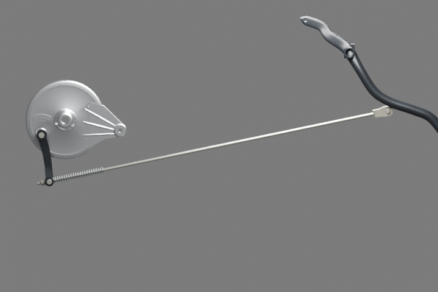

# Frein arrière — correction G2 v2, gel définitif

Même8clés et mêmes matrices parents identité. Remplacer les8lignes du candidatv1 préparées pourv20 par `integration-fragment.json` de cette révision, sans ajouter8parents une seconde fois. Routes dans le dossier de recherche `pose-correction-v2/export-routes.json`.

Ancien essai, sources et preuves gelés conservés intégralement. Correction **de pose seulement** : normale commune orthogonale à la tringle et à la direction du levier ; levier roulé, barillet réorienté au même centre, bout d’axe apparent tourné rigidement autour du même centre de came. Tous les maillages strictement inchangés, aucun bevel/remesh. Tringle droite, ses extrémités et sa pose inchangées. Centres des deux yeux conservés.

Contrôle des vraies surfaces triangulées : zéro croisement levier/barillet, levier/bout d’axe et bout d’axe/flasque. Axes levier/barillet parallèles ; passage du barillet aligné avec la tringle. Réimportation GLB/parité et composeur sans erreur. Une vue native96échantillons720×480 + EXR FLOAT32 réellement lue suffit au delta demandé ; les anciennes3vues96 restent historiques. Pas de nouvelle scène whole ni de gros fichier.

Le bout d’axe reste une enveloppe visible estimée : aucune certification d’engagement interne, de course ou d’effort mécanique. G5 fonctionnel/G8 non reçus. Le glTF global et les fichiers racine ne sont pas modifiés ici.
