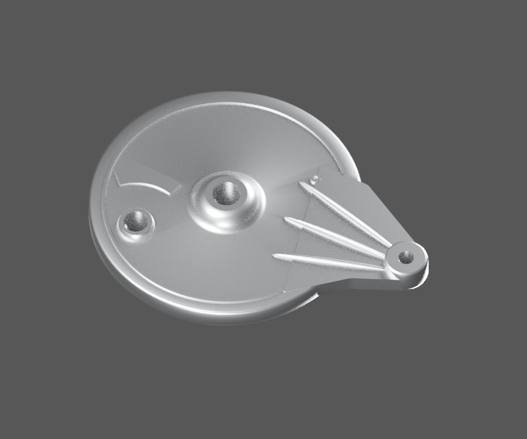
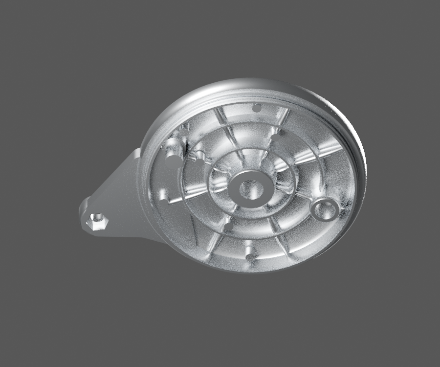
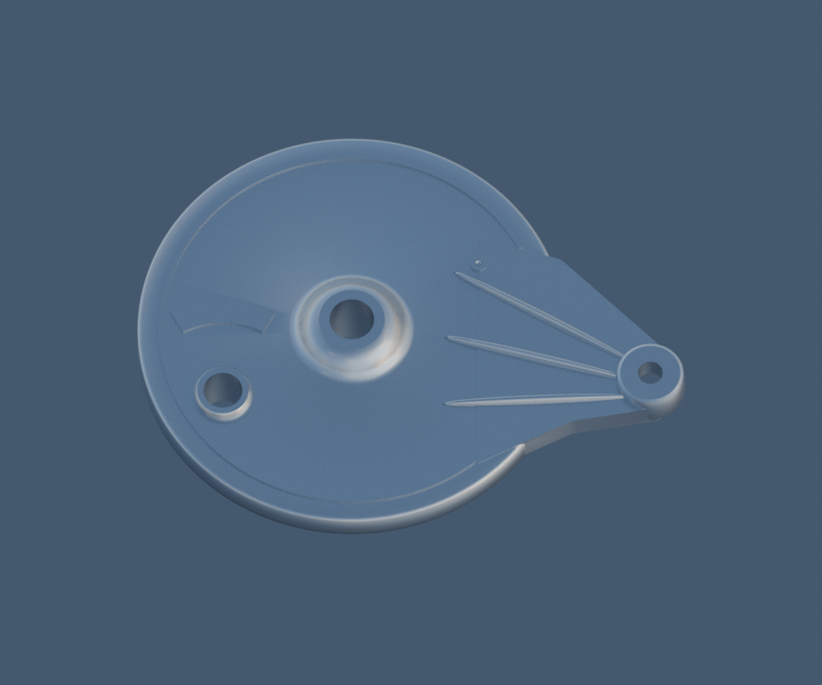
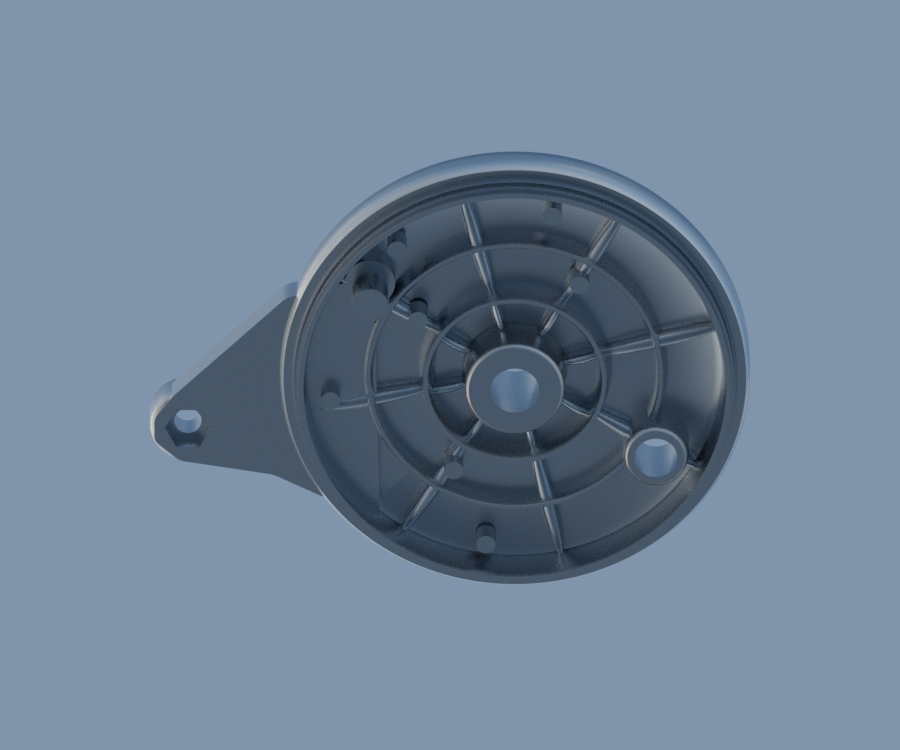

# LEGACY15-REAR-BRAKE — DS151069 rear brake panel visible casting extension LEGACY15

[Source Blender](../../../assets-src/moto-components/rear-brake-panel-ds151069-visible-v2/rear-brake-panel-material.blend) · [GLB](../../../assets-src/moto-components/rear-brake-panel-ds151069-visible-v2/rear-brake-panel-material.glb) · [Dossier](../../../creative/research/rear-brake-panel-ds151069-visible-v2-coordination-v1/G0-G2-plan-v1.json) · [Étude auteur](../rear-brake-panel-ds151069-visible-v2/delivery.json)

[Source rouverte](source-geometry-check.json), [export réel](export-buffer-check.json), [rendus96 associés à la source figée](render-report.json), [EXR FLOAT32](raw-render-check.json), [quatre vues Babylon de coordination](inspection-v5/engine-check.json), [lecture réelle](coordinator-review.json), [manifestes](production-manifest.json). Les images et rapports auteur restent inchangés. Leur association à la source est vérifiée dans le lot figé. Une éventuelle vue indépendante `coordination-neutral` est identifiée séparément avec sa provenance ; elle ne modifie pas la source.

Flasque arrière DS151069 : corps circulaire, trois passages réels, oreille percée/poche hexagonale au revers, trois nervures longues devant et reliefs arrière photographiés. Quatre natifs96 matière, dont deux vues neutres opposées, et Babylon relus. Les sections, profondeurs et cotes restent estimées ; aucune garniture, came, filetage ou fixation masquée ajoutée. Variante à roue moulée documentée, montage RDC125 et normal de côté non reçus. Extension de couverture décidée par le coordinateur, hors des trente paquets historiques.

Les dimensions et interfaces restent estimées. Aucune réception artistique ou qualification matérielle n’est transmise. Le paquet reste ouvert pour ses enfants et raccords manquants.
