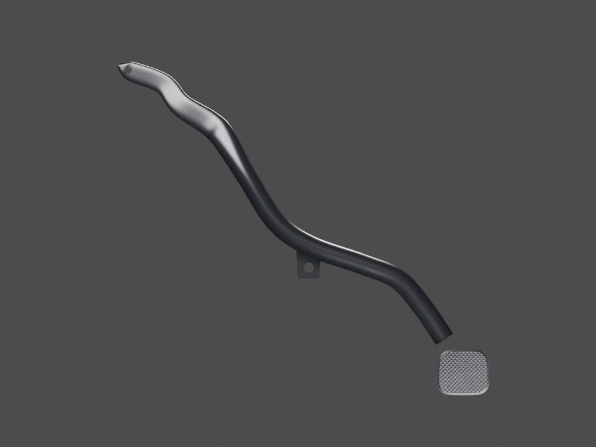
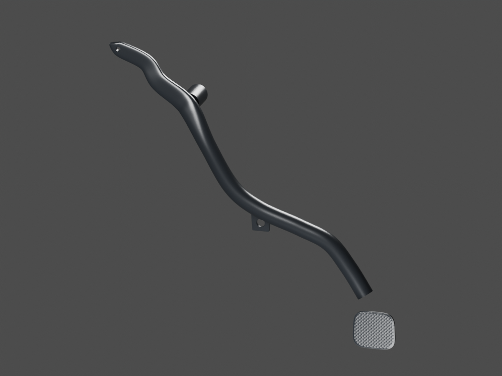
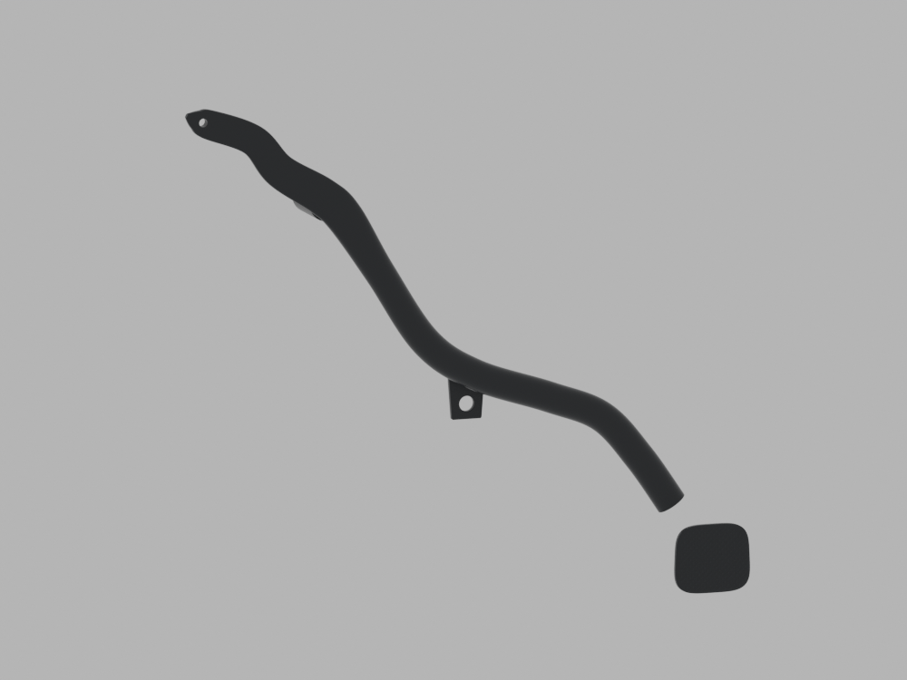

# P15 — P15 existing four-parent local exterior review; pad parked

[Source Blender](../../../assets-src/moto-components/rear-brake-pedal-exterior-context-v1/integration-wrapper.blend) · [GLB](../../../assets-src/moto-components/rear-brake-pedal-exterior-context-v1/rear-brake-pedal-exterior-context-v1-inspection.glb) · [Dossier](../../../creative/research/rear-brake-pedal-exterior-context-v1-coordination-v1/G0-G2-plan-v1.json) · [Étude auteur](../rear-brake-pedal-exterior-context-v1/README.md)

[Source rouverte](source-geometry-check.json), [export réel](export-buffer-check.json), [rendus96 associés à la source figée](render-report.json), [EXR FLOAT32](raw-render-check.json), [quatre vues Babylon de coordination](inspection-v5/engine-check.json), [lecture réelle](coordinator-review.json), [manifestes](production-manifest.json). Les images et rapports auteur restent inchangés. Leur association à la source est vérifiée dans le lot figé. Une éventuelle vue indépendante `coordination-neutral` est identifiée séparément avec sa provenance ; elle ne modifie pas la source.

Quatre parents existants de commande arrière : bras, tube ouvert, languette et patin texturé sont réunis pour revue. Le patin reste séparé dans sa pose photographique, pas monté avec une face de pied horizontale. Images96 issues de la représentation native imbriquée ; équivalence géométrie/matériaux/poses avec le wrapper direct vérifiée, sans prétendre l’avoir rendu directement. Axe moteur, unions et biellette restent inconnus.

Les dimensions et interfaces restent estimées. Aucune réception artistique ou qualification matérielle n’est transmise. Le paquet reste ouvert pour ses enfants et raccords manquants.
