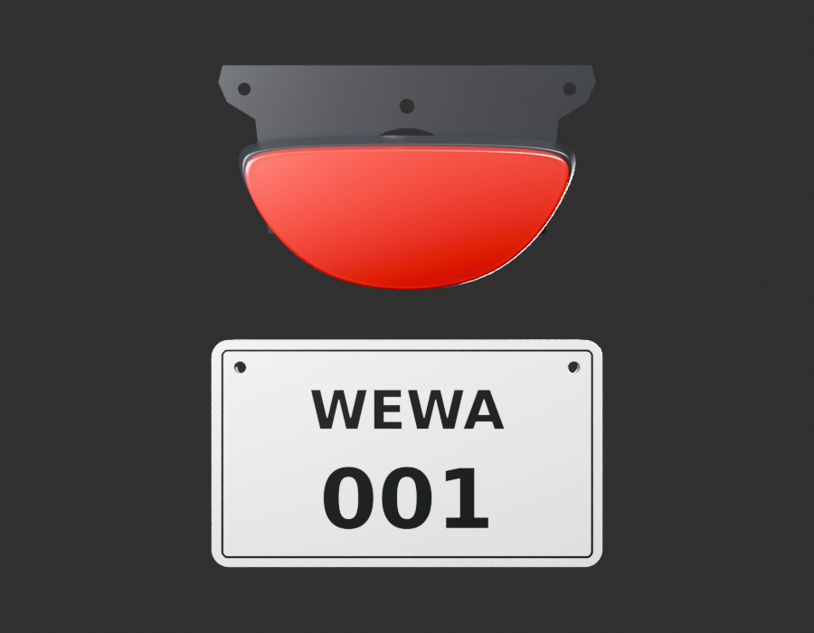
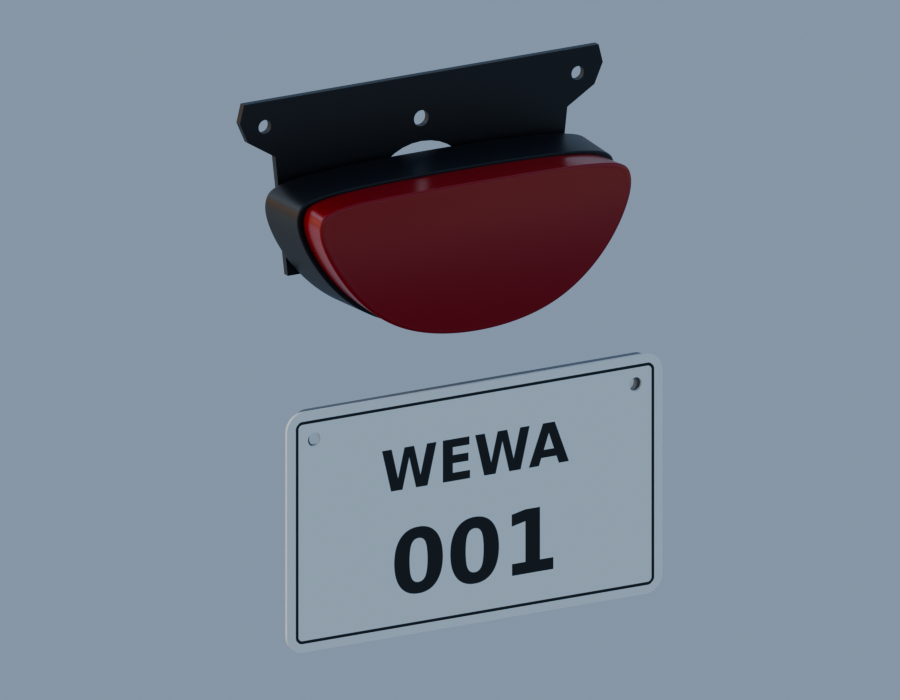

# Revue du montage arrière — cinq sources inchangées

Le feu, son carter, le pont supérieur, la traverse et la plaque fictive WEWA sont réunis dans une pose de revue estimée à ±40 mm. Ce montage ne constitue pas une nouvelle pièce ni une réception de la moto.

Les cinq sources Blender originales sont inchangées. Les positions exportées dans le GLB correspondent à leurs transformations déclarées (écart numérique maximal inférieur à 0,00000003 m ; ce chiffre ne mesure pas la précision physique). Trois rendus Blender à 96 échantillons, sept EXR FLOAT32 et quatre captures WebGL sont sauvegardés. Aucun test matériel iPhone n'est revendiqué.

L'arceau reliant le pont à la traverse est absent : la plaque paraît suspendue. Ses trous à ±77 mm diffèrent de ceux de la traverse à ±75 mm, soit 2 mm de décalage nominal par côté. Les attaches du feu, les bagues et le positionnement réel sur le cadre restent ouverts. La concordance du bord du feu et du carter ne valide ni les épaisseurs ni les retenues internes.

[Sources et limites](../../research/rear-cluster-review-v1/G0-G2-plan-v1.json) · [Parité des exports](world-export-parity.json) · [Contrôle moteur](inspection-v5/engine-check.json) · [Lecture des rendus](native-review-v1.json)
