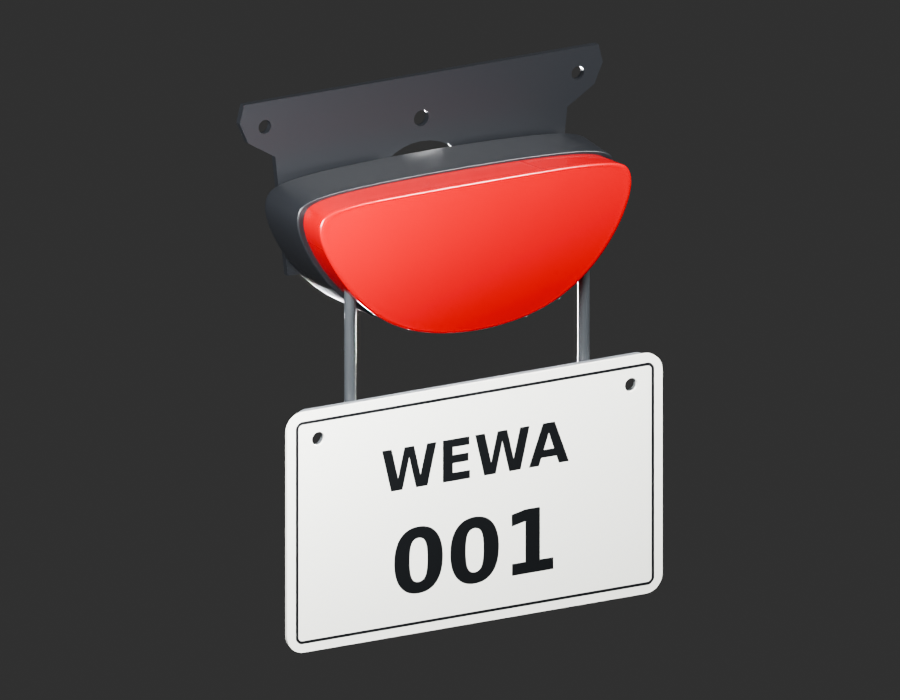

# Montage arrière v2 — diagnostic conservé, à reprendre

Les six sources sont réunies sans modification de leurs géométries. La plaque révisée et ses perçages sont présents. Le support supérieur et l’arceau plan sont désormais contredits par deux nouvelles poses documentaires : trou central fermé, oreilles repliées, arceau plus large en haut et déport en profondeur. Les quatre rendus gris/aperçus sont des diagnostics à16 échantillons ; aucun rendu détaillé96 ni réception de ce montage n’est revendiqué.

[Contradictions et prochaine correction](../../research/rear-cluster-reference-reconciliation-v2/contradictions-v1.json) · [Parité des six sources](source-parts-parity.json) · [Parité GLB réelle](world-export-parity.json) · [Paramètres et limites](../../../assets-src/moto-components/rear-cluster-review-v2/parameters-v1.json).

Les boulons, les soudures, les grommets et la pose sur la moto restent ouverts. Les anciens fichiers restent conservés ; ils ne constituent pas un montage reçu.
