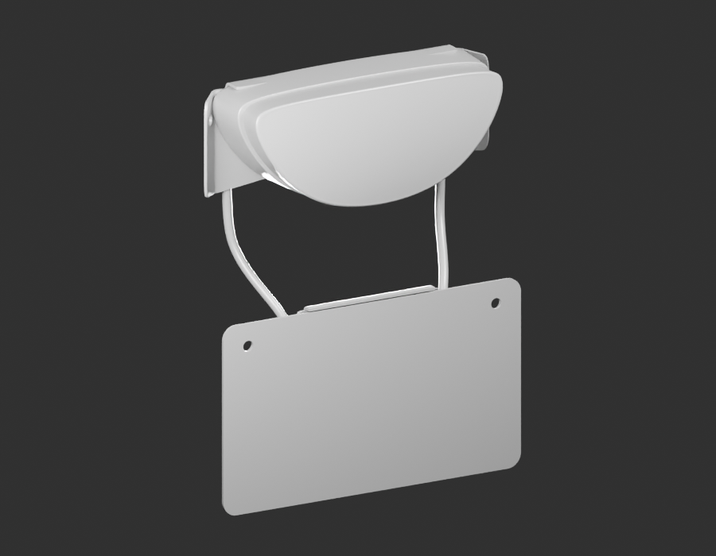

# Montage arrière v3 — diagnostic de raccords

Six parents corrigés, inchangés, réunis dans une pose provisoire. Les deux gris16 révèlent des raccords non résolus : corps du feu/bride supérieure, retours de traverse/plaque, continuité des soudures de l’arceau. Les candidats de contact BVH ne constituent pas une preuve de bon ajustement.

[Constats et suite](diagnostic-review-v1.json) · [Sources inchangées](source-parts-parity.json) · [Export réel](world-export-parity.json) · [Pose estimée](../../../assets-src/moto-components/rear-cluster-review-v3/parameters-v1.json).

Pas de matériau final ni de rendu96 de cette pose. Les prochaines poses restent des revues, avec écarts d’affichage explicites ; visserie, silentblocs, colliers et soudures ne sont pas implicitement créés. Aucun paquet ni assemblage reçu.
