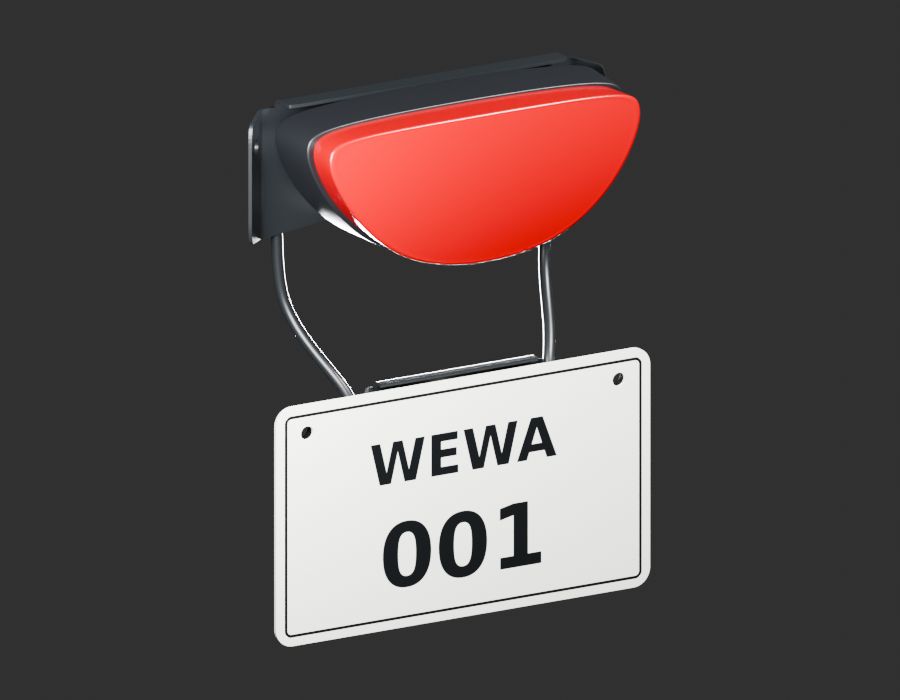
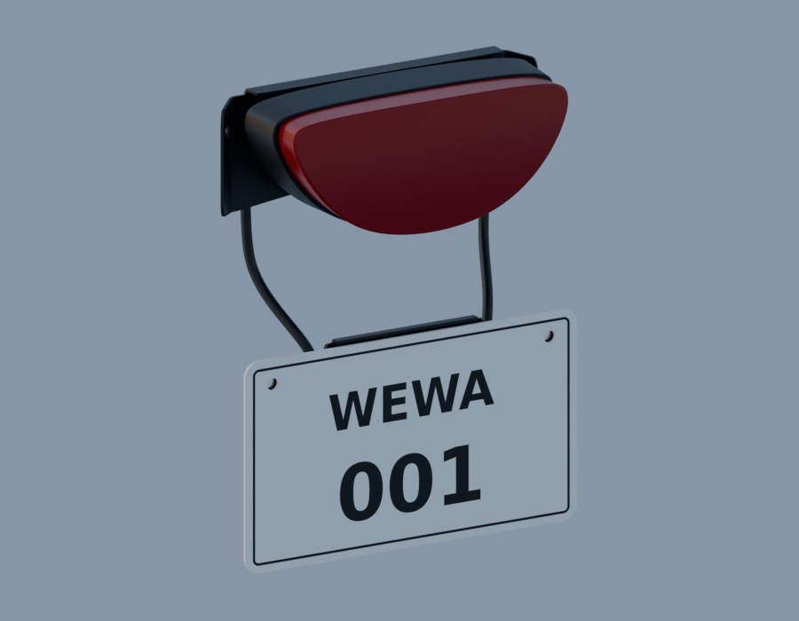
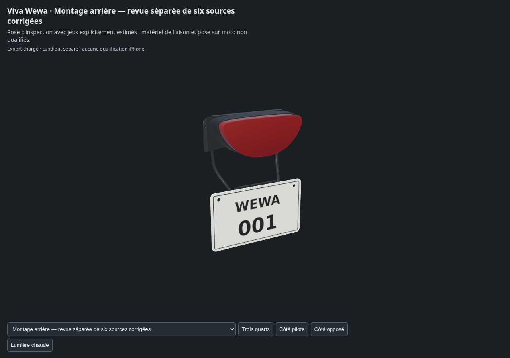

# Montage arrière v4 — revue de six sources corrigées

Tôle supérieure v4, arceau3D v3, traverse formée v2, corps/lentille v2 et plaque fictive WEWA v2. Les six géométries sources sont conservées sans déformation. Cette revue ne crée aucune nouvelle pièce physique et ne reçoit pas le montage.

Le [diagnostic v3](../rear-cluster-review-v3/README.md) conserve la première pose avec interférences. Ici le feu est décalé de14mm et la plaque de3mm pour inspection. Les [jeux d’enveloppes](display-clearances-v1.json) sont respectivement2,712mm et1,606mm ; ce sont des espacements d’affichage, pas des entretoises ni des cotes relevées. Les [axes des trous de plaque/traverse](nominal-hole-axes-v1.json) sont alignés nominalement, avec3mm entre leurs faces opposées sous ces déplacements estimés.

Les vis, écrous captifs, silentblocs, colliers, gaine, soudures et ancrages au cadre ne sont pas montés. Leurs études isolées ne sont pas implicitement reçues ou répétées. Contact lentille/corps et attache haute de l’arceau restent à qualifier ; la liaison basse n’est pas certifiée. Les reliefs optiques et la photométrie ne sont pas reçus.

[Sources et paramètres](../../../assets-src/moto-components/rear-cluster-review-v4/README.md) · [Gris relus](gray-review.json) · [Aperçus relus](preview-review.json) · [Rendus96](render-report.json) · [EXR FLOAT32](raw-render-check.json) · [Six sources inchangées](source-parts-parity.json) · [Parité GLB réelle](world-export-parity.json) · [Quatre vues moteur](inspection-v3/engine-check.json) · [Revue](coordinator-review.json).

Exposition0, gamma1, AgX Medium High Contrast et ciel artistique0,65. Aucun étalonnage, certificat de montage, réception artistique ni qualification iPhone.
